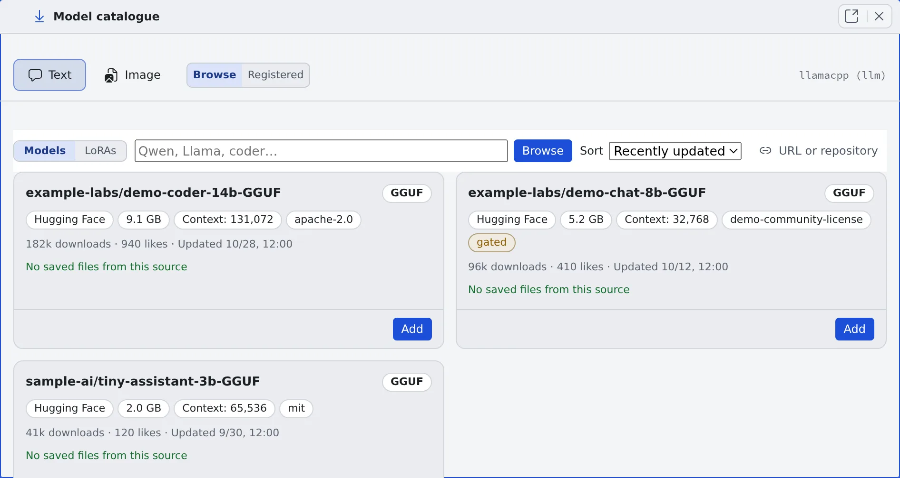

# Take models into the inference engines

English | [日本語](models.ja.md)

Find models on Hugging Face and Civitai, and take them into the deployment's catalogue with one press.
Once a model is enabled, the engine uses it from its next start.

## How it works

| What you do | What happens |
|---|---|
| Register the Hugging Face and Civitai tokens under **API tokens** | Gated repositories and assets that need an account can be taken in too |
| Search in **Model catalogue** and press **Add** on a card | A plan card opens, listing the files the model needs and what they cost |
| Read the plan and press **Take it in** | The ingest task puts the files in the S3 bucket, and the catalogue gains a row |
| Enable the row | The engine loads that model from its next start |
| Let a tenant take models in | That tenant's administrators get a reduced model screen as well |

An engine's mode and GPU size are decided in [Run inference engines on your own GPUs](gpu.md).

## Register the tokens

Open **Admin** from the account menu → **Deployment** → **API tokens**. It opens even before any engine is registered.

| Token | Without it |
|---|---|
| Hugging Face token | Only ungated repositories can be taken in |
| Civitai token | Assets that require a logged-in account cannot be taken in |

- Each is one token for the whole deployment. It is stored encrypted, read by the ingest task only, and never handed to an engine instance
- Registering and removing one is written to the audit log
- The switch that adds **Civitai Red** (the sister domain Civitai split off for NSFW browsing) as a search source is here too. It appears only where the deployment was given it (the Control Plane's `AF_ENGINE_CIVITAI_RED`). A standard deployment does not have it

The Civitai Red switch is a choice about what the deployment offers, not a content filter. The plain Civitai search also answers models that carry Civitai's NSFW level.

## Find a model

Press **Model catalogue** on a row of **Inference engines**, and the catalogue opens in a pane of its own.

| Switch | What it chooses |
|---|---|
| **Text**, **Image** | Which role's catalogue |
| **Browse**, **Registered** | Searching, or what has been taken in |
| **Models**, **LoRAs** | Checkpoints or LoRAs. A LoRA is never mixed into the checkpoint list |

- Chat models are searched on Hugging Face. Image models are searched on one source at a time, chosen with the source tabs (**Civitai**, **Hugging Face**, and **Civitai Red** where the deployment was given it)
- **Family** narrows to one family. The default is **Every family**. Repositories laid out for ComfyUI are found like any other
- The results, the filters and the scroll position are kept while you look at another tab

Each card marks what the source will not let you do, before anything is downloaded.

| Kind | Marks |
|---|---|
| Hugging Face gating | **gated (accept the terms)**, **gated (the author approves)** |
| Civitai account | **login required** (the Civitai token gets past it) |
| Licence and content | **non-commercial**, **credit required**, **no derivatives**, **same licence only**, **paid**, **early access (paid until a date)**, **not public**, **on-site generation only (no download)**, **NSFW** (with Civitai's level), **real person**, **minor**, **virus scan not clean**, **pickle warning** |

A card with no mark at all could not be told apart. That does not mean anyone may use it.

## Read the plan and take it in

1. Press **Add** on the card. The plan card opens
2. Read the plan. Each file the model needs has a line, with what the press costs, the licence and the source's warnings
3. Check **Family**. Where the upstream name ("SDXL 1.0", "Illustrious" and the like) is a family the deployment knows, it is already chosen. Otherwise it stays at **choose one**, and nothing can be taken in until you pick
4. Press **Take it in**

The cost column shows one of these.

| On screen | Meaning |
|---|---|
| A number of MiB | Downloaded from the source |
| **no download (already held)** | The deployment already has the same bytes, so nothing is fetched |
| **no download (moved inside the bucket)** | The file is only moved to another key in the S3 bucket |

- The Control Plane decides where each file goes and which parts the family needs (a text encoder, a VAE). The card asks for no role, key or file name, and a model split across several files goes in with the same single press
- The author's published Steps, CFG and sampler appear under **Read out of the author's description (unverified):**, with the sentence they were read from. **Use these** keeps them. Nothing is guessed
- When another row already declares the destination of a part the family needs, or an unfinished ingest job has recorded it, a warning line says what to do first (complete that row, or dismiss that job)
- A chat model's plan shows whether it fits the chosen GPU class. The **Context** field opens at the largest window that fits the class, not at the model's published ceiling
- For an image family measured on this deployment, the measurement appears beside the field. The ingest never writes the measured field; enter it with the row's **Edit** after the model is in

## Enable it

Rows that have been taken in are enabled under **Registered**.

- **Enable** makes the engine able to load the model. When it needs more VRAM than the chosen class has, you are asked to confirm ([Check whether a model fits](gpu.md#check-whether-a-model-fits))
- **Start with this** decides the model the engine loads when it starts
- Every enabled row is synced onto the instance at every start. The more rows are enabled, the longer the cold start

## Tidy the registered rows

**Registered** lists the rows taken in as cards.

- Image rows are grouped by family, and chips narrow them to one. Rows that declare no family come first, because they cannot be enabled
- Chat rows are grouped by the repository they came from. The heading says how many of that repository's sizes the deployment holds
- A card is titled with the name and version the publisher gave the model, with the row's id underneath. The publisher's example image is shown too

| Press | What it does |
|---|---|
| **Edit** | Change the description, the family, the measured VRAM, a chat model's context window and max output, a LoRA's **trigger words**, and the generation **Parameters** |
| **Files** | See where each file came from. **Source page** opens the publisher's page |
| **Complete** | Supply the missing parts. A file that is right but sits under the wrong key is moved inside the S3 bucket rather than fetched again |
| **Fetch names and example images** | Fill in the rows that have neither from their source pages. **Read the source page** does the same for one card |
| **Forget** | Remove the catalogue row only. The files stay in the S3 bucket and keep costing storage |

- The generation **Parameters** override the family's recipe field by field. An empty field keeps the recipe
- A row whose source is a plain URL, and a row with no recorded source, cannot get a name or an image. There is no model page behind either
- Example images point at the publisher's own location; the deployment copies nothing. An image the publisher deletes leaves an empty frame, which the same press repairs

### Look at the S3 bucket

**Bucket**, below the registered rows, lists every object the deployment holds in the S3 bucket, with the row that declares it, and what is still being taken in or failed.

- Bytes no row declares can be registered as a model there, or deleted
- A row whose files are incomplete is repaired with the row's own **Complete**, never from a part

## Switch to another size or version

| Button on the card | What it lists |
|---|---|
| **Show the other quantisations in this repository**, **Other sizes…** (a chat model from Hugging Face) | The repository's other sizes, each with its size, its KV cache and whether it fits the GPU class |
| **Other versions…** (an image model from Civitai) | The model's other versions, with size, whether it fits and whether it is already held |

The verdict is **Fits**, **Tight (n%)** or **Will not fit this class**, and a model that does not fit names the smallest class that would hold it.

- The verdict is an estimate of the weights plus the KV cache. It leaves out llama.cpp's compute buffers and the CUDA context
- **Add** on any line opens the plan card, already filled in. Taking it in makes a new row
- To swap, press **Start with this** on the new row, then **Forget** on the old one
- A chat model's **Edit** shows the verdict too, and **Use the largest this class holds (n)** sets it in one press
- Changing the chat engine's GPU class rewrites every row's context window for the new class, and lists the rows that moved and the ones that could not be fitted, with the reason. It applies from the next start

### The instruction-editing families

| Family | What it does | Reference pictures |
|---|---|---|
| Qwen-Image-Edit 2509 / 2511 | Edit and inpaint only. No plain generation, no strength, no size choice | Up to 3 |
| Qwen-Image 2.1 | Generate and edit | Up to 10 |

Qwen-Image 2.1 shares no file with the edit families. Its autoencoder is a different one, so its parts are taken in as files of its own even where the edit families' parts are already held.
The ComfyUI version a Qwen-Image 2.1 row needs is in [Generate images on your own ComfyUI](comfyui.md#register-the-models).

A request that names no size is drawn at the size its family decides: 1024×1024 for the megapixel-era families and 512×512 for SD 1.5. A row's own size list wins over that.

## When taking in is refused

When a press is refused because something already holds its destination, the card names what holds it and offers one next step as a button.

| | What is shown |
|---|---|
| What holds it | the registered row, the ingest job, the bucket object, the running task |
| The next step | **Register it**, **Complete it**, **Replace it**, **Forget the row**, **Dismiss the job** (removes one finished line from the ingest history) |

## Let a tenant take models in

By default only a deployment administrator (super_admin) can start an ingest.
**Admin** → the tenant → **Limits & idle** → **Inference engine model ingest** grants it to a tenant. That tenant's administrators then get a reduced model screen.
What the grant lets a tenant administrator do is in [Choose who may use the inference engines and which models](../../admin/resources/engines.md#take-models-in).

**The catalogue is one per deployment and is not split per tenant. The id of a model taken in is visible from every tenant.**

- The GPU instance is shared between tenants, and every enabled model is synced onto it at every start
- A catalogue per tenant would push the cold start past ten minutes at about five tenants, even with one model each
- The boundary worth having is the GPU instance, not the catalogue. Do not treat this grant as isolation between tenants

## Related

- [Run inference engines on your own GPUs](gpu.md)
- [Check the inference engines' state and history](status.md)
- [Choose who may use the inference engines and which models](../../admin/resources/engines.md): the tenant administrator's screen
