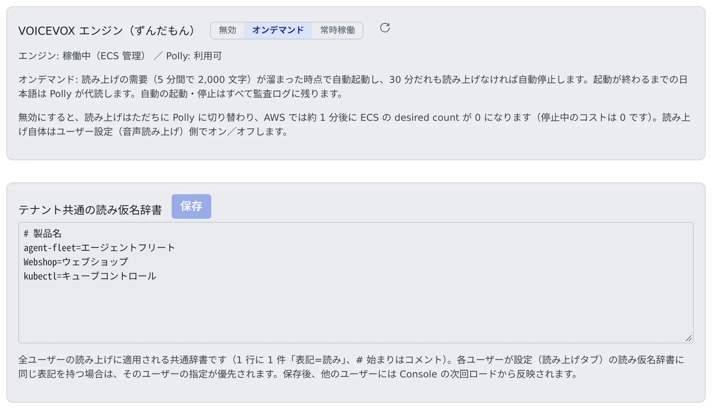

# 読み上げエンジンを動かす

[English](read-aloud.md) | 日本語

メンバーが回答を声で聞くための音声エンジン（VOICEVOX のずんだもん）を、配備に用意して動かせます。
全メンバーに効く読み仮名の辞書も、同じ画面で管理します。

## 全体像

| あなたがやること | 起きること |
|---|---|
| VOICEVOX のエンジンを用意し、Control Plane から届くようにする | 日本語の読み上げが、ずんだもんの声になる |
| Amazon Polly を設定する | エンジンが止まっているときや準備中に、Polly が代わりに読む |
| 「**読み上げ**」でエンジンのモードを選ぶ | エンジンを起動・停止する。オンデマンドなら需要に合わせて自分で動く |
| 「**テナント共通の読み仮名辞書**」に読み方を書く | 全メンバーの読み上げで、その表記がその読みになる |

読み上げを使うかどうかと声は、メンバーがそれぞれ決めます（[読み上げを使う](../../user/settings/read-aloud.ja.md)）。
ほかの配備から音声エンジンを借りることはできません。

## エンジンを用意する

VOICEVOX のエンジンはパッケージに含まれていません。形態ごとに用意します。

| 形態 | 用意するもの |
|---|---|
| AWS の ECS | 音声エンジンのスタック（`50-tts`）。ふだんは 0 台で、この画面から起動・停止します（[ECS の runbook](../../../deploy/aws/ecs/README.md#optional-japanese-speech-the-voicevox-engine-cfn50-ttsyaml)） |
| native・WSL | Windows の VOICEVOX か、Linux の VOICEVOX ENGINE を動かす（[native の runbook](../../../deploy/native/README.md#text-to-speech-tts--zundamon--optional)） |
| そのほか | Control Plane から HTTP で届く VOICEVOX ENGINE を動かす |

- エンジンの場所は Control Plane の `AF_VOICEVOX_URL` で指定します。既定は `http://127.0.0.1:50021` です
- Polly を使うときは、`AF_POLLY_REGION` と、Control Plane のプロセスから見える AWS の資格情報を用意します
- エンジンが止まっているあいだも、失敗するのは声だけです。エンジンが戻れば、次の文から読み上げが戻ります

## エンジンのモードを選ぶ

アカウントメニューの「**管理**」を開き、「**配備全体**」の「**読み上げ**」を選びます。配備管理者（super_admin）だけが開けます。



| モード | 起きること |
|---|---|
| **無効** | 読み上げはすぐ Polly に切り替わります。AWS では約 1 分後に ECS の desired count が 0 になります |
| **オンデマンド** | 読み上げの需要（5 分間で 2,000 文字）がたまると自動で起動し、30 分だれも読み上げなければ自動で止まります |
| **常時稼働** | エンジンを止めません |

- 起動には 1〜2 分かかります。準備が整うまで、日本語の読み上げは Polly が代読します。Polly を設定していなければ、そのあいだ音声は出ません
- 自動の起動と停止は、すべて監査ログに残ります
- 「**エンジン:**」の行には、エンジンの状態と、ECS 管理か外部管理か、Polly を使えるかが出ます

ECS の管理下にないエンジン（単独で動かしている VOICEVOX など）の画面は、次のように変わります。

| エンジン | 画面 |
|---|---|
| 外部管理のエンジンに届く | 「オンデマンド」はありません。スイッチは経路を開け閉めするだけで、エンジンそのものは起動も停止もしません |
| エンジンがない | 流す先がないので、スイッチは「無効」のまま固定されます。エンジンを用意すれば操作できるようになります |

## 読み方の辞書を作る

「**テナント共通の読み仮名辞書**」に、製品名や社内の用語の読み方を書いて「**保存**」を押します。

```
# 製品名
agent-fleet=エージェントフリート
Webshop=ウェブショップ
```

- 1 行に 1 件、「表記=読み」の形で書きます。`#` で始まる行はコメントです
- 全メンバーの読み上げに効きます。メンバーが自分の辞書に同じ表記を書いていると、メンバーのほうが優先されます
- 保存した変更は、ほかのメンバーには次に Console を読み込んだときから効きます

読み間違いが続く言葉は、テナント管理者やメンバーから追加を頼まれることがあります。

## うまくいかないとき

| 症状 | 原因と対処 |
|---|---|
| 声がずんだもんでなく Polly になる | エンジンが起動中か止まっています。オンデマンドなら、需要がたまって起動するまで Polly が代読します |
| 音声がまったく出ない | エンジンが止まっていて、Polly も設定していません。どちらかを用意します |
| スイッチが「無効」のまま押せない | Control Plane から届くエンジンがありません。`AF_VOICEVOX_URL` の先でエンジンを動かします |
| 辞書を直したのに読み方が変わらない | ほかのメンバーには、次に Console を読み込んだときから効きます。メンバー自身の辞書に同じ表記があると、そちらが優先されます |

## 関連

- [読み上げを使う](../../user/settings/read-aloud.ja.md)：メンバーの設定
- [自前の GPU で推論エンジンを動かす](gpu.ja.md)
- [監査ログを見る](../../admin/audit.ja.md)
