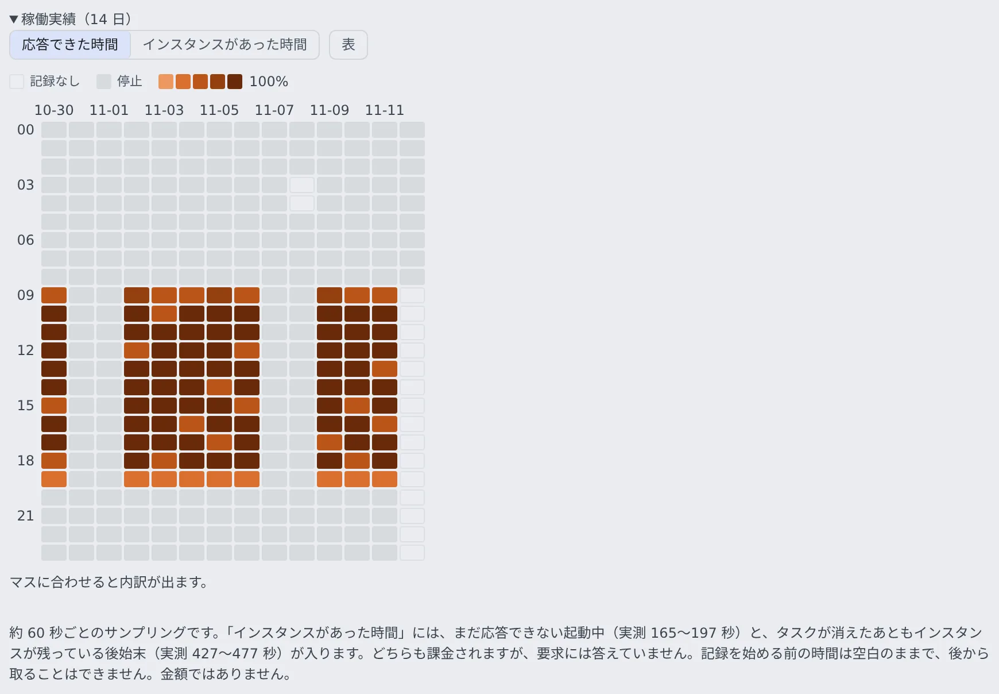

# 推論エンジンの状態と履歴を見る

[English](status.md) | 日本語

自前の推論エンジンが、いま動いているか、いつ止まるか、使われているかを確かめられます。
過去 14 日のあいだ、いつ動いていたかもヒートマップで見られます。

## 全体像

| あなたが見るもの | 分かること |
|---|---|
| 行の状態のバッジと、その下の数行 | いま動いているインスタンス、自動停止の時刻、直近の要求、読み込み済みのモデル |
| 「**稼働実績（14 日）**」 | 時間ごとに、エンジンが答えられた時間とインスタンスがあった時間 |

どちらも、アカウントメニューの「**管理**」→「**配備全体**」→「**推論エンジン**」の各行にあります。行の全体は [推論エンジンの画面を開く](gpu.ja.md#推論エンジンの画面を開く) にあります。

## いまの状態を読む

モードの下に、そのエンジンの現況が出ます。**出ていない行は「分からない」という意味です。** 0 や「予定なし」で埋めてはいません。

| 表示 | 意味 |
|---|---|
| 状態のバッジ | 選んだモードではなく、いま実際に動いているもの。「無効」を押した直後は「**停止処理中**」 |
| 「**インスタンスの起動**」 | GPU のインスタンスがクラスタに入った時刻、そこからの経過時間、インスタンス ID と型 |
| 「**サービスの更新**」 | インスタンスが見つからなかったときに代わりに出る時刻。配備の更新でも動くので、インスタンスの寿命ではない |
| 「**自動停止**」 | オンデマンドで動いているときだけ、「自動停止まで」の設定から決まる時刻。常時稼働・無効・停止中には出ない |
| 「**直近 N 分の要求**」 | その時間に届いた要求の数 |
| 「**最後の要求**」 | 最後に要求が届いた時刻 |
| モデルの `（読み込み済）` | そのエンジンが応答を返せるところまで暖まっている |
| モデルの `（宣言。まだ読み込まれていません）` | 起動したばかりで、まだ読み込んでいる。起動の 3 分前後は、ほぼこの待ち時間 |

- 直近の要求の数は、Control Plane が自分のメモリで数えています。Control Plane が入れ替わると 0 に戻ります。数え始めてからその時間がたっていないときは、「※ この CP が数えているのは直近 … ぶんだけです」と添えられます
- 「最後の要求」は保存されているので、Control Plane が入れ替わっても正しい値です
- 要求が 0 件でも、誰も使っていないとは限りません

## 稼働実績を見る

行の下の「**稼働実績（14 日）**」を開くと、縦に 24 時間、横に日付のヒートマップが出ます。1 マスが 1 時間で、色が濃いほどその時間に長く動いていたことを表します。

濃さが何を表すかは、2 つから選べます。

| 選択 | 数える時間 |
|---|---|
| 「**応答できた時間**」 | 要求に答えられた時間 |
| 「**インスタンスがあった時間**」 | それに加えて、起動中（まだ答えられない）と後始末（タスクが消えたあともインスタンスが残っている）の時間 |

- 起動中と後始末の時間も課金されます。請求書と突き合わせるときは「インスタンスがあった時間」で見ます
- **空白のマスは「止まっていた」ではなく「記録なし」です。** Control Plane が動いていなかった時間か、そのエンジンがまだなかった時間で、あとから埋めることはできません。止まっていた時間は灰色（停止）で、空白とは別の色です
- マスにポインタを合わせると内訳が出ます。「**表**」で同じ値を表で見られます

### 金額は出ない

この画面が答えるのは「いつ動いていたか」で、「いくらだったか」ではありません。クラウドの実費は日単位でしか取れないので、時間ごとの金額は単価と秒数の掛け算の見積もりにしかならないからです。

- 金額はクラウド費用の画面で見ます
- この配備が知っている実際の単価は、買ったインスタンスごとの時間単価だけです。監査ログの `engine.<エンジン>.offer` の行に、実際に買えたインスタンスの型と一緒に 1 度だけ書かれます（[監査ログを見る](../../admin/audit.ja.md)）

## うまくいかないとき

| 症状 | 原因と対処 |
|---|---|
| 起動中のまま進まない | 状態の下に ECS の理由（配置できるインスタンスがない、イメージを取れない、など）がそのまま出ます。AWS のコンソールを開かなくても、ここで読めます |
| クラスを変えたあと、インスタンスがいつまでも用意されない | アカウントの GPU の台数上限を超えています（`VcpuLimitExceeded`）。[GPU のインスタンスクラスを選ぶ](gpu.ja.md#gpu-のインスタンスクラスを選ぶ) を見ます |
| 要求が 0 件なのに使っている人がいる | Control Plane が入れ替わって数え直しています。「最後の要求」を見ます |
| ヒートマップに空白がある | その時間の記録がありません。止まっていた時間ではありません |
| 外部管理のエンジンに稼働実績がない | 記録は、この配備がインスタンスを制御しているエンジンにだけ付きます |

## 関連

- [自前の GPU で推論エンジンを動かす](gpu.ja.md)
- [推論エンジンにモデルを取り込む](models.ja.md)
- [監査ログを見る](../../admin/audit.ja.md)
