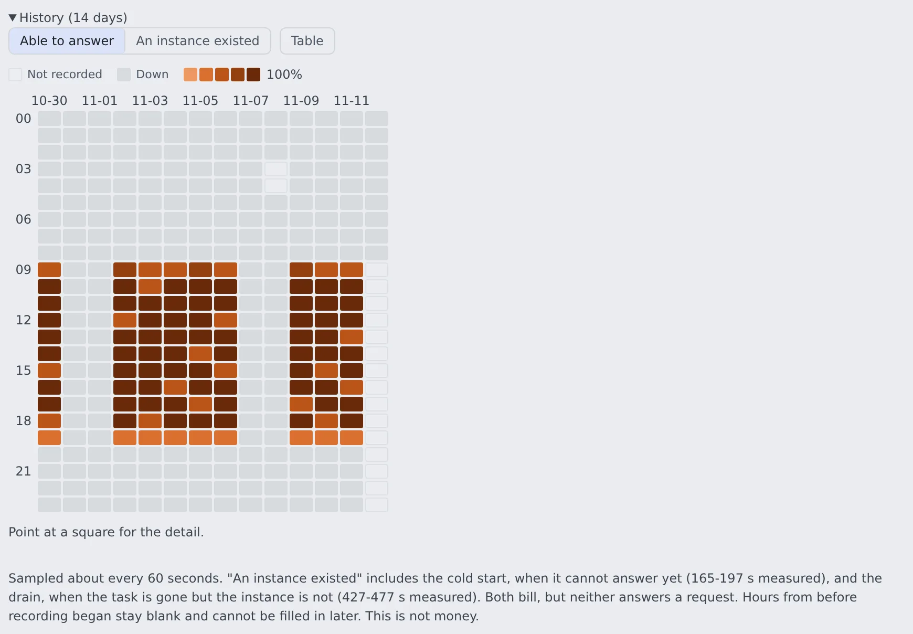

# Check the inference engines' state and history

English | [日本語](status.ja.md)

See whether a self-hosted inference engine is running, when it will stop and whether it is being used.
A heatmap shows when it was running over the last 14 days.

## How it works

| What you look at | What it tells you |
|---|---|
| The row's state badge and the lines below it | The running instance, when it stops by itself, recent requests, the loaded model |
| **History (14 days)** | Hour by hour, how long the engine could answer and how long an instance existed |

Both are on each row under **Admin** → **Deployment** → **Inference engines** in the account menu. The whole row is described in [Open the inference engines screen](gpu.md#open-the-inference-engines-screen).

## Read the current state

Below the modes is what the engine is doing right now. **A line that is not there means "not known".** Nothing is padded out with a zero or a "not scheduled".

| On screen | Meaning |
|---|---|
| The state badge | What is actually running, not the mode you chose. Right after Disabled it says **Stopping** |
| **Instance started** | When the GPU instance joined the cluster, how long ago that was, the instance id and its type |
| **Service updated** | Shown instead when no instance was found. It also moves on a deployment update, so it is not the instance's own lifetime |
| **Stops by itself at** | Only for an engine running on demand: the time **Stop after** gives it. Not shown under Always on, Disabled or when stopped |
| **Requests in the last N min** | How many requests arrived in that time |
| **Last request** | When the last request arrived |
| `(loaded)` after the model | The engine is warm enough to answer |
| `(declared, not loaded yet)` after the model | It has just started and is still loading. This is where the three minutes or so go |

- The request count lives in the Control Plane's own memory. It goes back to zero when the Control Plane is replaced. Until a full window has been counted, "(this control plane has only been counting for …)" is added
- **Last request** is stored, so it stays correct across a replacement
- A count of zero does not prove nobody is using the engine

## Look at the uptime history

Open **History (14 days)** below the row for a heatmap with 24 hours down and the dates across. One cell is one hour, and the darker it is, the longer the engine was up in that hour.

The shade can mean one of two things.

| Choice | Time counted |
|---|---|
| **Able to answer** | The time it could answer requests |
| **An instance existed** | That, plus the cold start (not able to answer yet) and the drain (the task is gone but the instance is still there) |

- The cold start and the drain are billed too. Use An instance existed when reconciling against an invoice
- **A blank cell means "Not recorded", not "it was stopped".** The Control Plane was not running, or the engine did not exist yet, and it cannot be filled in later. Time spent stopped is grey (Down), a different colour from blank
- Point at a cell for the detail. **Table** shows the same values as a table

### No amounts

This screen answers "when was it running", not "what did it cost". Real cloud spend is only available per day, so an hourly amount could only be a rate times seconds, which is an estimate.

- Amounts are on the cloud cost screen
- The one real price this deployment knows is the hourly rate of each instance it bought. It is written once, in the audit log's `engine.<engine>.offer` line, with the instance type that was actually bought ([Read the audit log](../../admin/audit.md))

## When it goes wrong

| Symptom | Cause and fix |
|---|---|
| It stays starting | ECS's own reason (no instance to place it on, the image could not be pulled, and so on) is shown under the state. You can read it here without opening the AWS console |
| After a class change, the instance never arrives | The account's GPU quota is exceeded (`VcpuLimitExceeded`). See [Choose the GPU instance class](gpu.md#choose-the-gpu-instance-class) |
| Zero requests, yet someone is using it | The Control Plane was replaced and is counting again. Look at Last request |
| The heatmap has blank cells | Nothing was recorded in those hours. It was not stopped then |
| An externally managed engine has no history | History is recorded only for engines whose instance this deployment controls |

## Related

- [Run inference engines on your own GPUs](gpu.md)
- [Take models into the inference engines](models.md)
- [Read the audit log](../../admin/audit.md)
