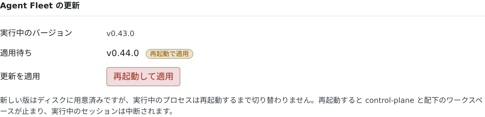

# ネイティブパッケージを更新する

[English](update.md) | 日本語

ネイティブパッケージを新しいバージョンに上げます。新しいバージョンの用意までは自動で行われ、切り替えは都合のよいときに自分で再起動して行います。

## 全体像

| あなたがやること | 起きること |
|---|---|
| 何もしない（インストーラーがタイマーを有効にできたとき） | 毎日のタイマーが `af update` を実行し、新しいバージョンを取得・検証して、今のバージョンの隣に用意する。タイマーがなければ、自分で `af update` を実行する |
| 都合のよいときに再起動する | 新しいバージョンに切り替わる。動いていたセッションは中断される |
| バージョンを固定したいときは `AF_VERSION` を書く | 自動更新がそのバージョンより先に進まない |

`WS_DATA` の下のデータには触れません。新しいワークスペースのイメージ（rootfs）は、次の起動のときに必要なら取得します。

## 新しいバージョンを用意する

`af update` は最新のリリース（`AF_VERSION` があればそのバージョン）を取得し、sha256 で検証し、今のバージョンの隣に置いてから `~/.local/bin/af` を付け替えます。
**動いている Control Plane は再起動しません。** 新しいバージョンは再起動したときから使われるので、動いているエージェントのセッションが勝手に切れることはありません。

```bash
af update --check   # 新しいリリースがあるかを表示する（ダウンロードしない）
af update           # 最新版（または AF_VERSION の版）を取得・検証して用意する
```

- `--yes` を付けると、取得前の確認を省きます
- `af update` は、インストーラーで入れた配置（`~/.local/bin/af` のリンク）でだけ使えます。tar を手で展開したものでは実行を拒否されるので、下の [tar で入れ替える](#tar-で入れ替える) の手順を使います

### 毎日のタイマー

インストーラーは、`af update` を毎日実行する **ユーザータイマー**（`agent-fleet-update.timer`）を有効にします。用意するだけで、切り替えはしません。

- 有効にするのは、`systemctl` があり、ユーザーの systemd に接続できるときだけです。有効にできたときは、インストーラーが `auto-update: daily 'af update' timer enabled` と表示します
- 表示されなかったとき（WSL で systemd が無効など）は、タイマーはありません。上の `af update` を自分で実行して更新します。WSL で systemd を有効にする方法は [systemd でサービスとして動かす](service.ja.md#うまくいかないとき) にあります
- インストール時に無効にしておくなら `AF_NO_AUTOUPDATE=1` を付けます
- あとから止めるときや、次に動く時刻を見るときは次のとおりです

```bash
systemctl --user disable --now agent-fleet-update.timer   # 新しいバージョンの自動取得を止める
systemctl --user list-timers agent-fleet-update.timer     # 次に動く時刻
```

## 用意したバージョンに切り替える

切り替えとは、メインのサービスを再起動することです。都合のよいときに、どちらかで行います。

| 場所 | 操作 |
|---|---|
| Console | 新しいバージョンが用意されると、**設定 → ツールチェーン** の「**Agent Fleet の更新**」に「**再起動して適用**」が出ます。再起動する前に、動いているセッションの数を示して確認を求めます |
| シェル | `systemctl --user restart agent-fleet`。フォアグラウンドで動かしているなら Ctrl-C して `af start` |



> [!WARNING]
> 再起動すると、Control Plane とその下のワークスペースが止まり、動いているエージェントのセッションは中断されます（systemd では unit の cgroup がまるごと止まります）。
> そのため、切り替えは自動にせず、自分で行う操作にしています。

## バージョンを固定する

`agent-fleet` と `agent-fleet-update` の **両方の** unit に `Environment=AF_VERSION=<v>` を書きます。
`af update` はそのバージョンを目標にし、そのバージョンになったら何もしません。unit の書き方は [systemd でサービスとして動かす](service.ja.md) にあります。

## tar で入れ替える

tar を手で展開して使っているときは、新しいバージョンを展開して、その中の `af` で起動します。

```bash
tar xzf agent-fleet-native-<v'>-linux-<arch>.tar.gz   # 新しいバージョンを展開する
cd agent-fleet-native-<v'>-linux-<arch> && ./af start
```

- データ（`WS_DATA`）はパッケージの外にあるので、そのまま使われます
- DB の移行は起動のときに自動で行われ、前にしか進みません。**ダウングレードはできません**。更新の前に `WS_DATA` を tar でバックアップしておくことをおすすめします
- rootfs のバージョンが同じリリースどうしなら、rootfs を取り直しません
- 古いパッケージのディレクトリは、いらなくなったら消します

## 手で持ち込む

インターネットに出られないホストでは、ファイルを手で持ち込みます。

| 方法 | 内容 |
|---|---|
| rootfs を同梱したパッケージを使う | `--bundle-rootfs` で作った `-bundle` の tar は rootfs を含み、何も取得せずに起動します |
| rootfs の tar を渡す | 通常のパッケージでも、別のホストで取得した rootfs の tar を `./af start --rootfs <tar.zst>` で渡せます。同じ sha256 の検証を行います |

- ネットワークが要るのは、初回のエージェントの CLI の自動インストールだけです
- CLI まで完全にオフラインで使うなら、リポジトリの Dockerfile から `BAKE_AGENT_CLIS=1` で自分でビルドした Docker の形態を使います。CLI を組み込んだビルドは、ライセンスの都合で配布できません

## 関連

- [ネイティブパッケージを入れる](install.ja.md)
- [systemd でサービスとして動かす](service.ja.md)
- [ツールチェーンを選ぶ](../../user/workspace/toolchains.ja.md#agent-fleet-を更新する)
