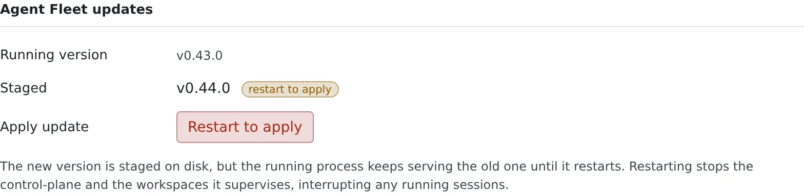

# Update the native package

English | [日本語](update.ja.md)

Move the native package to a new version. Getting the new version ready is automatic; switching to it happens when you restart, at a time that suits you.

## How it works

| What you do | What happens |
|---|---|
| Nothing (when the installer could enable the timer) | A daily timer runs `af update`, which fetches and verifies the new version and stages it beside the current one. Without the timer, you run `af update` yourself |
| Restart when it suits you | It switches to the new version. Running sessions are interrupted |
| Write `AF_VERSION` to pin a version | Automatic updates do not move past that version |

Data under `WS_DATA` is not touched. A new workspace image (rootfs) is fetched on the next start, if needed.

## Stage a new version

`af update` fetches the latest release (or the `AF_VERSION`-pinned one), verifies its sha256, stages it beside the current version and re-points `~/.local/bin/af`.
**It never restarts a running Control Plane.** The new version takes effect only when you restart, so live agent sessions are never dropped without your say-so.

```bash
af update --check   # report whether a newer release exists (no download)
af update           # download + verify + stage the latest (or AF_VERSION-pinned)
```

- `--yes` skips the question whether to download
- `af update` works only in the installer's layout (the `~/.local/bin/af` symlink). A hand-extracted copy is refused: use [Replace it from a tar](#replace-it-from-a-tar) below

### The daily timer

The installer enables a **user timer** (`agent-fleet-update.timer`) that runs `af update` daily. It only stages; it does not switch.

- It is enabled only when `systemctl` exists and the user systemd bus is reachable. When it is, the installer prints `auto-update: daily 'af update' timer enabled`
- If that line did not appear (on WSL with systemd off, for instance), there is no timer: run `af update` above yourself to update. How to turn systemd on in WSL is in [Run it as a systemd service](service.md#when-it-goes-wrong)
- Opt out at install time with `AF_NO_AUTOUPDATE=1`
- To stop it later, or to see when it runs next:

```bash
systemctl --user disable --now agent-fleet-update.timer   # stop auto-staging
systemctl --user list-timers agent-fleet-update.timer     # when it next runs
```

## Switch to the staged version

Switching is a restart of the main service. Do it when it suits you, in either place.

| Where | What to do |
|---|---|
| The Console | When a new version is staged, **Restart to apply** appears in **Agent Fleet updates** under **Settings → Toolchains**. Before restarting it tells you how many sessions are running |
| A shell | `systemctl --user restart agent-fleet`. For a foreground run, Ctrl-C and `af start` |



> [!WARNING]
> Restarting stops the Control Plane and the workspaces it supervises, and running agent sessions are interrupted (under systemd the whole unit cgroup is stopped).
> That is why switching is a deliberate action, not automatic.

## Pin a version

Write `Environment=AF_VERSION=<v>` in **both** the `agent-fleet` and the `agent-fleet-update` units.
`af update` then treats that version as the target and does nothing once you are on it. How to write the unit is in [Run it as a systemd service](service.md).

## Replace it from a tar

If you run a hand-extracted tar, extract the new version and start with the `af` inside it.

```bash
tar xzf agent-fleet-native-<v'>-linux-<arch>.tar.gz   # extract the new version
cd agent-fleet-native-<v'>-linux-<arch> && ./af start
```

- The data (`WS_DATA`) lives outside the package and is used as it is
- DB migrations run automatically at startup and only go forward. **Downgrades are not supported**. A tar backup of `WS_DATA` before updating is recommended
- Releases with the same rootfs version do not download it again
- Delete the old package directory once you no longer need it

## Carry it in by hand

On a host that cannot reach the internet, carry the files in by hand.

| Way | What it does |
|---|---|
| Use the variant with the rootfs bundled | The `-bundle` tar built with `--bundle-rootfs` contains the rootfs and starts without any download |
| Pass a rootfs tar | With the regular variant, pass a rootfs tar fetched on another host with `./af start --rootfs <tar.zst>`. The same sha256 verification applies |

- Only the first-time automatic install of the agent CLIs needs the network
- To have the CLIs fully offline, use a Docker target you built yourself from the repository's Dockerfile with `BAKE_AGENT_CLIS=1`. Licensing forbids redistributing builds with the CLIs baked in

## Related

- [Install the native package](install.md)
- [Run it as a systemd service](service.md)
- [Choose your toolchains](../../user/workspace/toolchains.md#update-agent-fleet)
