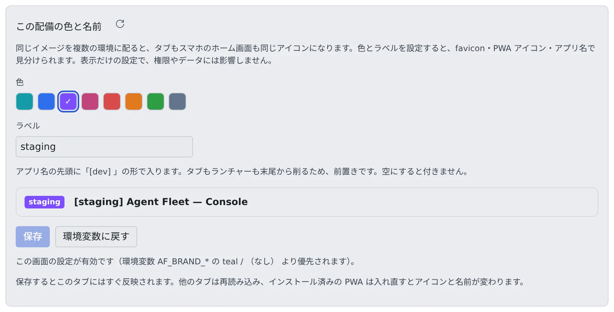

# 複数のデプロイを見分ける

[English](deployment-label.md) | 日本語

本番の隣にステージングを立てると、タブのアイコンもスマホのホーム画面もサインインの画面も同じになります。
配備ごとに色とラベルを決めておくと、どの配備を開いているかがひと目でわかります。

## 全体像

| あなたがやること | 起きること |
|---|---|
| 「管理」→「見た目」で色とラベルを選んで保存する | 再起動なしで、次のリクエストから反映される。開いているタブはその場で変わる |
| 新しい配備の初期値は環境変数で決めておく | 「管理」で何も保存していない配備は、環境変数で決めた色とラベルで表示される |

どちらも見た目だけの設定です。アクセス権やデータには影響しません。

## 色とラベルを決める

アカウントメニューの「**管理**」を開き、「**配備全体**」の「**見た目**」を選びます。配備管理者（super_admin）だけが開けます。



| 項目 | 効果 |
|---|---|
| **色** | favicon・PWA（ホーム画面）のアイコン・Android のタスクスイッチャーの色。`teal`（同梱の既定）・`blue`・`violet`・`magenta`・`red`・`orange`・`green`・`slate` から選びます |
| **ラベル** | アプリ名の先頭に `[staging] Agent Fleet` の形で入る短い名前。16 文字までです。ブラウザのタブ・インストールした PWA の名前・サインインの画面・Console の上部バー（同じ色のチップ）に出ます |

- ラベルを前に置くのはわざとです。タブもスマホのランチャーも末尾から削るので、`[staging] Agent Fle…` でも今どこにいるかがわかります
- この画面で保存した値は、環境変数より優先されます。あとから環境変数を変えても、「**環境変数に戻す**」を押すまでは変わりません
- 「環境変数に戻す」は、この画面で保存した値があるときだけ出ます

## 環境変数で決める

新しい配備の初期値で、「環境変数に戻す」で戻る先です。

```
AF_BRAND_COLOR=violet
AF_BRAND_LABEL=staging
```

| 形態 | 設定する場所 |
|---|---|
| Docker Compose | `.env` |
| ECS | スタックのパラメータ `BrandColor` / `BrandLabel` |
| native ランタイム・`run-dev.sh` | 環境変数 |

Control Plane を再起動すると反映されます。Control Plane が配信時に同梱の画像の色を塗り替えるので、配備ごとにイメージを作る必要はありません。
知らない色の名前を書いても止まりません。ログに記録して、`teal` のまま動きます。

## インストール済みの PWA が古い色のまま

すでにインストールした PWA は、インストールしたときの色・アイコン・名前を持ち続けます。
Android ではこれらがアプリに焼き込まれるので、ブラウザのタブは新しい色なのに、アプリの中のステータスバーだけ古い色、ということが起きます。

Chrome はいずれ裏でアプリを作り直しますが、数日かかります。すぐに変えたいときは入れ直します。

1. アイコンを長押ししてアンインストールします
2. ブラウザからもう一度インストールします

## 関連

- [ロール](../../ref/roles.ja.md)：配備管理者ができること
