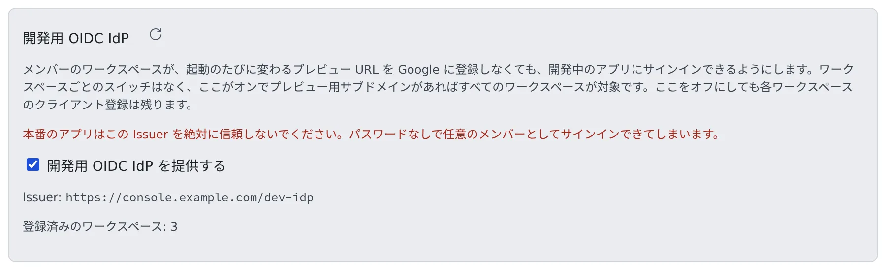

# 開発用サインインを使う

[English](dev-signin.md) | 日本語

サインインのない `AUTH=dev` をどこで使ってよいかがわかり、メンバーのプレビュー上のアプリが使う開発用 OIDC IdP をオン／オフできるようになります。
どちらも、本番の利用者を通す仕組みではありません。

## 全体像

| あなたがやること | Agent Fleet がやること |
|---|---|
| 共有する配備に `AUTH=oauth` か `AUTH=proxy` を設定する | 設定のない配備は、native 以外では起動しない |
| 自分のマシンで試すときだけ `AUTH=dev` を明示する | すべてのリクエストを固定の `super_admin` として扱い、警告を出し続ける |
| 開発用 OIDC IdP を 管理 > 開発用ログイン でオン／オフする | オンの間、プレビュー用サブドメインのアプリに、パスワードなしのサインインを提供する |

## `AUTH=dev` は既定値ではない

`AUTH` に既定値はありません。`AUTH=dev` はサインインが一切ない状態で、すべてのリクエストが固定の `super_admin` になります。

| 条件 | Control Plane のふるまい |
|---|---|
| native 以外で `AUTH` が未設定 | 起動しません |
| native 以外で `AUTH=dev` | `AF_ALLOW_INSECURE_DEV_AUTH=1` も設定したときだけ起動します。自分のマシンでの試用に限ります |
| `PUBLIC_BASE_URL` が `https` | `AUTH=dev` を一切受け付けません |
| native | 1 人で使う設計なので、どちらの手順も踏まずに `dev` を使えます |

- `AUTH=dev` で動いている間は、起動時にログへ `WARNING` を出し、管理画面に警告の帯を出します
- 共有する配備には、`AUTH=oauth` か `AUTH=proxy` を設定してください（[サインインの方法を設定する](../signin/overview.ja.md)）

## 開発用 OIDC IdP をオン・オフする

メンバーのワークスペースで開発しているアプリは、起動のたびに変わるプレビュー URL を Google などに登録しなくても、Control Plane の開発用 OIDC IdP でサインインできます。
**管理 → 配備全体 → 開発用ログイン** で、配備全体のオン／オフを決めます。配備管理者だけの設定で、テナント管理者には見えません。

- **既定はオン**です。ワークスペースごとのスイッチはなく、オン（かつプレビュー用サブドメインがある）の間は、すべてのワークスペースが対象です
- 「**開発用 OIDC IdP を提供する**」のチェックを外すと、再起動なしにオフになります。ほかの Control Plane のレプリカも数秒で追いつき、`/dev-idp/…` はすべて 404 になります
- ワークスペースのクライアントの登録は残ります。オンに戻すと、同じクライアント ID とシークレットが戻ります
- 切り替えるたびに監査ログに残ります（`dev_idp.set`）

> [!WARNING]
> **本番のアプリは、この Issuer を絶対に信頼しないでください。** パスワードなしで、任意のメンバーとしてサインインできてしまいます。

## 画面に出るもの

| 表示 | 意味 |
|---|---|
| Issuer | 開発用 IdP の issuer。プレビューのアプリはこれを信頼します |
| 登録済みのワークスペース: N | クライアントを持つワークスペースの数。IdP を提供している間にワークスペースが起動すると作られ、そのあとも残ります |
| プレビュー用ドメインが未設定 | `AF_PREVIEW_DOMAIN` がないと、メンバーはこの IdP を使えません。`/dev-idp/…` は 404 で、ワークスペースには何も渡らず、ワークスペースからは使えないように見えます。スイッチ自体は操作できます |
| `AF_DEV_IDP=0` でオフに固定 | 運用者が環境変数でオフにしています。ここで切り替えるには、その設定を外します |
| `PUBLIC_BASE_URL` が未設定 | IdP を置くアドレスがないので、オンにできません。設定して Control Plane を再起動します |

メンバーの側の使い方は [プレビューで Google ログインを試す](../../user/preview/dev-signin.ja.md) にあります。

## 関連

- [サインインの方法を設定する](../signin/overview.ja.md)：本番のサインイン
- [そのほかの運用上の制御](controls.ja.md)：プレビュー用ドメインを別のドメインに置く
- [インストールする](../install.ja.md)
