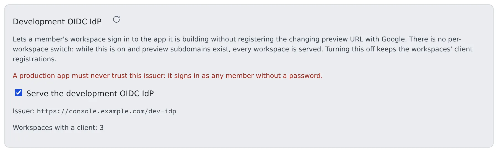

# Use development sign-in

English | [日本語](dev-signin.ja.md)

Know where `AUTH=dev`, which has no sign-in at all, may be used, and turn the development OIDC IdP that apps on members' previews use on or off.
Neither is a way to let production users in.

## How it works

| What you do | What Agent Fleet does |
|---|---|
| Set `AUTH=oauth` or `AUTH=proxy` on a shared deployment | Refuses to start a deployment with no setting, except on native |
| Ask for `AUTH=dev` explicitly only when trying it on your own machine | Treats every request as a fixed `super_admin` and keeps warning |
| Turn the development OIDC IdP on or off in Admin > Dev sign-in | While on, offers apps on preview subdomains a sign-in with no password |

## `AUTH=dev` is not a default

`AUTH` has no default. `AUTH=dev` means no sign-in at all: every request is a fixed `super_admin`.

| Condition | What the Control Plane does |
|---|---|
| `AUTH` unset, on anything but native | Does not start |
| `AUTH=dev`, on anything but native | Starts only when `AF_ALLOW_INSECURE_DEV_AUTH=1` is set too. For trying it on your own machine only |
| `PUBLIC_BASE_URL` is `https` | Never accepts `AUTH=dev` |
| native | Single-user by design, so `dev` works without either step |

- While on `AUTH=dev`, the Control Plane logs a `WARNING` at start and shows a warning banner in the Admin screen
- Set `AUTH=oauth` or `AUTH=proxy` on any deployment you share ([Set up how people sign in](../signin/overview.md))

## Turn the development OIDC IdP on or off

An app a member is building in their workspace can sign in through the Control Plane's development OIDC IdP, without registering the preview URL, which changes on every start, with Google or anyone else.
**Admin → Deployment → Dev sign-in** turns it on or off for the whole deployment. Only the deployment administrator has it; tenant administrators do not see it.

- **It is on by default.** There is no per-workspace switch: while it is on (and preview subdomains exist), every workspace is served
- Clearing "**Serve the development OIDC IdP**" turns it off without a restart. Other Control Plane replicas follow within seconds, and every `/dev-idp/…` path returns 404
- Workspaces' client registrations stay. Turning it back on brings back the same client id and secret
- Every change is audited (`dev_idp.set`)

> [!WARNING]
> **A production app must never trust this issuer.** It signs in as any member without a password.

## What the screen shows

| Shown | Meaning |
|---|---|
| Issuer | The development IdP's issuer. Apps on previews trust it |
| Workspaces with a client: N | How many workspaces hold a client. One is created when a workspace starts while the IdP is served, and it stays afterwards |
| No preview domain is configured | Without `AF_PREVIEW_DOMAIN`, members cannot use this IdP: `/dev-idp/…` returns 404, nothing reaches the workspaces, and it looks unavailable from inside them. The switch itself stays operable |
| Locked off by `AF_DEV_IDP=0` | The operator turned it off in the environment. Remove that setting to manage it here |
| `PUBLIC_BASE_URL` is not set | There is no address to serve the IdP from, so it cannot be turned on. Set it and restart the Control Plane |

The member's side is in [Try Google sign-in on a preview](../../user/preview/dev-signin.md).

## Related

- [Set up how people sign in](../signin/overview.md): production sign-in
- [Other operational controls](controls.md): put the preview domain on a separate domain
- [Install Agent Fleet](../install.md)
