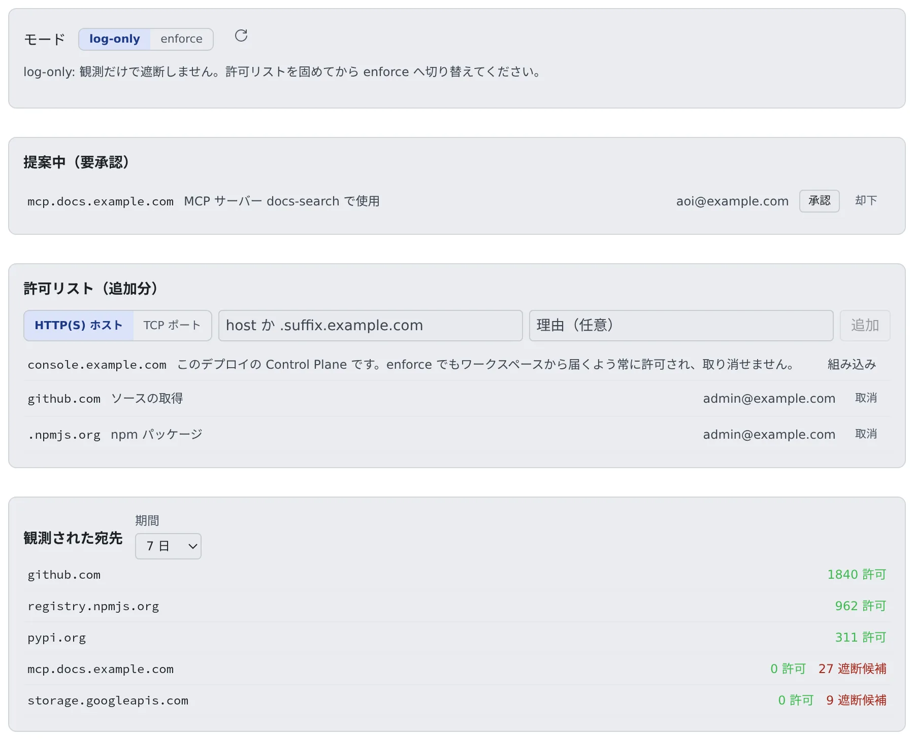

# 外向きの通信を制御する

[English](egress.md) | 日本語

ワークスペースからインターネットへの通信を観測し、許可リストを育て、許可した宛先だけに絞れるようになります。
判定はフォワードプロキシが宛先の名前（CONNECT と SNI）で行い、TLS は復号しません。操作できるのは配備管理者（super_admin）だけです。

## 全体像

| あなたがやること | Agent Fleet がやること |
|---|---|
| log-only のまま、しばらく観測する | 通信は止めずに、宛先ごとの件数を「観測された宛先」に集計する |
| 正当な宛先を許可リストに足す | 許可リストをバージョン管理し、ワークスペースのプロキシに配る |
| メンバーの申請を承認・却下する | MCP サーバーの登録で届かない宛先を、申請として「提案中（要承認）」に出す |
| enforce に切り替える | 許可リストにない宛先を止める |

**段階を踏むのがこの仕組みの要です。** いきなり enforce にすると、エージェントの更新や MCP の接続先など、必要な通信まで止まります。

## 画面を開く

**管理 → 配備全体 → 通信** を開きます。上から、モード、提案中（要承認）、許可リスト（追加分）、観測された宛先が並びます。

## 1. log-only で観測する

既定のモードは **log-only** です。通信を止めずに宛先を記録し、「観測された宛先」にホストごとの「許可」と「遮断候補」の件数を出します。
まずここで、何がどこへ出ているかをつかみます。期間は 1 日・7 日・30 日から選べます。

件数は目安です。

- タイムアウトのあとに送り直された報告は、二重に数えられることがあります
- Control Plane に届かない間、プロキシが保持できるのは 5000 宛先までです。あふれた分は監査ログの `egress.dropped` に出ます
- プロキシを再起動すると、メモリ上に保持していた分は消えます

**一覧にないホストは「見ていない」だけで、「使われていない」ではありません。** enforce にする前に、監査ログに `egress.dropped` がないか確かめてください。

## 2. 許可リストを固める

観測を見ながら、正当な宛先を「許可リスト（追加分）」に足していきます。

1. **HTTP(S) ホスト** を選び、`host` か `.suffix.example.com` の形で入力します
2. 必要なら理由を書き、**追加** を押します
3. 要らなくなったエントリは **取消** で外します

許可リストはバージョン管理され、状態は active・proposed・retired のどれかです。AI は提案するだけで、承認するのは人です。

### はじめから許可されている宛先

| 宛先 | 扱い |
|---|---|
| 製品の既定 | ワークスペース自身のインストーラ（JDK・Node.js・Go・gcloud・MySQL・Postgres・Chromium）と、起動時に入れて更新するエージェントの CLI（Claude・Cursor・Kiro・muse・Antigravity）の取得元。追加分がなくても有効なので、enforce でも 設定 › ツールチェーン と起動時の導入は動きます |
| この配備の Control Plane | 公開 URL と、設定していれば内部 URL のホスト。「**組み込み**」として出て、取り消せません。ワークスペースは egress の経路を通って Control Plane に届くためです |

- `storage.googleapis.com` は既定に入っていません。誰でもアップロードできる汎用のストレージだからです。Antigravity を使うワークスペース（初回の導入と更新のたびにここから取得する）や、x64 で Chromium を導入するワークスペースがあるときに足してください
- 組み込みのエントリはホスト全体（どのポート・パスも）を許します。Control Plane には、ほかのサービスと共有しないホスト名を付けてください
- 組み込みのエントリでも、ゲートウェイのそのほかの拒否（ほかのポート、内部アドレス）は外れません

Control Plane の URL が IPv6 のアドレスのとき（`https://[2001:db8::5]`）は、次のとおりです。

- 小文字・省略形のアドレスとして、角括弧ありとなしの両方でゲートウェイに渡ります
- ゾーン ID 付き、IPv4 射影・IPv4 互換、ループバック・リンクローカル・マルチキャストのアドレスは許可されず、Control Plane が起動時に警告をログに出します
- IPv6 で実際に Control Plane まで届くかは、まだ確かめていません。ワークスペースから届くことを確かめてください
- 自分で足すエントリはホスト名と `.suffix` だけで、IPv6 のアドレスは手では足せません

### HTTP 以外の宛先を許可する（AWS の egress ゲートウェイだけ）

SSH の git やデータベースは HTTP ではないので、ホストのエントリでは通りません。**TCP ポート** を選び、ホストとポートを入れます。

| 入力 | 例 |
|---|---|
| ホスト | 完全なホスト名か、公開の IPv4 アドレス 1 つ（`git.example.com`・`203.0.113.7`）。ワイルドカードと `.suffix` は使えません |
| ポート | 1 つ（`22`）か範囲（`11000-11999`）。範囲は 2048 ポートまで。53・80・443・853・3128 は使えません |

- enforce では、TCP のエントリにない宛先は止まります。log-only では通して、遮断候補として記録します
- 承認すると、すべてのワークスペースからそのホストのそのポートへ、HTTP 以外のアクセスが開きます。ゲートウェイは、そのホストが解決されるアドレスのそのポートだけを通します
- 宛先側のファイアウォールで、ゲートウェイの egress アドレスを通しておきます

> [!WARNING]
> **止められた TCP の接続も、最初はつながったように見えます。** ゲートウェイは接続をいったん受けて宛先を読んでから切るので、`nc -z` や `connect()` は成功し、そのあとの読み書きが EOF かリセット（`Connection reset by peer`）で失敗します。
> 「つながった」を「許可された」と読まず、「通信」の記録か、ゲートウェイの `/var/log/squid/af-tcp.log` の `deny` の行で確かめてください。

設定と制約は [外向きの通信をゲートウェイで制御する](../aws-ecs/egress-gateway.ja.md) にあります。

## メンバーの申請を承認する

メンバーが 設定 > 接続 > MCP サーバー（セッションで使う） で登録したサーバーの宛先が許可リストにないと、メンバーはその場で許可を申請できます。

- 申請は「**提案中（要承認）**」に、宛先・理由・申請した人の順で並びます
- **承認** で許可リストに入り、**却下** で退けます
- あなたが決めるまで、メンバーの画面には「管理者の承認待ち」と出ます
- TCP の申請には、承認すると何が開くかの注意が添えられます

## 3. enforce に切り替える

許可リストが固まったら、モードを **enforce** にします。以降、許可リストにない宛先は止まります。

- log-only のうちに、「観測された宛先」の遮断候補をなくしておくと、スムーズに切り替えられます
- 切り替える前に、監査ログの `egress.dropped` を確かめます（[1. log-only で観測する](#1-log-only-で観測する)）

## 縛れる範囲

Control Plane に `AF_EGRESS_PROXY_ADDR` を設定すると、すべてのワークスペースに `http_proxy`・`https_proxy`・`no_proxy`（と大文字の同名の変数）が渡ります。既定はオフです。
変数に従うプログラムはプロキシを通りますが、**変数を無視するプロセスはそのまま外へ出ます**。

| 配備 | enforce が効くか |
|---|---|
| AWS（`ecs`・`ecs-ec2`）で `00-network` の `EgressRoute=gateway` | 効きます。ワークスペースのルートテーブルが egress ゲートウェイを通り、ほかの出口がありません |
| それ以外 | 効きません。プロキシだけを出口に残すネットワークやセキュリティグループのルールは、まだ用意していません。観測して許可リストを育てる段階まで使えます |

- egress ゲートウェイは新しく、テスト用の配備でだけ確かめています。本番ではまだ使っていません（[デプロイ先を選ぶ](../choose.ja.md#aws-の出口の経路を選ぶ)）
- ゲートウェイの判定は、クライアントが送る名前（HTTP の Host、TLS の SNI）で行います。そのほかの制約は `SECURITY.md` にあります
- Control Plane の内部アドレス（`AF_CP_INTERNAL_URL`）は、docker・Kubernetes・ecs・ecs-ec2 でプロキシの対象から外れます
- ecs・ecs-ec2 ではプロキシがリンクローカル宛てを拒むので、タスクとインスタンスのメタデータのアドレス（`169.254.170.2`・`169.254.169.254`）も対象から外れます

## 記録を残す

egress ゲートウェイが接続を記録する構成（AWS で `EgressRoute=gateway`）では、接続ごとにワークスペースと結び付けた記録も残ります。
画面に出るのはホストごとの件数だけで、接続ごとの記録は `GET /api/admin/egress/events`（super_admin）で読めます。

| 設定 | 効果 |
|---|---|
| `AF_EGRESS_EVENT_RETENTION_DAYS` | 接続ごとの記録を残す日数。既定は 30 日で、`0` にすると消しません。ホストごとの件数は残ります |
| `AF_EGRESS_ARCHIVE_URL` | 消す前に、過ぎた日（UTC）ごとの記録を保存する先。`s3://bucket/prefix`・`gs://bucket/prefix`・`file:///dir` のどれかで、既定は空（保存しない）です |

保存先の用意は形態ごとに違います。

- **AWS**: データスタックの `EgressArchive` パラメータを使います
- **GKE**: `deploy/gcp/gke` の `egress_archive = true` で非公開のバケットを作ります（既存のバケットなら `egress_archive_existing_bucket`）。`cp.env` に入れる行は Terraform の出力 `egress_archive_env` にあり、追記ではなく既存の行を置き換えます
- Control Plane の Google サービスアカウントには、**そのバケットだけ**に `roles/storage.objectCreator` と `roles/storage.objectViewer` を付けます。viewer がないと、書いた日を Control Plane が確かめられず、削除がその日で止まります
- GKE のバケットの中身は、`egress_archive_retention_days` を指定しない限り期限切れになりません

## 関連

- [MCP と外部接続のサインインを運用する](mcp.ja.md)：MCP サーバーの登録と許可リストの関係
- [MCP サーバーを全員に配る](../../admin/mcp-distribute.ja.md)：テナント管理者の側
- [デプロイ先を選ぶ](../choose.ja.md#aws-の出口の経路を選ぶ)：AWS の出口の経路
- [外向きの通信をゲートウェイで制御する](../aws-ecs/egress-gateway.ja.md)：egress ゲートウェイの設定
