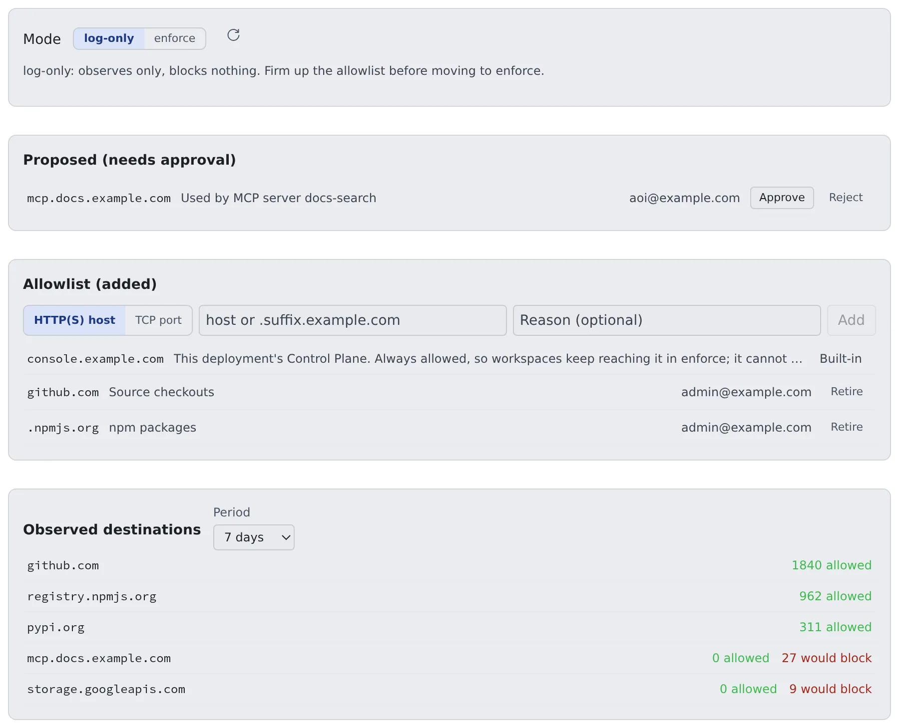

# Control outbound traffic

English | [日本語](egress.ja.md)

Observe the traffic from workspaces to the internet, grow an allowlist, and narrow it to the destinations you allowed.
A forward proxy decides by the destination's name (CONNECT and SNI) and does not decrypt TLS. Only the deployment administrator (super_admin) can operate it.

## How it works

| What you do | What Agent Fleet does |
|---|---|
| Stay in log-only and observe for a while | Lets everything through and counts each destination under "Observed destinations" |
| Add legitimate destinations to the allowlist | Versions the allowlist and delivers it to the workspaces' proxy |
| Approve or reject members' requests | Shows a destination an MCP server registration cannot reach as a request under "Proposed (needs approval)" |
| Switch to enforce | Blocks destinations not on the allowlist |

**Going in stages is the core of the design.** Switching straight to enforce also blocks traffic you need, such as agent updates and MCP endpoints.

## Open the screen

Open **Admin → Deployment → Egress**. From the top: the mode, Proposed (needs approval), Allowlist (added), and Observed destinations.

## 1. Observe in log-only

The default mode is **log-only**. Nothing is blocked; destinations are recorded, and "Observed destinations" shows an "allowed" and a "would block" count per host.
Start here to learn what goes where. The period can be 1 day, 7 days or 30 days.

The counts are approximate.

- A report re-sent after a timeout can be counted twice
- While the Control Plane is unreachable, the proxy holds up to 5000 destinations; the overflow appears as `egress.dropped` in the audit log
- Restarting the proxy loses what it held in memory

**A host missing from the list was not seen, which is not the same as not used.** Before you switch to enforce, check the audit log for `egress.dropped`.

## 2. Firm up the allowlist

While you watch the observations, add legitimate destinations under "Allowlist (added)".

1. Choose **HTTP(S) host** and enter it as `host` or `.suffix.example.com`
2. Add a reason if you like, and press **Add**
3. Remove an entry you no longer need with **Retire**

The allowlist is versioned, and each entry is active, proposed or retired. AI only proposes; a person approves.

### Destinations allowed from the start

| Destination | Treatment |
|---|---|
| The product defaults | The sources of the workspace's own installers (JDK, Node.js, Go, gcloud, MySQL, Postgres, Chromium) and of the agent CLIs installed and updated at start (Claude, Cursor, Kiro, muse, Antigravity). They apply with no added entries, so Settings › Toolchains and the install at start keep working in enforce |
| This deployment's Control Plane | The host of the public URL and, when set, the internal URL. Shown as "**Built-in**" and cannot be retired, because workspaces reach the Control Plane through the egress path |

- `storage.googleapis.com` is not in the defaults: it is general-purpose storage anyone can upload to. Add it when a workspace uses Antigravity (it downloads from there on first install and every update) or installs Chromium on x64
- A built-in entry allows the whole host (any port, any path). Give the Control Plane a host name it shares with no other service
- A built-in entry does not lift the gateway's other refusals (other ports, internal addresses)

When the Control Plane's URL is an IPv6 address (`https://[2001:db8::5]`):

- It reaches the gateway as a lower-case, compressed address, both with and without brackets
- Zone IDs, IPv4-mapped and IPv4-compatible addresses, and loopback, link-local and multicast addresses are not allowed; the Control Plane logs a warning at start
- Whether the Control Plane is actually reached over IPv6 has not been checked yet; confirm that workspaces reach it
- The entries you add yourself are host names and `.suffix` only; you cannot add an IPv6 address by hand

### Allow a non-HTTP destination (AWS egress gateway only)

Git over SSH and databases are not HTTP, so a host entry does not let them through. Choose **TCP port** and enter the host and the port.

| Field | Example |
|---|---|
| Host | A full host name or one public IPv4 address (`git.example.com`, `203.0.113.7`). No wildcards and no `.suffix` |
| Port | One port (`22`) or a range (`11000-11999`). A range is at most 2048 ports. 53, 80, 443, 853 and 3128 are refused |

- In enforce, a destination with no TCP entry is dropped; in log-only it passes and is recorded as would-block
- Approving opens non-HTTP access to that port of that host from every workspace. The gateway passes only that port, on the addresses the host resolves to
- Let the gateway's egress address through the destination's firewall first

> [!WARNING]
> **A blocked TCP connection still looks connected at first.** The gateway accepts the connection, reads the destination and then closes it, so `nc -z` or a bare `connect()` succeeds and the reads and writes after it fail with EOF or a reset (`Connection reset by peer`).
> Do not read "connected" as "allowed"; check the Egress records or the `deny` lines in `/var/log/squid/af-tcp.log` on the gateway.

Settings and limits are in "Egress gateway" in the [ECS runbook](../../../deploy/aws/ecs/README.md).

## Approve members' requests

When a server a member registers under Settings > Connections > MCP servers (used by sessions) points at a destination not on the allowlist, the member can request it right there.

- A request appears under "**Proposed (needs approval)**" with the destination, the reason and who asked
- **Approve** adds it to the allowlist; **Reject** turns it down
- Until you decide, the member's screen says the host is awaiting an administrator's approval
- A TCP request carries a note on what approving it opens

## 3. Switch to enforce

Once the allowlist is settled, set the mode to **enforce**. From then on, destinations not on the allowlist are blocked.

- Clearing the would-block entries in "Observed destinations" while still in log-only makes the switch smooth
- Check the audit log for `egress.dropped` before switching ([1. Observe in log-only](#1-observe-in-log-only))

## What it can hold

Setting `AF_EGRESS_PROXY_ADDR` on the Control Plane gives every workspace `http_proxy`, `https_proxy` and `no_proxy` (and their upper-case twins). It is off by default.
Programs that honour those variables go through the proxy; **a process that ignores them goes straight out**.

| Deployment | Does enforce hold? |
|---|---|
| AWS (`ecs`, `ecs-ec2`) with `EgressRoute=gateway` in `00-network` | Yes. The workspaces' route table goes through the egress gateway, and there is no other way out |
| Everything else | No. A network or security-group rule that leaves the proxy as the only way out is not provided yet. You can run it up to observing and growing the allowlist |

- The egress gateway is new and has been checked on a test deployment only; it is not in production use yet ([Choose where to deploy](../choose.md#choose-the-egress-route-on-aws))
- The gateway decides by the name the client sends (the HTTP Host, the TLS SNI). Its other limits are in `SECURITY.md`
- The Control Plane's internal address (`AF_CP_INTERNAL_URL`) is excluded from the proxy on docker, Kubernetes, ecs and ecs-ec2
- On ecs and ecs-ec2 the proxy refuses link-local destinations, so the task and instance metadata addresses (`169.254.170.2`, `169.254.169.254`) are excluded too

## Keep the records

Where the egress gateway records connections (`EgressRoute=gateway` on AWS), a record of each connection tied to its workspace is kept as well.
The screen shows only the per-host counts; the per-connection records are read from `GET /api/admin/egress/events` (super_admin).

| Setting | Effect |
|---|---|
| `AF_EGRESS_EVENT_RETENTION_DAYS` | How many days per-connection records are kept. The default is 30; `0` keeps them forever. The per-host counts stay |
| `AF_EGRESS_ARCHIVE_URL` | Where each past UTC day is saved before it is deleted: `s3://bucket/prefix`, `gs://bucket/prefix` or `file:///dir`. Empty by default (nothing saved) |

How to prepare the store depends on the target.

- **AWS**: use the data stack's `EgressArchive` parameter
- **GKE**: `egress_archive = true` in `deploy/gcp/gke` creates a private bucket (`egress_archive_existing_bucket` for an existing one). The line for `cp.env` is the Terraform output `egress_archive_env`; it replaces the existing line rather than being appended
- Give the Control Plane's Google service account `roles/storage.objectCreator` and `roles/storage.objectViewer` on **that bucket only**. Without the viewer role the Control Plane cannot verify a day it wrote, and the purge stops at that day
- Objects in the GKE bucket never expire unless you set `egress_archive_retention_days`

## Related

- [Operate MCP and external-connection sign-in](mcp.md): how MCP server registration meets the allowlist
- [Distribute an MCP server to everyone](../../admin/mcp-distribute.md): the tenant administrator's side
- [Choose where to deploy](../choose.md#choose-the-egress-route-on-aws): the egress route on AWS
- [ECS runbook](../../../deploy/aws/ecs/README.md): configuring the egress gateway
