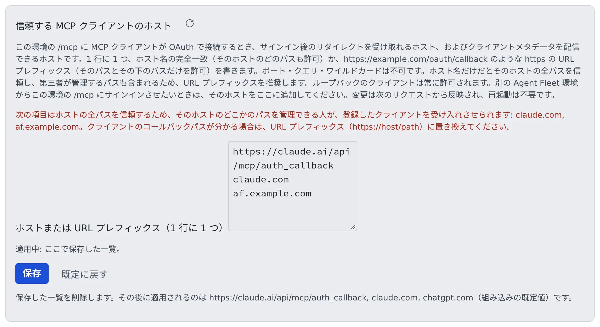

# MCP と外部接続のサインインを運用する

[English](mcp.md) | 日本語

メンバーが MCP サーバーを使うときと、外の MCP クライアントが Agent Fleet に入ってくるときに、配備の側で何を決め、何を見るかをまとめます。
リモートの MCP クライアントを OAuth でサインインさせ、信頼するクライアントのホストを決め、`/mcp` に届いたものをログで読めるようになります。

## 全体像

| 向き | メンバーがやること | あなたがやること |
|---|---|---|
| 外へ: セッションから MCP サーバーを使う | 設定 > 接続 > MCP サーバー（セッションで使う） で登録する | 接続先を許可リストに入れる。OAuth のサーバー用の公開パスを通す |
| 中へ: 外のクライアントからワークスペースを使う | 設定 > 外部からのアクセス > MCP トークン・接続アプリ でトークンを発行するか、OAuth で接続する | `/mcp` を有効にし、OAuth を使うなら信頼するクライアントのホストを決める |

## メンバーの MCP サーバーについて知っておくこと

メンバーは自分の MCP サーバーを登録でき、テナント管理者は全メンバーに配れます（[MCP サーバーを全員に配る](../../admin/mcp-distribute.ja.md)）。

| 知っておくこと | 中身 |
|---|---|
| 秘密の置き場所 | 環境変数とヘッダーの値は暗号化して保存されます。ただし、そのサーバーを使うエージェントの CLI の設定ファイルにも、CLI が読むために平文（モード 0600、メンバーの home の中）で書かれます。このファイルは home のバックアップとスナップショットに入り、ワークスペースの鍵を捨てても消えません |
| 配れるのはリモート（HTTP）だけ | stdio を配れると、管理者が全員のコンテナで任意のコマンドを動かせるのと同じになるためです。個人の登録では stdio も使えます |
| 外向きの通信とつながっている | 接続先が許可リストになければ、登録しても動きません。メンバーの申請は 管理 > 通信 の「提案中（要承認）」に届きます（[外向きの通信を制御する](egress.ja.md#メンバーの申請を承認する)） |

## 外から入ってくる口を開ける

メンバーは 設定 > 外部からのアクセス > MCP トークン・接続アプリ でトークンを発行し、手元の Claude Code や Claude Desktop からワークスペースを操作できます。

- 入り口は `/mcp`（Bearer 認証）です。配備の側では、`AF_MCP_ENABLED` と、ingress が `/mcp` を通すかどうかで決まります
- スコープ（read・write・admin:dangerous）と有効期限はメンバーが選び、失効もメンバー自身が行います
- メンバーは同じ入り口から、自分のエージェントに自分の Agent Fleet のメモリを使わせることもできます。メンバーごとの設定で、既定はオフです（[外部のエージェントからメモリを使う](../../user/memory/external.ja.md#始める前に)）
- テナント管理者はテナント全体でメモリの利用を止められます（[外部からのメモリの利用を許可する](../../admin/memory-outside.ja.md)）。`AF_MCP_ENABLED` は入り口全体を止めます

## リモートの MCP クライアントを OAuth でサインインさせる

既定の `/mcp` は個人アクセストークン（PAT）だけを受け付けます。OAuth を有効にすると、Control Plane が `/mcp` 用の OAuth 2.1 の認可サーバーにもなります。
claude.ai・ChatGPT・Claude Code・Codex は、トークンを貼り付ける代わりに、メンバーが Console にサインインして接続できます。OAuth を使えない CI などでは、PAT をそのまま使えます。

| 設定 | 意味 |
|---|---|
| `AF_MCP_OAUTH=1` | 認可サーバーを有効にします。`AF_MCP_ENABLED=true` と、`https` の `PUBLIC_BASE_URL` も要ります。どれかが欠けると下のパスはすべて 404 になり、`/mcp` は素の 401 を返し、クライアントはトークンを求める動きに戻ります |
| `AF_MCP_OAUTH_TRUSTED_HOSTS` | サインインのリダイレクト先になれるホストと、クライアントのメタデータを配れるホスト（カンマ区切り）。既定は `https://claude.ai/api/mcp/auth_callback,claude.com,chatgpt.com` で、`none` にするとループバックのクライアントだけになります。画面から上書きできます（[信頼するクライアントのホストを決める](#信頼するクライアントのホストを決める)） |

### 有効にする

| 形態 | やること |
|---|---|
| compose・native・local | Control Plane の環境に `AF_MCP_ENABLED=true` と `AF_MCP_OAUTH=1` を設定します。値はこのとおりに書きます（`AF_MCP_ENABLED=1` は通りません） |
| Kubernetes | Control Plane の環境ファイル（`cp.env`）に同じ行を足します |
| ECS | `30-ingress` のパラメータ `McpEnabled=on`・`McpOAuth=on`（必要なら `McpOAuthTrustedHosts`）を、`30-ingress.yaml` に対する個別の `aws cloudformation deploy` で設定します |

ECS の `update.sh` は、これらを有効にも無効にもしません。前回の値を保ち、スタックにまだないパラメータはオフで始まります。手順は [リモートの MCP を公開する](../aws-ecs/options.ja.md#リモートの-mcp-を公開する) にあります。

### 公開するパスと ingress

issuer は `{PUBLIC_BASE_URL}/mcp-oauth` です。次のパスを提供します。

| 種類 | パス |
|---|---|
| 探索 | `/.well-known/oauth-protected-resource/mcp`・`/.well-known/oauth-protected-resource/mcp/memory`・`/.well-known/oauth-authorization-server/mcp-oauth` |
| ブラウザで開く | `/mcp-oauth/authorize`・`/mcp-oauth/consent` |
| クライアントのサーバーから呼ばれる | `/mcp-oauth/token`・`/mcp-oauth/register`・`/mcp-oauth/revoke` |

- ホスト型のクライアントは、`/mcp` とトークンのエンドポイントを**ベンダーのサーバーから**呼びます。Control Plane はこれらのパスでインターネットから届く必要があります
- VPN の内側や、ALB の受け付ける送信元を絞った配備では、コマンドライン（ループバック）のクライアントだけが使えます。これは仕様です
- `AUTH=oauth` と `AUTH=dev` では、Console のセッションのゲートが探索・`token`・`register`・`revoke` を素通しし、`authorize` と `consent` をゲートの内側に置きます

`AUTH=proxy` では、ゲートウェイ側で同じ分け方をします。

| ゲートウェイを通す（メンバーを識別するヘッダーが付く） | ゲートウェイを迂回させる |
|---|---|
| `/mcp-oauth/authorize`・`/mcp-oauth/consent` | 残りの 6 つのパスと `/mcp`・`/mcp/memory` |

`/mcp` の 401 には `WWW-Authenticate: Bearer resource_metadata="…"` が付きます。示されたトークンが無効なら `, error="invalid_token"` も付きます。

### 2 つのリソース

| リソース | 提供するもの |
|---|---|
| `/mcp` | すべてのツール |
| `/mcp/memory` | 外部メモリの 8 つのツールだけ。claude.ai がメンバーのワークスペースのセッションにも渡してしまうコネクタのためのものです |

- それぞれが専用のメタデータ文書と 401 のチャレンジを持ち、相手のトークンを拒みます
- OAuth のコード・グラント・トークンは、クライアントが求めたリソースに結び付きます（リフレッシュしても変わりません）
- PAT は 1 つのエンドポイント向けに発行されます。既定は `mcp` で、分ける前に発行したトークンもすべて `mcp` です
- テナントのスイッチ、メンバーのメモリ設定、スコープの段階、監査の記録は両方で同じです

### クライアント・トークン・スコープ

| 対象 | 決まり |
|---|---|
| クライアントの登録 | 誰でも登録できます。送信元ごとに 1 時間 10 件まで（IPv6 は /64 全体で 1 つ）、配備全体で 2,000 件までです。一度も接続されなかった登録は 24 時間で消えます |
| リダイレクト先 | ループバックか、信頼するホストの `https` のアドレスだけです。表記も正規の形に限ります（大文字・末尾のドット・明示したポート・ユーザー情報・フラグメントは不可） |
| メタデータ文書の URL で示すクライアント | URL が信頼するホストにあるときだけ取りに行きます。リダイレクトは追わず、短いタイムアウトとサイズの上限を設け、公開アドレス以外には接続しません |
| アクセストークン | 不透明な値で、1 時間有効です。`{PUBLIC_BASE_URL}/mcp` か `{PUBLIC_BASE_URL}/mcp/memory` に結び付きます |
| リフレッシュトークン | 使うたびに新しくなります。使い終えたものがもう一度出されると、接続全体を取り消します |
| 接続 | 30 日使われないか、90 日たつと終わります。保存するのはハッシュだけで、PAT の 20 個の上限には数えません |
| スコープ | `read` と `write` だけです。`admin:dangerous` は、メンバーのロールにかかわらず OAuth では渡しません。同意の画面は `read` を選んだ状態で開き、求められたときだけ `write` を出します |
| テナントのネットワーク制限 | 同意の段階、つまりブラウザの前の人にかかります。ベンダーのサーバーから来る `/mcp` とトークンのエンドポイントには、PAT と同じくかかりません |

## 信頼するクライアントのホストを決める

**管理 → 配備全体 → MCP ログイン許可ホスト** で、MCP OAuth が信頼するクライアントのホストを編集します。
サインインのあとのリダイレクトを受け取れるホストと、クライアントのメタデータを配れるホストです。テナントごとではなく配備全体の設定で、配備管理者にだけ出ます。



1. 1 行に 1 つ、ホストか URL プレフィックスを書きます
2. **保存** を押します。誤りがあれば理由が出て、何も保存されません
3. 下の「適用中:」で、どの一覧が効いているかを確かめます

ループバックのクライアント（メンバー自身のマシンの CLI など）は、いつも許可されます。

### 書き方

| 項目 | 許すもの |
|---|---|
| ホスト名（`chatgpt.com`） | そのホストの**すべてのパス** |
| URL プレフィックス（`https://claude.ai/api/mcp/auth_callback`） | そのパスと、その下のパスだけ。`…/auth_callbackx` のような長い名前は許しません |

- ポート・クエリ・ワイルドカード・IP アドレスは使えません。エンコードした文字、`.`・`..`、空のセグメントを含むパスは一致しません
- **URL プレフィックスをおすすめします。** クライアントの登録にはサインインが要らないので、ホスト名だけの項目は、大きな共有ホストで第三者が管理するパスまで信頼します。ホスト名だけの項目があると、画面に警告が出ます
- 別の Agent Fleet の環境からこの環境の `/mcp` にサインインさせたいときは、そのホストを足します（`af.example.com`）
- ベンダーを外すこともできます。`chatgpt.com` を消して保存すれば、ChatGPT からはサインインできなくなります。空の一覧を保存すると、ホスト経由のクライアントは一切信頼しません

### どの一覧が効くか

| 順 | 一覧 |
|---|---|
| 1 | この画面で保存した一覧 |
| 2 | 環境変数 `AF_MCP_OAUTH_TRUSTED_HOSTS` |
| 3 | 組み込みの既定値（`https://claude.ai/api/mcp/auth_callback`・`claude.com`・`chatgpt.com`） |

- **既定に戻す** は保存した一覧を消し、2 か 3 が効くようになります
- 既定の `claude.com` と `chatgpt.com` がホスト名のままなのは、ChatGPT は固定のリダイレクトを使わないとパスが接続ごとに変わり、`claude.com` のパスは公開されていないためです

### 変えたときに起きること

- 再起動は要りません。次のリクエストから、新しいサインイン・クライアントの登録・トークンの要求に効きます
- リダイレクト先のホスト（メタデータの URL で示すクライアントでは、そのクライアント自身のホスト）を外すと、その接続はトークンの更新も、使っていないコードの交換もできなくなります
- 発行済みのアクセストークンは期限（最長 1 時間）まで使えます。ループバックの接続には影響しません
- 変更はすべて監査されます（`mcp_oauth.trusted_hosts.set`・`.reset`。前後の一覧を含みます）

### 同意の画面と監査に出るもの

- 同意の画面には、リダイレクト先の URI 全体と、クライアントがメタデータ文書（CIMD）と動的登録（DCR）のどちらから来たかが出ます
- 監査ログの `mcp.oauth.grant` には `via=cimd|dcr` と `redirect_path` が残ります

### CIMD のサインインが `authorize` で止まる

Control Plane は `client_id` のホストからメタデータ文書を取りに行きますが、Control Plane から見て公開アドレスに解決されないホストは拒みます。
ループバック、プライベートの範囲、リンクローカル、tailnet のアドレスが入るキャリアグレード NAT（`100.64.0.0/10`）などです。

- この一覧に載せていても、サインインは `authorize` の汎用の拒否ページで止まります
- そのクライアントでは、動的登録（DCR）だけが使えます。クライアント側の案内にある **動的登録でやり直す** を押してもらいます
- これは意図した SSRF 対策で、設定では変えられません。CIMD を使いたいときは、Control Plane から見た名前解決を直してください

### 登録が上限に達したとき

配備全体の動的登録が 2,000 件に達すると、接続のない登録を古いものから消して空きを作ります（接続のあるクライアントは消しません）。
その後 24 時間、管理画面に警告が出ます（Control Plane のレプリカごと）。登録にはサインインが要らないので、大量に登録されていないか、アクセスログで送信元を確かめてください。

## メンバーが登録した OAuth のサーバーへのサインイン

上とは逆向きです。メンバーが OAuth しか受け付けないリモートの MCP サーバーを登録すると、メンバー自身の Agent がそのサーバーにサインインします。
Control Plane はそのための公開パスを 2 つ持ち、どちらにも届く `PUBLIC_BASE_URL` が要ります。

| パス | 役目 | `AUTH=proxy` のゲートウェイ |
|---|---|---|
| `GET {PUBLIC_BASE_URL}/oauth2/mcp/callback` | サーバーの認可サーバーがブラウザを戻す先。呼んだ人は Control Plane が自分で確かめます（`AUTH=oauth` では Console のセッション、`AUTH=proxy` ではゲートウェイの識別ヘッダー） | **通す**。識別ヘッダーがないとサインインは失敗します |
| `GET {PUBLIC_BASE_URL}/oauth/mcp-client.json` | クライアント ID のメタデータ文書（CIMD）。`PUBLIC_BASE_URL` が `https` のときだけ配ります | このパス**だけ**を認証なしで通します。CIMD に対応した認可サーバーが、その側のサーバーから取りに来るためです |

- ブラウザは、サインインを始めたメンバー本人のものでなければなりません。サインインは 10 分間、1 回だけ有効です
- `/oauth/` の下のほかのパスは公開しません
- `https` の基底 URL がないときや、認可サーバーが文書を取れないときは、Agent が動的登録に切り替えるか、メンバーにクライアント ID を尋ねます
- メンバーの操作は [セッションに MCP サーバーを追加する](../../user/integrations/mcp-servers.ja.md#oauth-のサーバーにサインインする) にあります

### トークンがどこを通るか

トークンは、Agent がメンバーの暗号化されたストアに保存します。Control Plane を通るのは 1 つの場合だけです。

- テナント管理者が自分で登録した **confidential クライアント**（クライアントシークレット付き）でそのサーバーを配ったとき、シークレットは Control Plane に残ります
- そのときは Control Plane がメンバーの Agent の代わりにトークン・更新・失効を要求し、応答を保存せずにそのまま返します
- この場合だけ、**Control Plane 自身**が `https` で認可サーバーに届く必要があります。トークンのエンドポイントは管理者が入れた issuer から探し、公開アドレスにだけ接続し、リダイレクトは追いません
- それ以外の要求は、ワークスペースから出ます

## 監査に残るもの

| 記録 | いつ |
|---|---|
| `mcp.oauth.grant` | 接続の作成・取り消し・再利用による取り消し。メンバーが失効させると `revoked by member`、テナントを無効にしたときは接続ごとに `revoked reason=tenant-disabled` |
| `mcp.oauth.token` | トークンを発行するたび |
| `tenant.mcp_oauth` | テナントの設定を変えたとき（`enabled=true/false`） |
| `mcp.client_oauth` | メンバーの OAuth のサーバーへのサインイン（`started`・`completed`・`failed`・`disconnected`）。サーバーと認可サーバーの名前だけで、コードやトークンは書きません |

- `mcp.oauth.grant` と `mcp.oauth.token` は、応答を返す前に書きます。監査の保存先が止まっているときは、トークンを発行しません
- 接続を使った呼び出しは、接続の ID を実行者として `mcp` で記録します
- テナントの無効化と重なってコードの交換を断ったときは `refused reason=tenant-disabled` を足します。先に書いた `created` が、成立した接続ではなく試みだったとわかるようにするためです

## クライアントが `/mcp` に送ったものを読む

`/mcp` へのリクエストは、1 件ごとに Control Plane のログへ 1 行出ます。拒んだもの、認証の前に 405 で答える `GET`・`DELETE`、バッチの各要素も含みます。
つながるのにツールが出ないクライアントも、実際に何を送ったかから原因を追えます。

```
mcp-call endpoint="/mcp" http_method="POST" status=400 latency_ms=2 principal="grant:<id>" client_id="<id>" header_version="2026-07-28" mcp_method_header=false mcp_name_header=false accept="application/json, text/event-stream" content_type="application/json" user_agent="…" items=[{"method":"tools/list","era":"stateless","meta_version":"2026-07-28","client_name":"…","status":400,"error_code":-32020,"error_message":"header mismatch: Mcp-Method (absent) does not match body method \"tools/list\""}]
```

| 項目 | 読み方 |
|---|---|
| `endpoint` | 宛先のパス。`/mcp` か `/mcp/memory` |
| `principal` | `pat:<id>`、`grant:<id>`（OAuth。続けて `client_id`）、`unauthenticated` のどれか。拒んだときは `reason=` に理由（Bearer がない、不明か期限切れのトークン、別のリソース向けの OAuth のトークン、別のエンドポイント向けの PAT、`method not allowed`） |
| `era` | `legacy`（`initialize` のハンドシェイク）か `stateless`（毎回 `_meta` を付ける） |
| `error_code` | stateless で拒んだときの JSON-RPC のコード。-32020 はヘッダーの不一致、-32022 は対応していない版、-32602 は `_meta` の欠け（`clientInfo` と `clientCapabilities` を含む）。`Mcp-Method`・`Mcp-Name` ヘッダーの有無も出ます |
| `tools` | `tools/list` で返したツールの数 |
| `tool_error` | 実行して失敗した `tools/call`（200 で `isError`）。本文は書きません |

- トークン、`Authorization` の値、リクエストの引数、ツールの結果は記録しません。`tools/call`・`prompts/get` のツール名とプロンプト名だけを記録します
- 認証できた呼び出しは、メンバー本人が 設定 > 外部からのアクセス > MCP トークン・接続アプリ の「**最近の呼び出し**」で読めます。トークンか接続ごとに直近 50 件で、メモリの上にだけあり、再起動で消えます
- 「最近の呼び出し」は **Control Plane のレプリカごと**です。レプリカが複数あるときは、全部のログを探してください。405 と認証されていないリクエストは、ログにしか残りません

## 関連

- [外向きの通信を制御する](egress.ja.md)
- [MCP サーバーを全員に配る](../../admin/mcp-distribute.ja.md)
- [セッションに MCP サーバーを追加する](../../user/integrations/mcp-servers.ja.md)
- [アクセスを取り消す・super_admin を引き継ぐ](offboarding.ja.md)：PAT と OAuth の接続がどう切れるか
- [パラメータで任意の機能をオンにする](../aws-ecs/options.ja.md#リモートの-mcp-を公開する)
