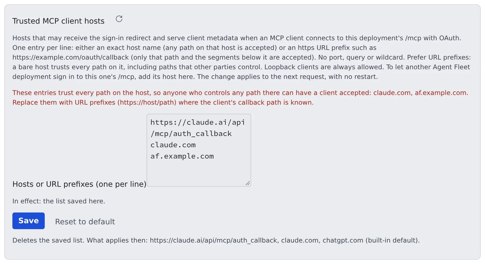

# Operate MCP and external-connection sign-in

English | [日本語](mcp.ja.md)

What the deployment decides and what you watch when members use MCP servers and when outside MCP clients come into Agent Fleet.
Afterwards you can sign remote MCP clients in with OAuth, decide which client hosts to trust, and read what reached `/mcp` in the log.

## How it works

| Direction | What the member does | What you do |
|---|---|---|
| Out: sessions use an MCP server | Registers it under Settings > Connections > MCP servers (used by sessions) | Put its endpoint on the allowlist; let the public paths for OAuth servers through |
| In: an outside client uses the workspace | Issues a token under Settings > Outside access > MCP tokens & apps, or connects with OAuth | Turn `/mcp` on; with OAuth, decide which client hosts to trust |

## What to know about members' MCP servers

Members can register their own MCP servers, and tenant administrators can distribute them to every member ([Distribute an MCP server to everyone](../../admin/mcp-distribute.md)).

| What to know | Detail |
|---|---|
| Where the secrets are | Environment-variable and header values are stored encrypted. They are also written in plain text (mode 0600, inside the member's home) to the settings file of each agent CLI that uses the server, because the CLI has to read them. That file is in home backups and snapshots, and survives discarding the workspace's key |
| Only remote (HTTP) servers can be distributed | Distributing stdio would equal letting an administrator run any command in everyone's container. Personal registrations can use stdio |
| It is tied to outbound traffic | A server whose endpoint is not on the allowlist does not work, even when registered. Members' requests arrive under "Proposed (needs approval)" in Admin > Egress ([Control outbound traffic](egress.md#approve-members-requests)) |

## Open the way in

Members issue a token under Settings > Outside access > MCP tokens & apps and drive the workspace from Claude Code or Claude Desktop on their own machine.

- The entry point is `/mcp` (Bearer authentication). On the deployment side, `AF_MCP_ENABLED` and whether the ingress passes `/mcp` decide it
- Members choose the scope (read, write, admin:dangerous) and the expiry, and revoke tokens themselves
- Through the same entry point a member can let their own agents use their Agent Fleet memory. It is a per-member setting, off by default ([Use memory from an external agent](../../user/memory/external.md#before-you-start))
- A tenant administrator can block memory use for the whole tenant ([Allow memory use from outside](../../admin/memory-outside.md)); `AF_MCP_ENABLED` stops the whole entry point

## Sign remote MCP clients in with OAuth

By default `/mcp` accepts personal access tokens (PATs) only. With OAuth on, the Control Plane is also an OAuth 2.1 authorization server for `/mcp`.
claude.ai, ChatGPT, Claude Code and Codex then connect by having the member sign in to the Console instead of pasting a token. CI and other clients that cannot use OAuth keep using PATs.

| Setting | Meaning |
|---|---|
| `AF_MCP_OAUTH=1` | Turns the authorization server on. It also needs `AF_MCP_ENABLED=true` and an `https` `PUBLIC_BASE_URL`. If any is missing, every path below is a 404, `/mcp` returns a plain 401, and clients fall back to asking for a token |
| `AF_MCP_OAUTH_TRUSTED_HOSTS` | The hosts a sign-in may redirect to and that may serve client metadata, comma-separated. The default is `https://claude.ai/api/mcp/auth_callback,claude.com,chatgpt.com`; `none` leaves loopback clients only. The screen can override it ([Decide which client hosts to trust](#decide-which-client-hosts-to-trust)) |

### Turn it on

| Target | What to do |
|---|---|
| compose, native, local | Set `AF_MCP_ENABLED=true` and `AF_MCP_OAUTH=1` in the Control Plane's environment, written exactly so (`AF_MCP_ENABLED=1` does not work) |
| Kubernetes | Add the same lines to the Control Plane's environment file (`cp.env`) |
| ECS | Set the `30-ingress` parameters `McpEnabled=on` and `McpOAuth=on` (and `McpOAuthTrustedHosts` if needed) with a separate `aws cloudformation deploy` of `30-ingress.yaml` |

On ECS, `update.sh` neither turns these on nor off: parameters keep their previous value, and one the stack does not have yet starts off. The steps are in [Serve remote MCP](../aws-ecs/options.md#serve-remote-mcp).

### The public paths and the ingress

The issuer is `{PUBLIC_BASE_URL}/mcp-oauth`. These paths are served:

| Kind | Paths |
|---|---|
| Discovery | `/.well-known/oauth-protected-resource/mcp`, `/.well-known/oauth-protected-resource/mcp/memory`, `/.well-known/oauth-authorization-server/mcp-oauth` |
| Opened in the browser | `/mcp-oauth/authorize`, `/mcp-oauth/consent` |
| Called from the client's servers | `/mcp-oauth/token`, `/mcp-oauth/register`, `/mcp-oauth/revoke` |

- Hosted clients call `/mcp` and the token endpoint **from the vendor's servers**, so the Control Plane must be reachable from the internet on these paths
- On a deployment behind a VPN or with a narrowed ALB ingress range, only command-line (loopback) clients work. That is by design
- With `AUTH=oauth` and `AUTH=dev`, the Console's own session gate lets discovery, `token`, `register` and `revoke` through and keeps `authorize` and `consent` behind it

With `AUTH=proxy`, the gateway splits them the same way.

| Through the gateway (the member's identity headers are added) | Bypassing the gateway |
|---|---|
| `/mcp-oauth/authorize`, `/mcp-oauth/consent` | The other six paths, and `/mcp` and `/mcp/memory` |

A 401 from `/mcp` carries `WWW-Authenticate: Bearer resource_metadata="…"`, with `, error="invalid_token"` added when the token presented was invalid.

### Two resources

| Resource | What it serves |
|---|---|
| `/mcp` | Every tool |
| `/mcp/memory` | The eight external-memory tools only. It is for connectors that claude.ai also hands to the sessions in a member's workspace |

- Each has its own metadata document and 401 challenge, and refuses the other's tokens
- OAuth codes, grants and tokens are bound to the resource the client asked for (refreshing does not change it)
- A PAT is issued for one endpoint. The default is `mcp`, and every token issued before the split is `mcp`
- The tenant switch, the member's memory setting, the scope ladder and the audit records are the same on both

### Clients, tokens and scopes

| Subject | Rule |
|---|---|
| Client registration | Anyone can register: up to 10 an hour per source (an IPv6 source counts per /64) and 2,000 deployment-wide. A registration that never connects is deleted after 24 hours |
| Redirect targets | Loopback, or an `https` address on a trusted host, in canonical form only (no upper case, trailing dot, explicit port, user info or fragment) |
| A client identified by a metadata-document URL | Fetched only when the URL is on a trusted host; redirects are not followed, a short timeout and a size cap apply, and only public addresses are dialled |
| Access tokens | Opaque, valid for one hour, bound to `{PUBLIC_BASE_URL}/mcp` or `{PUBLIC_BASE_URL}/mcp/memory` |
| Refresh tokens | Rotated on every use. Presenting a used one again revokes the whole connection |
| Connections | End after 30 days unused or 90 days in total. Only hashes are stored, and they do not count toward the limit of 20 PATs |
| Scopes | `read` and `write` only. `admin:dangerous` is never granted through OAuth, whatever the member's role. The consent page opens with `read` selected and shows `write` only when asked for |
| The tenant's network restriction | Applies at consent, to the person at the browser. Like PATs, it does not apply to `/mcp` or the token endpoint called from the vendor's servers |

## Decide which client hosts to trust

In **Admin → Deployment → MCP sign-in hosts**, edit the client hosts the MCP OAuth server trusts:
the hosts that may receive the redirect after sign-in and that may serve client metadata. It is deployment-wide, not per tenant, and only the deployment administrator sees it.



1. Write one host or URL prefix per line
2. Press **Save**. A mistake is refused with a reason, and nothing is saved
3. Check under "In effect:" which list applies

Loopback clients (a CLI on the member's own machine, say) are always allowed.

### How to write entries

| Entry | What it allows |
|---|---|
| A host name (`chatgpt.com`) | **Every path** on that host |
| A URL prefix (`https://claude.ai/api/mcp/auth_callback`) | That path and the paths under it only; a longer name such as `…/auth_callbackx` is not allowed |

- Ports, queries, wildcards and IP addresses are refused. A path with encoded characters, `.` or `..`, or an empty segment never matches
- **Prefer URL prefixes.** Registering a client needs no sign-in, so a host-only entry trusts every path on that host, including paths a third party controls on a large shared host. The screen warns while a host-only entry is in effect
- To let another Agent Fleet environment sign in to this one's `/mcp`, add its host (`af.example.com`)
- You can remove a vendor: delete `chatgpt.com` and save, and ChatGPT can no longer sign in. Saving an empty list trusts no host-based client at all

### Which list applies

| Order | List |
|---|---|
| 1 | The list saved on this screen |
| 2 | The environment variable `AF_MCP_OAUTH_TRUSTED_HOSTS` |
| 3 | The built-in default (`https://claude.ai/api/mcp/auth_callback`, `claude.com`, `chatgpt.com`) |

- **Reset to default** deletes the saved list, and 2 or 3 applies again
- The default keeps `claude.com` and `chatgpt.com` as host names because ChatGPT's path changes per connection unless it uses a fixed redirect, and `claude.com`'s path is not published

### What a change does

- No restart: it applies from the next request to new sign-ins, client registrations and token requests
- Removing a redirect host (for a metadata-URL client, the client's own host) stops that connection from refreshing or redeeming an unused code
- Access tokens already issued keep working until they expire (one hour at most). Loopback connections are unaffected
- Every change is audited (`mcp_oauth.trusted_hosts.set`, `.reset`, with the list before and after)

### What consent and the audit log show

- The consent page shows the full redirect URI and whether the client came from a metadata document (CIMD) or dynamic registration (DCR)
- The audit record `mcp.oauth.grant` carries `via=cimd|dcr` and `redirect_path`

### A CIMD sign-in stops at `authorize`

The Control Plane fetches the metadata document from the `client_id`'s host, and refuses a host that does not resolve to a public address from where the Control Plane stands:
loopback, private ranges, link-local, carrier-grade NAT (`100.64.0.0/10`, where tailnet addresses live) and the like.

- Even with the host on this list, the sign-in stops at the generic refusal page of `authorize`
- That client can use dynamic registration (DCR) only. Have the member press **Retry with dynamic registration** in the client's prompt
- This is a deliberate SSRF protection and no setting changes it. To use CIMD, fix the name resolution as the Control Plane sees it

### When registrations hit the cap

When dynamic registrations reach 2,000 deployment-wide, the oldest registrations with no connection are deleted to make room (clients with a connection are never deleted).
For 24 hours afterwards the Admin screen shows a warning (per Control Plane replica). Registration needs no sign-in, so check the access log for the sources of a flood.

## Sign-in to OAuth servers members register

This is the opposite direction. When a member registers a remote MCP server that accepts OAuth only, the member's own Agent signs in to it.
The Control Plane has two public paths for this, and both need a reachable `PUBLIC_BASE_URL`.

| Path | Role | `AUTH=proxy` gateway |
|---|---|---|
| `GET {PUBLIC_BASE_URL}/oauth2/mcp/callback` | Where the server's authorization server sends the browser back. The Control Plane checks the caller itself (the Console session with `AUTH=oauth`, the gateway's identity headers with `AUTH=proxy`) | **Through** the gateway. Without the identity headers the sign-in fails |
| `GET {PUBLIC_BASE_URL}/oauth/mcp-client.json` | The client ID metadata document (CIMD), served only when `PUBLIC_BASE_URL` is `https` | Let **this path only** through unauthenticated: an authorization server that supports CIMD fetches it from its own servers |

- The browser must belong to the member who started the sign-in. A sign-in is valid once, for 10 minutes
- No other path under `/oauth/` is public
- With no `https` base URL, or when the authorization server cannot fetch the document, the Agent falls back to dynamic registration or asks the member for a client ID
- The member's steps are in [Add an MCP server to your sessions](../../user/integrations/mcp-servers.md#sign-in-to-an-oauth-server)

### Where the tokens go

The Agent stores the tokens in the member's encrypted store. They pass through the Control Plane in one case only.

- When a tenant administrator distributes the server with a **confidential client** (with a client secret) they registered, the secret stays in the Control Plane
- The Control Plane then makes the token, refresh and revoke requests on the member's Agent's behalf and returns the answers without storing them
- Only in this case must **the Control Plane itself** reach the authorization server over `https`. It finds the token endpoint from the issuer the administrator entered, dials public addresses only and does not follow redirects
- Every other request leaves from the workspace

## What the audit log records

| Record | When |
|---|---|
| `mcp.oauth.grant` | A connection is created, revoked, or revoked for reuse. A member's revocation is `revoked by member`; disabling the tenant writes `revoked reason=tenant-disabled` per connection |
| `mcp.oauth.token` | Every token issued |
| `tenant.mcp_oauth` | The tenant setting changes (`enabled=true/false`) |
| `mcp.client_oauth` | A member's sign-in to an OAuth server (`started`, `completed`, `failed`, `disconnected`), with the server and authorization-server names only, never codes or tokens |

- `mcp.oauth.grant` and `mcp.oauth.token` are written before the response is returned. While the audit store is down, no token is issued
- Calls through a connection are recorded as `mcp` with the connection's ID as the actor
- When a code exchange is refused because it raced a tenant being disabled, `refused reason=tenant-disabled` is appended, so the `created` written earlier reads as an attempt, not a connection

## Read what a client sent to `/mcp`

Every request to `/mcp` writes one line to the Control Plane log, including refused ones, the `GET` and `DELETE` answered with 405 before authentication, and each element of a batch.
A client that connects but shows no tools can be traced from what it actually sent.

```
mcp-call endpoint="/mcp" http_method="POST" status=400 latency_ms=2 principal="grant:<id>" client_id="<id>" header_version="2026-07-28" mcp_method_header=false mcp_name_header=false accept="application/json, text/event-stream" content_type="application/json" user_agent="…" items=[{"method":"tools/list","era":"stateless","meta_version":"2026-07-28","client_name":"…","status":400,"error_code":-32020,"error_message":"header mismatch: Mcp-Method (absent) does not match body method \"tools/list\""}]
```

| Field | How to read it |
|---|---|
| `endpoint` | The path requested: `/mcp` or `/mcp/memory` |
| `principal` | `pat:<id>`, `grant:<id>` (OAuth, followed by `client_id`) or `unauthenticated`. A refusal adds the reason in `reason=` (no Bearer, an unknown or expired token, an OAuth token for another resource, a PAT for another endpoint, `method not allowed`) |
| `era` | `legacy` (the `initialize` handshake) or `stateless` (`_meta` on every request) |
| `error_code` | The JSON-RPC code when a stateless request was refused: -32020 header mismatch, -32022 unsupported version, -32602 missing `_meta` (including `clientInfo` and `clientCapabilities`). Whether the `Mcp-Method` and `Mcp-Name` headers were present is shown too |
| `tools` | How many tools `tools/list` returned |
| `tool_error` | A `tools/call` that ran and failed (200 with `isError`). The body is not written |

- Tokens, the `Authorization` value, request arguments and tool results are never recorded; only the tool or prompt name of `tools/call` and `prompts/get` is
- Authenticated calls are readable by the member under Settings > Outside access > MCP tokens & apps, "**Recent calls**": the last 50 per token or connection, in memory only and lost on restart
- "Recent calls" is **per Control Plane replica**. With several replicas, search every replica's log. 405s and unauthenticated requests are only in the log

## Related

- [Control outbound traffic](egress.md)
- [Distribute an MCP server to everyone](../../admin/mcp-distribute.md)
- [Add an MCP server to your sessions](../../user/integrations/mcp-servers.md)
- [Revoke access and hand over super_admin](offboarding.md): how PATs and OAuth connections end
- [Turn on optional features with stack parameters](../aws-ecs/options.md#serve-remote-mcp)
