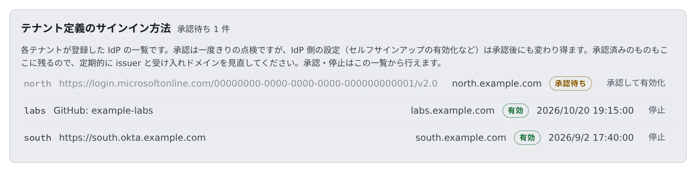

# テナント独自のサインインを承認する

[English](tenant-idp.md) | 日本語

テナントが自社の IdP や GitHub の組織を登録したら、中身を確かめて承認します。
承認すると、`.env` の編集や再起動なしに、そのテナント専用のサインイン画面にボタンが出ます。

## 全体像

| 誰が | やること |
|---|---|
| テナント管理者 | 自社の IdP にアプリを作り、**サインイン方式** に登録する（[サインインの方法を決める](../../admin/access/signin-methods.ja.md)） |
| Agent Fleet | 登録した行を「**承認待ち**」にする。承認されるまで、ボタンもセッションも出さない |
| あなた | issuer と受け入れるドメインを確かめて、承認する |
| Agent Fleet | 承認された方法のボタンを `/login/<slug>` に出す |

グループ会社、統合の途中の会社、業務委託先など、配備とは別のディレクトリを持つテナントのための機能です。
テナントを分けるかどうかの判断は [テナントとプロビジョニングの方式を決める](../install-decisions.ja.md#テナントを-1-つにするか分けるか) にあります。

## 承認が要る理由

IdP を登録することは、「この人が誰か」を宣言する権限を持つことを意味します。この配備では人をメールアドレスで見分けるので、その権限は配備全体に及び、
誰が配備管理者かにも及びます。自分の IdP を自分だけで有効にできる人は、**あなたのアドレスを名乗るトークン**を自分で発行できてしまいます。

そのため、登録した行も編集した行も、まず承認待ちになります。承認されるまでは、ボタンが出ないだけでなく、サインインの URL を手で組み立てた人にも
セッションは発行されません。

## 承認する

**管理 → サインイン方法の登録簿** を開きます。全テナントが登録した方法が並び、承認待ちの数が見出しに出ます。

1. 承認待ちの行の、発行元（issuer か GitHub の組織）と受け入れるドメインを確かめます（[承認の前に確かめること](#承認の前に確かめること)）
2. 「**承認して有効化**」を押します
3. 状態が「**有効**」になったら、テナント管理者に伝えます。テナント専用のサインイン URL は、テナント設定の **サインイン方式** に出ます

同じ行は、**管理 → テナント一覧 → そのテナント → サインイン方式** からも開けます。

## 承認の前に確かめること

| 確かめること | 理由 |
|---|---|
| issuer がその会社自身のディレクトリであること（`common`・`organizations` ではない） | 複数テナント向けの issuer では、Microsoft アカウントを持つ誰もがサインイン画面まで進めます |
| GitHub の行では、許可する組織がその会社のものであること | GitHub の issuer はどのテナントでも `github.com` なので、判断の材料になりません |
| 受け入れるメールドメインが、その会社のものであること | 承認はこのドメインの範囲に与えるものです。この配備でほかの人たちが使っているドメインを含む行は承認しません |

- 1 つのドメインを持てるのは 1 テナントだけです。ほかのテナントが持つドメインを含む行は、保存の時点で
  `domain … is already claimed by the sign-in method of tenant …` で拒否されます
- 受け入れるドメインが配備のログイン許可や配備管理者のドメインと重なっていると、行に「このサインイン方式が申告したドメインは、デプロイ自体のログインドメインと重なっています。承認前に確認してください:」と出ます
- 動く方法として組み立てられない行（issuer が不正、ドメインが空、client secret が復号できない）は、承認しようとすると理由つきで拒否されます。ボタンの出ない「承認済み」を作らないためです

## 承認待ちに戻る変更

承認は「この発行元・この組織を、この範囲で信じてよい」に与えたものです。次の変更をすると、行は承認待ちに戻ります。

- issuer・client_id・email の信頼方法・種類・同一アカウントの見分け方を変える
- 受け入れるドメイン・tenant id・GitHub の組織を足す

範囲を狭める変更と、client secret の入れ替えでは戻りません。定期的な鍵のローテーションのたびに承認を求めると、ローテーションしない運用を招くためです。

## 状態を読む

| 状態 | 意味 |
|---|---|
| 承認待ち | あなたの承認を待っています。まだサインインできません |
| 有効 | 承認済みで、サインインに使えます |
| 停止中 | 止めています。テナント管理者が「**承認を申請する**」で、もう一度承認を頼めます |
| 承認済みだが設定に不備あり | 承認はしたが、設定が足りず使えません。理由は Control Plane のログの `tenant login provider` の行に出ます |

承認済みの行も、承認した日時つきで一覧に残ります。IdP は相手の会社の管理下にあり、セルフサインアップのような設定は承認のあとでも変わります。
処理すれば空になるキューではなく、ときどき読み直す登録簿として扱ってください。

## 止める

「**停止**」は、あなたもテナント管理者もいつでも押せます。侵害されたおそれのある IdP は、すぐに止めてかまいません。

- その方法しか使ったことのないアクティブなメンバーがいると、人数が出て確認を求められます。止めると、その人たちは締め出されます
- 締め出したくないときは、止める前に、その人たちに別のサインインの方法を自分のアカウントに追加してもらいます（**設定 → 個人設定 → アカウント**）

## GitHub の組織を登録したテナント

種類が「**GitHub の組織**」の行は、issuer の代わりに **許可する GitHub 組織** を持ちます。その組織のアクティブなメンバーであることが、その会社の人である根拠になります。

- OAuth App はテナントが自分の組織に作ります。あなたのアプリを共有すると、テナントごとの組織のオーナーが「git の接続にも使っているアプリ」を承認することになるためです
- あなたの `.env` に GitHub の設定は要りません。配備共通の GitHub のサインインは無効のまま、テナントの分だけ動かせます
- 組織の承認が要る点は配備共通の GitHub と同じで、承認するのはそのテナントの組織のオーナーです（[GitHub でサインインする](github.ja.md#組織の承認が要る)）
- 受け入れるメールドメインは GitHub でも必須です
- 同じ組織を 2 つのテナントが登録してもかまいません。誰がどちらに入るかは、1 テナントに 1 つのメールドメインで決まります
- 同じ GitHub アカウントなら、配備共通の GitHub ボタンとテナントの GitHub ボタンのどちらから入っても同じ人として扱います

## 同じ IdP を配備でも使っているとき

配備共通の方法と同じ Entra のディレクトリを、テナントが別のアプリ登録で登録することがあります。Entra の `sub` はアプリ登録ごとに違うので、
テナントの行では **同一アカウントの見分け方** に `oid` を選ぶ必要があります。

- この状況で `oid` を選ばずに保存すると、保存が拒否されます。そのまま動かすと、すでにこの配備を使っている人が全員「メールアドレスが別のサインイン方法で使われている」として拒否されるためです
- テナントが選べるのは `oid` だけです。本人が名乗れる値を選べると、その値を名乗るだけで既存のアカウントに入れてしまうためです
- 配備共通の側で同じことをするには `AF_OIDC_<ID>_LINK_CLAIM` を使います（[Microsoft Entra ID でサインインする](entra.ja.md#同じディレクトリを-2-つのアプリ登録で使う)）

## 関連

- [サインインの方法を決める](../../admin/access/signin-methods.ja.md)（テナント管理者が埋める欄）
- [サインインの方法を設定する](overview.ja.md)
- [ログインできない](../diagnose/cannot-login.ja.md)
- [ロール — 誰が何をできるか](../../ref/roles.ja.md)
