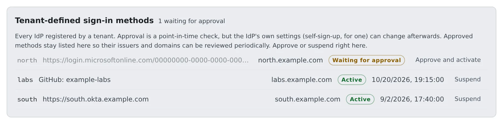

# Approve a tenant's own sign-in

English | [日本語](tenant-idp.ja.md)

When a tenant registers its own IdP or a GitHub organisation, check it and approve it.
Once approved, its button appears on that tenant's own sign-in page, with no `.env` edit and no restart.

## How it works

| Who | What they do |
|---|---|
| The tenant administrator | Creates an app at the company's IdP and registers it under **Sign-in methods** ([Choose how people sign in](../../admin/access/signin-methods.md)) |
| Agent Fleet | Marks the row "**Waiting for approval**". Until it is approved there is no button and no session |
| You | Check the issuer and the admitted domains, and approve |
| Agent Fleet | Shows the approved method's button on `/login/<slug>` |

It is for a tenant with a directory of its own: a group company, a company being integrated, a contractor.
Whether to split tenants at all is decided in [Choose the tenant and provisioning model](../install-decisions.md#one-tenant-or-several).

## Why it needs approval

Registering an IdP is the power to say who a person is. People are told apart by email address here, so that power reaches across the whole deployment,
including who the deployment administrators are. Somebody who could switch on their own IdP alone could mint **a token that claims your address**.

So every new or edited row starts out waiting for approval. Until then, not only is there no button: nobody who builds the sign-in URL by hand
gets a session either.

## Approve it

Open **Admin → Sign-in method register**. It lists the methods every tenant registered, with the number waiting in its heading.

1. On the waiting row, check the issuer (or the GitHub organisation) and the admitted domains ([What to check before you approve](#what-to-check-before-you-approve))
2. Press "**Approve and activate**"
3. When the state reads "**Active**", tell the tenant administrator. The tenant's own sign-in URL is shown in its tenant settings under **Sign-in methods**

The same rows also open from **Admin → Tenants → the tenant → Sign-in methods**.

## What to check before you approve

| What to check | Why |
|---|---|
| The issuer is the company's own directory (not `common` or `organizations`) | With a multi-tenant issuer, anybody with a Microsoft account reaches the sign-in page |
| On a GitHub row, the allowed organisations are the company's | GitHub's issuer is `github.com` for every tenant, so it tells you nothing |
| The admitted email domains are the company's | Approval is given for this range of domains. Do not approve a row that claims a domain other people here use |

- One domain can belong to one tenant only. A row that includes a domain another tenant holds is refused when it is saved, with
  `domain … is already claimed by the sign-in method of tenant …`
- When the admitted domains overlap the deployment's login allowlist or the deployment administrators' domain, the row says "Domains this sign-in method claims overlap the deployment's own login domains. Check before approving:"
- A row that cannot be built into a working method (a bad issuer, no domains, a client secret that can no longer be decrypted) is refused with a reason when you try to approve it, so there is never an "approved" row without a button

## Changes that send it back for approval

Approval is given to "this issuer or organisation, trusted for this range". These changes put the row back to waiting:

- Changing the issuer, client_id, how the email is trusted, the kind, or how the same account is recognised
- Adding a domain, a tenant id or a GitHub organisation

Narrowing changes and replacing the client secret do not. Asking for approval at every routine key rotation would teach people not to rotate.

## Read the state

| State | Meaning |
|---|---|
| Waiting for approval | Waiting for you. Nobody can sign in with it yet |
| Active | Approved, and usable for sign-in |
| Suspended | Stopped. The tenant administrator can ask again with "**Request approval**" |
| Approved, but the settings are incomplete | Approved, but unusable because a setting is missing. The reason is in the Control Plane's log, on a `tenant login provider` line |

Approved rows stay on the list with their approval time. The IdP stays under the other company's control, and settings such as self-sign-up can change after you approve.
Treat it as a register to reread now and then, not a queue that empties.

## Stop it

You or the tenant administrator can press "**Suspend**" at any time. Stop an IdP that may be compromised straight away.

- If some active members have only ever used that method, the count is shown and you are asked to confirm. Stopping it locks them out
- To avoid that, have them add another sign-in method to their account first (**Settings → Personal → Account**)

## A tenant that registered a GitHub organisation

A row of the kind "**A GitHub organization**" has **Allowed GitHub organizations** instead of an issuer. Active membership of that organisation is the evidence that a person belongs to the company.

- The tenant creates the OAuth App in its own organisation. Sharing yours would have each tenant's organisation owner approve "the app that is also used for git connections"
- Your `.env` needs no GitHub settings. Deployment-wide GitHub sign-in can stay off while the tenants' methods work
- The organisation has to approve the app, as for deployment-wide GitHub; here it is the tenant's organisation owner who does it ([Sign in with GitHub](github.md#the-organisation-has-to-approve-the-app))
- Email domains to admit are required for GitHub too
- Two tenants may register the same organisation. Which one a person enters is decided by the email domain, and a domain belongs to one tenant
- The same GitHub account is the same person whether it comes through the deployment-wide GitHub button or a tenant's

## When the deployment uses the same IdP

A tenant may register, through another app registration, the same Entra directory that a deployment-wide method uses. Entra's `sub` differs per app registration,
so the tenant's row needs `oid` under **How the same account is recognised**.

- Saving it without `oid` in that situation is refused. Running it as it is would turn away everybody who already uses this deployment, as "this email address is already used by another sign-in method"
- A tenant can choose only `oid`. If it could choose a value people can claim, claiming it would be enough to get into an existing account
- The deployment-wide side does the same with `AF_OIDC_<ID>_LINK_CLAIM` ([Sign in with Microsoft Entra ID](entra.md#one-directory-behind-two-app-registrations))

## Related

- [Choose how people sign in](../../admin/access/signin-methods.md) (the fields a tenant administrator fills in)
- [Set up how people sign in](overview.md)
- [Cannot log in](../diagnose/cannot-login.md)
- [Roles — who may do what](../../ref/roles.md)
