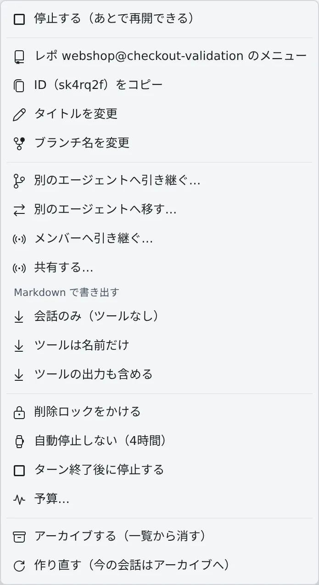

# アイコン・バッジ・メニュー

[English](console-ui.md) | 日本語

Console に出る状態の印、バッジ、右クリックメニューの項目を、意味から引けるようにまとめます。
使いかたは、各行からリンクしているページにあります。メニューの項目は、対象の種類、状態、権限、ワークスペースが動いているかで変わります。

## セッションの状態

左ペインのセッションの行の最後に出る印です。印にマウスを重ねると、状態の名前が出ます。
読みかたの基本は [セッションの状態を読む](../user/sessions/status.ja.md) にあります。

### 動いているとき

| 表示 | 意味 |
|---|---|
| 進行中… | エージェントが作業している |
| 圧縮中… | エージェントが会話を圧縮している |
| 入力待ち | ひと区切りついて、次の指示を待っている |
| 入力待ち · BG 実行中 | 入力は受けられるが、バックグラウンドの処理が続いている |
| 入力待ち · サブエージェント実行中 | 入力は受けられるが、サブエージェントが動いている |
| 入力待ち · BG コマンド実行中 | 入力は受けられるが、バックグラウンドのコマンドが動いている |
| 入力待ち・引継あり | セッションが最後に提案した引き継ぎを、まだ誰も起動していない。行には「引継あり」と短く出る |
| 質問あり | 質問への答えを待っている |
| プランあり | プランの承認か却下を待っている |
| 許可待ち | コマンドの実行や編集の許可を待っている |
| 制限解除待ち · 19:50 | 利用上限でターンが止まった。時刻は自動で再開する予定で、予定がなければ時刻は出ない |
| 上限で停止 — 操作が必要 | 利用上限のメニューで止まっていて、ターミナルで操作するまで進まない |
| 残高上限 — 増枠が必要 | 支出や残高の上限に達した。待っても解けないので、上限を上げるかクレジットを足す |
| 認証切れ — 再認証が必要 | エージェントのログインが切れた。送っても始まらない（[エージェントにログインできない・モデルが出ない](../user/troubleshooting/agents.ja.md#認証切れ-再認証が必要と出て送っても何も始まらない)） |
| 起動中 | 状態を報告しない shell や SSM のセッションが動いている |

- 「BG コマンド実行中」の claude のセッションでは、会話の入力欄の上にバックグラウンドのコマンドが 1 件ずつ並びます。
  30 分ほど CPU をほとんど使わずに待っているものには「**止まっているかもしれません**」と出ます
- 「**停止**」を押すと、そのコマンドと、そこから起動したものを終了します。エージェントには終了が知らされ、それを受けて新しいターンを始めることがあります
- 引き継ぎの提案は、会話の中の引き継ぎのカードから起動するか破棄します（[別のセッションやエージェントに引き継ぐ](../user/sessions/handoff.ja.md)）

### 止まっているとき

| 表示 | 意味 |
|---|---|
| 停止中 | プロセスが止まっている。あとで再開できる |
| 停止中・質問あり | 質問に答えないまま止まった（[止まったセッションに残ったカードに答える](../user/sessions/reply.ja.md#止まったセッションに残ったカードに答える)） |
| 停止中・承認待ち | プランを承認しないまま止まった |
| 停止中・許可待ち | 許可を出さないまま止まった |
| 停止中・自動再開 19:50 | 止まっているが、利用上限からの自動再開がその時刻に予約されている。行には時刻だけが出る |
| 停止中・引継あり | 止まっているが、最後に提案した引き継ぎがまだ起動されていない |
| フォルダ無し — 再開不可 | 作業フォルダがなく、同じ会話を再開できない（[セッションを止める・再開する](../user/sessions/stop-resume.ja.md#フォルダ無し-再開不可と出て行を開けない)） |
| メモリ不足で終了 | メモリ不足でプロセスが強制終了された |
| 強制終了 | プロセスが SIGKILL で終了した |
| 異常終了 | プロセスがシグナルか 0 以外の終了コードで終わった |

- 終了の理由の詳細は、行にマウスを重ねると出ます

## セッションの行の印

| 印 | 意味 |
|---|---|
| 行の先頭の色付きアイコン | エージェントの種類（`claude`、`codex`、`shell`、`ssm` など） |
| アイコンの角の赤いドットと太字の名前 | まだ読んでいない通知がある。どれかのペインにそのセッションを出すか、通知センターの「**すべて既読にする**」で消える（[セッションの状態を読む](../user/sessions/status.ja.md#赤いドット)） |
| 行を囲む枠 | あなたの返事を待っている。答えるまで消えない |
| 行の左端の色の線 | 親のセッションと、それが起動した子のセッションの組 |
| 警告とブランチ名 | 作業コピーが、起動したときとは別のブランチに切り替わった（[セッションを止める・再開する](../user/sessions/stop-resume.ja.md#行に警告アイコンとブランチ名が出る)） |
| スピーカー | このセッションの回答を読み上げている |
| 杖 | 画像スタジオに紐づいている。開くとスタジオに移る（[スタジオで画像を仕上げる](../user/images/studio.ja.md)） |
| 受信箱 | 受信箱の依頼から起動した。マウスを重ねると送った人が出る（[受信箱でチームメイトに頼む](../user/team/inbox.ja.md)） |
| ロック | 削除ロック中。削除や自動の整理の対象にならない（[終わったセッションを片付ける](../user/sessions/cleanup.ja.md#削除ロックをかける)） |
| 一時停止の印 | 「自動停止しない」の期限内。マウスを重ねると残りの時間が出る（[終わったら止める・動かしたままにする](../user/sessions/auto-stop.ja.md)） |
| 停止の印 | 今のターンが終わったら停止する予約がある（[終わったら止める・動かしたままにする](../user/sessions/auto-stop.ja.md)） |
| 脈拍 | 推定の費用が予算に達して止まった（[使いすぎたセッションを予算で止める](../user/sessions/budget.ja.md#止まったら)） |
| 電波 | 会話をほかのメンバーに共有している（[会話を共有する](../user/team/share.ja.md)） |
| 色付きの数字 | そのセッションを出しているペインの番号。押すとそのペインに移る |

### 2 行目のリンク

行の下に、もう 1 行が付くことがあります。

| 表示 | 意味 |
|---|---|
| プルリクエスト | セッションが作業しているブランチのプルリクエスト。アイコンがオープン・下書き・マージ済み・クローズを、オープン中なら CI の結果も表す。押すと GitHub か Bitbucket で開く |
| 紐づいた項目 | セッションに紐づいたチケット。押すと詳細が開く（[Issue やチケットから始める](../user/sessions/from-issues.ja.md#セッションとチケットの紐づき)） |
| マージ済み | セッションのプルリクエストがすべて終わり（1 件以上マージ済み）、作業もしていない。押すと確認のあとアーカイブする |
| `:5173` などのポート | セッションのプロセスが待ち受けているポート。押すとプレビューで開く（[起動した Web アプリを見る](../user/preview/browser-pane.ja.md)） |
| … へ移動済み・… への移動が未完了 | 別のエージェントへ移したセッション（[別のセッションやエージェントに引き継ぐ](../user/sessions/handoff.ja.md#別のエージェントへ移す)） |

- プルリクエストは、origin が github.com か bitbucket.org で、そのサービスを ⚙設定 →「接続」でつないでいるときだけ出ます。既定のブランチには出ません
- プルリクエストの後ろに、変更の依頼やコンフリクトの印が付くことがあります
- 状態は数分おきに読み直すため、マージが表示に反映されるまで少しかかります

## リポジトリの行のバッジ

意味と見かたは [リポジトリからセッションを起動する](../user/code/launch-from-repo.ja.md#行のバッジを読む) にあります。

| バッジ | 意味 |
|---|---|
| 未コミット | コミットしていない変更がある |
| 親= | worktree が親と同じコミット |
| 親+N・FF 可 | 親が N コミット進んでいて、fast-forward で取り込める |
| 未取込 N | 親に入っていない worktree だけのコミットが N 件ある |
| 分岐 N↕M・FF 不可 | worktree と親の両方に固有のコミットがある |
| 比較不可 | 親との関係を判定できない |
| ↑N | origin より N コミット進んでいる |
| ↓N FF可 | origin が N コミット進んでいて、fast-forward できる |
| ↑N ↓M 要マージ | origin と分かれている |
| `●N` | 稼働中のセッションの数 |
| 数字だけ | 停止中のセッションの数 |
| ロック・電波 | 削除ロック中・共有中 |

- 折りたたんだ行の数には、その下の worktree のセッションも入ります
- 折りたたんだ行には、その作業コピーでいちばん新しいセッションが 2 行目に出ます

## エンジンのピル

配備が推論エンジンを動かしているか借りているとき、画面上部のバーに役ごとのピル（「**チャット**」「**画像**」）が出ます。押すと詳しい行が開きます。

| 状態 | 意味 |
|---|---|
| 使用中 | 誰かのリクエストをいま処理している |
| 準備済み | モデルが読み込まれていて、すぐ答えられる |
| 稼働中 | インスタンスは起動しているが、モデルを読み込み中 |
| 起動中… | インスタンスを起動している |
| 停止処理中 | インスタンスを止めている |
| 停止中 | 止まっている。最初のリクエストで起動し、数分かかることがある |
| 利用可 | 外部で管理しているか借りているエンジンで、使える |

ピルとその詳しい行には、次のものも出ます。

| 表示 | 意味 |
|---|---|
| ×N | 同じ役を N 個のエンジンが受け持っている |
| あと 12 分 | 自動停止までの残り |
| 待ち N | 順番を待っているリクエストの数 |
| 外部管理・借用 | この配備からは起動も停止もできない |
| モデル: … | いま読み込まれているモデル。行がなければ何も読み込まれていない |
| 最後の利用 2 分前 | 誰も使っていないときの、最後に使われた時刻 |
| 自動停止 11-11 19:50 · あと 12 分 | 予約された自動停止。行がなければ予約はない |

- ⚙設定 →「エージェント」で自分の llama.cpp の接続先を設定していると、「チャット」のピルはその接続先の状態（「**接続中**」「**届いていません**」「**確認中**」）を出します（[lcpp を使う](../user/agents/lcpp.ja.md)）
- 画像生成のペインの見出しは、ピルとは別の言いかたでエンジンの状態を出します（[画像を生成する](../user/images/generate.ja.md)）

## そのほかのバッジ

| 表示 | 場所 | 意味 |
|---|---|---|
| AWS・Google Cloud のマーク | ワークスペース操作バー | プロファイルのログイン状態（[AWS プロファイルの仕様](aws-profiles.ja.md#aws-バッジ)、[Google Cloud を使う](../user/integrations/gcloud.ja.md#ワークスペース操作バーの-google-cloud-バッジ)） |
| 要再起動 | 電源ボタンの隣 | ワークスペースが更新前のまま動いている。押すと「**今すぐ再起動**」が出る（[一日の終わりにワークスペースを止める](../user/start/end-of-day.ja.md#新しいバージョンがありますと要再起動)） |
| 新しいスロットへ移動 | 電源ボタンの隣 | 管理者がこのワークスペースのマシンを入れ替える対象にした。次の起動が少し遅くなるが、ファイルやログインは引き継がれる |
| 応答なし | 電源ボタンの隣 | Agent が数分間応答していない（[ワークスペースが起動しない・止まった](../user/troubleshooting/workspace.ja.md#電源ボタンの横に応答なしと出る)） |
| 受信箱ボタンの数字 | 画面上部 | 受信箱の新着と、受け取りを待っている引き継ぎの合計（[受信箱でチームメイトに頼む](../user/team/inbox.ja.md)） |
| 14 日以上未完了 | 受信箱 | 誰も終えていない依頼 |
| 引き継ぎが届いています | 共有セッション | あなた宛ての引き継ぎがある |
| 承認待ち N 件 | 共有セッション | 共有先からの提案が承認を待っている（[会話を共有する](../user/team/share.ja.md)） |
| 未追跡・追加・変更・改名・削除 | ファイルの変更 | Git の変更の種類 |
| LFS ポインタ | ファイル | Git LFS の実体ではなく、ポインタだけがある |
| 承認待ち・承認済み・却下・決定済み | プランのカード | プランへの判断 |
| 停止時に未回答だった質問・停止時に承認待ちだった計画・停止時に許可を求めていた操作 | 会話のカード | セッションが止まったときに出ていたもの。答えると再開して届ける（[セッションに返事をする](../user/sessions/reply.ja.md#止まったセッションに残ったカードに答える)） |
| 停止中 | スケジュールの行 | 一時停止したスケジュール（[決まった時刻に実行する](../user/fleet/schedules.ja.md)） |
| 安全・要確認・保持 | 掃除の画面 | 片付けてよいかの判定（[終わったセッションを片付ける](../user/sessions/cleanup.ja.md#まとめて片付ける掃除)） |

### プロンプトの出所

チャット表示で、あなたが入力していないプロンプトに付く印です。

| 表示 | 出所 |
|---|---|
| オペレーターから | フリート・オペレーター（[フリート・オペレーターに任せる](../user/fleet/operator.ja.md)） |
| 定時実行・手動実行 | スケジュール（[決まった時刻に実行する](../user/fleet/schedules.ja.md)） |
| 自動再開 | 中断からの自動再開 |
| ◯◯ から・別のセッションから | ほかのセッションからのメッセージ（[セッション同士でやりとりさせる](../user/fleet/messages.ja.md)） |
| Slack から・Discord から | チャットの返信から届いた入力 |
| MCP 経由: ◯◯ | 外部のアシスタントやクライアントが MCP 接続から送った入力。あなたの承認の代わりにはならない |
| ◯◯ が起動・別のセッションが起動 | ほかのセッションが起動したセッションの最初のプロンプト（[セッションから子セッションを起動する](../user/fleet/child-sessions.ja.md)） |
| 停滞通知 | 子がすべて静かになった親に、Agent Fleet が送るプロンプト |

## 右クリックメニュー

右クリックのほか、項目にフォーカスがあるときのメニューキーや Shift+F10 でも開きます。メニューが出ないときは
[ターミナルやスマートフォンで操作できない](../user/troubleshooting/terminal-phone.ja.md#メニューが出ない) を見てください。

### セッション

行の `⋯`、右クリック、セッションのタブ、セッション一覧のカードで、同じメニューが出ます。項目は区切り線で 6 つに分かれています。

| まとまり | 項目 |
|---|---|
| 実行 | 再開・再ログインして再開（SSM）・停止する（あとで再開できる）・ターミナル（CLI）に切り替え／マネージドに切り替え・リモートセッションを開く |
| 表示と名前 | 生成した画像 (N)・レポ {name} のメニュー・ID（{name}）をコピー・タイトルを変更・ブランチ名を変更（worktree のセッション） |
| 引き継ぎ・保存 | 別のエージェントへ引き継ぐ…・別のエージェントへ移す…・メンバーへ引き継ぐ…・共有する…・Markdown で書き出す（3 通り） |
| 作業グループ | 作業グループへの割り当て（リポジトリに属さないセッション） |
| 動作 | 削除ロックをかける／削除ロックを解除する・自動停止しない（4時間）／自動停止しないを解除・ターン終了後に停止する／ターン終了後の停止をやめる・予算…（予算で止まったときは「予算を上げて再開…」） |
| 片付け | アーカイブする（一覧から消す）・削除（shell と SSM）・作業コピー（worktree）を作り直す…・作り直す（今の会話はアーカイブへ） |

| 項目 | 説明 |
|---|---|
| 生成した画像 (N) | そのセッションが作った画像（[画像ギャラリーを使う](../user/images/gallery.ja.md)） |
| レポ {name} のメニュー | 左ペインのそのリポジトリのメニューを開く。スマホとワークスペースの停止中には出ない |
| 別のエージェントへ移す… | 移したあとは「移動先のセッションを開く」「それでもここで再開する…」、未完了なら「移動をやり直す／取り消す…」になる（[別のセッションやエージェントに引き継ぐ](../user/sessions/handoff.ja.md#別のエージェントへ移す)） |
| Markdown で書き出す | 「会話のみ（ツールなし）」「ツールは名前だけ」「ツールの出力も含める」（[会話を Markdown で保存する](../user/sessions/export.ja.md)） |
| 自動停止しない・ターン終了後に停止する | [終わったら止める・動かしたままにする](../user/sessions/auto-stop.ja.md) |
| 予算… | [使いすぎたセッションを予算で止める](../user/sessions/budget.ja.md) |
| 作業コピー（worktree）を作り直す… | worktree を消した停止中のセッションに出る（[セッションを止める・再開する](../user/sessions/stop-resume.ja.md#フォルダ無し-再開不可と出て行を開けない)） |
| アーカイブ・作り直す | [終わったセッションを片付ける](../user/sessions/cleanup.ja.md) |

- 作業フォルダがないセッションには、再開、引き継ぎ、作り直しは出ません

### リポジトリと worktree

項目と使いかたは [リポジトリからセッションを起動する](../user/code/launch-from-repo.ja.md#右クリックでできること) にあります。

- Git の作業コピー：コミットグラフを開く・フォルダを開く・変更をコミット・ブランチ切替・ブランチ名をコピー・ディレクトリ名をコピー・Fast-Forward・Git Flow を初期化…・プロジェクト設定…・スキル…・共有する…・Shell を起動・画像スタジオを始める・作業グループ・配下のセッションを停止・停止中のセッションを全てアーカイブ・この作業コピーのアーカイブ済みセッション・削除ロックをかける・作業コピーを削除
- Subversion の作業コピー：Git の項目の代わりに「ログを表示」「ローカルの変更」「更新（svn）」「ロックを解除（svn）」「再認証（svn）」が出ます（[Subversion のリポジトリを使う](../user/code/svn.ja.md)）
- 行をクリックすると開閉し、Ctrl／⌘+クリックか中クリックでコミットグラフを新しいペインで開きます

### ファイルとフォルダ

使いかたは [ファイルを見る・ダウンロードする](../user/files/browse.ja.md#右クリックでできること) にあります。

| 項目 | 出る対象 |
|---|---|
| 新規ファイル・新規フォルダ・名前をコピー・相対パスをコピー・名前を変更・削除 | すべて |
| ログを表示 | Subversion の作業コピーの中 |
| フォルダを開く | ホームディレクトリ直下でないファイル |
| ここでシェルを開く | フォルダ |
| フォルダをギャラリーで開く | ホームディレクトリ直下でない、画像以外のファイル |
| ギャラリーで開く | フォルダと画像ファイル |
| 朗読で開く・ダウンロード・アシスタントで翻訳・アシスタントで要約 | ファイル |
| zip でダウンロード | フォルダ |

- フォルダの行は、タッチで長押ししても開きます

### 返信や文書の中のリンク

エージェントの返信、アシスタントのチャット、ドキュメントビューア、Markdown のプレビューにあるファイルやフォルダのリンクのメニューです（[ドキュメントや図を表示する](../user/files/view.ja.md#文書の中のリンク)）。右クリックか長押しでも開きます。

| 項目 | 出る対象 |
|---|---|
| ペインで開く・新しいペインで開く | ファイル |
| ファイル一覧で表示 | ホームディレクトリの中のパス |
| ファイルとフォルダのメニューのうち、何も変更しない項目 | ホームディレクトリの中のパス |
| パスをコピー・ダウンロード（ファイル）・ここでシェルを開く（フォルダ） | ホームディレクトリの外のパス（`/…`） |

- メニューを開いたときに対象を調べ直すので、消えたファイルにはメニューが出ず、消えていると表示されます

### 画像ギャラリーのカード

使いかたは [画像ギャラリーを使う](../user/images/gallery.ja.md#カードを操作する) にあります。

| カード | 項目 |
|---|---|
| 画像 | セッション/アシスタントに送る…・パスをコピー・ファイル名をコピー・生成したセッション「…」を開く・ファイル名を変更・ファイルを削除 |
| フォルダ | 別のペインで開く・フォルダを zip でダウンロード・パスをコピー・フォルダ名をコピー・生成したセッション「…」を開く・フォルダ名を変更・フォルダを削除 |

- 「生成したセッション『…』を開く」は、そのセッションがまだあるときだけ出ます

### アシスタント

| 対象 | 項目 |
|---|---|
| 「＋」の一覧のアシスタント | 新規チャット・新しいペインで開く・編集と削除（自分で作ったアシスタントだけ） |
| チャットの行 | ID（{id}）をコピー・表示名を変更・作業グループ・削除ロックをかける／削除ロックを解除する・このチャットを削除 |

- 常設のアシスタントは編集も削除もできません

### コミットグラフ

コミットを右クリックしたときの項目です（[コミットグラフでコミットする](../user/code/commit.ja.md)）。

| 項目 | 出るとき |
|---|---|
| 詳細を表示 | いつも |
| {name} で作業を始める… | ローカルのブランチが、ほかの作業コピーで使われていない |
| ブランチ切替: {name} | ローカルのブランチが、ほかの作業コピーで使われていない |
| {name} は {folder} で作業中 — 開く | ローカルのブランチを、ほかの作業コピーが使っている |
| チェックアウト（detached HEAD） | コミットにローカルのブランチがない |
| リモートブランチへ切替: {name} | コミットにリモートのブランチがある |
| このコミットから新規ブランチ… | いつも |

- submodule を表示しているあいだは「詳細を表示」だけになります

## ペインのボタン

ペインの見出しには、次のボタンが並びます（[画面を分けて並べる](../user/start/panes.ja.md)）。

| ボタン | すること |
|---|---|
| 左端のペイン番号 | ドラッグして、ほかのペインと入れ替える |
| 別タブで開く | ペインをブラウザの別のタブへ移す。移せない種類のペインには出ない |
| 行を折り返す・折り返しを解除 | ファイルと差分のペインだけ |
| 閉じる | ペインを閉じる。中クリックか Ctrl+クリックなら確認なしで閉じる |

- タブ付きの配置では、セッションのタブと、セッションに紐づいた画像スタジオのタブを右クリックすると、左ペインの行と同じメニューが出ます。それ以外のタブとワークスペースの停止中は、ブラウザのメニューが出ます
- セッション一覧のカードでも、右クリック、カードの `⋯`、メニューキーで同じメニューが出ます（[動いているセッションを一覧する](../user/fleet/overview.ja.md#カードから操作する)）

## 関連

- [画面の見かた](../user/start/console-tour.ja.md)
- [セッションの状態を読む](../user/sessions/status.ja.md)
- [リポジトリからセッションを起動する](../user/code/launch-from-repo.ja.md)
- [ターミナルやスマートフォンで操作できない](../user/troubleshooting/terminal-phone.ja.md)
