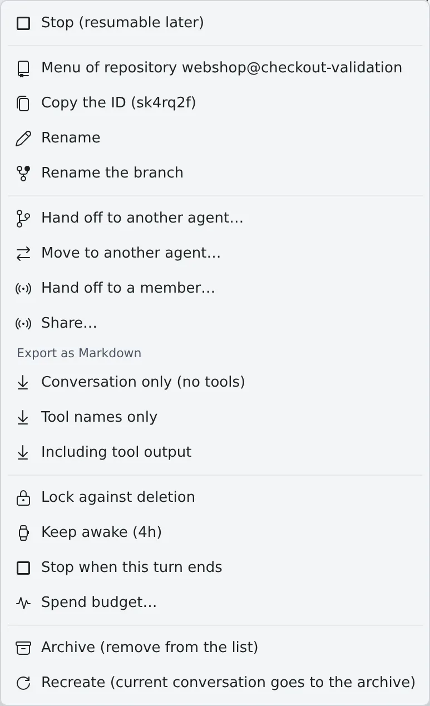

# Icons, badges and menus

English | [日本語](console-ui.ja.md)

Look up the state marks, badges and right-click menu items the Console shows, by what they mean.
How to use each one is on the page its row links to. Menu items vary with the target's type, its state, your permissions, and whether the workspace is running.

## Session states

The mark at the end of a session row in the left pane. Hover over it to see the state's name.
The basics of reading it are in [Read a session's state](../user/sessions/status.md).

### While it runs

| Shown | Meaning |
|---|---|
| Working… | The agent is working |
| Compacting… | The agent is compacting the conversation |
| Ready | It has reached a stopping point and waits for the next instruction |
| Ready · running in background | It accepts input, but background work is still running |
| Ready · subagent running | It accepts input, but a subagent is running |
| Ready · background command running | It accepts input, but a background command is running |
| Ready · handoff to launch | Nobody has launched the last handoff the session proposed. The row shows the short "Handoff" |
| Question | It waits for an answer to a question |
| Plan ready | It waits for you to approve or reject a plan |
| Awaiting permission | It waits for permission to run a command or make an edit |
| Waiting for limit reset · 19:50 | A usage limit stopped the turn. The time is the scheduled auto-resume; with none scheduled, no time is shown |
| Limit reached — action needed | It is stopped on the usage-limit menu and goes nowhere until someone acts in the terminal |
| Spend limit — needs a raise | A spend or balance limit was reached. Waiting does not clear it: raise the limit or add credits |
| Login expired — sign in again | The agent's login expired, and sending starts nothing ([Fix an agent's login or a missing model](../user/troubleshooting/agents.md#login-expired-sign-in-again-and-sending-starts-nothing)) |
| Running | A shell or SSM session, which reports no state, is running |

- On a claude session with a background command running, the background commands are listed one per line above the conversation's input box.
  One that has waited about 30 minutes with almost no CPU shows "**may be stuck**"
- "**Stop**" ends that command and everything it started. The agent is told it ended and may start a new turn to react to it
- A handoff proposal is launched or discarded from the handoff card in the conversation ([Hand off to another session or agent](../user/sessions/handoff.md))

### While it is stopped

| Shown | Meaning |
|---|---|
| Stopped | The process is stopped. It can be resumed later |
| Stopped · question | It stopped with a question unanswered ([Answer the cards a stopped session left](../user/sessions/reply.md#answer-the-cards-a-stopped-session-left)) |
| Stopped · approval | It stopped with a plan not yet approved |
| Stopped · permission | It stopped with permission not yet given |
| Stopped · auto-resume 19:50 | It is stopped, but an auto-resume from a usage limit is booked for that time. The row shows only the time |
| Stopped · handoff to launch | It is stopped, and the last handoff it proposed has not been launched |
| Folder missing — can't resume | The working folder is gone, so the same conversation cannot be resumed ([Stop and resume a session](../user/sessions/stop-resume.md#folder-missing-cant-resume-and-the-row-will-not-open)) |
| Ended (out of memory) | The process was killed for lack of memory |
| Force-killed | The process ended on SIGKILL |
| Crashed | The process ended on a signal or a non-zero exit status |

- Hover over the row to see the details of why it ended

## Marks on a session row

| Mark | Meaning |
|---|---|
| Coloured icon at the start of the row | The agent's kind (`claude`, `codex`, `shell`, `ssm` and so on) |
| Red dot on the icon's corner, and a bold name | A notification you have not read. Showing the session in any pane, or "**Mark all as read**" in the notification center, clears it ([Read a session's state](../user/sessions/status.md#the-red-dot)) |
| Outline around the row | It waits for your answer. It does not clear until you answer |
| Coloured line on the row's left edge | A parent session and the child sessions it started |
| Warning and a branch name | The working copy switched to a branch other than the one it started on ([Stop and resume a session](../user/sessions/stop-resume.md#the-row-shows-a-warning-icon-and-a-branch-name)) |
| Speaker | This session's reply is being read aloud |
| Wand | Bound to an image studio. Opening it goes to the studio ([Finish an image in the studio](../user/images/studio.md)) |
| Inbox | Started from an inbox request. Hover to see who sent it ([Ask a teammate through the inbox](../user/team/inbox.md)) |
| Lock | Locked against deletion. Delete and automatic cleanup skip it ([Clear away finished sessions](../user/sessions/cleanup.md#lock-something-against-deletion)) |
| Pause mark | Within a "Keep awake" window. Hover to see the time left ([Stop when done, or keep a session awake](../user/sessions/auto-stop.md)) |
| Stop mark | Booked to stop when the running turn ends ([Stop when done, or keep a session awake](../user/sessions/auto-stop.md)) |
| Pulse | Stopped because its estimated spend reached its budget ([Stop a session that spends too much with a budget](../user/sessions/budget.md#when-it-stops)) |
| Broadcast | The conversation is shared with other members ([Share a conversation](../user/team/share.md)) |
| Coloured number | The number of a pane showing the session. Press it to go to that pane |

### The links line

A second line can appear under the row.

| Shown | Meaning |
|---|---|
| Pull request | The pull request of the branch the session works on. The icon shows open, draft, merged or closed, and an open one also shows its CI result. Press it to open it on GitHub or Bitbucket |
| Linked items | Tickets linked to the session. Press one to open its details ([Start from an issue or a ticket](../user/sessions/from-issues.md#how-sessions-and-tickets-are-linked)) |
| Merged | Every pull request of the session is finished (at least one merged) and the session is not working. Press it to archive the session after a confirmation |
| A port such as `:5173` | A port the session's processes listen on. Press it to open it in a preview ([See a web app you started](../user/preview/browser-pane.md)) |
| Moved to … · Move to … unfinished | A session moved to another agent ([Hand off to another session or agent](../user/sessions/handoff.md#move-to-another-agent)) |

- The pull request appears only when origin is github.com or bitbucket.org and that service is connected under ⚙Settings → "Connections". It does not appear on the default branch
- Marks for requested changes or a conflict can follow the pull request
- It is re-read every few minutes, so a merge takes a moment to show

## Badges on a repository row

What they mean and how to read them is in [Launch a session from a repository](../user/code/launch-from-repo.md#read-the-rows-badges).

| Badge | Meaning |
|---|---|
| Uncommitted | There are uncommitted changes |
| ↑N | N commits ahead of origin |
| ↓N FF ok | origin is N commits ahead, and a fast-forward is possible |
| ↑N ↓M needs merge | It has diverged from origin |
| = parent | The worktree is on the same commit as its parent |
| unmerged N | N commits only the worktree has are not in the parent |
| parent +N · FF ok | The parent is N commits ahead and can be fast-forwarded in |
| diverged N↕M · no FF | Both the worktree and the parent have commits of their own |
| n/a | The relation to the parent cannot be worked out |
| `●N` | The number of running sessions |
| A bare number | The number of stopped sessions |
| Lock · broadcast | Locked against deletion · shared |

- On a folded row the counts include the sessions of the worktrees under it
- A folded row shows the working copy's newest session on a second line

## Engine pills

When the deployment runs or borrows an inference engine, the bar at the top of the screen shows one pill per role ("**Chat**", "**Images**"). Press it to open the detail lines.

| State | Meaning |
|---|---|
| In use | It is serving someone's request right now |
| Ready | The model is loaded and answers at once |
| Running | The instance is up, but the model is still loading |
| Starting | The instance is starting |
| Stopping | The instance is being stopped |
| Stopped | It is stopped. The first request starts it, which can take a few minutes |
| Available | An engine managed outside or borrowed, ready to use |

The pill and its detail lines can also show:

| Shown | Meaning |
|---|---|
| ×N | N engines serve the same role |
| in 12 min | Time left until the automatic stop |
| N queued | The number of requests waiting their turn |
| External · Borrowed | This deployment can neither start nor stop it |
| Model: … | The model loaded now. No line means nothing is loaded |
| Last used 2 min ago | When it was last used, while nobody is using it |
| Stops at 11-11 19:50 · in 12 min | A booked automatic stop. No line means none is booked |

- When you set your own llama.cpp endpoint under ⚙Settings → "Agents", the "Chat" pill shows that endpoint's state ("**Connected**", "**Not reachable**", "**Checking**") instead ([Use lcpp](../user/agents/lcpp.md))
- The image generation pane's header words the engine's state differently from the pill ([Generate images](../user/images/generate.md))

## Other badges

| Shown | Where | Meaning |
|---|---|---|
| AWS and Google Cloud marks | Workspace bar | The login state of your profiles ([AWS profiles reference](aws-profiles.md#aws-badge), [Use Google Cloud](../user/integrations/gcloud.md#the-google-cloud-badge-in-the-ws-bar)) |
| Restart needed | Beside the power button | The workspace still runs the version from before an update. Press it for "**Restart now**" ([Stop the workspace at the end of the day](../user/start/end-of-day.md#a-new-version-is-available-and-restart-needed)) |
| Moves to a new slot | Beside the power button | An administrator marked this workspace's machine for replacement. The next start is a little slower; files and logins carry over |
| Not responding | Beside the power button | The Agent has not answered for several minutes ([Fix a workspace that will not start or has stopped](../user/troubleshooting/workspace.md#not-responding-appears-beside-the-power-button)) |
| Number on the inbox button | Top of the screen | New inbox items plus handoffs waiting for you to accept them ([Ask a teammate through the inbox](../user/team/inbox.md)) |
| Open for 14+ days | Inbox | A request nobody has finished |
| A handoff is waiting | Shared session | A handoff addressed to you is waiting |
| N pending approval(s) | Shared session | Suggestions from the people you shared with wait for approval ([Share a conversation](../user/team/share.md)) |
| Untracked · Added · Modified · Renamed · Deleted | File changes | The kind of Git change |
| LFS pointer | File | Only the Git LFS pointer is there, not the content |
| Awaiting approval · Approved · Rejected · Decided | Plan card | The decision on a plan |
| Question left unanswered at stop · Plan awaiting approval at stop · Permission requested at stop | Card in the conversation | What was on screen when the session stopped. Answering resumes the session and delivers it ([Reply to a session](../user/sessions/reply.md#answer-the-cards-a-stopped-session-left)) |
| Paused | Schedule row | A paused schedule ([Run at a set time](../user/fleet/schedules.md)) |
| Safe · Review · Keep | Cleanup screen | Whether it is safe to clear away ([Clear away finished sessions](../user/sessions/cleanup.md#tidy-up-in-bulk-cleanup)) |

### Where a prompt came from

The marks the chat view puts on a prompt you did not type.

| Shown | Source |
|---|---|
| From operator | The Fleet Operator ([Hand work to the Fleet Operator](../user/fleet/operator.md)) |
| Scheduled · Manual fire | A schedule ([Run at a set time](../user/fleet/schedules.md)) |
| Auto-resume | An automatic resume after an interruption |
| From … · From another session | A message from another session ([Let sessions message each other](../user/fleet/messages.md)) |
| From Slack · From Discord | Input that arrived as a chat reply |
| Via MCP: … | Input an outside assistant or client sent over an MCP connection. It never stands in for your approval |
| Started by … · Started by another session | The first prompt of a session another session started ([Start child sessions from a session](../user/fleet/child-sessions.md)) |
| Stalled-tree notice | A prompt Agent Fleet sends a parent once all its children have gone quiet |

## Right-click menus

Besides right-click, the menu key or Shift+F10 opens them while the item has focus. When a menu does not appear, see
[Fix the terminal, keys and phone layout](../user/troubleshooting/terminal-phone.md#a-menu-does-not-appear).

### Sessions

The row's `⋯`, right-click, the session's tab and a card in the sessions overview all open the same menu. Its items are split by rules into six groups.

| Group | Items |
|---|---|
| Run | Resume · Re-login and resume (SSM) · Stop (resumable later) · Switch to terminal execution / Switch to managed execution · Open the remote session |
| View & names | Generated images (N) · Menu of repository {name} · Copy the ID · Rename · Rename the branch (worktree sessions) |
| Hand over & keep | Hand off to another agent… · Move to another agent… · Hand off to a member… · Share… · Export as Markdown (three ways) |
| Working sets | Assign to working sets (sessions that belong to no repository) |
| Behaviour | Lock against deletion / Unlock · Keep awake (4h) / Stop keeping awake · Stop when this turn ends / Don't stop after this turn · Spend budget… ("Raise budget & resume…" once the budget stopped it) |
| Clean up | Archive (remove from the list) · Delete (shell and SSM) · Recreate working copy (worktree)… · Recreate (current conversation goes to the archive) |

| Item | Notes |
|---|---|
| Generated images (N) | The images the session made ([Use the image gallery](../user/images/gallery.md)) |
| Menu of repository {name} | Opens the menu of that repository in the left pane. Not on a phone, nor while the workspace is stopped |
| Move to another agent… | Once moved it becomes "Open the session it moved to" and "Resume here anyway…"; while unfinished, "Retry or cancel the move…" ([Hand off to another session or agent](../user/sessions/handoff.md#move-to-another-agent)) |
| Export as Markdown | "Conversation only (no tools)", "Tool names only", "Including tool output" ([Save a conversation as Markdown](../user/sessions/export.md)) |
| Keep awake · Stop when this turn ends | [Stop when done, or keep a session awake](../user/sessions/auto-stop.md) |
| Spend budget… | [Stop a session that spends too much with a budget](../user/sessions/budget.md) |
| Recreate working copy (worktree)… | On a stopped session whose worktree was deleted ([Stop and resume a session](../user/sessions/stop-resume.md#folder-missing-cant-resume-and-the-row-will-not-open)) |
| Archive · Recreate | [Clear away finished sessions](../user/sessions/cleanup.md) |

- A session whose working folder is gone offers no resume, handoff or recreate

### Repositories and worktrees

The items and how to use them are in [Launch a session from a repository](../user/code/launch-from-repo.md#what-you-can-do-with-right-click).

- A Git working copy: Open commit graph · Open the folder · Commit changes · Switch branch · Copy the branch name · Copy the directory name · Fast-Forward · Initialize Git Flow · Project settings… · Skills… · Share… · Launch Shell · Start an image studio · Working sets · Stop the sessions below · Archive all stopped sessions · Archived sessions of this working copy · Lock against deletion · Delete the working copy
- A Subversion working copy: instead of the Git items, "Show log", "Local changes", "Update (svn)", "Clean up lock (svn)" and "Re-authenticate (svn)" ([Use a Subversion repository](../user/code/svn.md))
- Clicking the row folds and unfolds it; Ctrl/⌘+click or a middle click opens the commit graph in a new pane

### Files and folders

How to use them is in [See and download files](../user/files/browse.md#what-the-right-click-menu-does).

| Item | Shown for |
|---|---|
| New file · New folder · Copy the name · Copy the relative path · Rename · Delete | Everything |
| Show log | Inside a Subversion working copy |
| Open the folder | A file not directly in home |
| Open shell here | A folder |
| Open folder in gallery | A non-image file not directly in home |
| Open in gallery | A folder or an image file |
| Open in reader · Download · Translate with assistant · Summarize with assistant | A file |
| Download as zip | A folder |

- A folder row also opens the menu on a long press on a touch screen

### Links in replies and documents

The menu of a file or folder link in an agent's reply, the assistant's chat, the document viewer or a Markdown preview ([View documents and diagrams](../user/files/view.md#links-in-documents)). A long press opens it too.

| Item | Shown for |
|---|---|
| Open in pane · Open in new pane | A file |
| Show in Files | A path inside home |
| The items of the files and folders menu that change nothing | A path inside home |
| Copy the path · Download (file) · Open shell here (folder) | A path outside home (`/…`) |

- The target is checked again when the menu opens, so a file that is gone gets no menu and is reported as gone

### Image gallery cards

How to use them is in [Use the image gallery](../user/images/gallery.md#act-on-a-card).

| Card | Items |
|---|---|
| Image | Send to a session / assistant… · Copy the path · Copy the file name · Open {name}, the session that generated this · Rename the file · Delete the file |
| Folder | Open in another pane · Download the folder as zip · Copy the path · Copy the folder name · Open {name}, the session that generated this · Rename the folder · Delete the folder |

- "Open {name}, the session that generated this" appears only while that session still exists

### Assistants

| Target | Items |
|---|---|
| An assistant in the "+" list | New chat · Open in a new pane · Edit and Delete (assistants you made only) |
| A chat row | Copy ID · Rename · Working sets · Lock against deletion / Unlock · Delete this chat |

- A built-in assistant can be neither edited nor deleted

### Commit graph

The items when you right-click a commit ([Commit in the commit graph](../user/code/commit.md)).

| Item | Shown when |
|---|---|
| Show details | Always |
| Start work on {name}… | No other working copy has the local branch checked out |
| Switch branch: {name} | No other working copy has the local branch checked out |
| {name} is in use by {folder}; open it | Another working copy has the local branch checked out |
| Check out (detached HEAD) | No local branch points at the commit |
| Switch to remote branch: {name} | A remote branch points at the commit |
| New branch from this commit… | Always |

- While a submodule is shown, only "Show details" remains

## Pane buttons

A pane's header carries these buttons ([Split the screen into panes](../user/start/panes.md)).

| Button | What it does |
|---|---|
| Pane number at the left end | Drag it to swap with another pane |
| Open in a new tab | Moves the pane to another browser tab. Not shown on a pane that cannot move |
| Wrap lines · Disable line wrap | File and diff panes only |
| Close | Closes the pane. A middle click or Ctrl+click closes it without asking |

- In the tabbed layout, right-clicking a session's tab, or the tab of an image studio bound to a session, opens the same menu as the left-pane row. Other tabs, and any tab while the workspace is stopped, get the browser's own menu
- A card in the sessions overview opens the same menu from right-click, the card's `⋯` or the menu key ([See every running session](../user/fleet/overview.md#act-from-a-card))

## Related

- [Find your way around the screen](../user/start/console-tour.md)
- [Read a session's state](../user/sessions/status.md)
- [Launch a session from a repository](../user/code/launch-from-repo.md)
- [Fix the terminal, keys and phone layout](../user/troubleshooting/terminal-phone.md)
