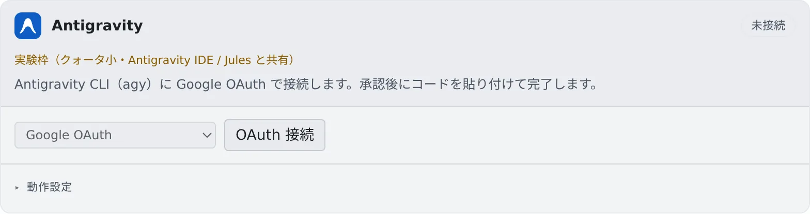

# Antigravity を接続する

[English](agy.md) | 日本語

Google アカウントでログインすると、Antigravity CLI（agy）をセッションで動かせます。
agy は実験枠です。利用枠は小さく、Antigravity IDE や Jules と共有です。

## 全体像

| あなたがやること | 起きること |
|---|---|
| Antigravity のカードで Google のログインをする | 起動メニューに「Antigravity を起動（実験枠）」が並ぶ |
| 動作設定を選ぶ | 次に起動する agy のセッションから使われる |
| ログインが切れたら再認証する | もう一度ログインの手順を踏む |

## 接続する

**⚙設定 →「エージェント」** の **Antigravity** カードで操作します。カードには「**実験枠（クォータ小・Antigravity IDE / Jules と共有）**」と出ています。

1. 「**OAuth 接続**」を押すと、Google のログインが新しいタブで開きます。開かないときは「**ログインリンク ↗**」から開きます
2. 自分のブラウザで承認します
3. 表示されたコードを「**コードを貼付**」の欄に貼り付けて、「**完了**」を押します

カードにアカウントのメールとプランが出ます。認証方式の「**GCP プロジェクト（準備中）**」は、まだ選べません。

## 動作設定

カードの「**動作設定**」の項目は、[ほかのエージェントと共通](choose.ja.md#動作設定を選ぶ)です。

- **RTK** は、`AGENTS.md` で rtk を使うよう促すだけのベストエフォートです（[料金と使用量を確かめる](usage.ja.md#rtk-でトークンを節約する)）

## 知っておくこと

- **ターミナル（CLI）だけで動きます。** マネージドでは起動できません
- **選べるモデルは、そのアカウントからその場で取得します。** reasoning effort はモデル名に含まれるので、別の欄はありません
- WS バーの使用量チップに、5 時間と週の使用量が出ます（[料金と使用量を確かめる](usage.ja.md)）
- **バックグラウンドのコマンドを動かしたまま、ターンを終えることがあります。** その間、セッションは「**入力待ち · BG 実行中**」と出て、アイドルとは扱われません
- ただし、バックグラウンドの作業でワークスペースを起こしておけるのは、既定では最長 2 時間です。もっと長いビルドには「**自動停止しない**」を使います（[終わったら止める・起こしたままにする](../sessions/auto-stop.ja.md#起こしたままにする)）
- agy が閉じないままのターンは、変化のないまま 1 時間たつと進行中の表示が外れます。そのターンのコマンドが動いている間は外れません
- **セッションに画像を作らせる経路の 1 つになります。** 1 回に 1 枚を作り、編集に渡せる参照画像は 3 枚までです（[セッションに画像を作らせる](../images/from-session.ja.md)）

### Agent Fleet が agy の設定に足すもの

- `~/.gemini/config/hooks.json` に `agent-fleet` という名前のエントリを足し、起動のたびに書き直します。セッションの会話と、作業中かどうかを知るためです。ほかの名前のエントリはそのまま残ります
- 起動のたびに作業フォルダを信頼済みにして、agy が信頼の確認で止まらないようにします
- agy のテレメトリの設定はオフに保ちます

## 困ったとき

### カードに「このホストでは利用できません」と出て、起動の選択肢にもない

agy はこのホストでは動きません。括弧の中に理由が出ています。ほかのエージェントを使ってください。

### 画像の生成が「is not offered image generation」というエラーで失敗する

ログインしている Antigravity のアカウントでは、画像の生成が提供されていません。ほかの画像の経路を使ってください。

## 関連

- [エージェントを選ぶ](choose.ja.md)
- [エージェントのリファレンス](../../ref/agents.ja.md)
