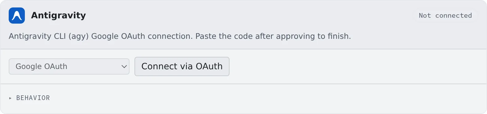

# Connect Antigravity

English | [日本語](agy.ja.md)

Sign in with a Google account and sessions can run the Antigravity CLI (agy).
Its quota is shared with the Antigravity IDE and Jules on the same Google account.

## How it works

| What you do | What happens |
|---|---|
| Sign in with Google on the Antigravity card | "Launch Antigravity" appears in the launch menu |
| Choose the behavior | agy sessions started afterwards use it |
| Re-authenticate when the sign-in expires | You go through the sign-in steps again |

## Connect

Work on the **Antigravity** card in **⚙Settings → Model credentials**.

1. Press "**Connect via OAuth**". The Google sign-in opens in a new tab; if it does not, open it from "**the sign-in link ↗**"
2. Approve in your own browser
3. Paste the code you are shown into "**Paste the code**" and press "**Done**"

The card shows the account's email and plan. The "**GCP project (coming soon)**" authentication method cannot be chosen yet.

## Behavior

The items under "**Behavior**" on the **Antigravity** card in **⚙Settings → Agents** are [the ones every agent shares](choose.md#choose-the-behavior).

- **RTK** only asks for rtk through `AGENTS.md`, best effort ([Check prices and usage](usage.md#save-tokens-with-rtk))

## Good to know

- **It runs in Terminal (CLI) only.** It cannot start as Managed
- **The models on offer are fetched from the account when you start.** The reasoning effort is part of the model name, so there is no separate picker
- The usage chip on the WS bar shows the 5-hour and weekly usage ([Check prices and usage](usage.md))
- **It may end a turn while a background command keeps running.** Meanwhile the session reads "**Ready · running in background**" and is not treated as idle
- When that background work finishes, agy normally starts the next turn by itself. If it has not done so a minute later, Agent Fleet sends it one prompt to read the output and continue. The turn carries the **Notice** badge. A session waiting on your answer, or with a message already on its way, does not get one, and a session gets at most 3 an hour
- Such a turn is not reported as finished until agy has taken up the result: a parent, a `fleet.session.idle` watch or a queue run sees the end of the follow-up turn, not the moment the command was backgrounded. A command that keeps running (a dev server) holds the report back for at most 2 hours
- Background work keeps the workspace awake for at most 2 hours by default, though. For a longer build, use "**Keep awake**" ([Stop when done, or keep a session awake](../sessions/auto-stop.md#keep-a-session-awake))
- A turn agy never closes loses its in-progress mark after an hour without change. It keeps the mark while that turn's command is still running
- **It is one of the routes a session can make images with.** It makes one image per call and takes up to 3 reference images for an edit ([Have a session make images](../images/from-session.md))

### What Agent Fleet adds to agy's configuration

- It adds an entry named `agent-fleet` to `~/.gemini/config/hooks.json` and rewrites it at every start, to know the session's conversation and whether it is working. Entries under other names are left as they are
- At every start it marks the working folder as trusted, so agy does not stop at its trust prompt
- It keeps agy's telemetry setting off

## When it goes wrong

### The card says "Not available on this host", and agy is not among the launch choices

agy does not run on this host. The reason is in the parentheses. Use another agent.

### Image generation fails with "is not offered image generation"

The Antigravity account you signed in with is not offered image generation. Use another image route.

## Related

- [Choose an agent](choose.md)
- [Agents reference](../../ref/agents.md)
