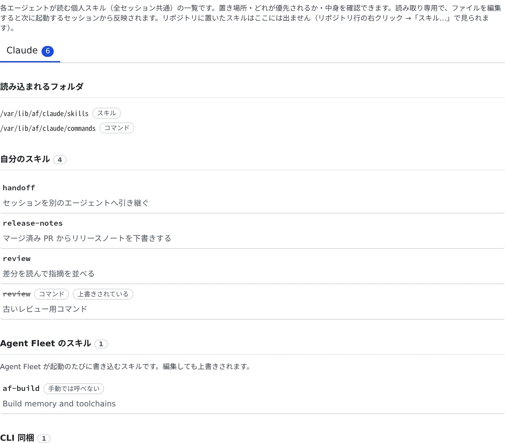

# 手元の Claude Code の設定を持ち込む

[English](bring-claude-setup.md) | 日本語

手元の `~/.claude` に置いているスキル・サブエージェント・フックは、ワークスペースの Claude Code の設定フォルダに置けば、
セッションでもそのまま使えます。置いたスキルは、Console の設定画面で確かめられます。

## 全体像

| あなたがやること | エージェントがやること |
|---|---|
| 設定フォルダにスキル・サブエージェント・フックのファイルを置く | 次に起動したセッションから読み込んで使う |
| ⚙設定 →「スキル」で、置いたスキルを確かめる | — |
| エージェントに、自分のスキルなどの編集を頼む | 頼まれたときだけ、個人のスキル・サブエージェント・フックを編集する |

## 何をどこに置くか

一部は設定画面で足ります。

| 手元の Claude Code での置き場所 | ワークスペースでは |
|---|---|
| グローバルな `CLAUDE.md` | ⚙設定 →「エージェントへの指示」（[作業のしかたを一度だけ書いておく](instructions.ja.md)） |
| MCP サーバーの設定 | ⚙設定 →「MCP サーバー（セッションで使う）」（[セッションに MCP サーバーを追加する](../integrations/mcp-servers.ja.md)） |
| スキル・サブエージェント・フック | 設定フォルダのファイル（下の表） |

設定フォルダは `/var/lib/af/claude` です。配備によって違うことがあるので、シェルで `echo $CLAUDE_CONFIG_DIR` を実行して確かめてください。
手元のマシンの `~/.claude` に当たる場所です。

| 置くもの | 置き場所 | チームと共有されるか |
|---|---|---|
| チームで使うフック・スキル・サブエージェント | リポジトリの `.claude/`（コミットする） | 共有される |
| 自分のスキル | `<設定フォルダ>/skills/<名前>/SKILL.md` | 共有されない |
| 自分のサブエージェント | `<設定フォルダ>/agents/<名前>.md` | 共有されない |
| 自分のフック | `<設定フォルダ>/settings.json` の `hooks` キー | 共有されない |

- Claude はこれらを**セッションの起動時**に読みます。変更は、それ以降に起動するセッションから効きます
- Agent Fleet はこれらのファイルを検査しません。頼りにする前に、自分で置いたものを実際のセッションで試してください
- `skills/` のスキルは、セッション画面のスキルの選択にも出ます
- このフォルダは専用のストレージにあります。停止・起動、[ワークスペースの作り直し](../workspace/recreate.ja.md)、ホームの掃除でも消えません

## 編集する

シェルかターミナル（CLI）のセッションから編集します。Console のファイルブラウザには、このフォルダは出ません（ログインの情報も入っているためです）。

> [!WARNING]
> - `.credentials.json` と `.claude.json` は、どこにもコピーしないでください
> - `settings.json`・自分のフックのコマンド・コミットする `.claude/` に、API キーやトークンを書かないでください。`env` やコマンドラインも同じです
> - ログイン情報や認証情報は、**⚙設定 → 接続** に置きます

エージェントに頼んで編集してもらうこともできます。エージェントがこれらのファイルを扱うのは頼まれたときだけで、扱えるのは個人のスキル・サブエージェント・フックだけです。
認証情報と、Agent Fleet 自身のフックのエントリには、エージェントも触れません。

## スキルを確かめる

**⚙設定 →「スキル」** で、各エージェントの個人スキルを読み取り専用で一覧できます。Claude のほかに、Codex・OpenCode・Muse のぶんもエージェントごとのタブで見られます。

| 出るもの | 内容 |
|---|---|
| 読み込まれるフォルダ | そのエージェントがスキルを読むフォルダ。まだないフォルダは「**未作成**」と出るので、作る場所がわかります |
| 自分のスキル | あなたが置いたスキル |
| Agent Fleet のスキル | Agent Fleet が起動のたびに書き込むスキル（`af-*`）。編集しても上書きされます |
| CLI 同梱 | CLI に組み込まれたスキル。ファイルはありません |

- 同じ名前のほかのスキルが優先されているものは、取り消し線付きで「**上書きされている**」と出て、どれが優先されるかがわかります
- スキルを開くと、パス・`SKILL.md`・同じフォルダのほかのファイルが見られます
- Cursor・Antigravity・Kiro・Copilot には、個人スキルのフォルダがありません

リポジトリに置いたスキルは、ここには出ません。プロジェクトツリーのリポジトリの行を右クリックして「**スキル…**」を開くと、
エージェントごとに読むフォルダ・優先されるコピー・ファイルの中身が見られます。サブディレクトリで起動したときに一覧がどう変わるかも確かめられます。

## フックを書くときの注意

- **Agent Fleet のフックは編集しないでください。** `settings.json` には、Console にセッションの状態を伝えるためのエントリが入っています。
  コマンドが `session-status` か `session-push-notification` を実行するエントリです。なくなると、そのセッションの状態が Console に出なくなります（Agent が起動時に足し直します）
- `/model` の切り替えで claude が「Switch model?」と止まらないようにする `PreModelSwitch` のエントリも Agent Fleet のものです。切り替えたあとの次のメッセージでは、履歴全体がキャッシュの効かない料金で読み直されます
- RTK のエントリ（`rtk hook claude`）は、編集ではなく Claude Code のカードの RTK で切り替えます（[料金と使用量を確かめる](usage.ja.md#rtk-でトークンを節約する)）
- **自分のフックとほかのキーは残ります。** 同じマッチャー（`Bash` など）に置いた自分のフックも、RTK を切り替えても消えません
- **コマンドに `session-status` という語を入れないでください。** Agent Fleet のエントリと取り違えられます
- **ワークスペースで動くように書きます。** 頼れるのは、イメージにあるもの（bash・jq・node・python）と、`~/.local` に自分で入れたものだけです。
  `/usr`・`/opt`・`/tmp` などはイメージの状態に戻るので、スクリプトはホームに置いてください
- **`claude -p` を起動するフックは、`env -u AF_SESSION_NAME claude -p …` の形で起動します。** そうしないと、子の claude の動きが親のセッションのものとして報告され、状態が乱れることがあります。
  自分のフックを一度動かして、セッションの状態が正しいままか確かめてください

## 関連

- [作業のしかたを一度だけ書いておく](instructions.ja.md)
- [セッションに MCP サーバーを追加する](../integrations/mcp-servers.ja.md)
- [Claude を接続する](claude.ja.md)
