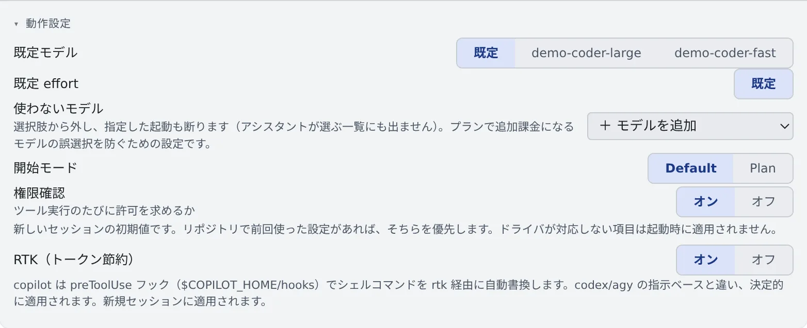

# エージェントを選ぶ

[English](choose.md) | 日本語

Agent Fleet は、Claude・Codex・OpenCode など 9 種類のコーディングエージェントを動かせます。
すでに契約しているサービスに合わせて 1 つ以上を接続すると、新しいセッションの種類に並びます。

## 全体像

| あなたがやること | 起きること |
|---|---|
| ⚙設定 →「エージェント」でエージェントを接続する | 新しいセッションの種類に、そのエージェントが並ぶ |
| カードの「動作設定」で既定モデルなどを選ぶ | 次に起動するセッションから使われる |
| 使わないモデルを外す | そのモデルは選べなくなり、名前を指定した起動も断られる |

接続も設定も、ワークスペースの中のエージェントの CLI を通して行います。ワークスペースが止まっているときは、先に起動してください。

## どれを選ぶか

**すでに払っている契約で選ぶ**のが確実です。

| 持っている契約・アカウント | エージェント | ページ |
|---|---|---|
| Anthropic（Claude）のアカウント | claude | [Claude を接続する](claude.ja.md) |
| ChatGPT のサブスク、OpenAI の API キー | codex | [Codex を接続する](codex.ja.md) |
| 複数の LLM プロバイダの API キー、opencode.ai | opencode | [OpenCode を接続する](opencode.ja.md) |
| GitHub Copilot のサブスク（Free を含む） | copilot | [GitHub Copilot を接続する](copilot.ja.md) |
| Cursor のアカウント | cursor | [Cursor を接続する](cursor.ja.md) |
| AWS Builder ID、Kiro のプラン | kiro | [Kiro を接続する](kiro.ja.md) |
| Google アカウント（実験枠） | agy | [Antigravity を接続する](agy.ja.md) |
| Meta のアカウント、Meta の API キー | muse | [Muse Code を接続する](muse.ja.md) |
| なし（配備の llama.cpp エンジンを使う） | lcpp | [lcpp を使う](lcpp.ja.md) |

決め手になりやすいのは、コンテキストのゲージ、画像の貼り付け、マネージドで動かせるかどうかです。
種類ごとに何ができるかは [エージェントのリファレンス](../../ref/agents.ja.md) の表にあります。
マネージドとターミナル（CLI）の違いは [セッションを始める](../../member/03-starting-sessions.ja.md#実行方式-マネージドとターミナルcli) にあります。

エージェントのいない種類も 2 つあります。

- **shell**：ワークスペースの素のシェルです
- **ssm**：AWS SSM で EC2 にログインする端末です（[SSM で EC2 にログインする](../integrations/aws-ssm.ja.md)）

どちらもターミナルだけで、会話・状態・通知はありません。

## 接続する

**⚙設定 →「エージェント」** を開き、使うエージェントのカードで接続します。手順はカードごとに違うので、上の表の各ページを見てください。

- 接続できたカードには「**接続済み**」と出ます。claude・codex では、ログインしているアカウントのメールとプランも出ます
- 接続の変更はすぐに効きます
- 期限のあるログインは、残り 3 日を切ると「**あと N 日で期限切れ**」と出ます

### ログインし直す

claude・codex・Antigravity・Cursor・Kiro・Muse Code の接続済みのカードには、「**切断**」の隣に「**再認証**」があります。

1. 「**再認証**」を押します
2. 確認の画面で続けると、一度サインアウトしてから、ログインの画面が開き直します
3. いつもの手順でログインします

実行中のセッションは止まりません。途中でログインに失敗したり、やめたりすると、そのエージェントは接続し直すまで「**未接続**」のままです。

## 動作設定を選ぶ

各カードの「**動作設定**」で、新しいセッションの初期値を決めます。リポジトリで前回使った設定があれば、そちらが優先されます。

| 項目 | 決めること |
|---|---|
| 既定モデル | セッションを起動するときに最初に選ばれているモデル |
| 既定 effort | reasoning effort を選べるエージェントでの初期値 |
| 開始モード | 「通常」か「Plan」か |
| 権限確認 | 権限の確認を省くか。オンで省き、オフにするとツールを実行するたびに許可を求めます |
| 使わないモデル | 選ばせたくないモデル（[次の節](#使わないモデルを外す)） |
| 思考を展開して表示 | セッション画面の「思考」を最初から開いておくか。表示だけの設定です |
| RTK（トークン節約） | コマンドを書き換えてトークンを節約するか（[料金と使用量を確かめる](usage.ja.md#rtk-でトークンを節約する)） |

エージェントによってない項目もあります。カードにある項目と、そのエージェントだけの設定は、各エージェントのページにあります。
反映されるタイミングは項目ごとに違い、カードの説明に書かれています。多くは次に起動するセッションからです。

### 使わないモデルを外す

「**使わないモデル**」で「＋ モデルを追加」からモデルを選ぶと、そのモデルは次のところから消えます。

- 起動ダイアログと設定のモデルの一覧
- アシスタントが選ぶモデルの一覧（MCP の `list_models`）

名前を指定した起動（定時実行のモデル欄や、アシスタント経由も含む）も断られます。外した時点で「既定モデル」やリポジトリごとの前回値からも外れます。
プランによっては追加料金になるモデルを、うっかり選ばないための設定です。

- 外すのは選んだモデル 1 つだけです。`gpt-5.4` を外しても `gpt-5.4-mini` は残ります
- claude のティア名（`fable` など）は別名なので、外すとその名前を含む完全なモデル名も外れます
- ターミナルで `/model` を打つなど、CLI の中での切り替えまでは止められません。料金を止める仕組みではありません

## もっと安全に使う

エージェントはあなたの代わりにコマンドを実行し、ファイルを編集し、push します。
定時実行では無人で、「権限確認」がオンのときは毎回尋ねずに実行します。取り消せない操作になることもあります。

- バックアップを取り、権限を絞った資格情報を使ってください
- 確かめながら進めたい作業では「**権限確認**」をオフにします。編集やコマンドのたびに、セッション画面の許可のカードか端末で承認を待つようになります。無人の定時実行には向きません
- muse のセッションは、ツールの承認を一度も求めません。shell と同じように何でも実行できるものとして扱ってください
- shell と ssm のセッションは、送った文字列をそのまま実行します

たくさんのセッションを同時に動かすときは [たくさんのセッションを動かす](../../member/11-many-sessions.ja.md) も見てください。

## 困ったとき

### 「設定はワークスペース内で実行されます」と出る

ワークスペースが止まっています。カードの下のボタンで起動してください。

### 「このワークスペースのイメージはエージェント設定 API（rtk）に未対応です」と出る

ワークスペースのイメージが古く、RTK などの設定を扱えません。新しいイメージで [ワークスペースを作り直す](../workspace/recreate.ja.md) と使えるようになります。

### 使いたいモデルが選べない

そのカードの「**使わないモデル**」に入っていないか確かめてください。ほかの原因は
[困ったとき](../../member/21-troubleshooting.ja.md#使いたいモデルが選べない指定したのに起動を断られる) にあります。

### ログインが切れてエージェントが止まった

エラーの「**再認証**」を押すと、そのエージェントのカードが開きます。ログインし直せば、セッションは続きから動かせます。
詳しくは [困ったとき](../../member/21-troubleshooting.ja.md#ログインが切れていますと出てエージェントが止まった) にあります。

## 関連

- [エージェントのリファレンス](../../ref/agents.ja.md)：種類ごとにできること、ログインのしかた、出る状態
- [料金と使用量を確かめる](usage.ja.md)
- [作業のしかたを一度だけ書いておく](instructions.ja.md)
