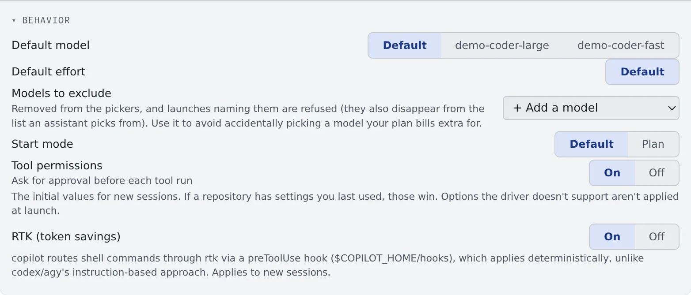

# Choose an agent

English | [日本語](choose.ja.md)

Agent Fleet runs nine kinds of coding agent, Claude, Codex and OpenCode among them.
Connect one or more to match the services you already pay for, and they appear among the kinds a new session can start.

## How it works

| What you do | What happens |
|---|---|
| Connect an agent in ⚙Settings → Agents | That agent appears among the kinds of a new session |
| Pick a default model and the like under the card's Behavior | Sessions started afterwards use it |
| Exclude the models you do not want | They can no longer be picked, and a launch that names one is refused |

Connections and settings go through the agent CLIs inside the workspace. If the workspace is stopped, start it first.

## Which one to choose

**Choose by the subscription you already pay for.** That is the safe bet.

| Subscription or account you have | Agent | Page |
|---|---|---|
| An Anthropic (Claude) account | claude | [Connect Claude](claude.md) |
| A ChatGPT subscription, an OpenAI API key | codex | [Connect Codex](codex.md) |
| API keys for several LLM providers, opencode.ai | opencode | [Connect OpenCode](opencode.md) |
| A GitHub Copilot subscription (Free included) | copilot | [Connect GitHub Copilot](copilot.md) |
| A Cursor account | cursor | [Connect Cursor](cursor.md) |
| An AWS Builder ID, a Kiro plan | kiro | [Connect Kiro](kiro.md) |
| A Google account (experimental slot) | agy | [Connect Antigravity](agy.md) |
| A Meta account, a Meta API key | muse | [Connect Muse Code](muse.md) |
| None (uses the deployment's llama.cpp engine) | lcpp | [Use lcpp](lcpp.md) |

What usually decides it is the context gauge, image paste, and whether you need Managed.
What each kind can do is in the tables of the [Agents reference](../../ref/agents.md).
The difference between Managed and Terminal (CLI) is in [Start a session](../sessions/start.md#choose-the-execution-method).

Two kinds have no agent at all.

- **shell**: a plain shell in the workspace
- **ssm**: a terminal logged in to EC2 over AWS SSM ([Log in to EC2 with SSM](../integrations/aws-ssm.md))

Both are terminal only, with no conversation, states or notifications.

## Connect

Open **⚙Settings → Agents** and connect on the card of the agent you want. The steps differ per card, so follow each page in the table above.

- A connected card reads "**Connected**". claude and codex also show the account's email and plan
- A change to a connection takes effect at once
- A sign-in with an expiry shows "**Expires in N day(s)**" once fewer than three days are left

### Sign in again

The connected cards of claude, codex, Antigravity, Cursor, Kiro and Muse Code have "**Re-authenticate**" next to "**Disconnect**".

1. Press "**Re-authenticate**"
2. Go on in the confirmation; it signs out first, then reopens the sign-in page
3. Sign in the usual way

Running sessions are not stopped. If that sign-in fails or you abandon it, the agent stays "**Not connected**" until you connect it again.

## Choose the behavior

Each card's "**Behavior**" sets the initial values for new sessions. If a repository has settings you last used, those win.

| Item | What it decides |
|---|---|
| Default model | The model selected when a session starts |
| Default effort | The initial reasoning effort, for agents that offer one |
| Start mode | "Normal" or "Plan" |
| Tool permissions | Whether the agent asks for approval before each tool run. On asks; off skips the prompts (the default) |
| Models to exclude | Models you do not want picked ([next section](#exclude-models)) |
| Show thinking expanded | Whether the session view opens "thinking" from the start. Display only |
| RTK (token savings) | Whether commands are rewritten to save tokens ([Check prices and usage](usage.md#save-tokens-with-rtk)) |

Some agents do not have every item. What a card has, and the settings only that agent has, are on each agent's page.
When a change takes effect differs per item and is written on the card. For most, it is the next session started.

### Exclude models

Pick a model from "+ Add a model" under "**Models to exclude**", and it disappears from:

- the model lists of the launch dialog and the settings
- the list an assistant picks from (MCP `list_models`)

A launch that names it is refused too, including a schedule's model field and a launch through the assistant. It also leaves the "Default model" and each repository's last-used value at once.
The setting is there so that a model your plan bills extra for is not picked by mistake.

- It excludes only the model you pick. Excluding `gpt-5.4` leaves `gpt-5.4-mini`
- A claude tier name (`fable` and so on) is an alias, so excluding it also excludes the full model names that contain it
- It cannot stop a switch inside the CLI, such as typing `/model` in the terminal. It is not a billing guard

## Use it more safely

Agents run commands, edit files and push on your behalf.
Scheduled runs do it unattended, and with "Tool permissions" off they do it without asking each time. Some of it cannot be undone.

- Keep backups and use credentials with narrow permissions
- For work you want to check step by step, turn "**Tool permissions**" on. The agent then waits for approval before every edit or command, from the permission card in the session view or the terminal. That does not suit unattended scheduled runs
- A muse session never asks to approve a tool. Treat it like shell: it can run anything
- shell and ssm sessions run what you send exactly as sent

When you run many sessions at once, see also [See every running session](../fleet/overview.md).

## When it goes wrong

### "Settings run inside the workspace" appears

The workspace is stopped. Start it with the button below the cards.

### "This workspace's image doesn't support the agent-settings API (rtk)" appears

The workspace image is too old to handle RTK and the other settings. [Recreate the workspace](../workspace/recreate.md) on a newer image to enable them.

### The model I want is not offered

Check that it is not under that card's "**Models to exclude**". Other causes are in
[Fix an agent's login or a missing model](../troubleshooting/agents.md#the-model-you-want-is-not-offered-or-launching-with-it-is-refused).

### The agent stopped because its sign-in expired

Press "**Re-authenticate**" on the error and that agent's card opens. Sign in again and the session can carry on where it stopped.
The details are in [Fix an agent's login or a missing model](../troubleshooting/agents.md#the-agent-stopped-saying-its-login-has-expired).

## Related

- [Agents reference](../../ref/agents.md): what each kind can do, how it signs in, the states it shows
- [Check prices and usage](usage.md)
- [Write down how you work, once](instructions.md)
