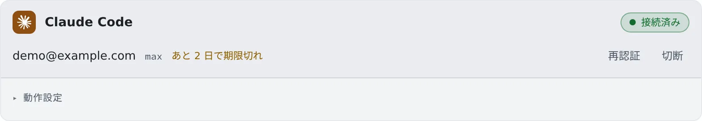

# Claude を接続する

[English](claude.md) | 日本語

Anthropic のアカウントでログインすると、Claude Code をセッションで動かせます。
ターミナル（CLI）で動き、セッション画面にはその会話が映ります。

## 全体像

| あなたがやること | 起きること |
|---|---|
| Claude Code のカードで OAuth のログインをする | 新しいセッションの種類に claude が並ぶ |
| 動作設定を選ぶ | 次に起動する claude のセッションから使われる |
| ログインが切れたら再認証する | 止まっていたセッションを、続きから動かせる |

## 接続する

**⚙設定 →「エージェント」** の **Claude Code** カードで操作します。

1. 「**OAuth 接続**」を押すと、ログインの画面が新しいタブで開きます。開かないときは「**ログインリンク ↗**」から開きます
2. 自分のブラウザで承認します
3. 表示されたコードを「**コードを貼付**」の欄に貼り付けて、「**完了**」を押します

カードが「**接続済み**」になり、アカウントのメールとプラン（`…@example.com · pro` など）が出ます。
ログインの期限が近づくと「**あと N 日で期限切れ**」と出ます。CLI 自身の警告は直前にしか出ないので、ここで気づけます。

## 動作設定

カードの「**動作設定**」には、[ほかのエージェントと共通の項目](choose.ja.md#動作設定を選ぶ)のほかに、次の項目があります。

| 項目 | 決めること |
|---|---|
| Claude の追加モデル | `claude-opus-4-8` のような完全なモデル ID を登録して、選択肢に足す |
| 返答をストリーミング表示 | 書いている途中の返答を、「**文字送り**」（既定）・「**行ごと**」・「**オフ**」のどれで見せるか |
| 中断したターンの自動再開 | 接続が切れたなど、時間をおけば直る原因で止まったターンを、自動で続けるか。既定ではオンです |
| 利用上限リセット後の自動再開 | 利用上限で止まったセッションに、上限が解ける時刻に「続きを進めて」と 1 回だけ送るか。既定ではオンです |
| リモートコントロール | 手元の Claude アプリなどから、動いているセッションを操作できるようにするか（[下の節](#リモートコントロールを使う)） |
| 通知 | セッションの状態が変わったときに通知するか |
| アイドル中の自動圧縮 | 長い会話を放置したとき、Claude Code が会話を自分で圧縮してよいか。既定ではオンです |

- **既定モデル**で Opus・Sonnet・Haiku などのティア名を選ぶと、そのティアの最新バージョンに追従します。追加モデルに登録した完全な ID は、そのリリースに固定されます
- **追加モデル**が使えるかどうかは、セッションの起動時に Claude Code が確かめます。登録を消しても、すでにあるセッションの設定は変わりません
- **ストリーミング表示**は表示だけの設定です。画面に届くのは書き終えた行なので、長い段落はまとめて届きます
- **アイドル中の自動圧縮**は、20 万トークン以上の会話で、最後の操作からおよそ 54 分後に圧縮します。次のターンが安くなる代わりに、戻ってきたときには会話が要約されています
- **利用上限リセット後の自動再開**は、Codex のカードの同じ項目と同じ設定です。オフにしても、上限のメニューでは待つほう（追加料金なし）が自動で選ばれます

### リモートコントロールを使う

新しいワークスペースでは、リモートコントロールはオフです。オンにすると、それ以降に起動または再開した claude のセッションから使えます。

- ワークスペースのイメージは、ふだん `CLAUDE_CODE_DISABLE_NONESSENTIAL_TRAFFIC` を設定しています。この変数があると、リモートコントロールは始まりません
- オンの間は、この変数を外してセッションを起動します。そのため、リリースノートの取得、PR/MR の状態の確認、利用できる機能の確認も行われ、`/feedback` も使えます
- テレメトリ・エラーレポート・自動更新は、別の変数で止めたままです

次のときは、オンにしても接続できません。

| 状況 | どうするか |
|---|---|
| Claude の `settings.json`（ユーザー・プロジェクト・ローカル・管理）の `env` に同じ変数が書かれている | その行を削除します。このトグルは設定ファイルを書き換えません |
| プロジェクトやローカルの設定ファイルが `remoteControlAtStartup` を上書きしている | その設定ファイルを直します |
| 組織が Trusted Devices（信頼済みデバイス）を必須にしている | このワークスペースからは接続できません |

## 知っておくこと

- **API キーでも動かせます。** ターミナル（CLI）で起動するときに経路を選ぶと、OpenCode のカードに保存した Anthropic の API キーで、従量課金として動きます。
  詳しくは [エージェントのリファレンス](../../ref/agents.ja.md#claude-api-キー経路) にあります
- **自分のスキル・フック・サブエージェントも使えます。** [手元の Claude Code の設定を持ち込む](bring-claude-setup.ja.md) を見てください
- 使用量チップと RTK は [料金と使用量を確かめる](usage.ja.md) にあります

## 困ったとき

### セッションに「Select login method」などのログインの画面が出る

接続はたいてい切れていません。セッションを再開するか、⋯ メニューの「**作り直す（今の会話はアーカイブへ）**」で直ることがほとんどです。
ターミナルで `/login` を実行してもかまいません。詳しくは [エージェントにログインできない・モデルが出ない](../troubleshooting/agents.ja.md#claude-のセッションにselect-login-methodなどのログインの画面が出る) にあります。

### 「認証切れ — 再認証が必要」と出て、送っても何も始まらない

ワークスペースの Claude のログインが切れています。カードの「**再認証**」でログインし直せば、セッションを止めずに続けられます。
詳しくは [エージェントにログインできない・モデルが出ない](../troubleshooting/agents.ja.md#認証切れ-再認証が必要と出て送っても何も始まらない) にあります。

### リモートコントロールがつながらない

[上の表](#リモートコントロールを使う)の 3 つを確かめてください。トグルを変えたあとに起動または再開したセッションでなければ、変更は効きません。

## 関連

- [エージェントを選ぶ](choose.ja.md)
- [エージェントのリファレンス](../../ref/agents.ja.md)
- [手元の Claude Code の設定を持ち込む](bring-claude-setup.ja.md)
