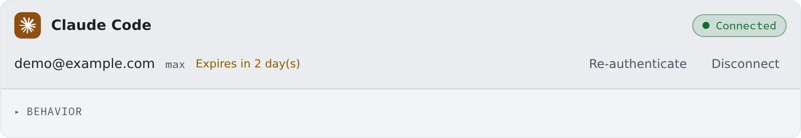

# Connect Claude

English | [日本語](claude.ja.md)

Sign in with your Anthropic account and sessions can run Claude Code.
It runs in Terminal (CLI), and the session view mirrors the conversation.

## How it works

| What you do | What happens |
|---|---|
| Sign in over OAuth on the Claude Code card | claude appears among the kinds of a new session |
| Choose the behavior | claude sessions started afterwards use it |
| Re-authenticate when the sign-in expires | A stopped session can carry on where it stopped |

## Connect

Work on the **Claude Code** card in **⚙Settings → Agents**.

1. Press "**Connect via OAuth**". The sign-in page opens in a new tab; if it does not, open it from "**the sign-in link ↗**"
2. Approve in your own browser
3. Paste the code you are shown into "**Paste the code**" and press "**Done**"

The card reads "**Connected**" with the account's email and plan (`…@example.com · pro`, say).
As the sign-in nears its expiry, the card shows "**Expires in N day(s)**". The CLI's own warning only appears at the last moment, so this is where you notice.

## Behavior

The card's "**Behavior**" has, besides [the items every agent shares](choose.md#choose-the-behavior), the following.

| Item | What it decides |
|---|---|
| Additional Claude models | Adds a full model ID such as `claude-opus-4-8` to the choices |
| Stream replies in the chat view | How a reply being written is shown: "**Typewriter**" (default), "**Line by line**" or "**Off**" |
| Auto-resume a cut-off turn | Whether a turn stopped by something that clears with time, such as a dropped connection, carries on by itself. On by default |
| Auto-resume after a usage limit resets | Whether a session stopped by a usage limit gets one "carry on" when the limit lifts. On by default |
| Remote control | Whether the Claude app on your own device and the like can drive a running session ([below](#use-remote-control)) |
| Notifications | Whether a change of session state notifies you |
| Idle compaction | Whether Claude Code may compact a long conversation by itself while it sits idle. On by default |

- A tier name such as Opus, Sonnet or Haiku as the **default model** follows that tier's newest release. A full ID added under additional models stays pinned to that release
- Whether an **additional model** is usable is checked by Claude Code when the session starts. Removing one does not change sessions that already have it
- **Streaming** is display only. What reaches the screen is finished lines, so a long paragraph arrives at once
- **Idle compaction** applies to conversations of 200,000 tokens or more, about 54 minutes after the last action. The next turn costs less, but you come back to a summarised conversation
- **Auto-resume after a usage limit** is the same setting as the one on the Codex card. Even with it off, the usage-limit menu picks the waiting option (no extra charge) by itself

### Use Remote control

Remote control is off in a new workspace. Turn it on, and sessions started or resumed afterwards can use it.

- The workspace image normally sets `CLAUDE_CODE_DISABLE_NONESSENTIAL_TRAFFIC`. While it is set, Remote control does not start
- While the toggle is on, claude sessions start without that variable. Release notes, PR/MR status and feature availability are then fetched too, and `/feedback` works
- Telemetry, error reporting and auto-update stay off through their own variables

Turning it on is not enough in these cases.

| Situation | What to do |
|---|---|
| The same variable is in the `env` of a Claude `settings.json` (user, project, local or managed) | Delete that line. The toggle does not edit settings files |
| A project or local settings file overrides `remoteControlAtStartup` | Fix that settings file |
| Your organisation requires Trusted Devices | It cannot connect from this workspace |

## Good to know

- **It can run on an API key too.** Choose the route when you start it in Terminal (CLI), and it runs on the Anthropic API key saved on the OpenCode card, billed per use.
  The details are in the [Agents reference](../../ref/agents.md#claude-the-api-key-route)
- **Your own skills, hooks and subagents work as well.** See [Bring your Claude Code setup](bring-claude-setup.md)
- Usage chips and RTK are in [Check prices and usage](usage.md)

## When it goes wrong

### The session shows a sign-in screen such as "Select login method"

The connection is usually still there. Resuming the session, or "**Recreate (current conversation goes to the archive)**" from the ⋯ menu, fixes it most of the time.
Running `/login` in the terminal works too. The details are in [Troubleshooting](../../member/21-troubleshooting.md#selecting-claude-shows-a-login-screen-select-login-method).

### "Login expired — sign in again" appears, and sending starts nothing

The workspace's Claude sign-in has expired. Sign in again with "**Re-authenticate**" on the card, and the session carries on without being stopped.
The details are in [Troubleshooting](../../member/21-troubleshooting.md#a-claude-session-shows-login-expired-sign-in-again-or-sending-starts-nothing).

### Remote control does not connect

Check the three cases in [the table above](#use-remote-control). Only a session started or resumed after you changed the toggle picks the change up.

## Related

- [Choose an agent](choose.md)
- [Agents reference](../../ref/agents.md)
- [Bring your Claude Code setup](bring-claude-setup.md)
