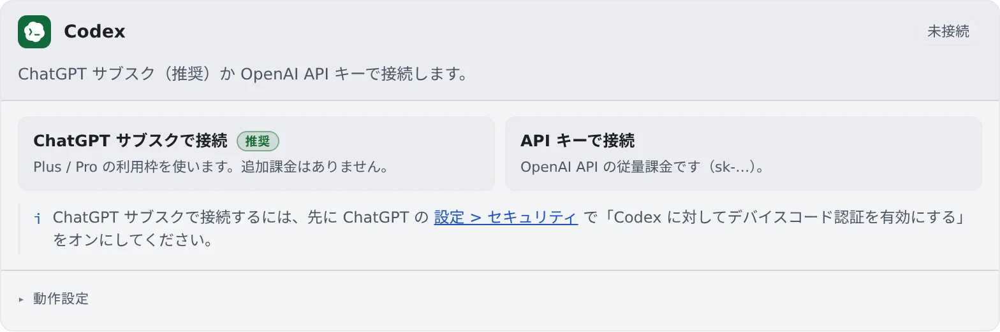

# Codex を接続する

[English](codex.md) | 日本語

ChatGPT のサブスクか OpenAI の API キーで接続すると、Codex をセッションで動かせます。
マネージドとターミナル（CLI）のどちらでも動きます。

## 全体像

| あなたがやること | 起きること |
|---|---|
| Codex のカードで、ChatGPT のサブスクか API キーで接続する | 新しいセッションの種類に codex が並ぶ |
| 動作設定を選ぶ | 次に起動する codex のセッションから使われる |
| ログインが切れたら再認証する | 止まっていたセッションを、続きから動かせる |

## 接続する

**⚙設定 →「エージェント」** の **Codex** カードで、接続のしかたを選びます。

| ボタン | 料金 | 必要なもの |
|---|---|---|
| ChatGPT サブスクで接続（推奨） | Plus / Pro の利用枠を使います。追加の料金はかかりません | ChatGPT のデバイスコード認証をオンにしておく |
| API キーで接続 | OpenAI API の従量課金です | OpenAI の API キー（`sk-…`） |

### ChatGPT のサブスクで接続する

1. 先に、ChatGPT の「**設定 > セキュリティ**」で「Codex に対してデバイスコード認証を有効にする」をオンにします
2. カードの「**ChatGPT サブスクで接続**」を押すと、コードとリンクが出ます
3. 「**コードをコピー**」して、「**リンクを開いて貼り付け**」ます
4. ブラウザで承認すると、カードが「**接続済み**」に変わります

接続済みのカードには、アカウントのメールとプランが出ます。

### API キーで接続する

「**API キーで接続**」を押し、OpenAI の API キーを貼り付けて接続します。

## 動作設定

カードの「**動作設定**」には、[ほかのエージェントと共通の項目](choose.ja.md#動作設定を選ぶ)のほかに、次の項目があります。

| 項目 | 決めること |
|---|---|
| 利用上限リセット後の自動再開 | マネージドの codex のターンが利用上限で止まったとき、上限が解ける時刻に「続きを進めて」と 1 回だけ送るか。既定ではオンです |
| 利用制限時のモデル切替案内 | 利用制限が近づいたとき、軽いモデルへの切り替えを勧める Codex の案内を出すか。既定ではオンです |

- **自動再開**は、Claude Code のカードの同じ項目と同じ設定です。ターミナル（CLI）の codex は対象外です
- **モデル切替案内**がオンだと、案内に従って軽いモデルに切り替わることがあります。モデルを変えたくないときはオフにします
- **RTK**は、`AGENTS.md` で rtk を使うよう促すだけのベストエフォートです（[料金と使用量を確かめる](usage.ja.md#rtk-でトークンを節約する)）

## 知っておくこと

- **マネージドの codex は、セッションごとのプロセスを持ちません。** たくさん同時に動かしてもワークスペースが重くなりにくいです
- 利用枠の残りは、ワークスペース操作バーの使用量チップで見られます（[料金と使用量を確かめる](usage.ja.md)）

## 困ったとき

### 承認しても先に進まない

ChatGPT の「**設定 > セキュリティ**」で「Codex に対してデバイスコード認証を有効にする」がオンか確かめてください。
オフのままだと、承認しても接続が終わりません。

### ログインが切れて、送っても断られる

ログイン切れでターンが失敗したあとは、ログインし直すまで送れません。カードの「**再認証**」でログインし直してください。
詳しくは [エージェントにログインできない・モデルが出ない](../troubleshooting/agents.ja.md#認証切れ-再認証が必要と出て送っても何も始まらない) にあります。

## 関連

- [エージェントを選ぶ](choose.ja.md)
- [エージェントのリファレンス](../../ref/agents.ja.md)
