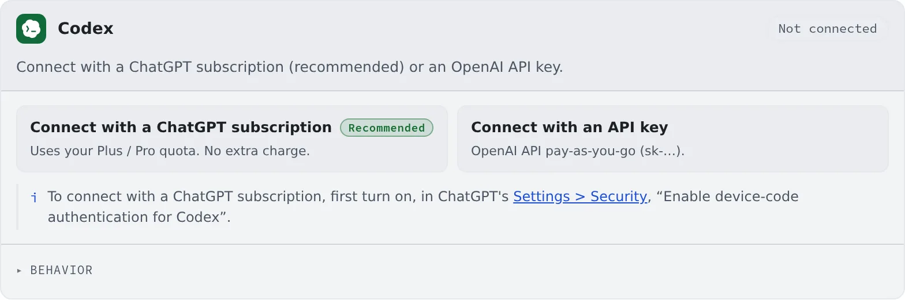

# Connect Codex

English | [日本語](codex.ja.md)

Connect with a ChatGPT subscription or an OpenAI API key and sessions can run Codex.
It runs in both Managed and Terminal (CLI).

## How it works

| What you do | What happens |
|---|---|
| Connect on the Codex card, with a ChatGPT subscription or an API key | codex appears among the kinds of a new session |
| Choose the behavior | codex sessions started afterwards use it |
| Re-authenticate when the sign-in expires | A stopped session can carry on where it stopped |

## Connect

Choose how to connect on the **Codex** card in **⚙Settings → Agents**.

| Button | Billing | What you need |
|---|---|---|
| Connect with a ChatGPT subscription (recommended) | Uses your Plus / Pro allowance. No extra charge | Device-code authentication turned on in ChatGPT |
| Connect with an API key | OpenAI API, billed per use | An OpenAI API key (`sk-…`) |

### Connect with a ChatGPT subscription

1. First turn on "Enable device-code authentication for Codex" under ChatGPT's "**Settings > Security**"
2. Press "**Connect with a ChatGPT subscription**" on the card. A code and a link appear
3. "**Copy the code**", then "**Open the link and paste**"
4. Approve in the browser, and the card turns "**Connected**"

A connected card shows the account's email and plan.

### Connect with an API key

Press "**Connect with an API key**", paste your OpenAI API key and connect.

## Behavior

The card's "**Behavior**" has, besides [the items every agent shares](choose.md#choose-the-behavior), the following.

| Item | What it decides |
|---|---|
| Auto-resume after a usage limit resets | Whether a Managed codex turn stopped by a usage limit gets one "carry on" when the limit lifts. On by default |
| Model-switch nudge at usage limits | Whether Codex shows its suggestion to switch to a lighter model as a usage limit nears. On by default |

- **Auto-resume** is the same setting as the one on the Claude Code card. Terminal (CLI) codex is not covered
- With the **nudge** on, following it may switch you to a lighter model. Turn it off if you do not want the model to change
- **RTK** only asks for rtk through `AGENTS.md`, best effort ([Check prices and usage](usage.md#save-tokens-with-rtk))

## Good to know

- **Managed codex keeps no process per session.** It is a kind you can run many of without weighing the workspace down
- The remaining allowance shows in the usage chip on the WS bar ([Check prices and usage](usage.md))

## When it goes wrong

### Approving gets me nowhere

Check that "Enable device-code authentication for Codex" is on under ChatGPT's "**Settings > Security**".
While it is off, approving never finishes the connection.

### The sign-in expired, and sending is refused

After a turn fails on an expired sign-in, sending is refused until you sign in again. Sign in again with "**Re-authenticate**" on the card.
The details are in [Fix an agent's login or a missing model](../troubleshooting/agents.md#login-expired-sign-in-again-and-sending-starts-nothing).

## Related

- [Choose an agent](choose.md)
- [Agents reference](../../ref/agents.md)
