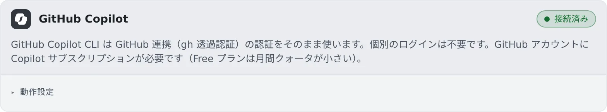

# GitHub Copilot を接続する

[English](copilot.md) | 日本語

GitHub を接続すると、GitHub Copilot CLI（copilot）をセッションで動かせます。
Copilot のためのログインはありません。

## 全体像

| あなたがやること | 起きること |
|---|---|
| ⚙設定 →「Git ホスティング」で GitHub を接続する | copilot のカードも「接続済み」になり、新しいセッションの種類に並ぶ |
| 動作設定を選ぶ | 次に起動する copilot のセッションから使われる |
| GitHub を切断する | copilot も一緒に切れる |

## 接続する

1. **⚙設定 →「Git ホスティング」** で GitHub を接続します（[GitHub の CLI を使う](../integrations/github-cli.ja.md)）
2. **⚙設定 →「エージェント」** の **GitHub Copilot** カードが「**接続済み**」になっていることを確かめます

GitHub をまだ接続していないときは、カードに「**先に GitHub を連携してください。**」と「**Git ホスティングを開く**」が出ます。

その GitHub アカウントに、**Copilot のサブスクリプション**（Free プランを含む）が必要です。ないと、最初の指示でエラーになります。

## 動作設定

カードの「**動作設定**」の項目は、[ほかのエージェントと共通](choose.ja.md#動作設定を選ぶ)です。

- **RTK** は、シェルのコマンドを毎回 rtk 経由に書き換えます。変更後に始めたセッションから効きます（[料金と使用量を確かめる](usage.ja.md#rtk-でトークンを節約する)）

## 知っておくこと

- **選べるモデルは、プランで決まります。** Free プランでは Copilot が自動で選ぶモデル（Auto）だけ、有料のプランではそのアカウントで使えるモデルが並びます
- Free プランは、月の利用枠が小さめです。使った量は GitHub の設定画面で確かめられます
- ワークスペース操作バーの使用量チップにも出ます（[料金と使用量を確かめる](usage.ja.md)）

## 困ったとき

### 最初の指示でエラーになる

その GitHub アカウントに Copilot のサブスクリプションがあるか確かめてください。

### カードに「このコンテナイメージでは利用できません」と出る

ワークスペースのイメージに copilot が入っていません。管理者に相談してください。

## 関連

- [エージェントを選ぶ](choose.ja.md)
- [エージェントのリファレンス](../../ref/agents.ja.md)
- [GitHub の CLI を使う](../integrations/github-cli.ja.md)
