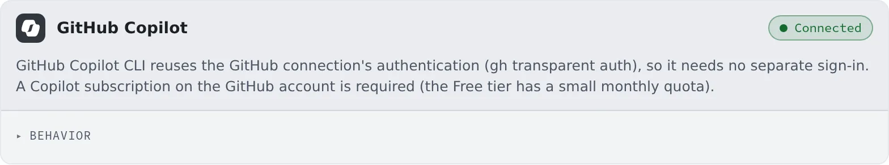

# Connect GitHub Copilot

English | [日本語](copilot.ja.md)

Connect GitHub and sessions can run the GitHub Copilot CLI (copilot).
There is no sign-in of Copilot's own.

## How it works

| What you do | What happens |
|---|---|
| Connect GitHub in ⚙Settings → Git hosting | The copilot card turns "Connected" too, and copilot appears among the kinds of a new session |
| Choose the behavior | copilot sessions started afterwards use it |
| Disconnect GitHub | copilot is disconnected with it |

## Connect

1. Connect GitHub in **⚙Settings → Git hosting** ([Use the GitHub CLI](../integrations/github-cli.md))
2. Check that the **GitHub Copilot** card in **⚙Settings → Agents** reads "**Connected**"

Until GitHub is connected, the card shows "**Connect GitHub first.**" and "**Open Git hosting**".

The GitHub account needs a **Copilot subscription** (the Free plan included). Without one, the first instruction fails with an error.

## Behavior

The items under the card's "**Behavior**" are [the ones every agent shares](choose.md#choose-the-behavior).

- **RTK** rewrites shell commands to go through rtk every time, from sessions started after the change ([Check prices and usage](usage.md#save-tokens-with-rtk))

## Good to know

- **The models on offer depend on your plan.** The Free plan offers only the model Copilot picks itself (Auto); a paid plan lists the models that account can use
- The Free plan has a small monthly allowance. You can check what you used in GitHub's settings
- It also has a usage chip on the WS bar ([Check prices and usage](usage.md))

## When it goes wrong

### The first instruction fails with an error

Check that the GitHub account has a Copilot subscription.

### The card says "Not available in this container image"

The workspace image does not include copilot. Ask your administrator.

## Related

- [Choose an agent](choose.md)
- [Agents reference](../../ref/agents.md)
- [Use the GitHub CLI](../integrations/github-cli.md)
