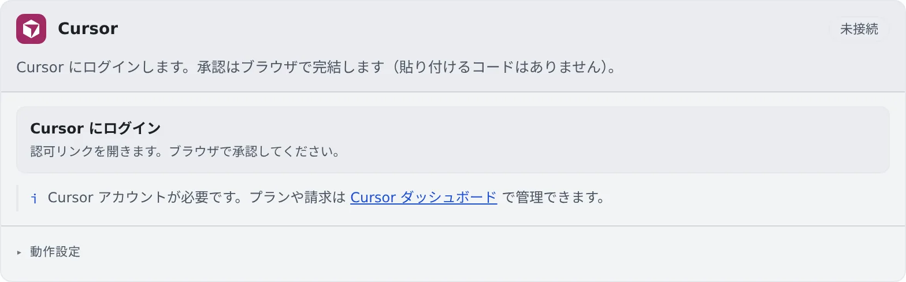

# Cursor を接続する

[English](cursor.md) | 日本語

Cursor のアカウントでログインすると、Cursor CLI（cursor）をセッションで動かせます。
ブラウザで承認するだけで、貼り付けるコードはありません。

## 全体像

| あなたがやること | 起きること |
|---|---|
| Cursor のカードでログインし、ブラウザで承認する | カードが自動で「接続済み」になり、新しいセッションの種類に cursor が並ぶ |
| 動作設定を選ぶ | 次に起動する cursor のセッションから使われる |
| ログインが切れたら再認証する | もう一度ログインの手順を踏む |

## 接続する

1. **⚙設定 →「エージェント」** の **Cursor** カードで「**Cursor にログイン**」を押します
2. 認可のリンクが開くので、ブラウザで承認します

承認すると、カードが自動で「**接続済み**」に変わります。Cursor のアカウントが必要です。API キーでは接続できません。

## 動作設定

カードの「**動作設定**」の項目は、[ほかのエージェントと共通](choose.ja.md#動作設定を選ぶ)です。RTK の設定はありません。

## 知っておくこと

- **選べるモデルは、そのアカウントで使えるものがそのまま並びます。** 起動したあとにモデルは変えられません
- プランの残りは、Cursor のダッシュボードで確かめてください。WS バーの使用量チップはありません
- **「エージェントへの指示」は届きません。** Cursor は User Rules を Cursor のアカウント側に持ち、ワークスペースに置き場がないためです
- **アシスタントとして使うときは読み取り専用です**
- **ターミナル（CLI）のセッションでは、ターンごとのトークン数が記録されます。** ⚙設定 →「エージェント使用量」に「一部のみ」として出ます（[料金と使用量を確かめる](usage.ja.md#何にトークンを使ったかを見る)）
- 記録のために、Agent Fleet は `~/.cursor/hooks.json` に `stop` のエントリを足します。同じファイルのほかのエントリはそのまま残ります
- 停止したマネージドのセッションは、会話の履歴を表示できません。読める履歴を残したいときは、ターミナル（CLI）で起動します
- **AWS や Google Cloud のコマンドを頼むときは、ツールの名前を書き添えます。** Cursor だけは、`af-aws-exec` と `af-gcloud-exec` の使い方を最初から知りません（[AWS SSO を使う](../integrations/aws-sso.ja.md)、[Google Cloud を使う](../integrations/gcloud.ja.md)）

## 困ったとき

### カードに「このコンテナイメージでは利用できません」と出る

ワークスペースのイメージに cursor が入っていません。管理者に相談してください。

### 「Cursor のログイン開始に失敗しました」と出る

もう一度「**Cursor にログイン**」を押してください。何度も失敗するときは、ワークスペースから外部のネットワークにつながるかを確かめます。

## 関連

- [エージェントを選ぶ](choose.ja.md)
- [エージェントのリファレンス](../../ref/agents.ja.md)
