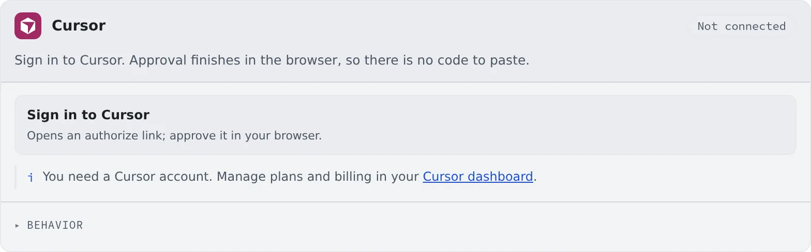

# Connect Cursor

English | [日本語](cursor.ja.md)

Sign in with your Cursor account and sessions can run the Cursor CLI (cursor).
You only approve in the browser; there is no code to paste.

## How it works

| What you do | What happens |
|---|---|
| Sign in on the Cursor card and approve in the browser | The card turns "Connected" by itself, and cursor appears among the kinds of a new session |
| Choose the behavior | cursor sessions started afterwards use it |
| Re-authenticate when the sign-in expires | You go through the sign-in steps again |

## Connect

1. Press "**Sign in to Cursor**" on the **Cursor** card in **⚙Settings → Agents**
2. An authorization link opens; approve in the browser

Once you approve, the card turns "**Connected**" by itself. You need a Cursor account. An API key cannot connect it.

## Behavior

The items under the card's "**Behavior**" are [the ones every agent shares](choose.md#choose-the-behavior). It has no RTK setting.

## Good to know

- **The models on offer are the ones that account can use, as they are.** The model cannot be changed after the session starts
- Check the plan's remaining allowance on the Cursor dashboard. There is no usage chip on the WS bar
- **Agent instructions do not reach it.** Cursor keeps User Rules on the Cursor account, and the workspace has no place for them
- **As the assistant, it runs read-only**
- **Terminal (CLI) sessions record their tokens per turn.** They appear in ⚙Settings → Agent usage as "partial" ([Check prices and usage](usage.md#see-what-your-tokens-went-on))
- To record them, Agent Fleet adds a `stop` entry to `~/.cursor/hooks.json`. The other entries in that file are left as they are
- A stopped Managed session cannot show its conversation history. Start it in Terminal (CLI) if you want a history you can read
- **When you ask for AWS or Google Cloud commands, name the tool.** Cursor alone does not know `af-aws-exec` and `af-gcloud-exec` from the start ([Use AWS SSO](../integrations/aws-sso.md), [Use Google Cloud](../integrations/gcloud.md))

## When it goes wrong

### The card says "Not available in this container image"

The workspace image does not include cursor. Ask your administrator.

### "Failed to start Cursor sign-in" appears

Press "**Sign in to Cursor**" again. If it keeps happening, check that the workspace can reach the outside.

## Related

- [Choose an agent](choose.md)
- [Agents reference](../../ref/agents.md)
