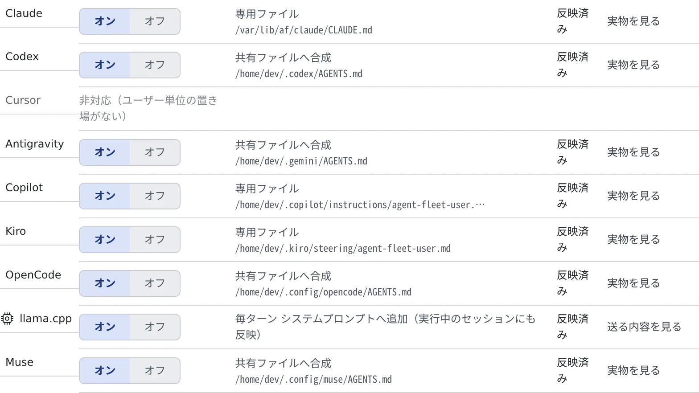

# 作業のしかたを一度だけ書いておく

[English](instructions.md) | 日本語

報告の言語や口調、確認してほしい場面、使ってほしいツールなどを一度書いておくと、
このワークスペースで起動するすべてのエージェントに毎回伝わります。プロンプトに書き足す必要はなくなります。

## 全体像

| あなたがやること | エージェントがやること |
|---|---|
| ⚙設定 →「エージェントへの指示」に書いて保存する | 次に起動したセッションから、その指示に従う |
| 配り先の行で「反映済み」か確かめる | 各エージェントの指示のファイルから読む。lcpp は毎ターン受け取る |
| 「ユーザー指示を使う」をオフにする | 新しいセッションでは、あなたの指示を読まない |

## 書く

**⚙設定 →「エージェントへの指示」** を開きます。指示の中身はワークスペースの中のファイルなので、ワークスペースが起動しているときだけ編集できます。

1. 「**ユーザー指示を使う**」がオンになっていることを確かめます（既定ではオンです）
2. 「**指示の内容（Markdown）**」に書きます。たとえば「報告は日本語で。破壊的な操作の前は必ず確認して。」
3. 「**保存**」を押します

保存すると「**保存しました（新しいセッションから有効。lcpp は次のターンから）**」と出ます。

- **新しく起動するセッションから効きます。** 動いているセッションは、起動したときに読んだ内容のままです。lcpp だけは、動いているセッションにも次のターンから効きます
- **リポジトリにはコミットされません。** 同僚には影響しない、あなただけの設定です
- 長さは 8192 バイトまでです。ここに書いたことは毎回のセッションのコンテキストに乗るので、短いほどよく効きます

> [!WARNING]
> **API キーやトークンなどの秘密は書かないでください。** いくつものエージェントが読む、ただのテキストです。

## ほかの指示との関係

エージェントへの指示は 3 つの層からなり、この設定は真ん中の層です。

| 層 | 誰のものか | 変えかた |
|---|---|---|
| ワークスペースの方針 | 配備の全員に共通 | ここからは変えられません。あなたの指示とぶつかったときは、こちらが優先されます |
| **エージェントへの指示** | **あなた個人** | **この設定** |
| リポジトリの指示（`CLAUDE.md`・`AGENTS.md`） | チームの全員（コミットされる） | リポジトリを編集します |

ワークスペースの方針は、同じ画面の「**方針を読む**」で読めます。

## 届いたか確かめる

「**配り先**」に、エージェントごとの行が並びます。行のオン／オフで、エージェントごとに配るかどうかも選べます。

| 行に出るもの | 意味 |
|---|---|
| 専用ファイル・共有ファイルへ合成・設定から参照 | 指示をどう渡すか。横に、書き込んだファイルのパスが出ます |
| 毎ターン システムプロンプトへ追加（実行中のセッションにも反映） | lcpp の行。ファイルには書きません |
| 反映済み／未反映 | いま効いているか。効いていないときは、理由がその行に出ます |
| 非対応（ユーザー単位の置き場がない） | 指示を受け取れないエージェント（Cursor） |

「**実物を見る**」で、書き込んだファイルの中身を確かめられます。lcpp の行では「**送る内容を見る**」です。

- opencode には、グローバルな `AGENTS.md` の目印付きのブロックを通して届きます。保存のたびに書き直されるので、手で触らないでください
- どのエージェントに届くかは、[エージェントのリファレンス](../../ref/agents.ja.md) の「エージェントへの指示が届く」の行にあります

### エージェントメモリの注意書き

エージェントメモリがオンの間は、同じ指示のファイルの、あなたの文章の隣に、メモリのツールについての短い決まった注意書きも書き込まれます。
copilot と Kiro には専用のファイルで、lcpp にはシステムプロンプトで渡します。

- 記憶そのものは入りません
- エージェントメモリをオフにすると、その部分だけが消えます。あなたの文章には触れません

## 困ったとき

### 保存できたのに「未反映」と出る

行に出ている理由を見てください。「**設定を読めないため反映できません**」なら、そのエージェントの設定ファイルが壊れていないか確かめます。

### 「上限を超えています。保存するには短くしてください。」と出る

8192 バイトを超えています。毎回伝える必要のないことは、リポジトリの `AGENTS.md` などに移してください。

### 動いているセッションが指示に従わない

指示は起動のときに読まれます。セッションを起動し直してください。

## 関連

- [手元の Claude Code の設定を持ち込む](bring-claude-setup.ja.md)：スキル・フック・サブエージェント
- [メモリの使いかたを設定する](../memory/settings.ja.md)：どの種類にも共有のメモリを渡すスイッチ
- [エージェントを選ぶ](choose.ja.md)
