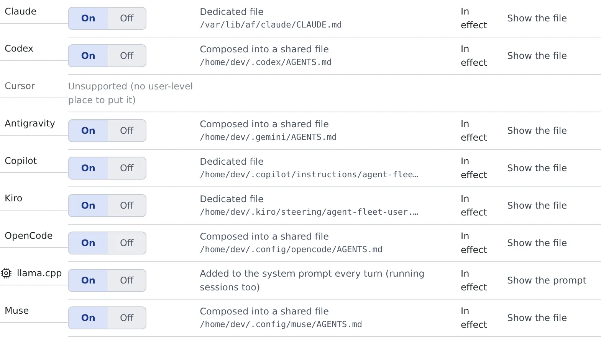

# Write down how you work, once

English | [日本語](instructions.ja.md)

Write down once the language and tone of reports, when to check with you, the tools you want used and the like,
and every agent you start in this workspace gets it each time. You no longer add it to your prompts.

## How it works

| What you do | What the agent does |
|---|---|
| Write it in ⚙Settings → Agent instructions and save | Follows it from the next session it starts |
| Check that the row under "Where it goes" reads "In effect" | Reads it from its own instruction file; lcpp gets it every turn |
| Turn "Use my instructions" off | New sessions do not read your instructions |

## Write it

Open **⚙Settings → Agent instructions**. The instructions are files inside the workspace, so you can edit them only while the workspace is running.

1. Check that "**Use my instructions**" is on (it is by default)
2. Write in "**Instructions (Markdown)**". For example, "Report in English. Always confirm before anything destructive."
3. Press "**Save**"

Saving says "**Saved (applies to new sessions; lcpp from its next turn)**".

- **It applies to sessions started afterwards.** A running session keeps what it read when it started. Only lcpp picks it up in running sessions, from the next turn
- **It is not committed to any repository.** It is yours alone and does not affect colleagues
- It can be up to 8192 bytes. What you write rides in the context of every session, so the shorter, the better it works

> [!WARNING]
> **Do not write secrets such as API keys or tokens.** It is plain text that several agents read.

## How it fits with other instructions

Agent instructions come in three layers, and this setting is the middle one.

| Layer | Whose | How to change it |
|---|---|---|
| The workspace policy | Common to everyone in the deployment | Not from here. When it conflicts with yours, it wins |
| **Agent instructions** | **You** | **This setting** |
| Repository instructions (`CLAUDE.md`, `AGENTS.md`) | The whole team (committed) | Edit the repository |

The workspace policy can be read with "**Read the guide**" on the same screen.

## Check that it arrived

"**Where it goes**" lists one row per agent. Each row's on / off also decides whether that agent gets it.

| What a row shows | Meaning |
|---|---|
| Dedicated file, Composed into a shared file, Referenced from config | How the instructions are delivered. The path of the file written appears beside it |
| Added to the system prompt every turn (running sessions too) | lcpp's row. Nothing is written to a file |
| In effect / Not in effect | Whether it works now. When it does not, the reason is on that row |
| Unsupported (no user-level place to put it) | An agent that cannot receive instructions (Cursor) |

"**Show the file**" shows the content of the file written. On lcpp's row it is "**Show the prompt**".

- opencode gets them through a marked block of its global `AGENTS.md`. It is rewritten on every save, so leave it alone
- Which agents receive them is the "Receives your agent instructions" row of the [Agents reference](../../ref/agents.md)

### The agent-memory note

While agent memory is on, a short fixed note about the memory tools is also written beside your text in the same instruction file.
copilot and Kiro get it in a file of their own, lcpp through the system prompt.

- No memories go into it
- Turning agent memory off removes just that part. Your text is left alone

## When it goes wrong

### It saved, but the row says "Not in effect"

Read the reason on the row. For "**Cannot apply because its config is not readable**", check that agent's configuration file is not broken.

### "Over the limit. Shorten it to save." appears

It is over 8192 bytes. Move what does not need saying every time into the repository's `AGENTS.md` or similar.

### A running session ignores the instructions

Instructions are read when a session starts. Start the session again.

## Related

- [Bring your Claude Code setup](bring-claude-setup.md): skills, hooks and subagents
- [Set how memory is used](../memory/settings.md): the switch that gives every kind the shared memory
- [Choose an agent](choose.md)
