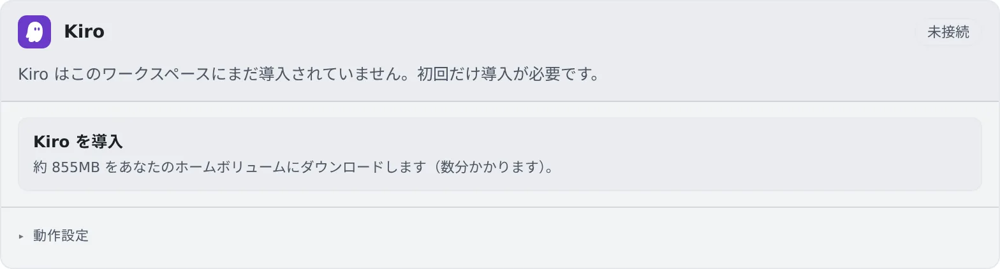

# Kiro を接続する

[English](kiro.md) | 日本語

Builder ID・Google・GitHub などのアカウントでログインすると、Kiro（旧 Amazon Q Developer CLI）をセッションで動かせます。
Builder ID なら無料で使えます。

## 全体像

| あなたがやること | 起きること |
|---|---|
| はじめての 1 回だけ「Kiro を導入」を押す | Kiro の CLI がホームにダウンロードされる |
| Kiro のカードでログインし、ブラウザで承認する | 新しいセッションの種類に kiro が並ぶ |
| 新しいバージョンが出たら「Kiro を更新」を押す | 次に起動するセッションから新しいバージョンになる |

## 導入する

Kiro の CLI は大きい（約 855 MB）ので、多くの配備ではワークスペースのイメージに入っていません。

1. **⚙設定 →「エージェント」** の **Kiro** カードで「**Kiro を導入**」を押します
2. ホームにダウンロードされます。数分かかります
3. 終わると、カードが自動でログインの画面に変わります

イメージに Kiro を入れている配備では、この手順はありません。

## 接続する

1. カードの「**Kiro にログイン**」を押すと、認可のリンクとコードが出ます
2. リンクをブラウザで開き、コードを確かめて承認します（Builder ID・Google・GitHub など）

カードに、アカウントのメールと「**接続済み**」が出ます。API キーでは接続できません。

## 更新する

固定された新しいバージョンがあると、カードに「**新しいバージョンが利用できます**」と「**Kiro を更新**」が出ます。

- 押すまでは、導入済みのバージョンが使われます
- 更新中も、動いている Kiro のセッションはそのまま動きます。新しいバージョンになるのは、次に起動したときからです
- ターミナル（CLI）で起動したときは、起動の時点で固定のバージョンに自動で更新されます

## 動作設定

カードの「**動作設定**」の項目は、[ほかのエージェントと共通](choose.ja.md#動作設定を選ぶ)です。RTK の設定はありません。

## 知っておくこと

- **マネージド（既定）とターミナル（CLI）のどちらでも動きます**
- **選べるモデルは、そのアカウントからその場で取得します。** Free プランでも、Auto のほかに Claude Sonnet・Haiku などを名前で選べます
- reasoning effort を選ぶ欄はありません
- ツールの承認待ちは、「許可待ち」ではなく「**質問あり**」として出ます

## 困ったとき

### 「導入に失敗しました」と出る

回線の状態を確かめて、もう一度「**Kiro を導入**」を押してください。ホームには約 855 MB の空きが要ります（[マシンと使用状況を見る](../workspace/machine.ja.md)）。

## 関連

- [エージェントを選ぶ](choose.ja.md)
- [エージェントのリファレンス](../../ref/agents.ja.md)
