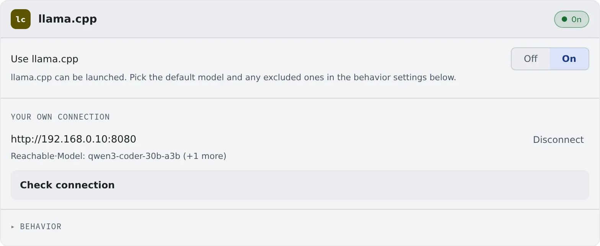

# Use lcpp

English | [日本語](lcpp.ja.md)

lcpp is the agent that runs models on the deployment's own llama.cpp engine.
It needs no vendor account, no sign-in and no install, and starts from the launch dialog like any other kind.

## How it works

| What you do | What happens |
|---|---|
| Pick "Launch llama.cpp" in the launch dialog | The session runs on the deployment's engine. A stopped engine starts on the first turn |
| Enter a llama-server URL under "Your own connection" | Sessions connect straight to that server instead of the deployment's engine |
| Turn "Use llama.cpp" off | lcpp can no longer be started |

## Decide whether to use it

"**Use llama.cpp**" on the **llama.cpp** card in **⚙Settings → Agents** is on / off for lcpp as a whole. It is on by default.

- Off removes it from the launch paths and refuses launches from any other route
- Sessions already running keep running when you turn it off

## Connect to your own llama-server

To use a llama-server on your own network, enter it under "**Your own connection**".

1. Enter the URL (`http://192.168.0.10:8080`, say) and, if needed, an API key
2. Press "**Check connection**". The build, the window and the models appear

While it is set:

- The launch dialog's model list is that server's
- lcpp sessions connect straight to that server. They do not go through the Control Plane, so limits your tenant administrator set on engines do not apply
- The "**Chat**" pill at the top of the screen reports that server too: its state (**Connected** / **Not reachable** / **Checking**) and the model it found ([Icons, badges and menus](../../ref/console-ui.md#engine-pills))

Clear the field to go back to the deployment's engine.

## Behavior

The card's "**Behavior**" picks the default model, the models to exclude and so on ([the items every agent shares](choose.md#choose-the-behavior)). It has no RTK setting.

## Before your first session

Before your first session, read [lcpp: what hardware measurement found](../../ref/agents.md#lcpp-what-hardware-measurement-found). In short:

- With the engine instance stopped, the first turn takes minutes
- The context window has a lower bound worth choosing
- Only a few model families are confirmed to work

## Good to know

- **It runs as Managed only.** It cannot start in Terminal (CLI)
- **Your agent instructions are added to the system prompt every turn.** Running sessions pick them up from the next turn ([Write down how you work, once](instructions.md))
- **MCP server tools are not loaded until needed.** When their descriptions run past a few thousand characters, it finds and uses what it needs through three tools,
  `tool_search`, `tool_describe` and `tool_call`, instead of sending them all every turn. That keeps a small context window free
- The history shows the names of the tools actually called. lcpp's own tools (read, edit, bash and so on) are always sent
- An administrator can pin either behaviour for the whole deployment

## When it goes wrong

### The first turn does not come back

The engine instance is starting. Check its state on the "**Chat**" pill at the top of the screen. It can take a few minutes.

### "Check failed" appears

Check the URL, the port and the API key. The server must be reachable from the workspace.

## Related

- [Choose an agent](choose.md)
- [Agents reference](../../ref/agents.md)
