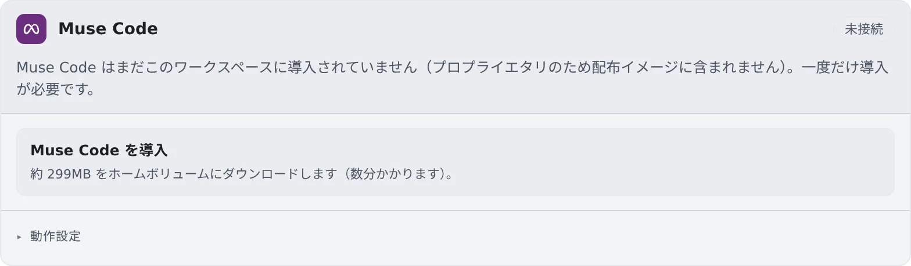

# Muse Code を接続する

[English](muse.md) | 日本語

Meta の Muse Code を導入してログインすると、セッションで動かせます。
マネージドだけで動き、ツールの承認を一度も求めないエージェントです。

## 全体像

| あなたがやること | 起きること |
|---|---|
| はじめての 1 回だけ「Muse Code を導入」を押す | Muse Code がホームにダウンロードされる |
| Meta アカウントか API キーでログインする | 起動メニューに Muse Code が並ぶ |
| 動作設定でモデルや contributor モードを選ぶ | 次に作成するセッションから使われる |

## 導入する

Muse Code はイメージに含まれないので、ログインの前に一度だけ導入します。

1. **⚙設定 →「エージェント」** の **Muse Code** カードで「**Muse Code を導入**」を押します
2. 約 299 MB がホームにダウンロードされます。数分かかります
3. 終わると、カードが自動でログインの画面に変わります

## 接続する

ログインのしかたは 2 つあり、料金のかかり方が違います。

| ボタン | 料金 | やること |
|---|---|---|
| Meta アカウントでログイン | 契約しているプランの範囲 | 出てきたリンクをブラウザで開き、コードを確かめて承認します。貼り戻すコードはありません |
| API キーを使う | 従量課金 | Meta の API キー（`LLM` で始まるもの）を保存します |

- API キーを保存すると、保存されていたアカウントのログイン情報は消え、従量課金になります。アカウントでログイン済みなら、先に「**切断**」してください
- カードには、今の接続がプランの範囲か従量課金かが出ます

## 更新する

固定された新しい版があると、カードに「**新しい版があります**」と「**Muse Code を更新**」が出ます。

- 押すまでは、導入済みの版が使われ続けます
- 動いている muse のセッションは、再起動するまで古い版で動きます

## 動作設定

カードの「**動作設定**」で、モデルと reasoning effort のほかに、次の項目を選べます。

| 項目 | 決めること |
|---|---|
| contributor モード | オンの間は、会話（セッション間のメッセージを含む）が Meta の製品改善に使われることがあります。既定ではオフです |

- 各セッションは、作成したときのモードを、停止・再開や Agent の再起動をまたいで保ちます
- 変更は、それ以降に作成するセッションと、次からのアシスタント・AI 補助に効きます

## もっと安全に使う

**muse のセッションは、ツールの承認を一度も求めません。** ワークスペースの中ではサンドボックスを作れないので、すべてのツールの呼び出しが許可されます。
shell のセッションと同じように、このワークスペースで何でもできるものとして扱ってください。

## 知っておくこと

- **マネージドだけで動きます。** ターミナル（CLI）では起動できません
- 入力欄の横の **`/`** ボタンには、動いているセッション自身のスキルが並び、選ぶとそのスキルが動きます（[スキルやコマンドを呼び出す](../sessions/skills.ja.md)）
- 利用上限でターンが止まったときは、上限が解けると自分で再開します
- muse の中で動く定時実行やセッション間のメッセージなど、Agent Fleet から見えないものは [エージェントのリファレンス](../../ref/agents.ja.md#muse-agent-fleet-からは見えないもの) にあります

## 困ったとき

### プランで使っているはずなのに、従量課金と出る

カードに「**環境変数 META_API_KEY が設定されています。**」と出ていないか確かめてください。
この変数はログインより優先されるので、カードの表示にかかわらず従量課金になります。プランで使うには、ワークスペースの環境変数から外します。

### 「導入に失敗しました」と出る

接続を確かめて、もう一度「**Muse Code を導入**」を押してください。

## 関連

- [エージェントを選ぶ](choose.ja.md)
- [エージェントのリファレンス](../../ref/agents.ja.md)
