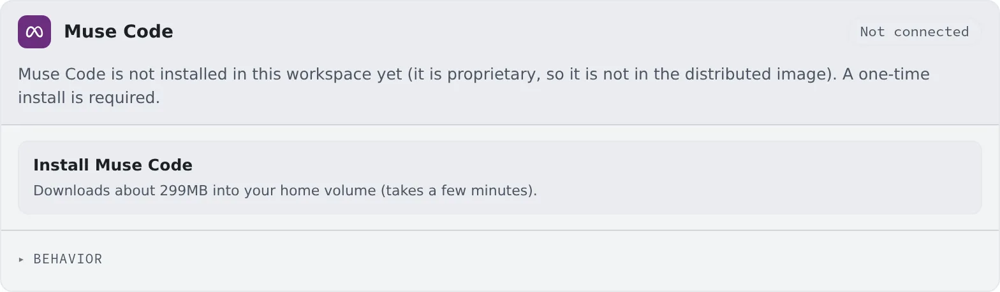

# Connect Muse Code

English | [日本語](muse.ja.md)

Install Meta's Muse Code and sign in, and sessions can run it.
It runs as Managed only, and it never asks to approve a tool.

## How it works

| What you do | What happens |
|---|---|
| Press "Install Muse Code" once, the first time | Muse Code is downloaded into your home |
| Sign in with a Meta account or an API key | Muse Code appears in the launch menu |
| Choose the model and Contributor mode under Behavior | Sessions created afterwards use them |

## Install

Muse Code is not in the image, so you install it once before signing in.

1. Press "**Install Muse Code**" on the **Muse Code** card in **⚙Settings → Agents**
2. About 299 MB downloads into your home. This takes a few minutes
3. When it is done, the card switches to the sign-in screen by itself

## Connect

There are two ways to sign in, and they bill differently.

| Button | Billing | What you do |
|---|---|---|
| Sign in with your Meta account | Within your plan | Open the link shown in the browser, check the code and approve. There is no code to paste back |
| Use an API key | Per use | Save a Meta API key (one that starts with `LLM`) |

- Saving an API key removes the stored account sign-in and moves you to per-use billing. If you signed in with an account, "**Disconnect**" first
- The card shows whether the current connection is within your plan or billed per use

## Update

When a newer pinned version exists, the card shows "**A newer version is available**" and "**Update Muse Code**".

- Until you press it, the installed version keeps being used
- Running muse sessions keep the old version until they restart

## Behavior

Besides the model and the reasoning effort, the card's "**Behavior**" has the following.

| Item | What it decides |
|---|---|
| Contributor mode | While on, conversations (messages between sessions included) may be used to improve Meta's products. Off by default |

- Each session keeps the mode it was created with, across stop / resume and Agent restarts
- A change applies to sessions created afterwards, and to the assistant and AI assistance from their next use

## Use it more safely

**A muse session never asks to approve a tool.** A sandbox cannot be built inside the workspace, so every tool call is allowed.
Treat it like a shell session: it can do anything in this workspace.

## Good to know

- **It runs as Managed only.** It cannot start in Terminal (CLI)
- The **`/`** button beside the input box lists the running session's own skills; pick one and it runs ([The conversation](../../member/04-conversation.md#calling-a-skill-or-a-command))
- When a turn stops on a usage limit, it resumes by itself once the limit lifts
- What Agent Fleet does not see, such as schedules and messages between sessions running inside muse, is in the [Agents reference](../../ref/agents.md#muse-what-agent-fleet-does-not-see)

## When it goes wrong

### It says per-use billing although I use a plan

Check whether the card says "**META_API_KEY is set in this workspace's environment.**"
That variable takes priority over the sign-in, so you are billed per use whatever the card shows. Remove it from the workspace environment variables to use your plan.

### "Install failed" appears

Check your connection and press "**Install Muse Code**" again.

## Related

- [Choose an agent](choose.md)
- [Agents reference](../../ref/agents.md)
