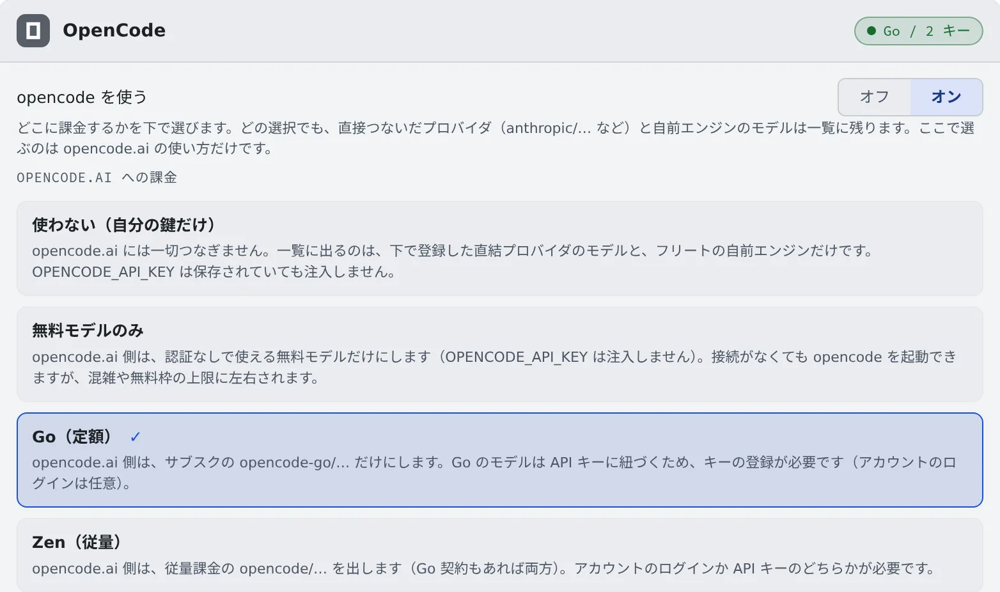

# OpenCode を接続する

[English](opencode.md) | 日本語

OpenCode は、Anthropic・OpenAI・OpenRouter など、いくつもの LLM プロバイダのモデルを切り替えて使えるエージェントです。
自分の API キーか opencode.ai の契約を登録すると、セッションで動かせます。

## 全体像

| あなたがやること | 起きること |
|---|---|
| 「opencode を使う」をオンにする | opencode を起動できるようになる |
| opencode.ai への課金のしかたを選ぶ | 起動の一覧に出るモデルが、その枠のものになる |
| プロバイダの API キーを登録する | opencode の起動時に、環境変数として渡される |
| 「opencode serve を再起動して反映」を押す | 動いている opencode に、変えた設定が届く |

## 使うかどうかを決める

**⚙設定 →「エージェント」** の **OpenCode** カードには、役割の違う 2 つの選択があります。

| 項目 | 決めること |
|---|---|
| opencode を使う | opencode 全体のオン／オフ。オフの間は、API キーを保存していてもログインしていても起動しません |
| opencode.ai への課金 | opencode.ai をどう使うか。オンにすると出てきます |

新しいワークスペースは「**opencode を使う**」がオフの状態で始まります。自分でオンにするまで、opencode.ai には何もつながりません。

## 課金のしかたを選ぶ

「**opencode.ai への課金**」で選ぶのは、opencode.ai の使い方だけです。どれを選んでも、自分で登録したプロバイダのモデルと、
配備の自前エンジンのモデルは、起動の一覧に残ります。

| 選択 | 一覧に出る opencode.ai のモデル | 必要なもの |
|---|---|---|
| 使わない（自分の鍵だけ） | なし。`OPENCODE_API_KEY` を保存していても渡しません | 自分のプロバイダの API キー、または自前エンジン |
| 無料モデルのみ | 認証なしで使える無料のモデル。混雑や無料枠の上限に左右されます | なし |
| Go（定額） | サブスクのモデル（`opencode-go/…`） | opencode.ai の API キー。アカウントのログインは任意です |
| Zen（従量） | 従量課金のモデル（`opencode/…`）。Go の契約もあれば両方 | アカウントのログインか API キーのどちらか |

選んだ枠のモデルが 1 つもないとき（Go の契約がないのに Go を選んだときなど）は、起動の一覧が Zen に切り替わり、そのことがカードに出ます。
選んだ枠で課金したいときは、認証と契約を確かめてください。

## API キーを登録する

1. プリセットからプロバイダを選びます。環境変数の名前が自動で入ります
2. キーを貼り付けて「**接続**」を押します

| プリセット | 環境変数 |
|---|---|
| opencode.ai（Go / Zen 共通キー） | `OPENCODE_API_KEY` |
| Anthropic | `ANTHROPIC_API_KEY` |
| OpenAI | `OPENAI_API_KEY` |
| OpenRouter | `OPENROUTER_API_KEY` |
| Google Gemini | `GEMINI_API_KEY` |
| Sakana AI（Fugu / Fugu Ultra） | `SAKANA_API_KEY` |
| カスタム… | 自分で指定します（`GROQ_API_KEY` など） |

- キーはいくつでも登録でき、起動するときに、接続したプロバイダのモデルを選べます
- 今の枠では渡さないキーも消えません。「**この枠では注入しません**」と出たまま残ります
- opencode.ai のキーは、opencode.ai にログインして、課金の設定から発行します。Go と Zen で同じキーです

### opencode.ai のアカウントでログインする

API キーの代わりに、または API キーと一緒に、opencode.ai のアカウントでログインすることもできます。

1. 「**opencode にログイン**」を押すと、認可のリンクが開きます
2. ブラウザで承認します。Console に貼り戻すものはありません

ログインすると、その組織で使えるモデルが起動の一覧に入ります。
動いているマネージドのセッションには次のターンから、ターミナル（CLI）のセッションには再起動のあとから効きます。

### Go の利用状況を開けるようにする

Go の利用枠のページの URL（または `wrk_…` の ID）を貼っておくと、カードの「**Go の利用状況を開く ↗**」から開けます。
利用率の数字は opencode.ai に API がないので取り込めませんが、上限に当たったときは「**直近の上限: …**」とカードに出ます。

## 変えた設定を反映する

キーや課金の選択を変えても、**動いている opencode serve には自動では届きません**。
反映が必要な変更をすると、カードに「**設定を N 件変更しました。**…再起動するまで反映されません」という案内と、「**opencode serve を再起動して反映**」が出ます。

再起動するときは、応答中の opencode のセッションが終わるのを少し待ち、終わらないものは途中で打ち切ります。手が空いているときに押してください。

## 動作設定

カードの「**動作設定**」の項目は、[ほかのエージェントと共通](choose.ja.md#動作設定を選ぶ)です。
RTK はコマンドを毎回書き換えます（[料金と使用量を確かめる](usage.ja.md#rtk-でトークンを節約する)）。

## 知っておくこと

- **読むのは `AGENTS.md` だけです。** `CLAUDE.md` しかないリポジトリでは、opencode には何も渡りません。守らせたいことはリポジトリの `AGENTS.md` に書いてください
- **「エージェントへの指示」は届きます。** opencode のグローバルな `AGENTS.md` の目印付きのブロックに書き込まれます。保存のたびに書き直されるので、そのブロックは手で編集しないでください（[作業のしかたを一度だけ書いておく](instructions.ja.md)）
- **ターミナル（CLI）のセッションは、1 つの opencode サーバーを共有します。** セッションごとにサーバーを立てないので、セッションを増やしてもメモリをあまり使いません。会話・環境・状態はセッションごとに別です。共有のサーバーを使えないときは、自動でセッション専用のサーバーで起動します
- **質問はフォームで答えます。** opencode が質問すると、セッション画面に質問のカードが出ます。選択肢を選ぶか、自分で入力します。「**キャンセルして会話に戻る**」でフォームを取り下げると、エージェントは先へ進みます
- 専用サーバーで動くターミナル（CLI）のセッションでは、Console に質問カードが出ません。質問はターミナルで答えます
- 答える前に opencode サーバーが再起動すると、待っていたフォームはなくなります
- **ToDo リストは、自分の opencode の設定で `experimental.todo` を有効にしたときだけ出ます。** 出なくても、接続が切れたわけではありません
- opencode 1 で作った会話は、opencode 2 が初めて起動したときに、同じセッション ID のまま取り込まれます。続きから再開できます
- Amazon Bedrock で動かすルートは [エージェントのリファレンス](../../ref/agents.ja.md#opencode-amazon-bedrock-ルート) にあります

## 困ったとき

### 「プロバイダがエラーを返し、エージェントが再試行しています」と出る

レート制限や過負荷のようなエラーを、opencode が再試行しています。答えが始まるかターンが終わると消えます。待つか、ターンを止めてください。
この帯はマネージドのセッションにだけ出ます。

### 「プロバイダのエラーは再試行しても直らないため、ターンを停止しました」と出る

マネージドのセッションで、再試行しても直らないエラーが返りました。表示されたプロバイダのメッセージで判断します。

| メッセージの内容 | やること |
|---|---|
| 「requires Global regions」などリージョンやプライバシー | プロバイダのアカウントの設定を変えます。opencode Go なら、opencode.ai のワークスペースの Privacy の設定です |
| クォータや課金の残高 | アカウントにチャージします |
| API キーが違う | カードでキーを入れ替えます |

### 設定を変えたのに効かない

カードに「**opencode serve を再起動して反映**」が出ていないか確かめてください。

### 「作業中」のまま何も返ってこない

[エージェントにログインできない・モデルが出ない](../troubleshooting/agents.ja.md#opencode-のセッションが作業中のまま何も返ってこない) を見てください。

## 関連

- [エージェントを選ぶ](choose.ja.md)
- [エージェントのリファレンス](../../ref/agents.ja.md)
