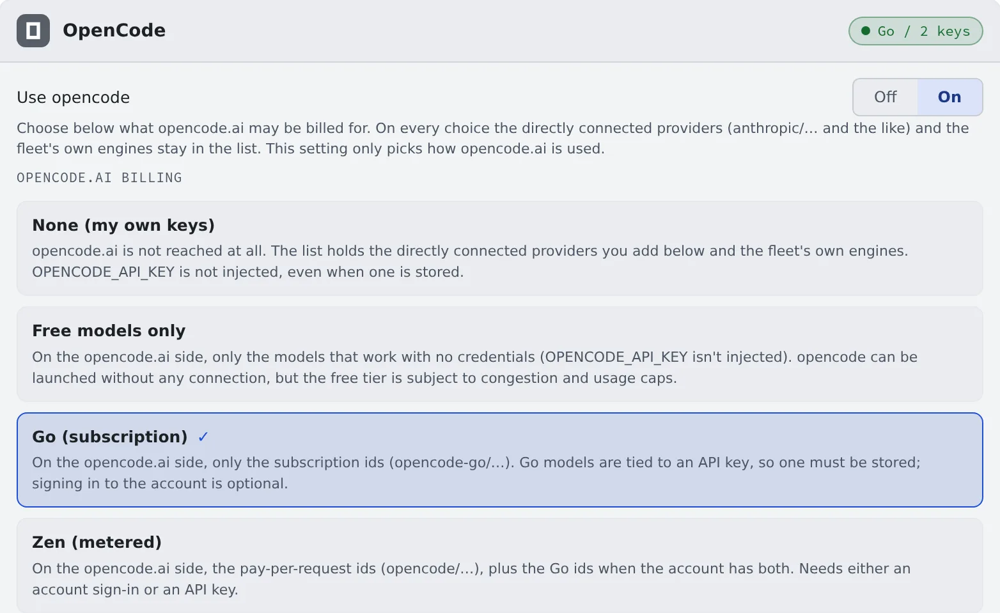

# Connect OpenCode

English | [日本語](opencode.ja.md)

OpenCode is an agent that switches between models from many LLM providers, such as Anthropic, OpenAI and OpenRouter.
Register your own API keys or an opencode.ai subscription and sessions can run it.

## How it works

| What you do | What happens |
|---|---|
| Turn "Use opencode" on | opencode can be started |
| Choose how opencode.ai bills you | The launch list shows that route's models |
| Register provider API keys | They are passed as environment variables when opencode starts |
| Press "Restart opencode serve to apply" | The running opencode picks up what you changed |

## Decide whether to use it

The **OpenCode** card in **⚙Settings → Agents** has two choices with different jobs.

| Item | What it decides |
|---|---|
| Use opencode | On / off for opencode as a whole. While off, it does not start, even with API keys saved or an account signed in |
| opencode.ai billing | How opencode.ai is used. It appears once the first is on |

A new workspace starts with "**Use opencode**" off. Nothing reaches opencode.ai until you turn it on yourself.

## Choose the billing

"**opencode.ai billing**" decides only how opencode.ai is used. Whichever you pick, the models of the providers you registered yourself,
and of the deployment's own engines, stay in the launch list.

| Choice | opencode.ai models in the list | What you need |
|---|---|---|
| None (my own keys) | None. `OPENCODE_API_KEY` is not passed even when saved | Your own provider's API key, or an own engine |
| Free models only | The free models usable without authentication. Subject to congestion and free-tier limits | Nothing |
| Go (subscription) | The subscription models (`opencode-go/…`) | An opencode.ai API key. Signing in to the account is optional |
| Zen (metered) | The metered models (`opencode/…`); with a Go subscription as well, both | Either an account sign-in or an API key |

If the route you chose has no models at all (Go chosen without a Go subscription, say), the launch list falls back to Zen and the card says so.
If you want to be billed on the route you chose, check your authentication or subscription.

## Register API keys

1. Pick a provider from the presets. The environment variable's name fills in
2. Paste the key and press "**Connect**"

| Preset | Environment variable |
|---|---|
| opencode.ai (one key for Go and Zen) | `OPENCODE_API_KEY` |
| Anthropic | `ANTHROPIC_API_KEY` |
| OpenAI | `OPENAI_API_KEY` |
| OpenRouter | `OPENROUTER_API_KEY` |
| Google Gemini | `GEMINI_API_KEY` |
| Sakana AI (Fugu / Fugu Ultra) | `SAKANA_API_KEY` |
| Custom… | You name it (`GROQ_API_KEY`, say) |

- You can register as many keys as you like, and pick a connected provider's model when you start
- A key the current route does not pass is not deleted. It stays, marked "**not injected on this route**"
- An opencode.ai key is issued from the billing settings once you sign in to opencode.ai. Go and Zen use the same key

### Sign in with an opencode.ai account

Instead of an API key, or alongside one, you can sign in with an opencode.ai account.

1. Press "**Sign in to opencode**" and an authorization link opens
2. Approve in the browser. There is nothing to paste back into the Console

Once signed in, the models your organisation can use join the launch list.
Running Managed sessions see them from their next turn; Terminal (CLI) sessions after a restart.

### Make Go usage one click away

Paste the URL of your Go usage page (or its `wrk_…` ID), and "**Open Go usage ↗**" on the card opens it.
The usage figures cannot be imported because opencode.ai has no API for them, but when you hit a limit the card shows "**Last limit: …**".

## Apply a change

Changing keys or the billing choice **does not reach a running opencode serve by itself**.
After a change that needs it, the card shows "**N settings changed.** … do not apply until it restarts" and "**Restart opencode serve to apply**".

A restart waits a while for answering opencode sessions to finish and cuts off the ones that do not. Press it when you are between tasks.

## Behavior

The items under the card's "**Behavior**" are [the ones every agent shares](choose.md#choose-the-behavior).
RTK rewrites commands every time ([Check prices and usage](usage.md#save-tokens-with-rtk)).

## Good to know

- **It reads only `AGENTS.md`.** In a repository that has only `CLAUDE.md`, opencode gets nothing. Put what opencode must follow in the repository's `AGENTS.md`
- **Your agent instructions do reach it.** They are written into a marked block of opencode's global `AGENTS.md`. The block is rewritten on every save, so do not edit it by hand ([Write down how you work, once](instructions.md))
- **Terminal (CLI) sessions share one opencode server.** No server is started per session, so adding sessions costs little memory. Conversation, environment and state stay separate per session. When the shared server is unavailable, the session starts on a server of its own automatically
- **Questions are answered in a form.** When opencode asks something, a question card appears in the session view. Pick an option or type your own. "**Cancel — back to chat**" withdraws the form, and the agent moves on
- A Terminal (CLI) session on its own server shows no question card in the Console; answer its questions in the terminal
- A pending form is lost if the opencode server restarts before you answer
- **The to-do list appears only when you enable `experimental.todo` in your own opencode configuration.** Its absence does not mean the connection dropped
- Conversations made with opencode 1 are taken in, under the same session ID, the first time opencode 2 starts. You can resume them where they left off
- The route that runs it on Amazon Bedrock is in the [Agents reference](../../ref/agents.md#opencode-the-amazon-bedrock-route)

## When it goes wrong

### "The provider returned an error and the agent is retrying" appears

opencode is retrying an error such as a rate limit or an overload. The band goes away once an answer starts or the turn ends. Wait, or stop the turn.
The band appears only in Managed sessions.

### "The provider returned an error that retrying cannot fix, so the turn was stopped" appears

In a Managed session, the provider returned an error that retrying cannot fix. Decide from the provider's message shown.

| What the message is about | What to do |
|---|---|
| Regions or privacy, such as "requires Global regions" | Change your provider account's settings. For opencode Go, it is the Privacy setting of your opencode.ai workspace |
| Quota or billing balance | Top up the account |
| A wrong API key | Replace the key on the card |

### A change has no effect

Check whether the card shows "**Restart opencode serve to apply**".

### It stays "working" and nothing comes back

See [Fix an agent's login or a missing model](../troubleshooting/agents.md#an-opencode-session-stays-working-and-nothing-comes-back).

## Related

- [Choose an agent](choose.md)
- [Agents reference](../../ref/agents.md)
