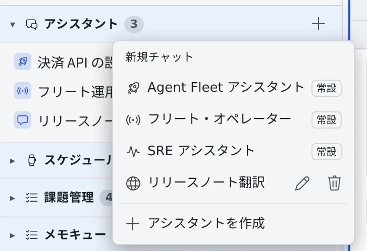
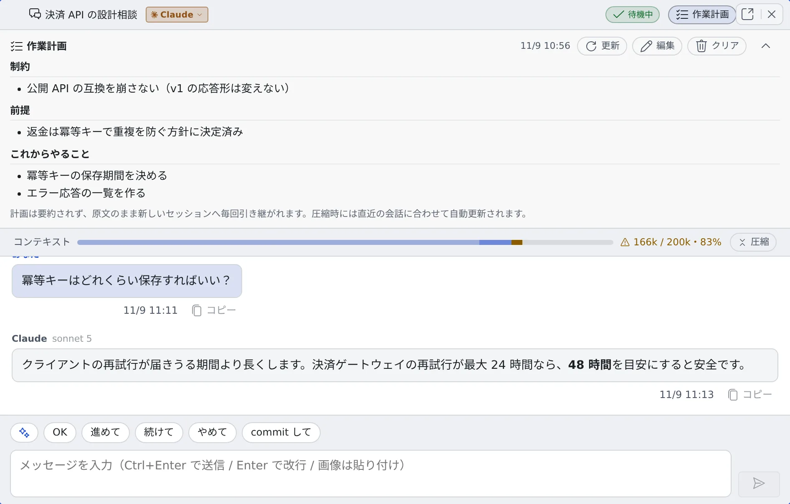

# アシスタントに質問する

[English](assistant.md) | 日本語

左ペインの **アシスタント** から、リポジトリを使わずに AI と会話できます。ちょっとした質問、文章の翻訳や要約、
Agent Fleet の使い方の確認に向いています。

## 全体像

| あなたがやること | エージェントがやること |
|---|---|
| アシスタントを選んでチャットを始める | 選んだアシスタントの役割と、許可されたツールの範囲で答える |
| 質問や文章を送る | 会話の中で答えを返す。ファイルは書き換えない |
| 長くなった会話を圧縮する | それまでの会話を要約し、要約と作業計画だけを持って続きを答える |
| 作業計画を書いておく | 圧縮しても新しいチャットに移っても、計画を原文のまま受け取る |

## チャットとセッションを使い分ける

| 使うもの | 向いていること |
|---|---|
| チャット（アシスタント） | 短い質問、翻訳、要約、文章の手直し。その場で答えが返れば済むもの |
| セッション | ファイルを読み書きする作業、コードの変更、大きなファイルの一括処理 |

チャットは作業フォルダを持たず、ファイルを作ることもありません。訳した結果を別のファイルに保存したいときなど、
ファイルの出力を伴う作業はセッションに頼んでください（[セッションを始める](../sessions/start.ja.md)）。

## チャットを始める

1. 左ペインの **アシスタント** の見出しにある **＋**（「**新規チャット**」）を押します
2. 話したいアシスタントを選びます。最初のメッセージを送るまで、会話は保存されません

最初から用意されているアシスタントは、次の 3 つです（一覧では「**常設**」が付きます）。

| アシスタント | できること |
|---|---|
| Agent Fleet アシスタント | Agent Fleet の使い方を案内します。今のワークスペースの状態（動いているセッションなど）を確かめながら答えます |
| フリート・オペレーター | セッションの起動・指示・停止や、メモキューの確認と送信まで、チャットから指揮します（[フリート・オペレーター](../fleet/operator.ja.md)） |
| SRE アシスタント | インシデント対応と監視運用の相談相手です。PagerDuty・Grafana・CloudWatch などを接続しておくと、実際の状況を読み取りながら手伝います（読み取り専用） |

翻訳用などの自分のアシスタントは、同じ一覧の「**アシスタントを作成**」で作れます（[翻訳や専用のアシスタントを使う](purpose-assistants.ja.md)）。

## 質問を送る

- 入力欄に書いて、既定では **Ctrl+Enter**（Mac は ⌘+Enter）で送ります。Enter だけで送りたいときは、⚙設定 →「**キー操作**」の **送信キー** で切り替えます
- 画像は入力欄に貼り付けて一緒に送れます。スクリーンショットを見せて質問するときに使います
- 答えている間は「**考え中…**」と出ます
- 回答の横には、それを書いたモデルが出ます（例: `sonnet 5`）。途中でモデルやエージェントが変わっても、前の回答の表示は変わりません。CLI がモデルを知らせないとき（Cursor の Auto など）は空欄です

## 会話の途中でエージェントを切り替える

チャットの見出しにあるエージェントのチップ（例: `Claude ▾`）を押し、切り替え先の CLI を選びます。

- それまでの会話は消えません。**次の送信**でまとめて新しいエージェントに渡すので、その 1 ターンだけトークンの消費が増えます
- モデルは、⚙設定 →「**アシスタント**」の **アシスタントのモデル** で、切り替え先の CLI の行に選んだものになります
- 元のエージェントに戻すと、そのエージェントは自分が最後に答えた続きから、留守の間の会話だけを受け取ります
- 接続していない CLI は選べません。答えを生成している間も切り替えられないので、いったん止めてから切り替えます

## 会話が長くなったら圧縮する

最初の回答が返ると、見出しの下に **コンテキスト** のバー（使用量 / 上限・%）が出ます。使用率が **80%** を超えると
バーが警告の色になり、会話にもお知らせが 1 回届きます。

| やり方 | どうなるか |
|---|---|
| バーの右端の **圧縮** を押す | それまでの会話を要約し、要約だけを新しいセッションに渡して、同じチャットで続けます。画面の履歴は残ります。要約を作るのに 1 ターン分のトークンを使います |
| 新しいチャットを開く | 必要な要点だけを自分で書いて渡します。区切りのよいときは、これがいちばん確実です |

放っておいたときのために、次の安全網があります。

- 使用率が **90%** を超えたまま次のやり取りが始まると、先に自動で圧縮してから答えます
- 使用量が **自動圧縮の閾値**（既定は 150k トークン）を超えたときも、90% に達していなくても自動で圧縮します
- 圧縮の前に上限を超えてしまったときも、自動で圧縮してから答え直します。それでも戻せないときはお知らせが出るので、「**圧縮**」か新しいチャットで続けてください

## 忘れさせたくないことを作業計画に書く

見出しの **作業計画** を押すと、計画の欄が開きます。ここに書いたことは要約されず、圧縮しても新しいチャットに移っても、原文のまま渡ります。

- **制約**（この先ずっと守ること）、**前提**（次の一手に必要な決定事項）、**これからやること**（順番と依存）を書きます
- 「**編集**」で直接書けます。「**更新**」を押すと、直近の会話から計画を作り直します。方針が変わった直後に押してください
- 圧縮するときは、直近の会話に合わせて自動で更新されます
- 「**クリア**」で空にできます。会話の履歴と要約は残ります
- 済んだ作業を並べる場所ではありません。「これがないと次の一手を間違える」ことだけを書くと役に立ちます

## 回答の言語とモデルを決める

⚙設定 →「**アシスタント**」で、これから始める会話の動きを決めます。

| 項目 | 決めること |
|---|---|
| 回答言語 | 「**入力に合わせる**」なら渡した文章の言語で答えます。日本語か English を選ぶと、ほかの言語の文章でもその言語で答えます。ファイルの「アシスタントで翻訳」には効きません |
| エージェント優先順位 | 新しい会話は、上から見て最初に接続済みの CLI で始まります。会話はその CLI のまま続きます |
| アシスタントのモデル | 用意されたアシスタントが新しい会話で使うモデルを、CLI ごとに選びます。「**推奨（現在: …）**」には、いま実際に何になるかが出ます |
| コンテキストの自動圧縮 | 90% を超えたときの自動圧縮です。オフにもできます |
| 自動圧縮の閾値（トークン） | この量を超えたら自動で圧縮します。既定は 150k です。小さいほど節約になり、圧縮の回数は増えます |
| 外観 | アシスタントの面のテーマと背景色です。このブラウザだけに保存されます |

「推奨」のままのとき、エージェントごとの既定は次のとおりです。会話向けに速くて安いモデルを選んでいます。

| エージェント | 既定のモデル |
|---|---|
| claude | Sonnet 5。配備全体の既定は管理者が変えられます |
| codex | 一覧にある最新の Luna |
| opencode | 一覧に `opencode-go/glm-5.2` があればそれ、なければ `opencode/nemotron-3-ultra-free` |
| agy | Gemini 3.5 Flash |
| cursor | Cursor 自身の既定（Auto） |
| muse | contributor 版ではない最新のモデル |

- 使わないと決めたモデルは選ばれません。当てはまるものがなければ、CLI 自身の既定で動きます
- すでに始めた会話のモデルは、あとから設定を変えても変わりません
- どの種類のエージェントがアシスタントになれるかは、[エージェント — 種別ごとにできること](../../ref/agents.ja.md) の「アシスタントチャットとして利用」の行にあります。cursor のアシスタントは読み取り専用で動きます
- モデルの価格とコンテキストの長さは [料金と使用量を確かめる](../agents/usage.ja.md#モデルの定価を見る) で見られます

同じタブのうち、セッション報告への自動応答・自動走行・中断時の自動再開・セッション出力の取得上限は、
フリート・オペレーターの動きを決める項目です（[自動応答を調整する](../fleet/operator.ja.md#自動応答を調整する)）。

## 困ったとき

### 「Claude のログインが切れています」と出る

チャットが claude で動いていて、ワークスペースの Claude のログインが切れています。お知らせの「**再認証**」でログインし直し、
「**再送する**」で同じメッセージを送り直してください（[エージェントにログインできない・モデルが出ない](../troubleshooting/agents.ja.md#ログインが切れていますと出てエージェントが止まった)）。

### 別のエージェントが答えた

会話の CLI が利用上限やレート制限で使えず、何も表示する前に失敗したターンは、**エージェント優先順位** で次に使える CLI が
1 回だけ代わりに答え、会話にお知らせが出ます。

- 会話のエージェントは変わりません。制限が解ければ、次のターンから元の CLI に戻ります
- 解除が近い制限のときは切り替えず、そのターンはエラーで終わります
- 答えを表示し始めたターンは、やり直しません

### 切り替え先の CLI が選べない

まだ接続していない CLI です。⚙設定 →「**エージェント**」でログインすると選べるようになります（[エージェントを選ぶ](../agents/choose.ja.md)）。

## 関連

- [翻訳や専用のアシスタントを使う](purpose-assistants.ja.md)：ファイルの翻訳・要約と、自分用のアシスタントを作る
- [メモをためて渡す](memos.ja.md)：思いついた指示をためて、あとでセッションやアシスタントに渡す
- [フリート・オペレーターに任せる](../fleet/operator.ja.md)：フリート・オペレーターでセッションを指揮する
- [エージェント — 種別ごとにできること](../../ref/agents.ja.md)：アシスタントになれるエージェント
