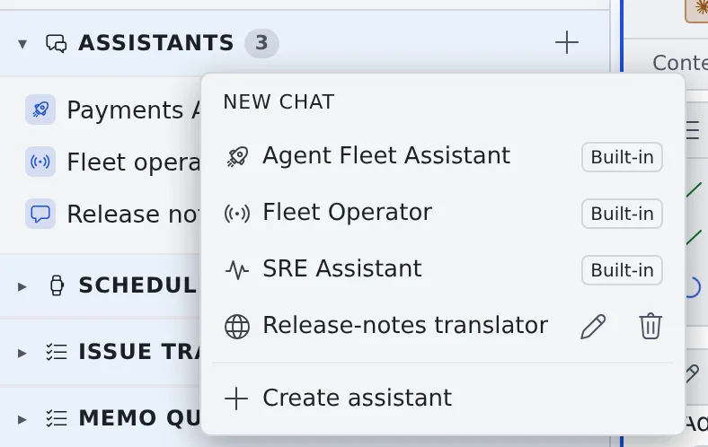
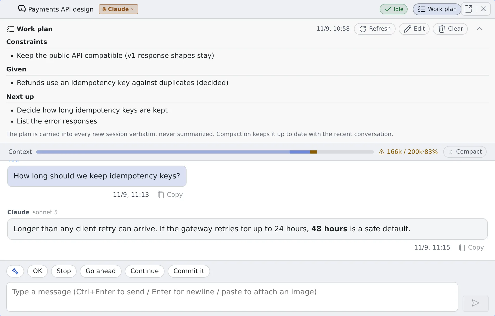

# Ask an assistant

English | [日本語](assistant.ja.md)

The **Assistants** section of the left pane lets you talk to an AI without a repository. It suits quick questions,
translating or summarizing text, and checking how Agent Fleet works.

## How it works

| What you do | What the agent does |
|---|---|
| Pick an assistant and start a chat | Answers in that assistant's role, within the tools it is allowed |
| Send a question or a text | Answers in the conversation. It does not change files |
| Compact a long conversation | Summarizes the conversation so far and carries on with only the summary and the work plan |
| Write a work plan | Receives the plan word for word, after a compaction and in a new chat alike |

## Choose between a chat and a session

| Use | Good for |
|---|---|
| A chat (assistant) | Quick questions, translation, summaries, polishing a text. Anything where an answer on the spot is enough |
| A session | Work that reads and writes files, code changes, processing large files in bulk |

A chat has no working folder and creates no files. When the work produces a file, such as saving a translation to a
new file, ask a session instead ([Start a session](../sessions/start.md)).

## Start a chat

1. Press **+** ("**New chat**") in the header of the **Assistants** section in the left pane
2. Pick the assistant you want to talk to. Nothing is saved until you send the first message

Three assistants come ready to use (marked "**Built-in**" in the list).

| Assistant | What it does |
|---|---|
| Agent Fleet Assistant | Explains how to use Agent Fleet. It answers while checking the current state of your workspace, such as which sessions are running |
| Fleet Operator | Directs your sessions from the chat: starting, instructing and stopping them, and checking and sending the memo queue ([the Fleet Operator](../fleet/operator.md)) |
| SRE Assistant | A partner for incident response and monitoring. With PagerDuty, Grafana, CloudWatch and the like connected, it reads the real state while it helps (read-only) |

Make your own, for translation or anything else, with "**Create assistant**" in the same list ([Use translation and purpose-built assistants](purpose-assistants.md)).

## Send a question

- Type in the box and send with **Ctrl+Enter** (⌘+Enter on a Mac) by default. To send with Enter alone, change the **Send key** under ⚙ Settings → "**Keyboard**"
- Paste an image into the box to send it along, for example a screenshot you have a question about
- While the assistant answers, "**Thinking…**" shows
- Each answer shows the model that wrote it (for example `sonnet 5`). Earlier answers keep theirs when the model or agent changes later. When the CLI does not report its model (Cursor's Auto, say), the field stays empty

## Switch the agent mid-conversation

Press the agent chip in the chat's header (for example `Claude ▾`) and pick the CLI to switch to.

- The conversation so far is kept. It goes to the new agent all at once with **your next message**, so that one turn uses more tokens
- The model becomes the one chosen on that CLI's row under **Assistant models** in ⚙ Settings → "**Assistant**"
- Switch back and the original agent picks up after its own last answer, receiving only what was said while it was away
- A CLI that is not connected cannot be picked. You cannot switch while an answer is being generated either; stop it first

## Compact a long conversation

After the first answer, a **Context** bar (used / limit, %) appears under the header. Past **80%** the bar turns to a
warning color and a notice is posted once in the conversation.

| What you do | What happens |
|---|---|
| Press **Compact** at the right end of the bar | The conversation so far is summarized and only the summary goes to a new session, so you continue in the same chat. The history on screen stays. Writing the summary costs one turn's worth of tokens |
| Open a new chat | You write the points that matter and hand them over yourself. At a natural break, this is the surest way |

As a safety net for a conversation left to grow:

- When the next exchange starts with usage past **90%**, the conversation is compacted automatically before the answer
- When usage passes the **Auto-compact threshold** (150k tokens by default), it is compacted automatically even below 90%
- When the limit is exceeded before a compaction, the conversation is compacted automatically and the answer is retried. If even that cannot recover it, a notice appears: continue with "**Compact**" or a new chat

## Put what must not be forgotten in the work plan

Press **Work plan** in the header to open the plan. What you write here is never summarized: it carries over word for word after a compaction and into a new chat.

- Write the **constraints** (what holds from now on), the **givens** (decisions the next step depends on) and the **next steps** (order and dependencies)
- "**Edit**" lets you write it directly. "**Refresh**" rebuilds the plan from the recent conversation; press it right after the direction changes
- A compaction updates the plan to match the recent conversation automatically
- "**Clear**" empties it. The conversation history and the summary stay
- It is not a list of finished work. It helps most when it holds only what would make the next step go wrong if it were missing

## Choose the reply language and the models

⚙ Settings → "**Assistant**" decides how the conversations you start from now on behave.

| Setting | What it decides |
|---|---|
| Reply language | "**Match input**" answers in the language of the text you sent. Japanese or English makes it answer in that language whatever the text is in. It does not apply to "Translate with assistant" on a file |
| Agent priority | A new conversation starts on the first connected CLI from the top. The conversation stays on that CLI |
| Assistant models | The model the built-in assistants use in a new conversation, per CLI. "**Recommended (currently: …)**" shows what it actually resolves to now |
| Auto-compact chat context | The automatic compaction past 90%. It can be turned off |
| Auto-compact threshold (tokens) | Compacts automatically past this many tokens. The default is 150k. Smaller saves tokens and compacts more often |
| Appearance | The theme and background color of the assistant surface, saved in this browser only |

With "Recommended", each agent defaults to a fast, inexpensive model suited to conversation:

| Agent | Default model |
|---|---|
| claude | Sonnet 5. An administrator can change the deployment-wide default |
| codex | The newest Luna in the list |
| opencode | `opencode-go/glm-5.2` when the list has it, otherwise `opencode/nemotron-3-ultra-free` |
| agy | Gemini 3.5 Flash |
| cursor | Cursor's own default (Auto) |
| muse | The newest model that is not a contributor version |

- A model you chose not to use is never picked. When nothing fits, the CLI's own default runs
- Changing the setting later does not change the model of a conversation already started
- Which kinds of agent can be an assistant is on the "Usable as the assistant chat" row of [Agents — what each kind can do](../../ref/agents.md). A cursor assistant runs read-only
- Model prices and context lengths are in [Check prices and usage](../agents/usage.md#see-model-list-prices)

The rest of the tab (auto-responding to session reports, auto-pilot, auto-resuming interrupted turns, the session output fetch limit)
decides how the Fleet Operator behaves ([Adjust the automatic replies](../fleet/operator.md#adjust-the-automatic-replies)).

## When it goes wrong

### "Your Claude login has expired"

The chat runs on claude and the workspace's Claude login has expired. Log in again with "**Re-authenticate**" on the notice,
then send the same message again with "**Retry**" ([An agent stopped with "your login has expired"](../troubleshooting/agents.md#the-agent-stopped-saying-its-login-has-expired)).

### A different agent answered

When the conversation's CLI is held back by a usage limit or a rate limit and the turn fails before showing anything,
the next available CLI in **Agent priority** answers that turn once, and a notice is posted in the conversation.

- The conversation's agent does not change. Once the limit lifts, the original CLI answers from the next turn
- When the limit is about to lift, there is no switch and the turn ends in an error
- A turn that has started showing an answer is not retried

### The CLI to switch to cannot be picked

That CLI is not connected yet. Log in under ⚙ Settings → "**Agents**" and it becomes available ([Choose an agent](../agents/choose.md)).

## Related

- [Use translation and purpose-built assistants](purpose-assistants.md): translate or summarize a file, and make your own assistant
- [Collect memos and hand them over](memos.md): collect instructions as they occur to you and hand them to a session or an assistant later
- [Hand work to the Fleet Operator](../fleet/operator.md): direct sessions with the Fleet Operator
- [Agents — what each kind can do](../../ref/agents.md): which agents can be an assistant
