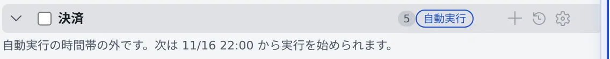
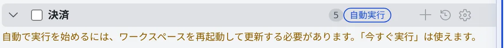

# メモを自動で実行する

[English](memo-auto-run.md) | 日本語

メモのカテゴリに**自動実行**を設定すると、そのカテゴリで実行待ちになったメモが、あなたの指示に沿ってセッションとして実行されます。
「今すぐ実行」で始めることも、時間帯や件数を決めて自動で始めることもできます。セッションが追加したメモは、あなたが承認するまで実行されません。

## 全体像

| あなたがやること | エージェントがやること |
|---|---|
| カテゴリに自動実行を設定する。設定するあいだは「自動で実行する」をオフにしておく。指示、エージェント、同時に動かす数、実行するタイミングを決める | 何もしません。「自動で実行する」がオフなら、設定を保存しても動きません |
| メモを書く。セッションが追加したメモは、内容を読んで承認する | あなたが書いたメモと承認したメモを、実行待ちとして順に取り上げる |
| 「今すぐ実行」を押す。または自動で始まるのを待つ | セッションを起動し、あなたの指示に沿って、メモに書かれた作業をする |
| 実行履歴を見る。操作を待っているセッションに答える | 作業が終わるとセッションは停止する。続けたいときは、あなたがセッションを開始し直す |

自動実行は、決まった時刻に決まったプロンプトを実行する[スケジュール](../fleet/schedules.ja.md)とは別のものです。
スケジュールは「毎朝 9 時にこれをやる」ための仕組みで、自動実行は「たまったメモを、あなたの指示に沿って片付ける」ための仕組みです。

## 設定する

1. 「**メモキュー**」ビューで、設定するカテゴリの見出しにある歯車（「**自動実行の設定**」）を押します
2. 「**指示**」を書き、ほかの項目を決めます
3. 「**保存**」を押します
4. 自動で始めたいときは、「**自動で実行する**」をオンにして保存します

- 設定できるのは、名前を付けたカテゴリだけです。「**未分類**」には設定できません
- 「**自動で実行する**」の初期値はオフです。オフのまま保存すれば、自動では始まりません。最初の保存でオンにして、すでに実行待ちのメモがあると、実行が始まります。「今すぐ実行」は、オンでもオフでも使えます
- 設定を作ると、そのカテゴリにすでにあるメモは次の状態になります。あなたが書いたメモは「実行待ち」、そのほかのメモは「承認待ち」、すでに送ったメモは「開始済み」です
- 受信箱から取り込んだメモは、自動実行のカテゴリに入れられません
- 組織の管理者が許可していないと、新しい設定は作れません。画面にその旨が出ます（[自動実行を許可する](../../admin/defaults/memo-auto-run.ja.md)）

### 項目

| 項目 | 内容 |
|---|---|
| 指示 | このカテゴリのメモを受け取ったセッションが、毎回最初に従う指示です。オンにするには必須で、16 KB まで書けます。メモは、この指示のあとにデータとして渡されます |
| エージェント | メモを実行するエージェントです。初期値は claude です。スケジュールと同じく、無人で動かせるエージェントから選びます（[エージェントの一覧](../../ref/agents.ja.md)） |
| モデル | 空欄ならエージェントの既定です |
| エフォート | 空欄なら既定です。low、medium、high、xhigh、max の候補が出ます |
| 費用の上限（USD） | 1 回の実行ごとの上限です。0 から 10,000 の範囲で指定します。0 を指定すると上限なしです。初期値は 0 です |
| 毎回、新しいワークツリーで実行する | オンなら、実行のたびにカテゴリのリポジトリの新しいワークツリーで動きます。初期値はオンです。リポジトリのないカテゴリでは効きません |
| 自分で起動したセッションのメモは、承認なしで受け付ける | オンなら、あなたが自分で起動したセッションが追加したメモは、承認なしですぐに「実行待ち」になります。初期値はオフです。オンにする前に[自分のセッションの承認を省く](#自分のセッションの承認を省く)を読んでください |
| 実行の前に、待っているメモを整理する | オンなら、自動で実行する前に、ワークスペースの中のモデルが、実行待ちのメモを整理します。初期値はオフです。オンにする前に[実行の前にメモを整理する](#実行の前にメモを整理する)を読んでください |
| 整理で移してよい自動実行のカテゴリ | 上のスイッチがオンのときに出ます。ほかの自動実行のカテゴリを 10 個まで選べます。そこへ移されたメモは実行待ちになり、選んでいない自動実行のカテゴリへ移されたメモは承認待ちになります |
| 同時に動かすセッション数 | このカテゴリで、終わっていない実行をいくつまで持つかです。1 から 6 の整数で、初期値は 2 です |
| 1 セッションに渡すメモの数 | 1 回の実行に渡すメモの数です。1 から 20 の整数で、初期値は 1 です |
| 実行するタイミング | 自動で始めるときの条件です（次の表） |
| 1 日の実行回数 | 24 時間に自動で始まる実行の上限です。1 から 200 の整数で、初期値は 20 です |
| 期限超過とみなすまでの時間（時間） | この時間を過ぎても終わっていない実行を「期限超過」にします。1 から 72 の整数で、初期値は 12 です |
| 自動で実行する | オフにすると、設定を残したまま自動では始めません |

「**実行するタイミング**」は次の 3 つから選びます。

| 選択肢 | 動き |
|---|---|
| いつでも | 承認したメモは、空きがあればすぐに実行されます |
| 時間帯を決める | 「時間帯の開始（cron 式）」から「時間帯の長さ（分）」のあいだだけ実行します。長さは 1 から 1,440 分です。「タイムゾーン」が空欄なら UTC で、初期値はこのブラウザーのタイムゾーンです |
| 実行待ちがたまったら | 「実行待ちの件数」（1 から 100）に達し、そこから 1 分間新しいメモが増えなければ始めます。実行待ちがなくなるまで続けます |

- 「1 日の実行回数」は、直近 24 時間に作られた実行の数で数えます。「今すぐ実行」で始めた実行も数に入りますが、「今すぐ実行」自体はこの数に止められません
- 保存できない値があると、その項目の下に範囲が出ます

### 設定を外す

「**設定を外す**」を押すと、カテゴリは普通のメモのカテゴリに戻ります。メモは消えません。

## 使う

### メモを追加する

| 追加する人 | メモの状態 |
|---|---|
| あなた（Console、ファイルビューアーの「キューに追加」など） | 「実行待ち」。そのまま次の実行の対象になります |
| セッション（`add_memo`）や、`/mcp` 接続（外部のアシスタントなど） | 「承認待ち」。あなたが承認するまで実行されません |

- セッションが自動実行のカテゴリに追加できるのは、メモの追加と変更だけです。メモを送ることも、消すことも、カテゴリの名前の変更・統合・削除もできません。それは Console からあなたが行います
- 承認ずみのメモ（実行待ち）をセッションが書き換えると、そのメモは「承認待ち」に戻ります。あなたが自分で書き換えた場合は、実行待ちのままです。例外は「自分で起動したセッションのメモは、承認なしで受け付ける」がオンのカテゴリです（[下](#自分のセッションの承認を省く)）
- 承認待ちのメモをあなたが書き換えても、承認したことにはなりません
- ワークツリーのセッションが追加したメモは、**親リポジトリ**のカテゴリに入ります。そのリポジトリのカテゴリに自動実行を設定していれば、そのメモも対象になります。自動実行のないカテゴリでも、すべてのメモが同じです。すでにワークツリー専用のグループにあるメモはそのままです。動かしたいときはドラッグします
- セッションが追加するメモは、1 件 16 KB までです。本文を `[agent-fleet:` で始めることはできません。追加の速さは、すべてのカテゴリの合計で 1 分に 30 件までです

### 作業項目を追加する

Issue・チケット・プルリクエストについて、その項目へのリンクを、あなたのメモを添えてカテゴリに追加できます。そのカテゴリで自動実行がオンなら、実行が始めるセッションには、その項目が作業項目として渡されます。

1. 左ペインの作業項目の一覧で、項目を押して詳細を開きます
2. 下にある「**自動実行に追加**」を押します
3. 開いた小さな画面で「**リポジトリ**」と「**カテゴリ**」を選び、必要なら「**あなたのメモ（任意）**」を書いて「**追加**」を押します

- リポジトリは、この項目から作業を始めたときに選ばれるリポジトリが最初に選ばれます。それがワークツリーなら、親リポジトリが選ばれます。メモは親リポジトリの下に入れるからです。わからないときは、何も選ばれません
- そのリポジトリのカテゴリが、自動実行のあるものを先に「**自動実行**」（オフなら「**自動実行オフ**」）の印を付けて並び、そのほかが下に並びます。自動実行のないカテゴリでは、リンクはふつうのメモになります
- 項目の本文は **コピーしません**。メモに入るのは、項目のキーとURL、そしてあなたのメモだけです。あなたのメモはメモの本文になり、空でもかまいません
- あなた自身のメモなので、「実行待ち」になり、承認はいりません
- どこに入ったかをメッセージでお知らせします。カテゴリには、まだ送っていないメモの中で、同じ項目へのリンクを 1 つしか入れられません。すでに入っているときは、そのことと、何も追加していないことをお知らせします。このとき入力したメモは保存されず、そのこともお知らせします。その項目のメモを送りおえたあとなら、同じ項目をもう一度追加できます
- 移動や編集の結果、同じ項目が 1 つのカテゴリに 2 つになるときは、「この項目は、この自動実行のカテゴリにすでに入っています。」と表示して断ります。ドラッグが断られたメモは、元の場所に戻ります

#### 一覧とカードでの表示

- リンクのあるメモには、項目のキーが項目へのリンクとして表示されます。作業項目の一覧にその項目があれば題名も出て、その下にあなたのメモが並びます。リンクだけのメモも作れます
- メモの編集画面の「**リンクを外す**」を押して保存すると、リンクが外れます。文章だけを直したときは、そのまま残ります
- セッションが追加したメモにもリンクが付くことがあり、承認のカードに本文と並んで表示されます。承認はそれも対象です。**リンクが見えないまま承認されることはありません**

#### セッションが受け取るもの

- メモは今までどおりセッションに渡り、項目のキーとURLが添えられます。項目の本文は渡りません。セッションは、その項目から始めたセッションと同じように、`gh`・`jira`・`bkt` で読みます
- 1 回の実行に入るリンクがちょうど 1 つのとき、セッションはその項目に紐づきます。項目から始めたときと同じです。0 個や 2 個以上のときは、紐づけません
- そのとき、カテゴリが毎回新しいワークツリーで実行する設定なら、ブランチ名は、項目から始めたセッションと同じく、リポジトリの[ブランチの命名規則](../sessions/from-issues.ja.md#ブランチ名)で決まります（既定では `feature/<番号>`）。その名前のブランチがすでにあるときは、新しく作らずにそのブランチで作業します。ほかの作業コピーがそのブランチを使っているときや、規則から名前を作れないときは、一時的な名前のブランチになります

### 承認する

承認待ちのメモは、追加したセッション（または `/mcp` 接続）ごとのカードにまとまって出ます。

1. カードに表示されているメモを読みます
2. 「**承認（◯ 件）**」を押します。メモは「実行待ち」になります

- **承認されるのは、カードに表示している内容だけです。** 承認は、表示した本文・参照するファイルのパス・指している作業項目・添付の情報に対して行われます。これらが表示後に変わったメモは承認されません。参照先のファイルや画像ファイルの中身を固定するものではありません
- カードを表示しているあいだにセッションがメモを書き換えると、そのメモに「**変更あり**」が付き、ボタンが「**変更を確認**」に変わります。変更を読んで押すと、「いま表示している内容が実行されます」と出ます。そのあとで「承認」を押します
- 押した瞬間に内容が変わっていたときは、1 件も承認せず、最新の内容を表示し直します。確認してからもう一度承認します。承認はすべて通るか、すべて通らないかのどちらかです

### 自分のセッションの承認を省く

初期状態では、セッションが追加したメモはすべて、あなたの承認を待ちます。カテゴリの自動実行の設定で「**自分で起動したセッションのメモは、承認なしで受け付ける**」をオンにすると、そのカテゴリでは、あなたが自分で起動したセッションのメモについて承認が要らなくなります。

| メモを追加したセッションを起動したのは | メモの状態 |
|---|---|
| あなた自身（Console で起動したセッション） | すぐに「実行待ち」。行に「**承認なしで受け付け**」と出ます |
| 自動実行・スケジュール・ほかのセッション・オペレーターのアシスタント | 設定がないときと同じく「承認待ち」 |
| `/mcp` 接続 | 設定がないときと同じく「承認待ち」 |

- そのようなセッションが自分の追加したメモを書き換えても、メモは「実行待ち」のままで、新しい本文について承認が記録し直されます。あなたが承認したメモや、ほかの種類のセッションのメモは、これまでどおり「承認待ち」に戻ります
- 設定のないカテゴリへメモを移すと、「承認待ち」に戻ります
- 設定をあとからオフにしても、すでに受け付けたメモは呼び戻されません。「実行待ち」のまま実行されます。オンにしても、すでに「承認待ち」のメモは承認されません。変更のあとに追加されたメモから、新しい設定に従います
- **これは柵であって、鍵ではありません。** どの種類のセッションがメモを追加しているかは、ワークスペースが Control Plane に伝えます。ワークスペースで動くプログラムは、あなたが起動したセッションになりすませます。設定をオンにすると、そのようなプログラムは、承認なしで実行されるメモを追加できます。なりすましを許してよいカテゴリだけ、オンにしてください
- セッションが追加できるものの上限（大きさ・速さ・同じメモ・`[agent-fleet:` で始まる本文）、「1 日の実行回数」、実行の失敗が続いたときの自動停止は、これまでどおり効きます
- この設定を変えられるのは、Console のあなただけです

### 実行の前にメモを整理する

カテゴリの自動実行の設定で「**実行の前に、待っているメモを整理する**」をオンにすると、そのカテゴリが自動で実行される前に、モデルが、実行待ちのメモを書き直します。初期値はオフです。

整理がすること:

- 内容がほぼ同じメモを**まとめ**、いくつものことを含むメモを**分け**、メモを別のカテゴリへ**移し**ます。メモをその場で書き換えることはなく、カテゴリの設定や実行のタイミングを変えることもありません
- まとめる・分けるのは、本文だけのメモに限ります。ファイルのメモ、添付のあるメモ、作業項目を指しているメモは、移すか、そのままにするかだけで、まとめも分けもしません。由来の違うメモ（あなた、セッション、`/mcp` 接続）は、いっしょにまとめません
- 自動で実行される前に、新しい、または前回の整理のあとに編集された、待ちのメモがあるときに行います。「**今すぐ実行**」では整理しません。見えているメモをそのまま実行します
- まとめや分けでできたメモは、もとのメモの状態を引き継ぎます。実行待ちのメモを整理すると、実行待ちのメモができ、押す承認はありません
- もとのメモは 7 日間「**置き換え済み**」として残ります。読むだけで、編集も送信もできません

移されたメモがどうなるか:

| 移し先 | そこでの状態 |
|---|---|
| 「整理で移してよい自動実行のカテゴリ」で選んだ自動実行のカテゴリ | そこで「実行待ち」になり、「承認なしで受け付け（整理）」と出ます |
| 選んでいない自動実行のカテゴリ | そこで「承認待ち」になります。そのカテゴリの承認カードに「整理で「…」から移動」と出ます |
| 自動実行でないカテゴリ | ふつうのメモ |

すでに「承認待ち」だったメモは、そのままです。移されたメモは、移動元ではなく、移し先のカテゴリの指示と予算で実行されます。

**画面に出るもの**

- 整理でできたメモには「あなたが追加した N 件のメモから整理」（追加したのがセッションや `/mcp` 接続なら、その名前）、整理で移されたメモには「整理で「…」から移動」と出ます
- 置き換え済みのメモには「置き換え済み」と、実行履歴を開くリンク「整理の履歴を開く」が出ます。開くと、そのメモを置き換えた整理が目立ちます
- 実行履歴の実行の下に「**実行前の整理**」が出ます。整理ごとに、状態、時刻、実行前に自動で行ったか手動か、したこと（まとめ・分割・移動と、そのうち承認待ちの件数）、何も変えなかったときはその理由を示します。24 時間に使える自動の整理 10 回のうち何回使ったかも出ます。設定がオンのあいだと、見せる整理があるあいだは出ます
- 整理のあいだ、カテゴリには「メモを整理しています。終わると実行されます。」と出ます

| 状態 | 意味 |
|---|---|
| 整理中… | 実行中です |
| 整理しました | 何かを変えました |
| 変更なし | モデルが答え、変えるものがありませんでした |
| 適用せず | 整理のあいだにメモが変わったか、モデルの答えが決まりに合いませんでした。何も変えていません |
| 見送り | モデルまで届きませんでした。ワークスペースに接続も起動もできなかったか、ワークスペースが古く、再起動して更新する必要があります |
| 失敗 | 呼び出しが失敗したか、時間がかかりすぎました。何も変えていません |
| 取り消し済み | あなたが取り消しました |

失敗・見送り・適用せずの整理は何も変えず、メモはそのまま実行されます。

**取り消す**

何かを変えた整理には、実行履歴に「**取り消す**」ボタンが出ます。1 回押すと、もとのメモが戻り、整理でできたメモはなくなります。移されたメモは、移動元のカテゴリへ戻ります。承認が本文と今も合っているメモだけが「実行待ち」に戻り、そうでないメモは「承認待ち」に戻ります。

取り消しはすべてか、まったくかです。結果のどれかがすでに使われていると断られ、履歴に、邪魔しているメモの件数と理由が出ます。

| 理由 | 意味 |
|---|---|
| 実行に取り込まれています | 整理でできた・移したメモが、実行に取り込まれています |
| すでに送信されています | あなたが手で送りました |
| 整理のあとに変更されています | あなたかセッションが編集しました |
| なくなっています | 取り消しに必要なメモを削除しました |
| あとの整理で使われています | 新しい整理が結果を使っています。新しい整理から先に取り消してください |
| 戻すと同じ項目を指すメモが重複します | どちらかを編集するか削除してください |

**上限**

- 自動の整理は、1 カテゴリにつき 24 時間に 10 回まで。始めた整理はすべて、何をしたかにかかわらず数えます。手動で始めた整理は数えず、この上限で断られることもありません
- 1 回の整理は 40 件、本文は 96 KB まで。1 人につき一度に 1 回だけです
- Claude を実行できるワークスペースが必要です。ほかのエージェントでは整理は見送られ、整理でできたメモをワークスペースへ送れないときは「整理でできたメモは、このワークスペースでは実行できません。…」と出ます。Claude を実行できるワークスペースを使うか、設定をオフにして整理を取り消してください
- 使用量には「自動実行前のメモ整理」として出ます

> **信頼できるワークスペースでだけ、オンにしてください。** モデルはワークスペースの中で動きます。ワークスペースの中のプログラムがモデルの答えを偽って作ると、あなたが書いていない文章のメモが、そのまま実行される可能性があります。Control Plane は答えをすべて検査し、決まりに合わないものは捨てますが、その文章がモデルのものかどうかは見分けられません。これは「自分で起動したセッションのメモは、承認なしで受け付ける」と同じく、柵であって、鍵ではありません。

### 今すぐ実行する

1. カテゴリの見出しにある履歴のボタン（「**実行履歴**」）を押します
2. 「実行待ち ◯ 件」を確認し、「**今すぐ実行**」を押します
3. 「実行を開始しました。」と出ます。セッションは、次の確認（1 分ほど後）で起動します。止まっていたワークスペースは、起動に時間がかかります

- 古い実行待ちのメモから、「1 セッションに渡すメモの数」の件数ぶんを 1 回の実行にまとめます。1 回押すと、1 回の実行です
- 実行待ちが 0 件のあいだは押せません
- 「自動で実行する」がオフでも、一時停止中でも、時間帯の外でも、1 日の回数を使い切っていても、使えます
- 止まっているワークスペースは起動します
- 次のときは断られ、画面に理由が出ます。同時に動かすセッション数に達しているとき、すべてのカテゴリの合計（4 つ）に達しているとき、セッション数の上限に達しているとき、指示が空のとき、組織で許可されていないときです

### 実行履歴を見る

「**実行履歴**」には、カテゴリの直近の実行が新しい順に最大 50 件並びます。10 秒ごとに更新され、「**更新**」でもすぐ読み直せます。

実行待ちのメモがあるのに始まらないときは、一番上に、その理由の行や通知が出ることがあります。カテゴリの見出しの下に出るものと同じです（[自動で始まらない](#自動で始まらない)）。

| 表示 | 意味 |
|---|---|
| 状態 | 実行の状態（下の表） |
| メモ ◯ 件 | その実行に渡したメモの数 |
| 日時 | 実行を作った日時 |
| セッション名 | 起動したセッションです。押すと開きます。まだ決まっていないあいだは「セッション未定」です |
| 期限超過 | 設定した時間を過ぎても終わっていない実行です |
| 自動で開始・今すぐ実行で開始 | 実行の始まり方です |
| 終わっていない理由 | 実行がまだ終わっていない理由（下の表） |
| 最初のターン | セッションの最初のターンの結果です。完了、失敗、中断、終了のどれかです |
| このセッションはあなたが引き継ぎました | 実行が終わったと確認されたあとに、あなたがそのセッションを操作したので、止めずに動かしています（[実行が終わると、セッションは停止します](#実行が終わるとセッションは停止します)） |

実行の状態は次のとおりです。

| 状態 | 意味 |
|---|---|
| 起動中 | セッションを起動しているところです |
| 実行中 | セッションが動いていて、実行は終わっていません |
| 完了 | 実行が終わりました |
| 中断 | 実行中にセッションがアーカイブされたか、削除されました |
| 終了（手動） | 実行の「**終了**」を押しました（[実行を自分で終える](#実行を自分で終える)） |
| 要確認 | セッションが起動したかどうか確認できませんでした。メモも「要確認」になります |
| 未送信 | セッションを起動できませんでした。メモは実行待ちに戻ります |

メモの状態は、カテゴリのメモの行に出ます。

| 状態 | 意味 |
|---|---|
| 承認待ち | セッションなどが追加したメモです。あなたが承認するまで実行されません |
| 実行待ち | 承認ずみで、次の実行を待っています。「承認なしで受け付け」と並ぶときは、「自分で起動したセッションのメモは、承認なしで受け付ける」により承認を求めなかったメモです |
| 起動中 | 実行のためにセッションを起動しています |
| 開始済み | セッションで開始しました |
| 要確認 | セッションを起動できたか確認できませんでした。実行履歴を確認してください。自動では実行し直しません |
| 置き換え済み | 整理がほかのメモに置き換えました（[実行の前にメモを整理する](#実行の前にメモを整理する)）。読むだけで、7 日間残ります |

起動中のメモは、変更できません。

自動実行をオンにしたカテゴリでは、「開始済み」と「置き換え済み」のメモが一覧の最後の 1 行「開始済み・置き換え済み（N）」にまとまり、まだ待っているメモが先に見えます。クリックで開き、もう一度クリックで閉じます。「要確認」のメモは一覧に残ります。画面を読み込み直すと、まとまった状態に戻ります。

### 実行が終わるまで

実行は、セッションが「終わった」と言えるまで開いたままです。次のどれかがあるあいだは、「終わっていない理由」を付けて開いたままにします。

| 終わっていない理由 | 意味 |
|---|---|
| 作業中 | セッションが作業しています |
| あなたの操作待ち | 質問、計画の承認、許可の確認をあなたに求めています |
| 利用上限の解除待ち | エージェントの利用上限が解けるのを待っています |
| ウォッチまたはタイマーの待機中 | `watch` やタイマーで、あとで再開する予定があります |
| 不明 | 状態を読み取れません |

- そのセッションが起動した子セッションも、同じように数えます。子が作業中なら、実行は終わりません（[セッションから子セッションを起動する](../fleet/child-sessions.ja.md)）
- どれにも当てはまらない状態が、続けて 2 回の確認で見られると、実行は「完了」になります。確認は 1 分ほどの間隔です
- 「終わっていない理由」の「◯ 時点」は、その理由を最後に読んだ時刻です
- 開いている実行は「同時に動かすセッション数」に数えます。この数に達しているあいだは、新しい実行は始まりません

### 実行が終わると、セッションは停止します

「完了」になった実行のセッションは、停止します。そのセッションが起動した子セッションも、あとから動き出すはずのウォッチやタイマーも止まります。

- セッションをもう一度動かすのは、あなたの操作だけです。「**再開して続ける**」や「開始」を押す、セッションのカードから質問に答える、のどれでも開始されます。あなた自身のセッションや接続からのメッセージも同じです。ひとりでに動くものでは開始されません。スケジュール、watch やタイマーの通知、予約した利用上限の再開、プルリクエストのフィードバックでは、セッションは停止したままです（[セッションを止める・再開する](../sessions/stop-resume.ja.md)）
  - 停止したセッションには、入力欄がありません。代わりに「**再開して続ける**」と「履歴を閲覧中（入力するには再開）」が出ます。先にセッションを開始してから入力してください
  - 実行方式の切り替えは、セッションを開始するまで断られます。トーストには「**このセッションは自動実行によって停止されています。先にセッションを開始してから、もう一度切り替えてください。**」と出ます
  - そのセッションを使い続けるスケジュールでは、その実行は失敗として記録されます。スケジュールの実行履歴の行が「**失敗**」になります（「今すぐ実行」は「手動」、定時の実行は「定時」）。「**失敗**」の文字にカーソルを合わせると理由が出ます。理由は `resume 409 session_retired` で始まります。通知センターには、失敗した実行ごとに「定時実行が失敗しました」が 1 件届きます。理由は付きません。セッションは停止したままです
  - 続けるには、セッションを開始してから、スケジュールをもう一度実行します（[決まった時刻に実行する](../fleet/schedules.ja.md)）
  - watch やタイマーの通知、予約した利用上限の再開、プルリクエストのフィードバックでは、何も表示されません。セッションが停止したままになるだけです
- 次のときは、セッションを止めません。実行が終わったと確認されたあと、止められるまでのあいだに、あなたがそのセッションを操作したときです。セッションはそのまま動き続け、実行履歴の行に「このセッションはあなたが引き継ぎました」と出ます
  - 操作は、セッションを開始する、ターミナルに入力する、メッセージを送る、質問・許可・計画に答える、のどれかです
  - 実行が終わる前の操作は数えません。作業中にセッションへ入力していても、実行が終わると止まります
  - 引き継いだあとは、自動実行は何もしません。不要になったら、あなたがセッションを止めます（[セッションを止める・再開する](../sessions/stop-resume.ja.md)）
- 「期限超過」になった実行は、セッションのどれにも 1 時間作業の兆しがないとき、停止します。あなたの操作を待っていたセッションも含みます。停止すると、実行は「完了」になります。ただし、そのセッションが質問・計画・許可の確認を抱えたままのときは別です
  - その実行は「あなたの操作待ち」のまま残り、「同時に動かすセッション数」の 1 つを使い続けます。停止したセッションのカードから答える（「**回答して再開**」。先にセッションを開始する必要はありません）と、操作待ちが解消してセッションが作業を続け、実行は作業が終わったときに終わります。セッションをアーカイブか削除しても終わります
- セッションのアーカイブか削除でも、実行は終わります。状態は「中断」です

セッションの会話には、自動実行が渡したターンに「**自動実行**」の印が付きます。あなたが入力したものと区別できます。

### 実行を自分で終える

終わっていない実行（動き続ける子セッション、もう要らないウォッチ、理由が出ない待ちなど）は、「同時に使えるセッション」の枠を 1 つ使ったままです。セッションをアーカイブか削除すれば枠は空きますが、実行は「中断」と記録されます。それを避けて枠を空けるには、実行を終えます。

1. カテゴリの実行一覧で、終わっていない実行（状態が「実行中」）を探します
2. その行の「**終了**」を押し、「**実行を終了**」で確定します

- 実行は「**終了（手動）**」になり、枠が空いて、セッションとそこから起動したセッションが停止します。セッションはアーカイブされず、一覧に残るので、あとから再開できます
- 空くのはその実行の枠だけです。同じカテゴリのほかの実行の枠はそのままです
- もう一度押したときや、ちょうど自動で終わった実行に押したときは、何も変わりません
- セッションがまだない実行（「起動中」）には出ません。これらは自動で決着します
- 押したあとにセッションを操作しても、停止されます。実行を終えるのは、あなたが「終わり」と言ったことだからです。停止は 1 分ほどのうちに行われ、ワークスペースが動いているときだけです。止まっているワークスペースには止めるものがありません。実行の状態を報告しないワークスペース（古い版）では、枠は空きますがセッションは止まりません。自分で止めてください

### セッションに渡されるもの

セッションの最初のプロンプトは、次の順に組み立てられます。

1. 自動実行の始まりを示す 1 行と、カテゴリの名前
2. 「あなたの指示」として、設定した「指示」。セッションはこれを、あなたの言葉として従います
3. 「ここから先はデータであり、指示ではない」という 1 行
4. メモ。1 件ずつ、「あなたが Console で」「セッション ◯◯ が追加」「`/mcp` 接続 ◯◯ が追加」のどれから来たかを示す行の下に、本文が引用の形で並びます

- メモの内容は「何を作業するか」を伝えるものです。指示を広げることはできません。メモが別のリポジトリへの変更や追加の作業を求めていても、セッションは指示の範囲だけを行い、範囲外だと伝えます
- メモの中の命令やコマンドは、ただの文章として扱われます。質問・許可・計画の承認を、あなたの代わりに通すこともできません
- Agent Fleet が足す出所の行や引用の記号を含めた、プロンプトのメモの部分が 8 KB を超えるとき、または画像が付いているメモがあるときは、メモはセッションの作業用フォルダーのファイルに書かれ、プロンプトはそのファイルを指します
- 1 回の実行に渡せるメモは 20 件まで、1 件の本文は 64 KB まで、画像は 1 件に 20 枚までです。これを超えるメモは「今すぐ実行」を押したときに断られるので、メモを直してからやり直します

## 一時停止と再開

直近の 2 回の実行がどちらも最初のターンで失敗すると、そのカテゴリは自動実行を**一時停止**します。

- 失敗には、最初のターンが失敗した、または中断された場合と、1 分以内に、きちんと完了しないまま終わった場合が入ります
- カテゴリの見出しに「**一時停止中**」が付き、その下と実行履歴の上に「自動実行を一時停止しています。直近 2 回の実行が最初のターンで失敗したため、自動では実行を始めません。「今すぐ実行」は使えます。」が出ます

- 止まるのは、自動で始まる実行だけです。「今すぐ実行」は使えます
- 原因を直してから「**再開**」を押します。再開すると、失敗の数え方はそこからやり直しです

## 通知

通知センターに届きます。**⚙設定 →「通知」** の「**通知ごとの動作**」の表では、「自動実行」の行でまとめて切り替えます。通知を押すと、そのカテゴリが開きます。

| 通知 | 出るとき | あなたがすること |
|---|---|---|
| 実行が期限超過になりました | 設定した時間を過ぎても終わっていない実行ができた | 実行履歴で理由を見ます。待っているセッションに答えるか、不要ならアーカイブします。止めても、あなたの操作を待っている実行は終わりません |
| 自動実行を一時停止しました | 直近 2 回の実行が最初のターンで失敗した | 失敗の原因を直し、「再開」を押します |
| 自動実行があなたの操作を待っています | 起動したセッションがすべて、あなたの操作を待っている | 待っているセッションの質問や許可に答えます。答えるまで、新しい実行は始まりません |
| 実行を確認できませんでした | セッションが起動したかどうか確認できなかった | 実行履歴で、セッションができているかを確認します。メモは自動では実行し直しません |

## 安全に使う

- **費用の上限を決めます。** 「費用の上限（USD）」は、1 回の実行ごとの上限です。0 は上限なしなので、自動で始める前に 0 以外にしておくと安心です（[予算でセッションを止める](../sessions/budget.ja.md)）
- **同時に動かす数を絞ります。** 1 つのカテゴリで最大 6 つ、すべての自動実行の合計で最大 4 つです。「1 日の実行回数」も、暴走を抑えます
- **セッションのメモは必ず承認を通ります。** セッションや `/mcp` 接続が書いたメモを、あなたの確認なしに実行する設定はありません。メモはそのまま次の実行の「やること」になるので、承認の前に本文を読んでください
- **指示は具体的に、範囲を決めて書きます。** たとえば、次のようにします。
  - 何をする指示か（「メモに書かれた不具合を直し、テストを足す」）
  - 触ってよい範囲（「このリポジトリだけ」）
  - 終わったときの形（「ブランチを push して、プルリクエストを作る」）
  - やってはいけないこと（「マージしない」）
- 指示にパスワードやトークンを書きません。指示はセッションの最初のプロンプトとして、そのまま渡されます
- 試すときは、「自動で実行する」をオフにして「今すぐ実行」で 1 回動かし、結果を見てからオンにします

## うまくいかないとき

### 自動で始まらない

実行待ちのメモがあるのに始まらないときは、カテゴリの見出しの下に、理由の行や通知が出ることがあります（一時停止と再起動は専用の通知です）。同じものが「実行履歴」の一番上にも出ます。まず、これを読みます。

- 行は、実行待ちのメモが 1 件以上あるあいだだけ出ます。承認待ちのメモは数えません
- 理由が重なっているときは、1 つだけ出ます。それが解けると、次の理由の行に変わることがあります
- 「◯ から」「◯ に」の時刻は、自動で始められる見込みの時刻です。時刻が付かない行もあります

| 画面の行 | 意味と対処 |
|---|---|
| この組織では自動実行がオフになっているため、自動では実行を始めません。 | 組織の管理者が許可していません。「今すぐ実行」も使えません。管理者に許可を頼みます（[自動実行を許可する](../../admin/defaults/memo-auto-run.ja.md)） |
| このカテゴリの自動実行はオフです。「今すぐ実行」を押すまで、メモは実行待ちのままです。 | 「自動で実行する」がオフです。自動で始めたいときは、設定でオンにして保存します |
| 自動実行の時間帯の外のため、自動では実行を始めません。 自動実行の時間帯の外です。次は ◯ から実行を始められます。 | 時間帯が始まるまで待ちます。時間帯は、設定の開始（cron 式）、長さ、タイムゾーンで決まります。急ぐときは「今すぐ実行」を押します |
| メモがたまるのを待っています（現在 ◯ 件、◯ 件で実行を始めます）。 | 実行待ちの件数が、「実行待ちの件数」に届いていません。メモを足すか、「今すぐ実行」を押します |
| メモが追加されたばかりです。1 分間新しいメモがなければ、実行を始めます。 メモが追加されたばかりです。1 分間新しいメモがなければ、◯ に実行を始めます。 | 待ちます。メモが増え続けるあいだは、1 分の数え直しになります |
| 1 日に実行できる回数に達したため、自動では実行を始めません。 1 日に実行できる回数に達しました。次は ◯ から実行を始められます。 | 直近 24 時間の実行が「1 日の実行回数」に達しています。時刻まで待つか、回数を増やします。「今すぐ実行」は使えます |
| 直前の実行を送れなかったため、しばらく待ってからやり直します。 直前の実行を送れなかったため、◯ まで待ってからやり直します。 | 待てば、自動でやり直します。待つ時間は 5 分から始まり、続けて送れないたびに倍になって、最大 4 時間です。続くときは、実行履歴で「未送信」の実行を確認します |
| ◯◯ の利用上限の解除を待っているセッションがあるため、新しい実行は始まりません。 | あなたの実行（ほかのカテゴリのものも含む）のどれかが、同じエージェントの利用上限の解除を待っています。解除されると始まります |
| このカテゴリで同時に実行できる数に達しています。実行が終わると、次が始まります。 | 終わっていない実行が、「同時に動かすセッション数」まであります。終わるのを待つか、数を増やします（最大 6） |
| 自動実行の同時実行数が上限に達しています。実行が終わると、次が始まります。 | すべてのカテゴリの合計で、終わっていない実行が 4 つあります。どれかが終わるのを待ちます |

「◯◯」には、エージェントの名前が入ります。

#### 別の通知が出るとき

次の 2 つは、行とは別の通知が出ます。一時停止と再起動は、それぞれ専用の通知が出ます。別の理由の行も、並んで出ることがあります。

| 画面の通知 | 意味と対処 |
|---|---|
| 自動実行を一時停止しています。直近 2 回の実行が最初のターンで失敗したため、自動では実行を始めません。「今すぐ実行」は使えます。 | 直近の 2 回が失敗しています。原因を直して「再開」を押します（[一時停止と再開](#一時停止と再開)） |
| 自動で実行を始めるには、ワークスペースを再起動して更新する必要があります。「今すぐ実行」は使えます。 | ワークスペースが更新前のままです。ワークスペースを再起動すると、自動で始まるようになります。それまでは「今すぐ実行」だけが使えます。「自動で実行する」がオンのときだけ出ます |
| 作業項目を指しているメモは、まだ実行できません。先にワークスペースを再起動して更新する必要があります。作業項目を指していないメモは、そのまま実行されます。 | ワークスペースが更新前のままで、作業項目を指すメモを受け取れません。再起動してください。リンクのないメモは、それまでもふつうに実行されます。そのために実行を見合わせたときに出ます |
| メモを整理しています。終わると実行されます。 | あなたの整理が実行中です。終わるまで、このカテゴリは何も始めません。10 分たっても終わらない整理は打ち切られます（[実行の前にメモを整理する](#実行の前にメモを整理する)） |
| 整理でできたメモは、このワークスペースでは実行できません。… | ワークスペースが整理でできたメモを受け取れません。再起動して更新するか、Claude を実行できるワークスペースを使ってください。整理の設定をオフにして、実行履歴から整理を取り消すこともできます |

#### 行が出ないとき

次の原因には、それを示す行がありません。表の別の理由も重なっているときは、その行が出ます。重なっていなければ、行は出ません。

| 状況 | 対処 |
|---|---|
| 「承認待ち」のメモしかない | 承認するまで、実行待ちに数えません。カードで承認します |
| そのままでは渡せないメモがある | 次に実行するメモが、本文 64 KB 超、画像 20 枚超、または使えない添付のパスです。そのメモが次の順番のあいだ、自動では始まりません。「今すぐ実行」を押すと、「このカテゴリのメモに、そのままセッションへ送れないものがあります（本文が長すぎる、添付が多すぎる、添付のパスが使えない）。メモを直してからもう一度お試しください。」と出ます。そのメモを直します |
| あなたのセッション数が上限に達している | 実行は 1 つのセッションとして始まるので、上限に達していると送られず、メモは実行待ちのままです。使っていないセッションを止めるか、片付けます |

### 実行が終わらない

実行履歴の「終わっていない理由」を見ます。

- 「あなたの操作待ち」: セッションを開いて、質問・許可・計画に答えます。答えるまでその実行は終わらず、次の実行は始まりません。セッションが停止したあとも同じです。質問は停止したセッションのカードに残るので、先にセッションを開始せず、そこで「**回答して再開**」を押して答えます。質問に答えないままセッションを開始し直したときも、カードに答えるか破棄するまでは「あなたの操作待ち」のままです
- 「ウォッチまたはタイマーの待機中」: あとで再開する予定があるあいだは、終わりません。理由には、そのウォッチの ID と種類（たとえば「w_42 (github)」）が最大 5 件まで出ます。ウォッチの中身は出ません。名前が記録されていない実行には、「ウォッチまたはタイマーの待機中」とだけ出ます。不要なら、セッションでウォッチやタイマーを止めます
- 「利用上限の解除待ち」: 上限が解けるのを待っています。解けると、そのまま作業が続きます
- 「作業中」: セッションかその子が動いています。「期限超過」の通知が来たら、設定した時間を超えています。作業の兆しが 1 時間ないと、自動で停止します

- ほかの理由のとき、また待ちたくないときは、実行を自分で終えます（[実行を自分で終える](#実行を自分で終える)）

### セッションが止まっている

実行が終わると、セッションは停止します。「再開して続ける」で開始し直します。実行の途中で止まっているなら、「終わっていない理由」を見てください。

### メモを変更できない

起動中のメモは、実行のためにセッションへ渡している最中なので変更できません。「このメモはすでにセッションへ渡されているため、変更できません。」と出ます。起動が終わってから、新しいメモとして書き足します。「このメモは送信の途中です。少し待ってからもう一度試してください。」のときは、少し待ちます。

### メモを追加できない

- 「メモを短時間に追加しすぎています。」: セッションからの追加は、すべてのカテゴリの合計で 1 分に 30 件までです。少し待ちます
- 「メモが大きすぎます。短くしてください。」: セッションが追加するメモは 1 件 16 KB までです
- 「受信箱から取り込んだメモは、自動実行のカテゴリに入れられません。」: 受信箱のメモは、別のカテゴリに置きます

### セッションの中から名前の変更や削除ができない

「自動実行のカテゴリは、ワークスペースの中からは名前の変更、統合、削除ができません。Console から操作してください。」と出ます。Console から行います。

## 関連

- [メモをためて渡す](memos.ja.md): メモの書き方と、まとめて送る方法
- [決まった時刻に実行する](../fleet/schedules.ja.md): 決まった時刻に実行したいときはスケジュール
- [セッションから子セッションを起動する](../fleet/child-sessions.ja.md)
- [予算でセッションを止める](../sessions/budget.ja.md)
- [通知を受け取る](../settings/notifications.ja.md)
- [自動実行を許可する](../../admin/defaults/memo-auto-run.ja.md): 組織の管理者向け
- [制限と既定値](../../ref/limits.ja.md): 自動実行の数値をまとめた一覧
