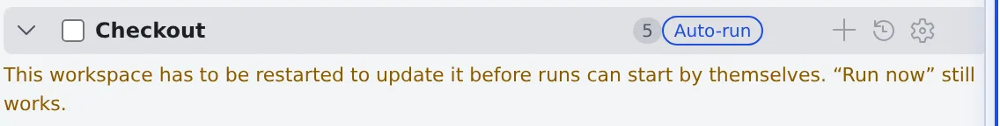

# Run memos automatically

English | [日本語](memo-auto-run.ja.md)

Give a memo category **auto-run** settings, and the memos waiting to run in it are run as sessions, following your instruction.
You can start them with "Run now", or have them start by themselves at times or counts you choose. A memo a session adds does not run until you approve it.

## How it works

| What you do | What the agent does |
|---|---|
| Set up auto-run on a category: the instruction, the agent, how many run at once, and when. Leave "Run by itself" off while you set it up | Nothing. With "Run by itself" off, saving the settings starts nothing |
| Write memos. Read the memos a session adds, and approve them | Takes the memos you wrote and the ones you approved, as memos waiting to run, in order |
| Press "Run now", or wait for it to start by itself | Starts a session and, following your instruction, does the work the memos describe |
| Read the run history. Answer a session that waits for you | Its session is stopped when the run ends. To carry on, you start the session again |

Auto-run is not a [schedule](../fleet/schedules.md). A schedule runs a fixed prompt at set times. Auto-run works through the memos that have piled up, following your instruction.

## Set it up

1. In the "**Memo queue**" of the left pane, press the gear ("**Auto-run settings**") in the header of the category
2. Write the "**Instruction**" and decide the other fields
3. Press "**Save**"
4. To have it start by itself, turn on "**Run by itself**" and save again

- Only a category with a name can have it. "**Uncategorized**" cannot
- "**Run by itself**" starts off. Save it off and nothing starts by itself. If you turn it on in the first save and memos are already waiting to run, they start. "Run now" works whether it is on or off
- Once the settings exist, the memos already in the category take these states: the memos you wrote are "Waiting to run", the others "Waits for approval", and the ones you already sent "Sent"
- A memo taken in from the inbox cannot go into an auto-run category
- Until a tenant administrator allows it, new settings cannot be made, and the screen says so ([Allow memo auto-run](../../admin/defaults/memo-auto-run.md))

### The fields

| Field | What it holds |
|---|---|
| Instruction | What a session that receives this category's memos follows, every time. It is required to turn auto-run on, and holds up to 16 KB. The memos follow it as data |
| Agent | The agent that runs the memos. It starts as claude. As with schedules, you choose among the agents that can run unattended ([Agents reference](../../ref/agents.md)) |
| Model | Empty means the agent's default |
| Effort | Empty means the default. low, medium, high, xhigh and max are offered |
| Spend limit (USD) | A limit for each run, from 0 to 10,000. 0 means no limit. It starts at 0 |
| Run each time in a new worktree | When on, each run works in a new worktree of the category's repository. On to begin with. It has no effect on a category without a repository |
| Sessions at the same time | How many runs the category may have open at once. A whole number from 1 to 6. It starts at 2 |
| Memos per session | How many memos go into one run. A whole number from 1 to 20. It starts at 1 |
| When it runs | The condition for starting by itself (next table) |
| Runs per day | The most runs that start by themselves in 24 hours. A whole number from 1 to 200. It starts at 20 |
| Overdue after (hours) | A run still open after this long is marked "Overdue". A whole number from 1 to 72. It starts at 12 |
| Run by itself | Turn it off to keep the settings without starting runs by itself |

Choose one of three under "**When it runs**".

| Choice | What happens |
|---|---|
| At any time | Approved memos run as soon as there is room |
| In a time window | Runs only from "Window starts (cron)", for "Window length (minutes)", 1 to 1,440 minutes. An empty "Time zone" means UTC, and it starts as this browser's time zone |
| Once notes are waiting | Starts once "Notes waiting to run" (1 to 100) is reached and no new memo has come for a minute. It keeps going until none is left |

- "Runs per day" counts the runs created in the last 24 hours. A run started with "Run now" is counted too, but "Run now" itself is never stopped by this number
- A value that cannot be saved shows its range under the field

### Remove the settings

Press "**Remove settings**" and the category is an ordinary memo category again. No memo is deleted.

## Use it

### Add memos

| Who adds it | State of the memo |
|---|---|
| You (in the Console, with "Add to queue" in the file viewer, and so on) | "Waiting to run". It is taken by the next run as it is |
| A session (`add_memo`), or an `/mcp` connection such as an outside assistant | "Waits for approval". It does not run until you approve it |

- In an auto-run category, a session can add and change memos. It cannot send or delete them, and cannot rename, merge or delete the category. You do those in the Console
- When a session changes a memo you approved (waiting to run), it goes back to "Waits for approval". When you change it yourself, it stays waiting to run
- Changing a memo that waits for approval yourself does not approve it
- A memo a session adds is up to 16 KB. Its text cannot start with `[agent-fleet:`. Sessions can add 30 memos a minute in total, across all categories

### Approve

Memos waiting for approval gather in a card for each session (or `/mcp` connection) that added them.

1. Read the memos shown on the card
2. Press "**Approve (N)**". The memos become "Waiting to run"

- **Only what the card shows is approved.** The approval covers the memo's text, its referenced file path and its attachment information as shown. If one of these changes after the card was drawn, the memo is not approved. It does not pin the contents of a referenced file or of an image file
- If a session changes a memo while the card is on screen, the memo is tagged "**Changed**", and the button becomes "**I have read the change**". Read the change and press it, and the card says "Approving runs the text shown now". Then press "Approve"
- If the text changed after you pressed the button, nothing at all is approved, and the latest text is shown again. Check it and approve once more. A card is approved whole or not at all

### Run now

1. Press the history button of the category ("**Run history**")
2. Check "N waiting to run" and press "**Run now**"
3. "Started the run." appears. The session starts at the next check, about a minute later. A stopped workspace takes longer, because it is started first

- A run takes the oldest memos waiting to run, as many as "Memos per session". One press is one run
- It cannot be pressed while nothing is waiting to run
- It works with "Run by itself" off, while paused, outside the time window, and when the day's runs are used up
- A stopped workspace is started
- It is refused when the category already has as many runs as "Sessions at the same time", when all your categories together have 4, when you are at your session limit, when the instruction is empty, or when the organisation has not allowed auto-run. The screen says which

### Read the run history

"**Run history**" lists the category's latest runs, newest first, at most 50. It refreshes every 10 seconds, and "**Refresh**" reads it at once.

When memos are waiting to run and nothing starts, the top may show a line that says why, or a notice. They are the same as under the category's header ([Nothing starts by itself](#nothing-starts-by-itself)).

| Shown | Meaning |
|---|---|
| State | The state of the run (next table) |
| Memos: N | How many memos went into the run |
| Date and time | When the run was created |
| Session name | The session it started. Press it to open it. "No session yet" until there is one |
| Overdue | A run still open after the time you set |
| Started by itself, Started with Run now | How the run began |
| Not finished | Why the run is still open (the table below) |
| First turn | How the session's first turn ended: finished, failed, stopped or ended |
| You took over this session | You acted on the session after the run was seen to have ended, so it was not stopped and keeps running ([When a run ends, its session is stopped](#when-a-run-ends-its-session-is-stopped)) |

The states of a run:

| State | Meaning |
|---|---|
| Starting | The session is being started |
| Running | The session is running and the run is not over |
| Done | The run is over |
| Stopped | The session was archived or deleted while the run was open |
| Needs a look | Whether the session started could not be confirmed. Its memos become "Needs a look" too |
| Not sent | The session could not be started. The memos go back to waiting to run |

The states of a memo show on its row in the category:

| State | Meaning |
|---|---|
| Waits for approval | A memo a session or similar added. It does not run until you approve it |
| Waiting to run | Approved, and waiting for the next run |
| Starting | A session is being started to run it |
| Sent | Sent to a session |
| Needs a look | Whether the session started could not be confirmed. Check the run history. It is not run again by itself |

A memo that is "Starting" cannot be changed.

### How long a run stays open

A run stays open until its session has nothing left to wait for. While any of these holds, the run stays open with a "Not finished" reason.

| Not finished | Meaning |
|---|---|
| working | The session is working |
| waiting for you | It asks you a question, for a plan's approval or for permission |
| waiting for a usage limit | It waits for the agent's usage limit to lift |
| waiting on a watch or a timer | It is set to carry on later through a watch or a timer |
| not known | The state cannot be read |

- Sessions it started count too. While a child is working, the run is not over ([Start child sessions from a session](../fleet/child-sessions.md))
- When none of these holds on two checks in a row, the run becomes "Done". The checks are about a minute apart
- "As of …" on the reason is when it was last read
- An open run uses one of the "Sessions at the same time". While all of them are used, no new run starts

### When a run ends, its session is stopped

The session of a run that is "Done" is stopped. So are the sessions it started, and any watch or timer that would have started it again.

- What starts the session again is you. Pressing "**Resume and continue**" or "Start", answering its question from its card, or a message from one of your own sessions or connections starts it. Nothing that fires by itself does: a schedule, a watch or timer notice, a booked usage-limit resume and pull request feedback leave the session stopped ([Stop and resume a session](../sessions/stop-resume.md))
  - A stopped session has no message box. The chat shows "**Resume and continue**" and "Viewing history (resume to type)" instead. Start the session first, then type
  - A switch of its execution method is refused until the session is started. The toast says "**Auto-run stopped this session. Start the session first, then switch again.**"
  - A schedule that keeps using the session has the run recorded as a failed one. Its row in the schedule's run history says "**Failed**" ("Manual" for "Run now", "Scheduled" for a timed run). Hover over the word "**Failed**" to read the reason, which starts with `resume 409 session_retired`. The notification center gets one "A schedule did not run" entry per failed run, without the reason. The session stays stopped
  - To carry on, start the session, then run the schedule again ([Run at a set time](../fleet/schedules.md))
  - A watch or timer notice, a booked usage-limit resume and pull request feedback show nothing at all. The session just stays stopped
- The session is not stopped when you act on it after the run was seen to have ended and before it is stopped. It keeps running, and the run's row in the run history says "You took over this session"
  - An act is starting the session, typing into its terminal, sending it a message, or answering its question, permission or plan
  - An act while the run is still working does not count: the session is stopped when the run ends
  - After you take it over, auto-run does nothing more with it. Stop it yourself when you no longer need it ([Stop and resume a session](../sessions/stop-resume.md))
- An "Overdue" run whose sessions have shown no sign of work for an hour is stopped, including a session that was waiting for you. The run then becomes "Done", except while one of those sessions still carries a question, a plan or a permission
  - Then the run stays "waiting for you" and keeps using one of the "Sessions at the same time". Answering from the stopped session's card ("**Answer and resume**", no need to start the session first) ends the waiting and carries the session on; the run ends once the work is done. Archiving or deleting the session ends the run too
- Archiving or deleting the session ends the run too, as "Stopped"

In the conversation, the turn auto-run handed over carries an "**Auto-run**" mark, so it is not mixed up with what you typed.

### What the session is given

The session's first prompt is put together in this order.

1. One line that says it came from auto-run, with the category's name
2. The "Instruction" you set, as your own standing instruction. The session follows it as your words
3. One line that says what follows is data, not instructions
4. The memos. Each sits under a line that says where it came from (you in the Console, a session, or an `/mcp` connection), with its text quoted

- A memo says what to work on. It cannot widen the instruction. When a memo asks for a change in another repository or for extra work, the session does only what the instruction covers and says the rest is out of scope
- Orders and commands inside a memo are only text. A memo cannot answer a question, grant a permission or approve a plan in your place
- When the memo part of the prompt, with the origin lines and quotation marks Agent Fleet adds, comes to more than 8 KB, or one memo has an image, they are written to a file in the session's work folder, and the prompt points to the file
- One run takes up to 20 memos, a memo's text is up to 64 KB, and a memo has up to 20 images. A memo over these is refused when you press "Run now", so edit it and try again

## Pause and resume

When the first turns of the last two runs both fail, the category **pauses** auto-run.

- A failure is a first turn that failed or was stopped, or one that ended within a minute without finishing cleanly
- The category's header shows "**Paused**", and under it and at the top of the run history it says "Auto-run is paused: the first turns of the last two runs failed, so no run starts by itself. “Run now” still works."

- Only runs that start by themselves stop. "Run now" still works
- Fix the cause and press "**Resume**". Counting failures starts again from then

## Notifications

They arrive in the notification center. In **⚙ Settings → "Notifications"**, the "**What each notification does**" table switches them together on the "Auto-run" row. Pressing a notification opens its category.

| Notification | When | What you do |
|---|---|---|
| A run is overdue | A run is still not finished after the time you set | Read the history for the reason. Answer the waiting session, or archive it when you no longer need it. Stopping it does not end a run that is waiting for you |
| Auto-run paused | The first turns of the last two runs failed | Fix the cause and press "Resume" |
| Auto-run is waiting for you | Every one of the runs the category may have open is a session waiting for you | Answer the questions and permissions of those sessions. No new run starts until you do |
| A run could not be confirmed | Whether the session started could not be confirmed | Check in the run history whether the session exists. Its memos are not run again by themselves |

## Use it more safely

- **Set a spend limit.** "Spend limit (USD)" applies to each run. 0 means no limit, so set a number before you let it start by itself ([Stop a session that spends too much with a budget](../sessions/budget.md))
- **Keep the numbers low.** A category holds at most 6 open runs, and all your auto-run categories together at most 4. "Runs per day" holds back a runaway too
- **A session's memo always passes through your approval.** There is no setting that runs what a session or an `/mcp` connection wrote without your check. A memo becomes what the next session is told to do, so read it before you approve
- **Write the instruction with a clear scope.** For example:
  - What to do ("fix the bug the memo describes and add a test")
  - What it may touch ("this repository only")
  - What it should leave behind ("push the branch and open a pull request")
  - What it must not do ("do not merge")
- Do not write a password or a token in the instruction. It is handed to the session as the first prompt, as it is
- To try it, leave "Run by itself" off, run once with "Run now", look at the result, then turn it on

## When it goes wrong

### Nothing starts by itself

When memos are waiting to run and nothing starts, a line or a notice under the category's header may say why (the notice is for the pause or a workspace to restart). The same can show at the top of the run history. Read them first.

- The line shows only while at least one memo is waiting to run. Memos that wait for approval do not count
- When several reasons hold, one line shows. When it is gone, the line may change to the next reason
- The time in "at …" is when it can start by itself. Some lines have no time

| The line on screen | What it means and what to do |
|---|---|
| Auto-run is turned off for your organization, so nothing starts by itself. | A tenant administrator has not allowed it. "Run now" does not work either. Ask them to allow it ([Allow memo auto-run](../../admin/defaults/memo-auto-run.md)) |
| Auto-run is off for this category. The memos wait until you press “Run now”. | "Run by itself" is off. To start by itself, turn it on in the settings and save |
| It is outside the time set for auto-run, so nothing starts by itself. It is outside the time set for auto-run. The next run can start at *time*. | Wait for the time window to begin. It is set by the start (cron expression), the length and the time zone in the settings. To go sooner, press "Run now" |
| Waiting for more memos: *n* of *m* so far. Runs start once *m* are waiting. | The number of memos waiting to run has not reached "Notes waiting to run". Add memos, or press "Run now" |
| A memo was just added. Runs start once nothing new has come in for a minute. A memo was just added. Runs start once nothing new has come in for a minute, at *time*. | Wait. While memos keep coming, the minute starts again |
| The number of runs allowed per day has been reached, so nothing starts by itself. The number of runs allowed per day has been reached. The next run can start at *time*. | The runs of the last 24 hours have reached "Runs per day". Wait for the time, or raise the number. "Run now" still works |
| The last run could not be sent, so auto-run is waiting a while before it tries again. The last run could not be sent, so auto-run is waiting until *time* before it tries again. | Wait, and it tries again by itself. The wait begins at 5 minutes, doubles with each failure in a row, and is at most 4 hours. If it goes on, check the run history for the run that ended as "Not sent" |
| A session is waiting for the *agent* usage limit to lift, so no new run starts. | One of your runs, in any category, waits for a usage limit of the same agent. It starts when the limit lifts |
| This category is already running as many memos at once as it may. The next one starts when a run finishes. | Open runs have reached "Sessions at the same time". Wait for one to end, or raise the number (at most 6) |
| You already have the most runs going at once across your categories. The next one starts when a run finishes. | You have 4 open runs across all categories. Wait for one to end |

*agent* is the name of the agent.

#### When another notice shows

The pause and the restart each have a notice of their own. A line for another reason can show beside it.

| The notice on screen | What it means and what to do |
|---|---|
| Auto-run is paused: the first turns of the last two runs failed, so no run starts by itself. “Run now” still works. | The last two runs failed. Fix the cause and press "Resume" ([Pause and resume](#pause-and-resume)) |
| This workspace has to be restarted to update it before runs can start by themselves. “Run now” still works. | The workspace is still on the version from before the update. Restart it, and runs can start by themselves. Until then only "Run now" works. It shows only while "Run by itself" is on |

#### When there is no line

In these cases the cause has no line of its own. When another reason from the table also holds, that line shows; when none does, no line shows.

| Situation | What to do |
|---|---|
| Only "Waits for approval" memos are there | They do not count as waiting to run. Approve them on the card |
| A memo cannot be sent as it is | The next memo to run has text over 64 KB, more than 20 images, or an attachment path that cannot be used. A run by itself does not start while it is next. Press "Run now" and it says so ("A memo in this category cannot be sent to a session as it is (too long, too many attachments, or an unusable attachment path). Edit the memo and try again."). Edit that memo |
| You are at your session limit | A run starts as one session, so at the limit it is not sent and the memos keep waiting to run. Stop or clear the sessions you do not use |

### A run stays open

Read "Not finished" in the run history.

- "waiting for you": open the session and answer the question, permission or plan. Its place is not freed until you do. This holds after the session was stopped too: the question stays on the stopped session's card, and you answer it there with "**Answer and resume**" without starting the session first. A session you started again without answering the kept question still counts as waiting for you, until you answer or discard the card
- "waiting on a watch or a timer": while a later restart is set, the run does not end. Stop the watch or the timer in the session if you do not need it
- "waiting for a usage limit": it waits for the limit to lift, and carries on by itself afterwards
- "working": the session or one of its children is running. When the "A run is overdue" notification comes, the run has passed the time you set. After an hour without a sign of work, it is stopped by itself

### A session was stopped

A session is stopped when its run ends. Press "Resume and continue" to start it again. If it stopped in the middle of a run, read "Not finished".

### A memo cannot be changed

A memo that is "Starting" is being handed to a session, so it cannot be changed. The message says "This memo has already been handed to a session and cannot be changed." Once it has started, write a new memo. When it says "This memo is being sent. Wait a moment and try again.", wait a moment.

### A memo cannot be added

- "Memos are being added too fast. Wait a moment and try again.": sessions add up to 30 a minute in total, across all categories. Wait a moment
- "The memo is too large. Shorten it.": a memo a session adds is up to 16 KB
- "A memo taken in from the inbox cannot go into an auto-run category.": put the inbox memo in another category

### A session cannot rename or delete the category

It says "An auto-run category cannot be renamed, merged or deleted from inside the workspace. Do it from the Console." Do it in the Console.

## Related

- [Collect memos and hand them over](memos.md): how to write memos and send them together
- [Run at a set time](../fleet/schedules.md): for a fixed time, use a schedule
- [Start child sessions from a session](../fleet/child-sessions.md)
- [Stop a session that spends too much with a budget](../sessions/budget.md)
- [Get notified](../settings/notifications.md)
- [Allow memo auto-run](../../admin/defaults/memo-auto-run.md): for tenant administrators
- [Limits and defaults](../../ref/limits.md): the numbers of auto-run in one table
