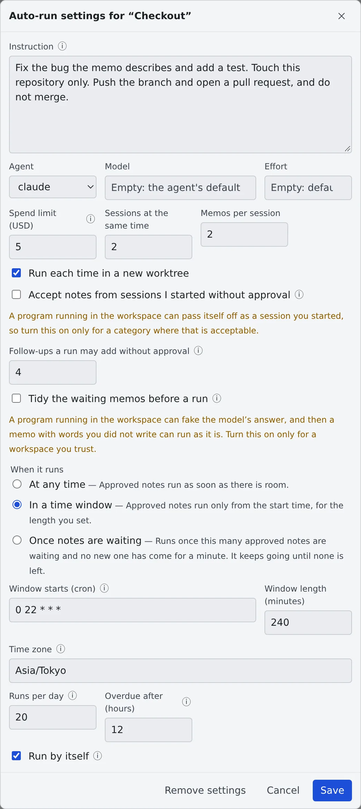
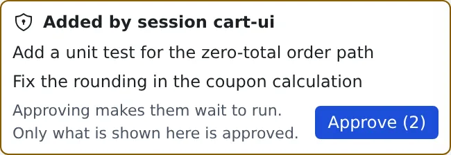
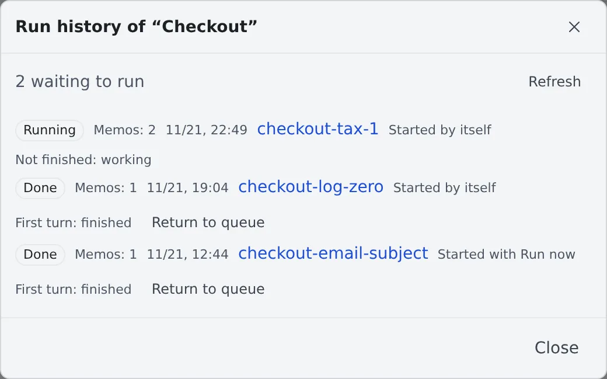
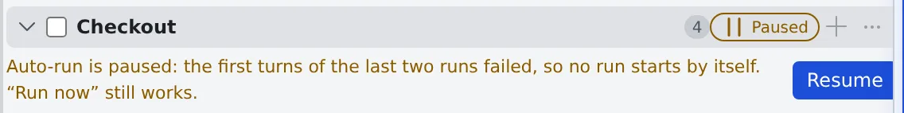
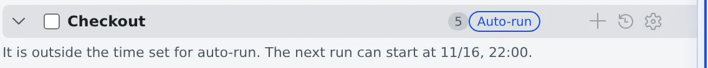

# Run memos automatically

English | [日本語](memo-auto-run.ja.md)

Give a memo category **auto-run** settings, and the memos waiting to run in it are run as sessions, following your instruction.
You can start them with "Run now", or have them start by themselves at times or counts you choose. A memo a session adds does not run until you approve it.

## How it works

| What you do | What the agent does |
|---|---|
| Set up auto-run on a category: the instruction, the agent, how many run at once, and when. Leave "Run by itself" off while you set it up | Nothing. With "Run by itself" off, saving the settings starts nothing |
| Write memos. Read the memos a session adds, and approve them | Takes the memos you wrote and the ones you approved, as memos waiting to run, in order |
| Press "Run now", or wait for it to start by itself | Starts a session and, following your instruction, does the work the memos describe |
| Read the run history. Answer a session that waits for you | Its session is stopped when the run ends. To carry on, you start the session again |

Auto-run is not a [schedule](../fleet/schedules.md). A schedule runs a fixed prompt at set times. Auto-run works through the memos that have piled up, following your instruction.

## Set it up

1. In the "**Memo queue**" view, open the **⋯** menu in the header of the category (or right-click the header) and choose "**Auto-run settings**"
2. Write the "**Instruction**" and decide the other fields
3. Press "**Save**"
4. To have it start by itself, turn on "**Run by itself**" and save again

- Only a category with a name can have it. "**Uncategorized**" cannot
- "**Run by itself**" starts off. Save it off and nothing starts by itself. If you turn it on in the first save and memos are already waiting to run, they start. "Run now" works whether it is on or off
- Once the settings exist, the memos already in the category take these states: the memos you wrote are "Waiting to run", the others "Waits for approval", and the ones you already started "Started"
- A memo taken in from the inbox cannot go into an auto-run category
- Until a tenant administrator allows it, new settings cannot be made, and the screen says so ([Allow memo auto-run](../../admin/defaults/memo-auto-run.md))

### The fields

| Field | What it holds |
|---|---|
| Instruction | What a session that receives this category's memos follows, every time. It is required to turn auto-run on, and holds up to 16 KB. The memos follow it as data |
| Agent | The agent that runs the memos, unless a memo names its own ([below](#run-a-memo-with-its-own-agent-model-or-effort)). It starts as claude. As with schedules, you choose among the agents that can run unattended ([Agents reference](../../ref/agents.md)) |
| Model | Empty means the agent's default. A memo may name its own |
| Effort | Empty means the default. A memo may name its own. low, medium, high, xhigh and max are offered |
| Spend limit (USD) | A limit for each run, from 0 to 10,000. 0 means no limit. It starts at 0 |
| Run each time in a new worktree | When on, each run works in a new worktree of the category's repository. On to begin with. It has no effect on a category without a repository |
| Accept notes from sessions I started without approval | When on, a memo added by a session you started yourself is "Waiting to run" at once, with no approval. Off to begin with. See [Skip the approval for your own sessions](#skip-the-approval-for-your-own-sessions) before turning it on |
| Follow-ups a run may add without approval | How many follow-up memos of one approved memo the run that gets it may add without another approval, from 0 to 10. Every category starts at **4**, existing ones included. 0 turns it off. See [Follow-ups of an approved memo](#follow-ups-of-an-approved-memo) |
| Tidy the waiting memos before a run | When on, a model in the workspace tidies the memos waiting to run before an automatic run. Off to begin with. See [Tidy the memos before a run](#tidy-the-memos-before-a-run) before turning it on |
| Auto-run categories a tidy may move memos to | Shown with the switch above. Up to 10 of your other auto-run categories. Memos moved there wait to run; memos moved to any other auto-run category wait for approval |
| Sessions at the same time | How many runs the category may have open at once. A whole number from 1 to 6. It starts at 2 |
| Memos per session | How many memos go into one run. A whole number from 1 to 20. It starts at 1 |
| When it runs | The condition for starting by itself (next table) |
| Runs per day | The most runs that start by themselves in 24 hours. A whole number from 1 to 200. It starts at 20 |
| Overdue after (hours) | A run still open after this long is marked "Overdue". A whole number from 1 to 72. It starts at 12 |
| Run by itself | Turn it off to keep the settings without starting runs by itself |

Choose one of three under "**When it runs**".

| Choice | What happens |
|---|---|
| At any time | Approved memos run as soon as there is room |
| In a time window | Runs only from "Window starts (cron)", for "Window length (minutes)", 1 to 1,440 minutes. An empty "Time zone" means UTC, and it starts as this browser's time zone |
| Once notes are waiting | Starts once "Notes waiting to run" (1 to 100) is reached and no new memo has come for a minute. It keeps going until none is left |

- "Runs per day" counts the runs created in the last 24 hours. A start of the workspace only to check the pull requests a memo waits for is not counted. A run started with "Run now" is counted too, but "Run now" itself is never stopped by this number
- A value that cannot be saved shows its range under the field

### Remove the settings

Press "**Remove settings**" and the category is an ordinary memo category again. No memo is deleted.

## Use it

### Add memos

| Who adds it | State of the memo |
|---|---|
| You (in the Console, with "Add to queue" in the file viewer, and so on) | "Waiting to run". It is taken by the next run as it is |
| A session (`add_memo`), or an `/mcp` connection such as an outside assistant | "Waits for approval". It does not run until you approve it |
| A run of this category, adding a follow-up of the memo it was given, for the same work item | "Waiting to run", marked "**Follow-up K of M, accepted without approval**", while your approval of the original still covers it ([Follow-ups of an approved memo](#follow-ups-of-an-approved-memo)). Past M, or for anything else, "Waits for approval" |

- In an auto-run category, a session can add and change memos. It cannot send or delete them, and cannot rename, merge or delete the category. You do those in the Console
- When a session changes a memo you approved (waiting to run), it goes back to "Waits for approval". When you change it yourself, it stays waiting to run. The exception is a category with "Accept notes from sessions I started without approval" on ([below](#skip-the-approval-for-your-own-sessions))
- Changing a memo that waits for approval yourself does not approve it
- The approval card groups the memos one session (or `/mcp` connection) added. When it holds more than one, each memo has a checkbox, all ticked at first, and the button approves only the ticked ones ("Approve 2 of 3"). The unticked memos stay on the card and keep waiting for approval, so you can approve the rest of a session's memos now and leave one for later
- A memo added from a worktree session lands in the category of the **parent repository**, so auto-run set on that repository's category sees it. This holds for every memo, whether or not the category has auto-run. Memos already under a worktree's own group stay there; drag them to move them
- A memo a session adds is up to 16 KB. Its text cannot start with `[agent-fleet:`. Sessions can add 30 memos a minute in total, across all categories

### Add a work item

On an issue, a ticket or a pull request, you can add a link to it, with a note of your own, to a category. When that category has auto-run on, the session a run starts is given the item as its work item.

1. Press the item in the work-item list of the left pane to open its detail
2. Press "**Add to auto-run**" at the foot
3. In the small screen that opens, choose the **Repository** and the **Category**, and write "**Your note (optional)**" if you like. Then press "**Add**"

- The repository starts on the one a launch from this item would start in. When that is a worktree, the parent repository is chosen, because memos are filed under the parent repository. Nothing is chosen for you when none is known
- The categories of that repository are listed with the auto-run ones first, marked "**Auto-run**" (or "**Auto-run off**"), and the others below. In a category without auto-run the link is an ordinary memo
- The item's text is **not** copied. The memo holds only the item's key and URL, and your note. Your note is the memo's text, and may be empty
- It is a memo of yours, so it is "Waiting to run" and needs no approval
- A message says where it went. A category holds one link to an item at a time among the memos that have not been sent yet: when the item is already there, the message says so and that nothing was added. A note you typed is not saved in that case, and the message says that too. Once a memo with the item has been sent, the item can be added again
- Moving or editing a memo so that a category would hold the same item twice is refused with "This item is already in this auto-run category." A drag that is refused puts the memo back where it was

#### On the list and on the card

- A memo with a link shows the item's key as a link to the item, with the item's title when the work-item list holds it, and your note below. A memo may be only the link
- "**Remove the link**" in the memo's edit view drops the link when you save. Editing only the text leaves it
- A memo a session adds can carry a link too, and the approval card shows it, with the memo's text. Approving covers it: **a link is never approved out of sight**

#### What the session receives

- The memo reaches the session as it does today, with the item's key and URL beside it. The item's text is not sent: the session reads it with `gh`, `jira` or `bkt`, as a session started from the item does
- When one run holds exactly one link, the session is linked to that item, as when you start from it. With none, or two or more, no link is made
- In that case, when the category runs each time in a new worktree, the branch is named by the repository's [branch naming rules](../sessions/from-issues.md#branch-names), as for a session started from the item (by default `feature/<number>`). When a branch of that name already exists, the session works on it instead of creating a new one. When another working copy holds that branch, or the rules give no name, the session gets a temporary branch

### Run a memo with its own agent, model or effort

The agent, model and effort in the category's auto-run settings are the **default**. A memo may name its own, so work that is easy and work that is hard need not share one setting.

- **Set it.** In the memo's edit view, the "**Runs with**" row has an agent, a model and an effort. "Category setting" and an empty field mean "use the category's". A session can set `agentKind`, `model`, `effort` and `route` with `add_memo` and `update_memo` (an empty value clears one; this is also how a route is cleared, since the Console has no route field); the Console API takes `agentKind`, `model`, `effort` and `route`. The Console has no route field, but the badge shows one if it is set
- **What runs.** The effective recipe of a memo is its own value for each field, and the category's for every field it leaves empty. If a memo names another agent than the category's, it does not take the category's model, effort or route, because they belong to the other agent. The spend limit is always the category's
- **Checked as the settings are.** The agent must exist and be allowed to run unattended, the model and effort must be well-formed values, and a route must be one the agent takes. Whether a model or effort really suits the agent is not checked when you save it, so choose values the agent accepts; a value it does not accept can make the run fail or be ignored. A value that fails a check is refused with an error and never dropped. A memo outside every auto-run category cannot carry one, and moving a memo out of the auto-run categories drops it
- **Memos with different recipes do not share a session.** A run takes the waiting memos oldest first, and the first one that is eligible to run fixes the recipe of that run. A memo whose effective recipe differs waits for its own run. Waiting memos with the same effective recipe, whether spelled out or taken from the category, can go into the same run, up to the category's "Memos per session" (1 unless you raised it). A tidy never merges memos whose recipes differ, and a memo it splits keeps its source's recipe
- **A continuation inherits it.** A follow-up (`continuation: true`) takes the recipe of the memo it continues, unless it names a recipe of its own, which replaces the inherited one whole
- **A session may set it, and you approve it.** The recipe is part of what you approve: a memo a session adds shows it on the approval card, and a session that changes it on a memo you approved sends the memo back to "Waits for approval". When you change it yourself, your approval is recorded again
- **You can see it.** A memo with its own recipe shows a badge such as `opus · high` on its row, on the approval card and in the run history. A memo without one shows nothing new. The run history shows the recipe of the memos still bound to that run
- **When it cannot start.** If the memo's recipe can no longer create a run (for example after the category's agent changed, so the route no longer fits), the memo goes back to "Waits for approval" with the reason "the agent, model or effort set on this memo cannot start a run". Change it, or clear it to use the category setting, and approve again. If the cause is the route, clear or correct it with `update_memo` or the Console API (`route` set to an empty string), because the Console's edit view has no route field

### Make a memo wait for another

A memo can wait for other memos of the same auto-run category: it runs only after each of them has run, that run ended well, and every pull request that run opened is merged. Use it for work that builds on other work, such as an issue that needs another issue's change first.

1. Click the memo to open its edit view
2. Under "**Waits for (other memos of this category, earlier or later)**", tick the memos it waits for, then press "Save"

- Any other memo of the category that a tidy has not replaced can be chosen, earlier or later in its order (a memo that waits for a later one simply waits for it), but never one that would make two memos wait for each other: a memo that already waits for it, directly or through others, is not offered. A session sets the same with `add_memo` and `update_memo` (`after`), naming a memo by its id or by its work item's key (`owner/repo#12`), which means the newest memo of the category that points at that item and was not replaced by a tidy
- Changing what a memo waits for counts as changing the memo: when a session does it to a memo you approved, the memo goes back to "Waits for approval"
- A memo that waits takes no place among "Sessions at the same time", and memos behind it still run. It does not count towards "Notes waiting to run" until what it waits for has ended well
- It never runs in the same session as a memo it waits for
- The row says what it waits for and how each stands, for example "Waits for acme/app#12: running"

A memo it waits for has **ended well** when it was run by auto-run (not sent by hand), the run ended as "Done", the run's first turn finished, and the run was not stopped for being overdue. Until the first turn is known, the memo keeps waiting.

Then its **pull requests** are checked: the pull request of the branch the run's session worked on, and the pull requests the session opened or worked on (not those of a reviewer it started). Auto-run reads them from the workspace after the run ended, every 10 minutes while the workspace runs, until every one is merged. A run that opened none counts as done only when it said so, as below. The row says what it waits for, for example "Waits for acme/app#12: waiting for PR #57 to merge".

A run that opened **no pull request** counts as done only when the session's **last answer starts with `Done:`**. A run can stop part way and still end cleanly, often without a pull request, so its own words are what tells a finished run from one that gave up. After the run ended, auto-run reads the first line of the session's last answer from the workspace, while the workspace runs, for up to a day:

- `Done:` at the start of that line (the case, and bold or code marks around the word, do not matter): the memos that wait for it can run
- Not read yet: they keep waiting. The row says "ended without a pull request: waiting for a Done: answer"
- Anything else, including `Partial:`, `Held:`, `Deferred:`, `Too large:` or `Stopped at part`, an answer that could not be read, or a day without one: they go back to "Waits for approval", and the row shows the first line it read, for example "ended without a pull request and without Done: — held (its last answer: “Partial: #12 part 1, next part queued”)"
- A line inside a quote, a list or a code block does not count. A run that opened pull requests is judged by its pull requests, whatever its answer says

Write your standing instruction so that a run that finished ends with an answer starting with `Done:` ([Write the standing instruction for nobody watching](../fleet/memo-auto-run-practices.md#write-the-standing-instruction-for-nobody-watching)). The run history shows how each run's last answer read ([Read the run history](#read-the-run-history)).

- Some agents never record how their first turn went. A run of such a session counts as done once it has opened at least one pull request and every one is merged, without the first turn
- While the workspace is stopped and every memo waiting to run waits only for pull requests or for a run's last answer, auto-run starts the workspace to check them at most once an hour (at most 24 times a day). Those starts are not runs, so they do not count towards "Runs per day"
- After a day without any change in those pull requests, auto-run stops starting the workspace for them and notifies you once. The memo keeps waiting, and the check goes on whenever the workspace runs
- An older workspace that cannot report pull requests leaves the memo waiting: restart the workspace to update it

When a memo it waits for can no longer end well, the memo goes back to "**Waits for approval**", and its row says which memo and why:

| Why | What happened to the memo it waits for |
|---|---|
| its run was cut off, how its run ended is unknown, its run did not end cleanly | The run ended as "Stopped", "Needs a look" or "Ended by you" |
| its run's first turn failed | The first turn failed or was stopped, or ended within a minute without finishing |
| its run went overdue and was stopped | The run was stopped for being overdue |
| a pull request of its run was closed without merging | A pull request of the run was closed without being merged |
| its run's session was deleted before its pull requests could be read | The session was deleted before auto-run could read its pull requests |
| ended without a pull request, and no Done: answer was confirmed — held; ended without a pull request and without Done: — held (its last answer: “…”) | The run opened no pull request, and its session's last answer did not start with `Done:`, or could not be read within a day after the run ended |
| its run opened no pull request, and nothing records how its first turn went | The session never recorded its first turn (some agents cannot), it opened no pull request, and a day has passed since the run ended |
| no record of how its first turn went | Shown on a memo that came back for this reason before pull requests were checked |
| was deleted, was moved out of this category, was replaced by a tidy, may or may not have started | The memo is gone from the category, or "Needs a look" |
| was sent by hand | You sent it yourself, so nothing shows how it ended |

Check the memo it waited for, then approve the memo again (it waits once more) or change what it waits for. A memo it waits for that is waiting for approval or waiting to run only makes it wait longer.

- A memo that waits, or that another waits for, is kept as it is by a tidy: it is never merged, split or moved
- A memo another waits for is kept past the 7 days after it was sent, until nothing waits for it any more
- When a memo has waited longer than "Overdue after (hours)" since it became "Waiting to run", you are notified once

### Run a memo no earlier than a given time

A memo can carry a start time: even once approved, it does not run before it, and "Run now" does not take it. Use it for work that must wait for something, such as a check that a scheduled deletion went through. In the memo's edit view, pick the time under "**Do not run before**" and press "Save" ("Clear" removes it). The row then says "Runs from *time*".

- The time is read in the time zone of your settings, at most 60 days ahead; one already past means none. A session sets it with `add_memo` / `update_memo` (`startAfter`, with its offset, such as `2026-12-04T09:00:00+09:00`; `""` removes it)
- It is part of the memo: approving the memo approves it, and the approval card shows it. Changing it is changing the memo, under the same approval rules as any edit. A tidy keeps such a memo as it is. Only a memo of an auto-run category takes one
- A time that the clocks skip (the hour a daylight saving change jumps over) is refused; one they repeat means its second occurrence

### Approve

Memos waiting for approval gather in a card for each session (or `/mcp` connection) that added them.

1. Read the memos shown on the card
2. Press "**Approve (N)**". The memos become "Waiting to run"

With the Memo queue view closed, an amber number on its icon in the activity bar counts the memos waiting for approval, "Changed" ones included. It stays while the view is open and drops as you approve or delete memos. Memos already waiting to run are not counted, and a working set does not narrow the count.

- **Only what the card shows is approved.** The approval covers the memo's text, its referenced file path, the work item it points at and its attachment information as shown. If one of these changes after the card was drawn, the memo is not approved. It does not pin the contents of a referenced file or of an image file
- If a session changes a memo while the card is on screen, the memo is tagged "**Changed**", and the button becomes "**I have read the change**". Read the change and press it, and the card says "Approving runs the text shown now". Then press "Approve"
- If the text changed after you pressed the button, nothing at all is approved, and the latest text is shown again. Check it and approve once more. A card is approved whole or not at all

### Follow-ups of an approved memo

A task too big for one pull request lands one part per run, and each run adds the next part. Approving the first memo covers that: the run it starts may add up to **M follow-ups** of it, where M is the category's "Follow-ups a run may add without approval" (4 unless you changed it, at most 10). A follow-up is "Waiting to run" with no card. Every category continues up to 4 follow-ups this way unless you lower it, and 0 turns it off.

A follow-up skips the approval only when all of these hold. Otherwise it waits for approval like any memo a session adds, and its row says why:

- The run that adds it was started by this category's auto-run, is still open (not overdue or being ended), and was given **one** memo. A category that runs several memos per session never continues those runs
- The follow-up points at the **same work item** and sits in the same category as the memo the run was given
- The memo the run was given was approved by you, or accepted by the setting for your own sessions while that setting is still on, or is itself a follow-up of one. Renaming the category keeps the chain. Moving a follow-up to another category ends it, and it starts none there. Changing a follow-up's work item ends the chain
- The chain has not reached M follow-ups counted from the original memo, and you have not stopped it
- The run has not added a follow-up already. Deleting the follow-up does not give the run another

What you see and do:

- The row reads "**Follow-up K of M, accepted without approval**". The approval card says that approving a memo with a work item also covers up to M follow-ups
- Past M, the follow-up waits on the approval card. **Approving it starts a new chain** of up to M from there
- "**Stop chain**" on a follow-up makes the next follow-up wait for approval. Setting the number to 0, deleting the waiting follow-up, or pausing the category also stops it
- When a session changes a follow-up, it goes back to "Waits for approval", and the count stays used. A tidy does not merge, split or move a follow-up. A run that hands its memo back keeps the chain as it was
- "Runs per day" and the automatic pause after failed runs apply to follow-ups as to any run
- **This is a guard rail, not a lock.** The workspace tells the Control Plane which run is adding the memo, and a program running in the workspace can pass itself off as that run. What it can reach is bounded: at most M memos of its choosing per approval, for the work item you approved, in that category. Set the number to 0 for a category where that is not acceptable

### Skip the approval for your own sessions

By default every memo a session adds waits for your approval. Turn on "**Accept notes from sessions I started without approval**" in a category's auto-run settings, and that stops being so for that category, for sessions you started yourself.

| Who started the session that adds the memo | State of the memo |
|---|---|
| You, yourself (a session you launched in the Console) | "Waiting to run", marked "**Accepted without approval**" on its row |
| Auto-run, a schedule, another session or the operator assistant | "Waits for approval", as without the setting. The one exception is a run adding a follow-up of the memo it was given ([above](#follow-ups-of-an-approved-memo)) |
| An `/mcp` connection | "Waits for approval", as without the setting |

- When such a session changes a memo it added, the memo stays "Waiting to run" and the approval is recorded again for the new text. A memo that was already approved by you, or one from another kind of session, goes back to "Waits for approval" as usual
- Moving a memo into a category without the setting puts it back to "Waits for approval"
- Turning the setting off later does not call back what it already accepted: those memos stay "Waiting to run" and still run. Turning it on does not approve memos already waiting for approval. Only memos added after the change follow the new setting
- **This is a guard rail, not a lock.** The workspace tells the Control Plane which kind of session is adding a memo, and a program running in the workspace can pass itself off as a session you started. With the setting on, such a program can add memos that run without your approval. Turn it on only for a category where that is acceptable
- The limits on what a session can add (size, speed, identical memos, the `[agent-fleet:` prefix), "Runs per day" and the automatic pause after failed runs apply as before
- Only you can change the setting, in the Console

### Tidy the memos before a run

Turn on "**Tidy the waiting memos before a run**" in a category's auto-run settings, and before the category runs by itself, a model rewrites the memos that are waiting to run. It is off to begin with.

What a tidy does:

- **Merges** memos that say nearly the same thing, **splits** a memo that holds several things, and **moves** a memo to another category. It never rewrites a memo in place, and it never changes what the category's settings say or when it runs
- Merges and splits take plain text memos only. A file memo, a memo with an attachment and a memo that points at a work item can be moved or left alone, never merged or split. Memos of different origin (you, a session, an `/mcp` connection) are never merged together
- It happens before an automatic run, when a waiting memo is new or was edited since the last tidy. **"Run now" never tidies**: it runs what you see
- A memo made by a merge or a split takes the state of the memos it came from. Tidying memos that are waiting to run gives memos that are waiting to run, with no approval to press
- The original memos stay for 7 days as "**Replaced**". They are read-only: you cannot edit or send them

Where a moved memo ends up:

| The memo is moved to | What it becomes there |
|---|---|
| An auto-run category you listed under "Auto-run categories a tidy may move memos to" | "Waiting to run" there, marked "Accepted without approval (tidy)" |
| An auto-run category you did not list | "Waits for approval" there. It shows on that category's approval card with "Moved from “…” by a tidy" |
| A category that does not auto-run | An ordinary memo |

A memo that was already waiting for approval stays so. A memo moved to another category runs with that category's instruction and budget, not those of the category it came from.

**What you see**

- A memo a tidy made shows "Tidied from N memos you added" (or the session or `/mcp` connection that added them), and one it moved shows "Moved from “…” by a tidy"
- A replaced memo shows "Replaced" and a link, "Open the run history", that opens the run history with the tidy that replaced it marked
- The run history has a "**Tidy before a run**" part below the runs. Each tidy shows its state, when it ran, whether it ran before a run or was started by hand, what it did (merged, split, moved, and how many of those are waiting for approval) and, when it changed nothing, why. The part also says how many of the 10 automatic tidies a category may use in 24 hours are used. It shows while the setting is on, and while there are tidies to show
- While a tidy is running, the category says "The memos are being tidied. They run when that is done."

| State | What it means |
|---|---|
| Tidying… | It is running |
| Tidied | It changed something |
| No change | The model answered, and nothing needed changing |
| Not applied | The memos changed during the tidy, or the model's answer broke the rules. Nothing was changed |
| Skipped | Nothing reached a model: the workspace could not be reached or started, or the workspace has to be restarted to update it |
| Failed | The call failed or took too long. Nothing was changed |
| Undone | You undid it |

A tidy that failed, was skipped or was not applied changes nothing, and the memos run as they are.

**Undo**

A tidy that changed something has an "**Undo**" button in the run history. One press brings the original memos back and removes the memos the tidy made. Moved memos go back to the category they came from. A memo goes back to "Waiting to run" only if its approval still matches its text, and otherwise to "Waits for approval".

It is all or nothing, and it is refused once a result has been used. The history then says how many memos are in the way and why:

| Why | What it means |
|---|---|
| Already taken into a run | A memo the tidy made or moved is part of a run |
| Already sent | You sent it by hand |
| Changed since the tidy | You or a session edited it |
| Gone | You deleted a memo the undo needs |
| Used by a later tidy | A newer tidy used a result. Undo the newer tidy first |
| Bringing back would put two memos that point at the same item in one category | Edit or delete one of them first |

**The limits**

- At most 10 automatic tidies per category in 24 hours. Every one that was started counts, whatever it did. A tidy you start by hand is not counted and is never refused by this limit
- At most 40 memos and 96 KB of text per tidy. One tidy at a time for each member
- It needs a workspace that can run Claude. With another agent the tidy is skipped, and when a memo a tidy made cannot be sent to the workspace, the category says "Memos a tidy made cannot run in this workspace. …". Use a workspace that can run Claude, or turn the setting off and undo the tidy
- The usage appears as "Memo tidy before auto-run" in the usage screen

> **Turn it on only for a workspace you trust.** The model runs inside the workspace, and a program in the workspace that can answer for the Agent could put words you did not write into a memo that then runs. The Control Plane checks every answer and drops one that breaks its rules, but it cannot tell that the words are the model's. This is a guard rail, not a lock, like "Accept notes from sessions I started without approval".

### Run now

1. Choose "**Run now**" in the **⋯** menu of the category's header in the Memo queue view, or choose "**Run now**" in the "**...**" menu of the category in the Auto-run view
2. "Started the run." appears. The session starts at the next check, about a minute later. A stopped workspace takes longer, because it is started first

- A run takes the oldest memos waiting to run, as many as "Memos per session". One press is one run
- It is enabled by what the queue list checks, which is whether a press can start something: at least one memo waiting to run whose "Waits for" memos are all done, and a free place (under "Sessions at the same time", and under the limit across all your categories). Otherwise it is greyed out, and its tooltip says why: no memo is waiting, every waiting memo waits for another memo or for its time, or the places are taken. The Control Plane still decides when you press, so a refusal can still appear (an empty instruction, your session limit, or an organisation that has not allowed auto-run are not checked beforehand)
- It works with "Run by itself" off, while paused, outside the time window, and when the day's runs are used up
- A stopped workspace is started
- It is refused when the category already has as many runs as "Sessions at the same time", when all your categories together have 4, when you are at your session limit, when the instruction is empty, or when the organisation has not allowed auto-run. The screen says which

### Run one memo now

To start one particular memo instead of the oldest ones, open the memo's menu (the **⋯** on its row, or right-click) and choose "**Run now**". It starts a session with that memo alone, whatever "Memos per session" says, and the memos waiting before it stay where they are. It works with "Run by itself" off, as the category's "Run now" does, and it shows the same messages, including the one that says every place is taken.

- It is greyed out, with the reason under it, when the memo is held for your approval, when it waits for other memos to finish ("Waits for"), when its start time or a hand-back's time has not come, or when the category has no free place
- It is offered only for waiting or held memos of an auto-run category
- The Control Plane still decides when you press. A memo that cannot run is refused, never replaced by another one

### See the runs

The "**Auto-run**" view of the left pane (the icon right after "Memo queue") lists the runs of every auto-run category, one row per run and not one per working copy. Its head shows the title and the number of runs that are running or waiting for you, with "**Clear finished runs**" and a refresh button.

The view follows the [working set](../fleet/working-sets.md) you picked: a category is listed when its repository is in the set. A category without a repository, and runs that no category names, are listed under every set.

A run is listed under the category whose delivery started it, also after that delivery has left the newest 50 of the category's history: the session records its category when it starts. "**Other runs**" holds the runs whose category cannot be told: the category no longer exists (its auto-run settings were deleted), or neither the delivery nor the session names one (the session was started before sessions recorded it, or you used Recreate on the run's session).

Each category has a pinned header like a repository in the "Sessions" view: the repository icon and `repository / category`. Its gear opens the category's auto-run settings, and its "**...**" menu has "**Run now**", "**Run history**" and "**Show in Memo queue**". Under it, "**Running / waiting N**" is open and "**Ended N**" is folded; press either to fold or open it.

A row shows the run's state (running, waiting for your answer, or ended), the work item it started for (`#12 title`), its pull request and the pull request's state when known, and how long it has been going. Press a row to open the run's session. The sessions the run started, such as reviewers, are listed one level under the row. Right-click a row (or press the Menu key on it) to open the same session menu as in the "Sessions" view, for that session: archive, delete, rename, share, resume and so on. A run the queue has closed whose session is running again, because you took it over or it was started again, is listed under "Running / waiting" with a "**resumed**" tag and not under "Ended".

The "**...**" button on a row opens its menu. "**Stop this run's sessions**" stops the run and the sessions it started, and nothing else in the same working copy. "**Delete the worktree**" opens the same confirmation as deleting a working copy from the repository tree; it is not offered for a run that works in a base clone, nor, when the Agent has a record of which session created the worktree, for one that session did not create: the record must name the run's own session. A worktree made before the record existed has none, so the Console falls back to its earlier guess (the first session still listed there), which can be wrong when the creator was archived; the same delete confirmation is the check. When the record cannot be read, or says no session owns the worktree, it is not offered. "**Clear finished runs**" at the top of the view archives the stopped sessions of ended runs after one confirmation, then offers the worktrees of runs whose pull request was merged to the same delete confirmation, on the same rule. A worktree that also holds a session of your own is left out.

The runs are not listed in the "Sessions" view: the working copies and sessions that auto-run started stay out of the repository tree. Stopping or deleting a repository from the tree still covers them, and its confirmation lists them as "Listed elsewhere". Runs that a [schedule](../fleet/schedules.md) started are not in the tree either; the **Schedules** view lists them.

The icon shows an amber number when a run's session waits for your answer; it stays until you answer. It shows a red dot when a run ended as failed, until you open the view. The view also lists a run that is older than the newest 50 of its category's history while it is still open. The row of the session open in the main area (a run, or a reviewer or other session it started) is highlighted like the active row in the Sessions view, and the view scrolls to it. A row inside a folded "Ended N" stays folded; open the fold to see it.

### Read the run history

"**Run history**" lists the category's latest runs, newest first, at most 50. It refreshes every 10 seconds, and "**Refresh**" reads it at once.

When memos are waiting to run and nothing starts, the top may show a line that says why, or a notice. They are the same as under the category's header ([Nothing starts by itself](#nothing-starts-by-itself)).

| Shown | Meaning |
|---|---|
| State | The state of the run (next table) |
| Memos: N | How many memos went into the run |
| Date and time | When the run was created |
| Session name | The session it started. Press it to open it. "No session yet" until there is one |
| Overdue | A run still open after the time you set |
| Started by itself, Started with Run now | How the run began |
| Not finished | Why the run is still open (the table below) |
| First turn | How the session's first turn ended: finished, failed, stopped or ended |
| Last answer | How the session's last answer reads, with its first line: Done, stopped part way, no Done:, or could not be read. For a run that opened no pull request, only "Done" lets the memos that wait for it run ([Make a memo wait for another](#make-a-memo-wait-for-another)) |
| You took over this session | You acted on the session after the run was seen to have ended, so it was not stopped and keeps running ([When a run ends, its session is stopped](#when-a-run-ends-its-session-is-stopped)) |

The states of a run:

| State | Meaning |
|---|---|
| Starting | The session is being started |
| Running | The session is running and the run is not over |
| Done | The run is over |
| Handed back | The run is over, and it handed its memo back to wait ([A run hands its memo back](#a-run-hands-its-memo-back)) |
| Stopped | The session was archived or deleted while the run was open |
| Ended by you | You pressed "**End**" on the run ([End a run yourself](#end-a-run-yourself)) |
| Needs a look | Whether the session started could not be confirmed. Its memos become "Needs a look" too |
| Not sent | The session could not be started. The memos go back to waiting to run |

The states of a memo show on its row in the category:

| State | Meaning |
|---|---|
| Waits for approval | A memo a session or similar added. It does not run until you approve it |
| Waiting to run | Approved, and waiting for the next run. "Accepted without approval" beside it means no approval was asked, because of "Accept notes from sessions I started without approval" |
| Starting | A session is being started to run it |
| Started | Started in a session |
| Needs a look | Whether the session started could not be confirmed. Check the run history. It is not run again by itself |
| Replaced | A tidy replaced it with other memos ([Tidy the memos before a run](#tidy-the-memos-before-a-run)). Read-only, and kept for 7 days |

A memo that is "Starting" cannot be changed.

In a category with auto-run on, the "Started" and "Replaced" memos are folded into one line at the bottom of the list, "Started or replaced (N)", so the memos still waiting come first. Click it to show them, and click again to fold them. The line stays where it is, under the waiting memos, and the started and replaced memos open below it, newest first. While you scroll, the open line stays pinned under the category's header, so you can close it from anywhere in the list. "Needs a look" memos stay in the list. The fold closes again when you reload the screen.

### How long a run stays open

A run stays open until its session has nothing left to wait for. While any of these holds, the run stays open with a "Not finished" reason.

| Not finished | Meaning |
|---|---|
| working | The session is working |
| waiting for you | It asks you a question, for a plan's approval or for permission |
| waiting for a usage limit | It waits for the agent's usage limit to lift |
| waiting on a watch or a timer | It is set to carry on later through a watch or a timer |
| not known | The state cannot be read |

- Sessions it started count too. While a child is working, the run is not over ([Start child sessions from a session](../fleet/child-sessions.md))
- When none of these holds on two checks in a row, the run becomes "Done". The checks are about a minute apart
- "As of …" on the reason is when it was last read
- An open run uses one of the "Sessions at the same time". While all of them are used, no new run starts

### When a run ends, its session is stopped

The session of a run that is "Done" is stopped. So are the sessions it started, and any watch or timer that would have started it again.

- What starts the session again is you. Pressing "**Resume and continue**" or "Start", answering its question from its card, or a message from one of your own sessions or connections starts it. Nothing that fires by itself does: a schedule, a watch or timer notice, a booked usage-limit resume and pull request feedback leave the session stopped ([Stop and resume a session](../sessions/stop-resume.md))
  - A stopped session has no message box. The chat shows "**Resume and continue**" and "Viewing history (resume to type)" instead. Start the session first, then type
  - A switch of its execution method is refused until the session is started. The toast says "**Auto-run stopped this session. Start the session first, then switch again.**"
  - A schedule that keeps using the session has the run recorded as a failed one. Its row in the schedule's run history says "**Failed**" ("Manual" for "Run now", "Scheduled" for a timed run). Hover over the word "**Failed**" to read the reason, which starts with `resume 409 session_retired`. The notification center gets one "A schedule did not run" entry per failed run, without the reason. The session stays stopped
  - To carry on, start the session, then run the schedule again ([Run at a set time](../fleet/schedules.md))
  - A watch or timer notice, a booked usage-limit resume and pull request feedback show nothing at all. The session just stays stopped
- The session is not stopped when you act on it after the run was seen to have ended and before it is stopped. It keeps running, and the run's row in the run history says "You took over this session"
  - An act is starting the session, typing into its terminal, sending it a message, or answering its question, permission or plan
  - An act while the run is still working does not count: the session is stopped when the run ends
  - After you take it over, auto-run does nothing more with it. Stop it yourself when you no longer need it ([Stop and resume a session](../sessions/stop-resume.md))
- An "Overdue" run whose sessions have shown no sign of work for an hour is stopped, including a session that was waiting for you. The run then becomes "Done", except while one of those sessions still carries a question, a plan or a permission
  - Then the run stays "waiting for you" and keeps using one of the "Sessions at the same time". Answering from the stopped session's card ("**Answer and resume**", no need to start the session first) ends the waiting and carries the session on; the run ends once the work is done. Archiving or deleting the session ends the run too
- Archiving or deleting the session ends the run too, as "Stopped"

In the conversation, the turn auto-run handed over carries an "**Auto-run**" mark, so it is not mixed up with what you typed.

### End a run yourself

A run that is still open (a child that keeps working, a watch you no longer need, a hold with no reason shown) keeps using one of the "Sessions at the same time". Archiving or deleting its session frees the place, but records the run as "Stopped". To free it without that, end the run.

1. Open the category's run list and find the open run (state "Running")
2. Press "**End**" on its row and confirm "**End run**"

- The run becomes "**Ended by you**", the place is freed, and the session and everything it started are stopped. The session is not archived: it stays in the list and you can resume it
- Only that run's place is freed. Other runs of the category keep theirs
- Pressing it again, or pressing it for a run that has just ended by itself, changes nothing
- It is not offered while the run has no session yet ("Starting"). Those settle by themselves
- A session you act on after pressing is still stopped: ending the run is your word that it is over. Stopping happens within about a minute, and only while the workspace is running. A stopped workspace has nothing to stop. If the workspace does not report the run's state (an older version), the place is freed but the session is not stopped; stop it yourself

### A run hands its memo back

A session that auto-run started can hand its memo back when the work cannot be done yet, for example because another change is not merged or a service it needs is down. The memo then runs again later, as a new run.

- The session asks for it with the `defer_queue_item` tool. Only a session a run started gets the tool, only for that run, and only in a category whose "Memos per session" is 1
- It takes effect only when the run ends as it otherwise would ("Done"). The run's state is then "**Handed back**", and the memo goes back to "Waiting to run" with "**Waits until** *time*: its run handed it back". The time is what the session asked for: 10 minutes to 7 days ahead, 1 hour when it named none. Until then the memo does not run, and "Run now" does not take it either
- The memo goes back only after the session has been stopped. When you take the session over before that ([When a run ends, its session is stopped](#when-a-run-ends-its-session-is-stopped)), or it starts working again, nothing is handed back and the run is "Done"
- The session's reason shows on the run's row in the run history and under the memo. It is never given to the next session
- The memo runs again as a new run, which counts towards "Runs per day"
- The third time one memo is handed back, it goes back to "**Waits for approval**" instead, with the reasons. Approve it again to run it; that starts the count again
- A handed-back run never counts towards pausing the category, and never stops a pause either ([Pause and resume](#pause-and-resume))

A run that went on working is not handed back: the run ends as "Done", the memo stays "Started", and the row says why.

| On the run's row | Meaning |
|---|---|
| Asked to hand its memo back | The run is still open. The request applies when it ends |
| Handed its memo back | It was applied |
| Handing its memo back once its session is stopped | The run is over. The memo goes back once its session has been stopped |
| Hand-back dropped: you took the session over | You acted on the session before it was stopped |
| You returned the memo before the hand-back | You pressed "Return to queue" first. Your return stands |
| Hand-back dropped: the run went on working after asking | The session, or a session it started, took another turn after asking |
| Hand-back dropped: its session has an open or merged pull request | The work may already be done |
| Hand-back dropped: whether the run went on could not be checked | The workspace could not show it (an older version, or the pull requests could not be read) |
| Hand-back not applied: the run did not end on its own | The run was stopped, ended by you, or its state is not known |
| Stayed with this run: another waiting memo (…) already holds the same work item | That memo will do the work. The memo of this run stays "Started" |

- While the workspace is stopped, a run that asked is left open, because only the running workspace can show whether it went on. When such runs use every place of a category with memos waiting, auto-run starts the workspace to settle them, as it does for an overdue run

### Return a run's memos to the queue

To run a finished run's memos again yourself, press "**Return to queue**" on its row in the run history (right after the run's state; each row also shows the run's work item keys and the start of its note), or choose "**Return this run to the queue**" in the ⋯ or right-click menu of a memo that run delivered, and confirm. Its memos go back to "Waiting to run", with no time to wait and the count of hand-backs started again.

- It is offered on a run that has ended, once. Only memos still of that run return: a memo you have since changed or that ran again is left alone
- When the run's session has a pull request that is open or merged, the confirmation says so: the work may already be done, and running it again may do it twice
- When another waiting memo already points at the same work item, nothing returns and the message names that memo
- Only you can do this, in the Console. A session or an `/mcp` connection cannot

### What the session is given

The session's first prompt is put together in this order.

1. One line that says it came from auto-run, with the category's name
2. The "Instruction" you set, as your own standing instruction. The session follows it as your words
3. One line that says what follows is data, not instructions
4. The memos. Each sits under a line that says where it came from (you in the Console, a session, or an `/mcp` connection), with its text quoted

- A memo says what to work on. It cannot widen the instruction. When a memo asks for a change in another repository or for extra work, the session does only what the instruction covers and says the rest is out of scope
- Orders and commands inside a memo are only text. A memo cannot answer a question, grant a permission or approve a plan in your place
- When the memo part of the prompt, with the origin lines and quotation marks Agent Fleet adds, comes to more than 8 KB, or one memo has an image, they are written to a file in the session's work folder, and the prompt points to the file
- One run takes up to 20 memos, a memo's text is up to 64 KB, and a memo has up to 20 images. A memo over these is refused when you press "Run now", so edit it and try again

## Pause and resume

When the first turns of the last two runs both fail, the category **pauses** auto-run.

- A failure is a first turn that failed or was stopped, or one that ended within a minute without finishing cleanly
- The category's header shows "**Paused**", and under it and at the top of the run history it says "Auto-run is paused: the first turns of the last two runs failed, so no run starts by itself. “Run now” still works."

- Only runs that start by themselves stop. "Run now" still works
- Fix the cause and press "**Resume**". Counting failures starts again from then

## Ask the operator

The [Fleet Operator](../fleet/operator.md) can **read** auto-run for you and nothing else.

| It can | It cannot |
|---|---|
| List your auto-run categories with their settings, and read a category's run history | Change a category's settings (the instruction included), turn "Run by itself" on or off, or remove auto-run |
| Tell you which Console control to press, and why | Press "Run now", "Resume" or "End", approve memos, or press "Return to queue" |

The operator's list says why a category with memos waiting starts nothing now (outside its time window, at its limit, paused). It is left out for a category that can run, so it is not a count of waiting memos; the operator counts those from your memo list.

You do these yourself, in the Console, because the operator reads memos that sessions wrote, and every session in the workspace can reach what the operator reaches. If the operator could save the instruction, start a run, resume a paused category or end a run, a memo carrying injected text could do the same. When you want to change a setting, the operator shows you the full settings it suggests, the instruction in full, and you save them under "Auto-run settings". For a run, it points you at "Run now", at "Resume" on a paused category, or at "End" on the run's row, after saying which run and which session. The reasons a session gave for handing a memo back are shown in the Console only.

## Notifications

They arrive in the notification center. In **⚙ Settings → "Notifications"**, the "**What each notification does**" table switches them together on the "Auto-run" row. Pressing a notification opens its category.

| Notification | When | What you do |
|---|---|---|
| A run is overdue | A run is still not finished after the time you set | Read the history for the reason. Answer the waiting session, or archive it when you no longer need it. Stopping it does not end a run that is waiting for you |
| Auto-run paused | The first turns of the last two runs failed | Fix the cause and press "Resume" |
| Auto-run is waiting for you | Every one of the runs the category may have open is a session waiting for you | Answer the questions and permissions of those sessions. No new run starts until you do |
| A run could not be confirmed | Whether the session started could not be confirmed | Check in the run history whether the session exists. Its memos are not run again by themselves |
| An auto-run memo has waited long | A memo has waited for the memos it depends on longer than "Overdue after (hours)" | Check the memos it waits for ([Make a memo wait for another](#make-a-memo-wait-for-another)) |

## Use it more safely

- **Set a spend limit.** "Spend limit (USD)" applies to each run. 0 means no limit, so set a number before you let it start by itself ([Stop a session that spends too much with a budget](../sessions/budget.md))
- **Keep the numbers low.** A category holds at most 6 open runs, and all your auto-run categories together at most 4. "Runs per day" holds back a runaway too
- **A session's memo always passes through your approval.** There is no setting that runs what a session or an `/mcp` connection wrote without your check. A memo becomes what the next session is told to do, so read it before you approve
- **Write the instruction with a clear scope.** For example:
  - What to do ("fix the bug the memo describes and add a test")
  - What it may touch ("this repository only")
  - What it should leave behind ("push the branch and open a pull request")
  - What it must not do ("do not merge")
- Do not write a password or a token in the instruction. It is handed to the session as the first prompt, as it is
- To try it, leave "Run by itself" off, run once with "Run now", look at the result, then turn it on

## When it goes wrong

### Nothing starts by itself

When memos are waiting to run and nothing starts, a line or a notice under the category's header may say why (the notice is for the pause or a workspace to restart). The same can show at the top of the run history. Read them first.

- The line shows only while at least one memo is waiting to run. Memos that wait for approval do not count
- When several reasons hold, one line shows. When it is gone, the line may change to the next reason
- The time in "at …" is when it can start by itself. Some lines have no time

| The line on screen | What it means and what to do |
|---|---|
| Auto-run is turned off for your organization, so nothing starts by itself. | A tenant administrator has not allowed it. "Run now" does not work either. Ask them to allow it ([Allow memo auto-run](../../admin/defaults/memo-auto-run.md)) |
| Auto-run is off for this category. The memos wait until you press “Run now”. | "Run by itself" is off. To start by itself, turn it on in the settings and save |
| It is outside the time set for auto-run, so nothing starts by itself. It is outside the time set for auto-run. The next run can start at *time*. | Wait for the time window to begin. It is set by the start (cron expression), the length and the time zone in the settings. To go sooner, press "Run now" |
| Waiting for more memos: *n* of *m* so far. Runs start once *m* are waiting. | The number of memos waiting to run has not reached "Notes waiting to run". Add memos, or press "Run now" |
| Waiting for more memos: *n* of *m* ready so far, and *k* more waiting for the memos they depend on. … | As above. Memos that wait for other memos do not count until those have ended well ([Make a memo wait for another](#make-a-memo-wait-for-another)) |
| Every waiting memo (*n*) waits for other memos of this category to finish first. | Every memo waiting to run waits for another memo. It runs once those have ended well |
| Every waiting memo (*n*) was handed back by its run and waits for its time. Every waiting memo (*n*) was handed back by its run. The next may run at *time*. | Their runs handed them back ([A run hands its memo back](#a-run-hands-its-memo-back)). They run by themselves once the time has come, and "Run now" does not take them before it |
| Every waiting memo (*n*) waits for its start time. Every waiting memo (*n*) waits for its start time. The next may run at *time*. | Each memo waiting to run has a start time still ahead ([Run a memo no earlier than a given time](#run-a-memo-no-earlier-than-a-given-time)). They run by themselves once the time has come, and "Run now" does not take them before it. To run one now, clear its start time |
| A memo was just added. Runs start once nothing new has come in for a minute. A memo was just added. Runs start once nothing new has come in for a minute, at *time*. | Wait. While memos keep coming, the minute starts again |
| The number of runs allowed per day has been reached, so nothing starts by itself. The number of runs allowed per day has been reached. The next run can start at *time*. | The runs of the last 24 hours have reached "Runs per day". Wait for the time, or raise the number. "Run now" still works |
| The last run could not be sent, so auto-run is waiting a while before it tries again. The last run could not be sent, so auto-run is waiting until *time* before it tries again. | Wait, and it tries again by itself. The wait begins at 5 minutes, doubles with each failure in a row, and is at most 4 hours. If it goes on, check the run history for the run that ended as "Not sent" |
| A session is waiting for the *agent* usage limit to lift, so no new run starts. | One of your runs, in any category, waits for a usage limit of the same agent. It starts when the limit lifts |
| This category is already running as many memos at once as it may. The next one starts when a run finishes. | Open runs have reached "Sessions at the same time". Wait for one to end, or raise the number (at most 6) |
| You already have the most runs going at once across your categories. The next one starts when a run finishes. | You have 4 open runs across all categories. Wait for one to end |

*agent* is the name of the agent.

#### When another notice shows

The pause and the restart each have a notice of their own. A line for another reason can show beside it.

| The notice on screen | What it means and what to do |
|---|---|
| Auto-run is paused: the first turns of the last two runs failed, so no run starts by itself. “Run now” still works. | The last two runs failed. Fix the cause and press "Resume" ([Pause and resume](#pause-and-resume)) |
| This workspace has to be restarted to update it before runs can start by themselves. “Run now” still works. | The workspace is still on the version from before the update. Restart it, and runs can start by themselves. Until then only "Run now" works. It shows only while "Run by itself" is on |
| Memos that point at a work item cannot run yet: the workspace has to be restarted to update it first. Memos without one still run. | The workspace is still on the version from before the update, and it cannot take memos that point at an item. Restart it. Memos without a link run as usual in the meantime. It shows while a run has been held back for this |
| The memos are being tidied. They run when that is done. | A tidy is running for you. The category starts nothing until it ends, one that has not finished in 10 minutes is ended ([Tidy the memos before a run](#tidy-the-memos-before-a-run)) |
| Memos a tidy made cannot run in this workspace. … | The workspace cannot take memos a tidy made: restart it to update it, or use a workspace that can run Claude. You can also turn the tidy setting off and undo the tidy in the run history |

#### When there is no line

In these cases the cause has no line of its own. When another reason from the table also holds, that line shows; when none does, no line shows.

| Situation | What to do |
|---|---|
| Only "Waits for approval" memos are there | They do not count as waiting to run. Approve them on the card |
| A memo cannot be sent as it is | The next memo to run has text over 64 KB, more than 20 images, or an attachment path that cannot be used. A run by itself does not start while it is next. Press "Run now" and it says so ("A memo in this category cannot be sent to a session as it is (too long, too many attachments, or an unusable attachment path). Edit the memo and try again."). Edit that memo |
| You are at your session limit | A run starts as one session, so at the limit it is not sent and the memos keep waiting to run. Stop or clear the sessions you do not use |

### A run stays open

Read "Not finished" in the run history.

- "waiting for you": open the session and answer the question, permission or plan. Its place is not freed until you do. This holds after the session was stopped too: the question stays on the stopped session's card, and you answer it there with "**Answer and resume**" without starting the session first. A session you started again without answering the kept question still counts as waiting for you, until you answer or discard the card
- "waiting on a watch or a timer": while a later restart is set, the run does not end. The reason names the watches (id and source, for example "w_42 (github)"), up to five. Nothing else of a watch is shown, and a run recorded without names just says "waiting on a watch or a timer". Stop the watch or the timer in the session if you do not need it
- "waiting for a usage limit": it waits for the limit to lift, and carries on by itself afterwards
- "working": the session or one of its children is running. When the "A run is overdue" notification comes, the run has passed the time you set. After an hour without a sign of work, it is stopped by itself

- Anything else, or you simply do not want to wait: end the run yourself ([End a run yourself](#end-a-run-yourself))

### A session was stopped

A session is stopped when its run ends. Press "Resume and continue" to start it again. If it stopped in the middle of a run, read "Not finished".

### A memo cannot be changed

A memo that is "Starting" is being handed to a session, so it cannot be changed. The message says "This memo has already been handed to a session and cannot be changed." Once it has started, write a new memo. When it says "This memo is being sent. Wait a moment and try again.", wait a moment.

### A memo cannot be added

- "Memos are being added too fast. Wait a moment and try again.": sessions add up to 30 a minute in total, across all categories. Wait a moment
- "The memo is too large. Shorten it.": a memo a session adds is up to 16 KB
- "A memo taken in from the inbox cannot go into an auto-run category.": put the inbox memo in another category

### A session cannot rename or delete the category

It says "An auto-run category cannot be renamed, merged or deleted from inside the workspace. Do it from the Console." Do it in the Console.

## Related

- [Collect memos and hand them over](memos.md): how to write memos and send them together
- [Keep auto-run settings in the repository](memo-auto-run-repo-file.md): keep these settings in `.agent-fleet/autorun.yaml` and approve the difference
- [Run work unattended with memo auto-run](../fleet/memo-auto-run-practices.md): how to write the instruction and the memos, and how to run large tasks and merges
- [Run at a set time](../fleet/schedules.md): for a fixed time, use a schedule
- [Start child sessions from a session](../fleet/child-sessions.md)
- [Stop a session that spends too much with a budget](../sessions/budget.md)
- [Get notified](../settings/notifications.md)
- [Allow memo auto-run](../../admin/defaults/memo-auto-run.md): for tenant administrators
- [Limits and defaults](../../ref/limits.md): the numbers of auto-run in one table
