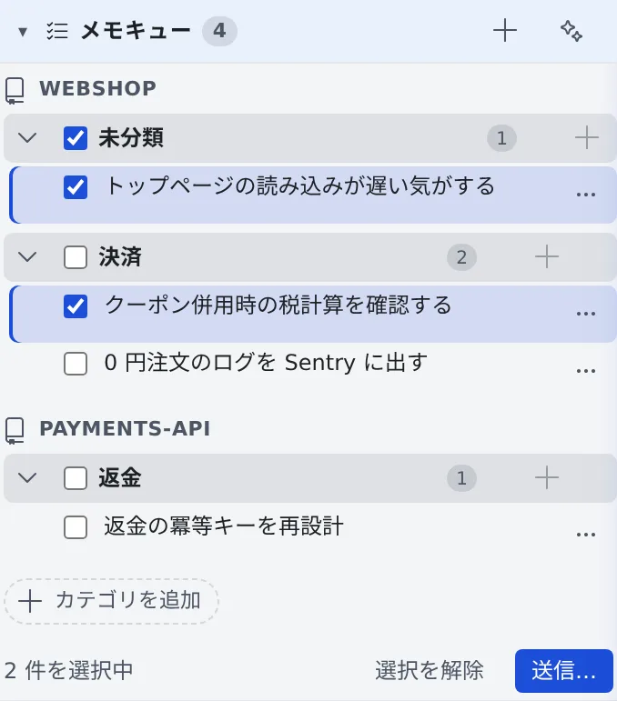
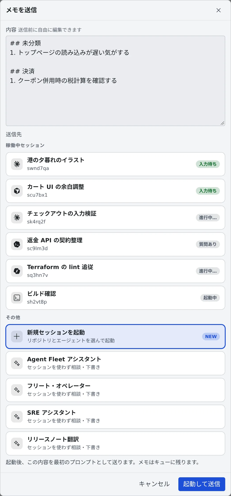

# メモをためて渡す

[English](memos.md) | 日本語

思いついた指示や要望を **メモキュー** に書きためておき、あとでまとめてセッションやアシスタントに渡せます。
移動中にスマホで書いておき、PC でまとめて渡す、といった使い方ができます。

## 全体像

| あなたがやること | エージェントがやること |
|---|---|
| メモを書きためる | 何もしません。メモは送るまで誰にも届きません |
| 必要ならアシスタントに整理させる | 走り書きを指示文に整え、カテゴリを提案する。反映するまで書き換えない |
| 送り先を選んで送る | 選んだセッションかアシスタントが、メモを 1 通のメッセージとして受け取る |

メモはサーバーに保存されるので、別の PC やスマホからも同じキューが見えます。

## メモを書く

1. 左ペインの **メモキュー** の見出しにある **＋**（「**メモを追加**」）を押します。キーボードでは **Alt+A** か、リーダーキー（Ctrl/⌘+K）のあと **M** でも開きます
2. 「**走り書きメモを追加…（後でまとめて送信）**」に書きます。必要なら「**カテゴリ（任意）**」に分類の名前を入れます
3. 「**追加**」（または Ctrl+Enter）で追加します。Esc で入力欄を閉じます

- 画像は、入力欄への貼り付け・ドロップか、添付のボタンで付けられます
- メモはリポジトリごとに、その中でカテゴリごとにまとまります
- カテゴリ見出しの **＋** を押すと、そのカテゴリに直接書き足せます。カテゴリは「**カテゴリを追加**」で先に作っておくこともできます
- ファイルを開いた画面の送るボタンからも、そのファイルについてのメモを「**キューに追加**」できます（[ファイルをセッションに渡す](../files/send.ja.md#あとでまとめて送る)）
- 「作業を始める」画面の「**メモに一時保存**」は、書きかけのプロンプトを添付ごとメモキューに移し、入力欄を空にします。メモの **⋯** の「**この内容で始める**」で画面に戻せ、起動するとそのメモは消えます

## メモを読む・直す

- 本文は 2 行で省略されます。押すと全文が開き、もう一度押すと編集になります（Ctrl+Enter で保存、Esc で取り消し）
- 本文の下の「**折りたたむ**」で 2 行に戻ります
- 行の **⋯**（または右クリック）から、「**編集**」「**このメモを送信**」「**コピー**」「**削除**」ができます
- ドラッグで並べ替えたり、別のカテゴリに移したりできます。カテゴリの名前は押すと変えられます。カテゴリを削除すると、中のメモは「**未分類**」に移ります

## アシスタントに整理させる

1. 整理したいメモにチェックを入れます
2. 見出しの ✨（「**選択したメモをアシスタントで整理**」）を押します。ワークスペースが動いている必要があります
3. 「**アシスタントで整理**」の画面に、整えた指示文と提案されたカテゴリが並びます
4. 反映する案を選んで「**◯ 件を反映**」を押します。押すまでメモは書き換わりません

## まとめて送る

1. 送りたいメモにチェックを入れ、下に出る「**送信…**」を押します。カテゴリ見出しの「**送信**」で、そのカテゴリをまとめて送ることもできます

   

2. 「**メモを送信**」の画面で、**内容** を確かめます。送る前に自由に書き直せます
3. **送信先** を選んで送ります

   

| 送信先 | どうなるか |
|---|---|
| 稼働中セッション | その場で送ります。送ったメモには「**送信済み**」が付き、7 日間キューに残ります |
| 新規セッションを起動 | 「**起動して送信**」で、リポジトリとエージェントを選ぶ画面が開き、内容が最初のプロンプトに入ります。メモはキューに残ります |
| アシスタント | そのアシスタントの新しいチャットが開き、内容が入力欄に入ります。確かめてから送ります。メモはキューに残ります |

- 何件かまとめて送ると、カテゴリごとの見出し（`## …`）と `1.` からの番号が付いて 1 通になります
- 1 件だけのときは、本文をそのまま送ります
- メモは誰かのメールなどに勝手に届くことはありません。届くのは、送るときに自分で選んだ相手だけです

### 受信箱から取り込んだメモ

受信箱のレシピを取り込んだメモには「**受信箱: …**」の印が付きます（[受信箱でチームメイトに頼む](../team/inbox.ja.md)）。

- 自分のメモとはつなげず、取り込み元を添えて 1 件ずつ別に送ります
- 自分のメモと一緒に選んだときの送り先は、実行中のセッションだけです
- 1 件だけを新しいセッションで始めると、そのセッションには左ペインで受信箱の印が付きます

## 関連

- [アシスタントに質問する](assistant.ja.md)：メモを渡す先のアシスタント
- [セッションを始める](../sessions/start.ja.md)：メモを最初のプロンプトにしてセッションを起動する
- [受信箱でチームメイトに頼む](../team/inbox.ja.md)：受信箱のレシピをメモに取り込む
