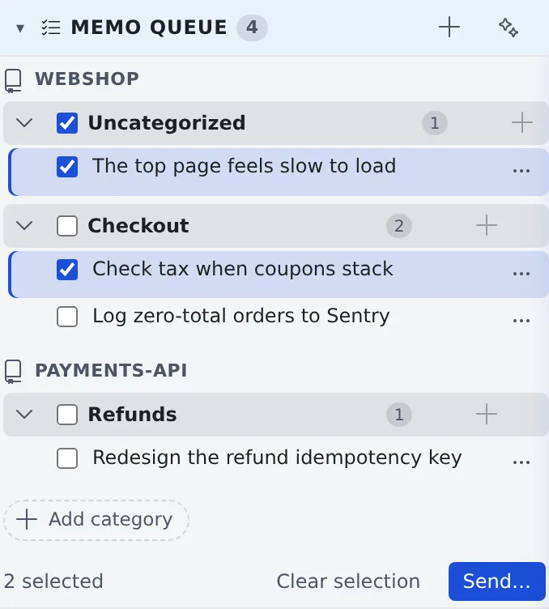
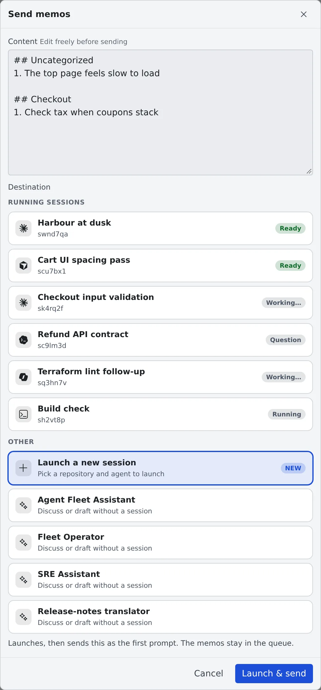

# Collect memos and hand them over

English | [日本語](memos.ja.md)

Write instructions and requests into the **Memo queue** as they occur to you, and hand them to a session or an
assistant later, all at once. Jot them down on your phone on the move and hand them over from your PC, for example.

## How it works

| What you do | What the agent does |
|---|---|
| Collect memos | Nothing. A memo reaches no one until you send it |
| Have an assistant tidy them, if you like | Turns the jottings into clear instructions and suggests categories. Nothing changes until you apply it |
| Pick a destination and send | The session or assistant you picked receives the memos as one message |

Memos are stored on the server, so the same queue shows on another PC or your phone.

## Write a memo

1. Press **+** ("**Add memo**") in the header of the **Memo queue** section in the left pane. From the keyboard, **Alt+A**, or the leader key (Ctrl/⌘+K) followed by **M**, opens it too
2. Write in "**Add a quick memo… (send them together later)**". Put a group name in "**Category (optional)**" if you like
3. Add it with "**Add**" (or Ctrl+Enter). Esc closes the box

- Attach images by pasting or dropping them into the box, or with the attach button
- Memos are grouped by repository, and by category within it
- Press **+** on a category header to write straight into that category. "**Add category**" creates one ahead of time
- The send button of an open file can also "**Add to queue**" a memo about that file ([Send a file to a session / chat](../../member/07-files.md#send-a-file-to-a-session-chat))
- "**Save to memo**" on the "Start working" screen moves the prompt you are writing, attachments included, into the memo queue and clears the box. "**Start with this**" in the memo's **⋯** brings it back, and the memo goes away once the session starts

## Read and edit memos

- The body is cut to two lines. Press it to open the whole text, and press again to edit (Ctrl+Enter saves, Esc cancels)
- "**Collapse**" under the body goes back to two lines
- The row's **⋯** (or a right-click) offers "**Edit**", "**Send this memo**", "**Copy**" and "**Delete**"
- Drag to reorder memos or move them to another category. Press a category's name to rename it. Deleting a category moves its memos to "**Uncategorized**"

## Have an assistant tidy them

1. Tick the memos to tidy
2. Press ✨ ("**Organize the selected memos with an assistant**") in the header. The workspace has to be running
3. The "**Tidy with assistant**" screen lists the rewritten instructions and the suggested categories
4. Choose the suggestions to apply and press "**Apply ◯ item(s)**". The memos do not change until you press it

## Send them together

1. Tick the memos to send and press "**Send…**" at the bottom. "**Send**" on a category header sends that whole category

   

2. Check the **Content** on the "**Send memos**" screen. You can rewrite it freely before sending
3. Pick a **Destination** and send

   

| Destination | What happens |
|---|---|
| Running sessions | Sent on the spot. The memos are marked "**Sent**" and stay in the queue for 7 days |
| Launch a new session | "**Launch & send**" opens the screen where you pick the repository and agent, with the content as the first prompt. The memos stay in the queue |
| An assistant | A new chat with that assistant opens with the content in the input box. Check it and send. The memos stay in the queue |

- Several memos sent together become one message, with a heading per category (`## …`) and numbers from `1.`
- A single memo is sent as its bare text
- A memo never goes anywhere on its own, such as to someone's mail. It reaches only the destination you pick when you send it

### Memos taken in from the inbox

A memo taken in from an inbox recipe is marked "**Inbox: …**" ([Ask a teammate through the inbox](../team/inbox.md)).

- It is never joined to your own memos: each is sent on its own, with its origin
- Selected together with your own memos, it can go only to a running session
- Started alone in a new session, that session is marked as coming from the inbox in the left pane

## Related

- [Ask an assistant](assistant.md): the assistants you can hand memos to
- [Start a session](../sessions/start.md): launch a session with a memo as the first prompt
- [Ask a teammate through the inbox](../team/inbox.md): take an inbox recipe into your memos
