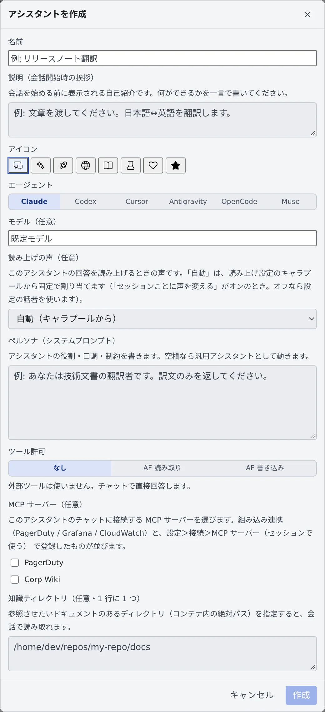

# 翻訳や専用のアシスタントを使う

[English](purpose-assistants.md) | 日本語

ファイルを右クリックするだけで、アシスタントに翻訳や要約を頼めます。決まった用途には、役割と口調を書いた自分用のアシスタントを作っておけます。
画面のあちこちで動く短い AI 生成（タイトルの提案や返信候補など）の設定も、このページで扱います。

## 全体像

| あなたがやること | エージェントがやること |
|---|---|
| ファイルを右クリックして「アシスタントで翻訳」「アシスタントで要約」を選ぶ | ファイルを読み、訳文か要点だけを返す |
| 自分用のアシスタントを作る | ペルソナに書いた役割と口調で、許可したツールだけを使って答える |
| AI 補助の機能を選ぶ | タイトル・ブランチ名・返信候補などを、ボタンを押したときに 1 回だけ作る |

## ファイルを翻訳する・要約する

1. 左ペインのファイル一覧で、ファイルを右クリックします
2. 「**アシスタントで翻訳**」か「**アシスタントで要約**」を選びます
3. 新しいチャットが開き、入力欄に依頼文とファイルのパスが入ります。中身を確かめて送ります

| 選ぶもの | 返ってくるもの |
|---|---|
| アシスタントで翻訳 | 訳文だけ。日本語と英語のどちらに訳すかは原文から決め、Markdown の書式は残します |
| アシスタントで要約 | 原文と同じ言語の、箇条書きの要点 |

- 翻訳には ⚙設定 →「**アシスタント**」の **回答言語** が効きません。常に原文に応じて訳す向きを決めます
- 訳文を別のファイルに保存したいときや、大きなファイルを分けて訳したいときは、セッションに頼んでください（[セッションを始める](../sessions/start.ja.md)）
- セッションの回答を自分の言語で読むのは別の機能です（[回答を自分の言語で読む](../sessions/translate.ja.md)）

## 自分用のアシスタントを作る

1. 左ペインの **アシスタント** の **＋** を押し、一覧のいちばん下の「**アシスタントを作成**」を選びます
2. 下の項目を入れて「**作成**」を押します
3. 次からは、同じ **＋** の一覧から選んでチャットを始められます。鉛筆のボタンで編集、ごみ箱のボタンで削除できます。削除しても、作った会話は残ります

| 項目 | 入れるもの |
|---|---|
| 名前 | 一覧に出る名前です |
| 説明（会話開始時の挨拶） | 会話を始める前に出る自己紹介です。何ができるかを一言で書きます |
| アイコン | 一覧に出るアイコンです |
| エージェント | 答える CLI です |
| モデル（任意） | 空欄なら、⚙設定 →「アシスタント」の **アシスタントのモデル** でそのエージェントに選んだものを使います |
| 読み上げの声（任意） | このアシスタントの回答を読み上げるときの声です |
| ペルソナ（システムプロンプト） | 役割・口調・守ることを書きます。空欄なら汎用のアシスタントとして動きます |
| ツール許可 | 下の表から選びます |
| MCP サーバー（任意） | このアシスタントのチャットにつなぐサーバーです。組み込みの連携と、[セッションに MCP サーバーを追加する](../integrations/mcp-servers.ja.md) で登録したものが並びます |
| 知識ディレクトリ（任意・1 行に 1 つ） | 読ませたいドキュメントのあるディレクトリを、コンテナの中の絶対パスで書きます |

たとえば翻訳用なら、説明に「文章を渡してください。日本語↔英語を翻訳します。」、ペルソナに「あなたは技術文書の翻訳者です。訳文のみを返してください。」と書きます。

### ツール許可を選ぶ

| ツール許可 | できること |
|---|---|
| なし | 外部のツールを使わず、チャットの中だけで答えます。翻訳や要約はこれで足ります |
| AF 読み取り | 自分のワークスペースのセッション一覧・状態・出力を読めます。書き込みはできません |
| AF 書き込み | 読み取りに加えて、セッションにプロンプトを送れます。作業を代わりに進めさせるので、信頼できる用途にだけ選んでください |

用意されているフリート・オペレーターは「AF 書き込み」の例です（[フリート・オペレーター](../fleet/operator.ja.md)）。

## AI 補助を設定する

⚙設定 →「**AI 補助**」は、セッション・ミラー・File ペインで動く**1 回きりの AI 生成**の設定です。アシスタントとの会話とは別に決めます。

| 項目 | 決めること |
|---|---|
| エージェント優先順位 | 補助生成に使う CLI の順番です。未接続の CLI と利用制限中の CLI は飛ばし、生成中に制限に当たったら次の CLI で 1 回だけやり直します |
| 短文生成のモデル | タイトル・ブランチ名・返信候補に使うモデルです |
| 文章生成のモデル | ファイル編集の提案と、作業計画の更新に使うモデルです。既定は短文より 1 つ上のモデルです |

- 補助生成は頻繁に動くので、アシスタントとは別に、安くて速い CLI を上に並べられます
- 「**推奨（現在: …）**」には、いま実際に何になるかが出ます。codex と agy の短文の推奨は、その CLI が一覧に出すモデルのうち公表単価がいちばん安いものです
- muse は、contributor 版ではない最新のモデルを使います。一覧が読めないときは補助生成をしません

### 機能ごとにオン／オフを切り替える

「**AI 補助生成を使う機能**」に、機能ごとのカードが並びます。オフにした機能は、ボタンそのものが出なくなります。

| 機能 | 使われる場所 |
|---|---|
| セッション件名の提案 | 何回かやり取りしたセッションの上に出るタイトルの案と、「表示名を変更」の「**AI に提案してもらう**」 |
| 会話タイトルの提案 | アシスタントの「タイトルを変更」の「**AI に提案してもらう**」。チャットに自動の提案は出ません |
| ブランチ名の提案 | worktree を作るときや、ブランチ名を変えるとき |
| 返信候補（セッション） | ミラーの入力欄の ✨ ボタン。押したときだけトークンを使います |
| 返信候補（チャット） | アシスタントの入力欄の ✨ ボタン。セッションの側とは別に決めます |
| 変更提案（エディタ） | File ペインで、選んだ範囲と指示から置き換える文を提案します |
| 作業計画の更新 | アシスタントの作業計画の「**更新**」ボタン |
| 回答の翻訳（ミラー） | ミラーで、表示言語と違う言語の回答に出る「**翻訳**」ボタン（[回答を自分の言語で読む](../sessions/translate.ja.md)） |

- 各カードでは、その機能だけのエージェントを選べます。既定は「**自動（優先順位）**」です。エージェントを 1 つに決めると、モデルも選べます
- カードの「**いま使うのは: …**」が、その機能が実際に使うエージェントとモデルです
- 「回答の翻訳（ミラー）」には「**自動翻訳**」があります。開いて見ている間に届いた回答を、完了した時点で自動で訳します。既定はオフで、翻訳の設定のうちこれだけは押さなくてもトークンを使います
- 入力履歴から覚える返信サジェストは、AI を使わない別の機能です（[返信サジェストを使う](../sessions/reply.ja.md#返信サジェストを使う)）

## 関連

- [アシスタントに質問する](assistant.ja.md)：チャットの始め方、圧縮、作業計画
- [回答を自分の言語で読む](../sessions/translate.ja.md)：セッションの回答を訳して読む
- [セッションに MCP サーバーを追加する](../integrations/mcp-servers.ja.md)：アシスタントにつなぐサーバーを登録する
