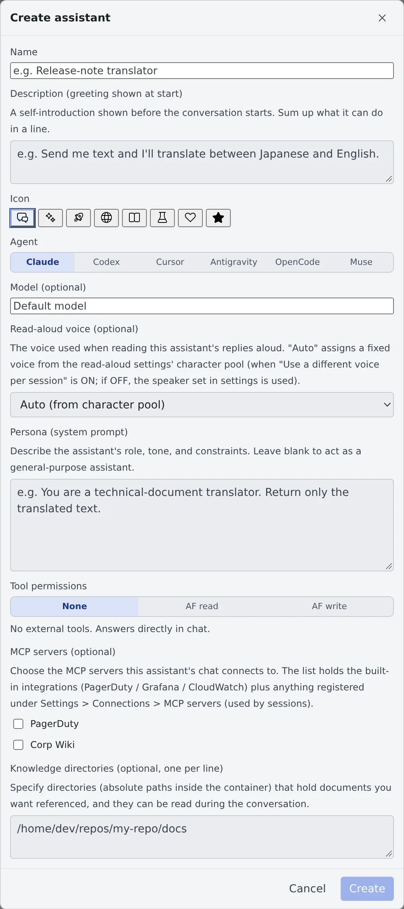

# Use translation and purpose-built assistants

English | [日本語](purpose-assistants.ja.md)

A right-click on a file is enough to have an assistant translate or summarize it. For a recurring purpose, make an
assistant of your own with its role and tone written down. This page also covers the short AI generations that run
around the screen (title suggestions, reply suggestions and the like).

## How it works

| What you do | What the agent does |
|---|---|
| Right-click a file and pick "Translate with assistant" or "Summarize with assistant" | Reads the file and returns only the translation or the key points |
| Make an assistant of your own | Answers in the role and tone its persona describes, using only the tools you allowed |
| Choose the AI assistance features | Writes a title, a branch name, reply suggestions and so on, once, when you press the button |

## Translate or summarize a file

1. Right-click the file in the file list of the left pane
2. Pick "**Translate with assistant**" or "**Summarize with assistant**"
3. A new chat opens with the request and the file's path in the input box. Check it and send

| You pick | You get back |
|---|---|
| Translate with assistant | The translation only. Whether it goes into Japanese or English is decided from the original, and the Markdown formatting is kept |
| Summarize with assistant | The key points in bullets, in the language of the original |

- Translation ignores the **Reply language** in ⚙ Settings → "**Assistant**": the direction always follows the original
- To save the translation to another file, or to translate a large file in parts, ask a session ([Start a session](../sessions/start.md))
- Reading a session's answers in your own language is a separate feature ([Read an answer in your own language](../sessions/translate.md))

## Make your own assistant

1. Press **+** in the **Assistants** section of the left pane and pick "**Create assistant**" at the bottom of the list
2. Fill in the fields below and press "**Create**"
3. From then on, start a chat with it from the same **+** list. The pencil button edits it and the trash button deletes it. Deleting it keeps the conversations you had

| Field | What goes in |
|---|---|
| Name | The name shown in the list |
| Description (greeting shown at start) | The self-introduction shown before the conversation starts. Sum up in a line what it can do |
| Icon | The icon shown in the list |
| Agent | The CLI that answers |
| Model (optional) | Left empty, it uses the model chosen for that agent under **Assistant models** in ⚙ Settings → "Assistant" |
| Read-aloud voice (optional) | The voice used when this assistant's answers are read aloud |
| Persona (system prompt) | The role, the tone and the rules to keep. Left empty, it acts as a general-purpose assistant |
| Tool permissions | Pick from the table below |
| MCP servers (optional) | Servers connected to this assistant's chat. The list holds the built-in integrations and what you registered in [Add an MCP server to your sessions](../integrations/mcp-servers.md) |
| Knowledge directories (optional, one per line) | Directories holding documents for it to read, as absolute paths inside the container |

For a translator, for example, put "Send me text and I'll translate between Japanese and English." in the description and "You are a technical-document translator. Return only the translated text." in the persona.

### Choose the tool permissions

| Tool permissions | What it can do |
|---|---|
| None | Answers inside the chat without external tools. Enough for translation and summaries |
| AF read | Reads your workspace's session list, states and output. It cannot write |
| AF write | On top of reading, sends prompts to sessions. It works on your behalf, so choose it only for a purpose you trust |

The built-in Fleet Operator is an example of "AF write" ([the Fleet Operator](../../member/11-many-sessions.md#what-is-the-fleet-operator)).

## Set up AI assistance

⚙ Settings → "**AI assistance**" holds the settings for the **one-shot AI generation** that runs in sessions, the mirror and the File pane. It is decided separately from the assistant conversations.

| Setting | What it decides |
|---|---|
| Agent priority | The order of CLIs used for assistance. Unconnected and rate-limited CLIs are skipped, and a generation that hits a limit is retried once on the next CLI |
| Model for short labels | The model for titles, branch names and reply suggestions |
| Model for prose | The model for file-edit suggestions and work-plan updates. Its default is one step above the short-label one |

- Assistance runs all the time, so you can put a cheap, fast CLI on top here, independently of the assistant
- "**Recommended (currently: …)**" shows what it actually resolves to now. For codex and agy, the recommended short-label model is the one with the lowest published price among the models that CLI lists
- muse uses the newest model that is not a contributor version. When the list cannot be read, it generates nothing

### Turn each feature on or off

"**Features that use AI assistance**" has a card per feature. A feature turned off shows no button at all.

| Feature | Where it is used |
|---|---|
| Session title suggestion | The title idea shown on a session after a few exchanges, and "**Ask AI to suggest**" in "Rename" |
| Chat title suggestion | "**Ask AI to suggest**" in an assistant's "Edit title". A chat gets no automatic suggestion |
| Branch name suggestion | Creating a worktree or renaming a branch |
| Reply suggestions (session) | The ✨ button in the mirror's input box. It uses tokens only when pressed |
| Reply suggestions (chat) | The ✨ button in the assistant's input box. Set separately from the session one |
| Edit suggestions (editor) | Suggests replacement text in the File pane from the selection and your instruction |
| Work-plan update | The "**Refresh**" button of an assistant's work plan |
| Answer translation (mirror) | The "**Translate**" button on an answer in a language other than your display language ([Read an answer in your own language](../sessions/translate.md)) |

- Each card can pick an agent for that feature alone. The default is "**Auto (priority order)**". Fix one agent and you can pick its model too
- "**Currently uses: …**" on the card is the agent and model the feature actually uses
- "Answer translation (mirror)" has "**Translate automatically**": answers that arrive while you have the session open are translated as soon as the turn completes. It is off by default, and it is the only translation setting that uses tokens without a press
- Reply suggestions learned from your input history are a separate feature that uses no AI ([Use reply suggestions](../sessions/reply.md#use-reply-suggestions))

## Related

- [Ask an assistant](assistant.md): starting a chat, compaction, the work plan
- [Read an answer in your own language](../sessions/translate.md): translate a session's answers to read them
- [Add an MCP server to your sessions](../integrations/mcp-servers.md): register a server to connect to an assistant
