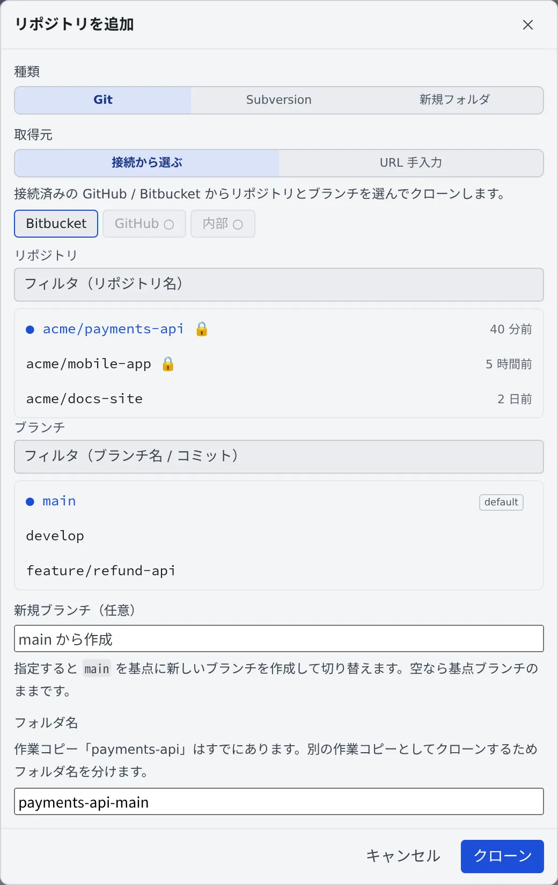

# リポジトリをクローンする

[English](clone.md) | 日本語

GitHub・Bitbucket・内蔵の Git からリポジトリを選んで、ワークスペースにクローンできます。
クローンしたリポジトリは左ペインの **リポジトリ** に並び、そこからセッションを起動できます。

## 全体像

| あなたがやること | 起きること |
|---|---|
| 「追加」でリポジトリとブランチを選ぶ | `~/repos` の下にクローンされ、左ペインに行が出る |
| 必要なら新しいブランチ名を入れる | 基点のブランチから新しいブランチを作って切り替える |
| 何もないところから始めるなら「新規フォルダ」を選ぶ | 空のフォルダを作り、`git init` まで済ませる |

submodule と Git LFS の中身は、クローンのときに自動で取得します。

## 始める前に

- ワークスペースを起動しておきます。停止中は「追加」を押せません
- private リポジトリは、先に [Git のサービスを接続する](connect-git.ja.md) を済ませます

## 接続から選んでクローンする

1. 左ペイン **リポジトリ** の「**追加**」を押します。「**リポジトリを追加**」が開きます
2. 「**種類**」で「**Git**」、「**取得元**」で「**接続から選ぶ**」を選びます
3. 「**Bitbucket**」「**GitHub**」「**内部**」のタブから、リポジトリとブランチを選びます
4. 「**クローン**」を押します

- private リポジトリには 🔒 が付きます
- 接続していないサービスのタブは押せず、「未接続（設定 → Git）」と出ます
- 「**内部**」は、テナントの [内蔵の Git](internal-git.ja.md) のリポジトリです

## URL を入れてクローンする

接続していないリポジトリは、「**取得元**」で「**URL 手入力**」を選びます。

| 欄 | 入れるもの |
|---|---|
| クローン URL | `https://…` か `git@…` |
| ブランチ（任意） | 空なら既定のブランチ |

## 新しいブランチで始める

「**新規ブランチ（任意）**」に名前を入れると、選んだブランチを基点に新しいブランチを作って切り替えます。空なら基点のブランチのままです。

- 「**フォルダ名**」で、作業コピーのフォルダ名を変えられます
- 同じ名前の作業コピーがすでにあると、別のフォルダ名が入ります
- 名前は英数字で始め、ほかの作業コピーと重ならないものにします

## 何もないところから始める

まだどこにもないものを作るときは、クローンする相手がありません。「**種類**」で「**新規フォルダ**」を選び、名前を入れて「**作成**」を押します。

- `~/repos` の下に空のフォルダを作り、`git init` まで済ませます
- ふつうのリポジトリと同じように、左ペインの行になります
- リモートは、あとから端末で `git remote add` すればつながります。[内蔵の Git](internal-git.ja.md) に受け皿を作るのも手です

「**はじめる**」→「**新しいフォルダで始める…**」からも作れます。こちらは、作ったあとそのまま「作業を始める」に進みます。

## submodule と Git LFS

| 種類 | 動き |
|---|---|
| submodule | クローンと、作業コピー（worktree）を作ったあとに取得します。SSH で登録された submodule は、HTTPS に読み替えて取得します |
| Git LFS | クローンやチェックアウトのときに、中身を取得します |

- submodule の取得に失敗しても、親のクローンは成功します
- 作業コピーを作るたびに submodule もクローンし直すので、大きな submodule は起動までに取得しきれないことがあります。そのまま作業は始められ、取得は裏で続きます

## 困ったとき

### 「submodule が未取得のまま作業を開始しました」と出る

取得が起動に間に合いませんでした。終わると「**submodule の取得が完了しました**」が出ます。

- 通知を押すと、その作業コピーのコミットグラフが開き、submodule の取得状況が見られます
- 途中で切れた submodule は、次の起動で自動で直ります
- 急ぐときは、端末でその作業コピーに入って `git submodule update --init --recursive` を実行します

### ファイルに「LFS ポインタ」と出る

その作業コピーでは、LFS の中身がまだ取得されていません。端末でそのリポジトリに入って `git lfs pull` を実行してください。

### 新しいフォルダで worktree を選べない

最初のコミットがまだないと、新しい作業コピー（worktree）は作れません。起動はそのフォルダで直接行われ、起動の画面にもそう出ます。
1 回コミットすれば、ふつうのリポジトリと同じになります。

## 関連

- [Git のサービスを接続する](connect-git.ja.md)
- [リポジトリからセッションを起動する](launch-from-repo.ja.md)
- [Subversion のリポジトリを使う](svn.ja.md)：「種類」で「Subversion」を選ぶ
- [内蔵の Git を使う](internal-git.ja.md)
