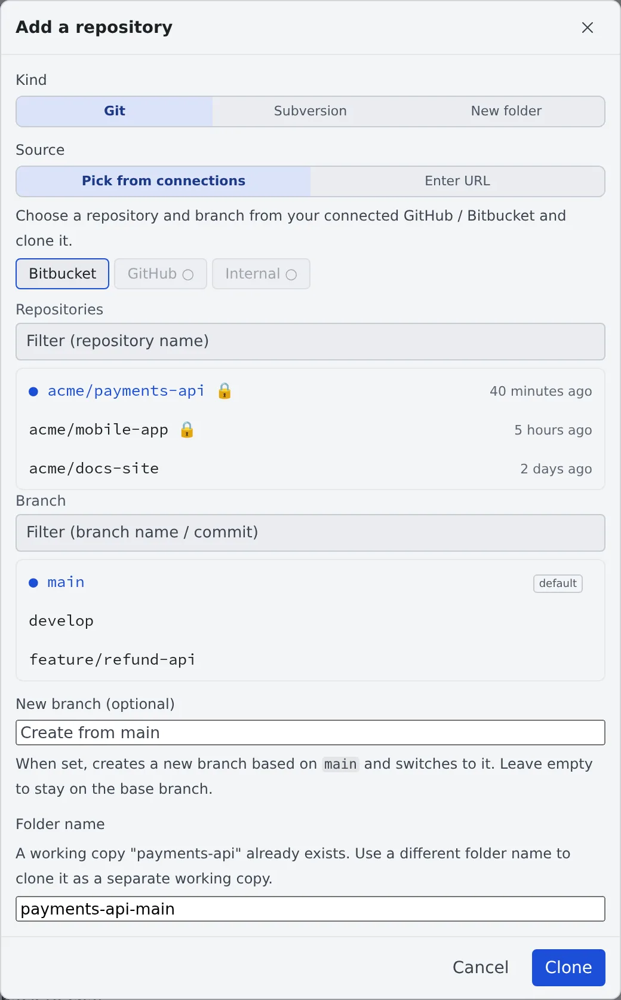

# Clone a repository

English | [日本語](clone.ja.md)

Pick a repository from GitHub, Bitbucket or the built-in Git and clone it into the workspace.
A cloned repository is listed under **Repositories** in the left pane, and you launch sessions from there.

## How it works

| What you do | What happens |
|---|---|
| Pick a repository and branch with "Add" | It is cloned under `~/repos` and gets a row in the left pane |
| Optionally give a new branch name | A new branch is created from the base branch and checked out |
| To start from nothing, pick "New folder" | An empty folder is created and `git init`ed |

Submodules and Git LFS content are fetched automatically on clone.

## Before you start

- Start the workspace. "Add" cannot be pressed while it is stopped
- For private repositories, first [connect a Git service](connect-git.md)

## Clone from a connection

1. Press "**Add**" in the **Repositories** section of the left pane. "**Add a repository**" opens
2. Pick "**Git**" under "**Kind**" and "**Pick from connections**" under "**Source**"
3. On the "**Bitbucket**", "**GitHub**" or "**Internal**" tab, pick the repository and branch
4. Press "**Clone**"

- Private repositories are marked with 🔒
- The tab of a service you have not connected cannot be pressed and says "Not connected (Settings → Git)"
- "**Internal**" lists the repositories of your tenant's [built-in Git](internal-git.md)

## Clone from a URL

For a repository you are not connected to, pick "**Enter URL**" under "**Source**".

| Field | What to enter |
|---|---|
| Clone URL | `https://…` or `git@…` |
| Branch (optional) | Leave empty for the default branch |

## Start on a new branch

Enter a name in "**New branch (optional)**" and a new branch is created from the branch you picked and checked out. Leave it empty to stay on the base branch.

- "**Folder name**" changes the working copy's folder name
- If a working copy of that name already exists, a different folder name is filled in
- The name must start with a letter or a digit and must not clash with another working copy

## Start from nothing

When you are making something that does not exist anywhere yet, there is nothing to clone. Pick "**New folder**" under "**Kind**", enter a name and press "**Create**".

- An empty folder is created under `~/repos` and `git init`ed
- It becomes a row in the left pane like any other repository
- Add a remote later with `git remote add` in a terminal. Creating a home for it in the [built-in Git](internal-git.md) is one way

"**Start**" → "**Start in a new folder…**" creates one too, and goes straight on to "Start working" once it exists.

## Submodules and Git LFS

| Kind | What happens |
|---|---|
| Submodules | Fetched after a clone and after a working copy (worktree) is created. Submodules registered over SSH are fetched over HTTPS instead |
| Git LFS | The content is fetched on clone and checkout |

- If a submodule fails to fetch, the parent clone still succeeds
- Each working copy clones its submodules again, so a large submodule may not finish before the launch. You can start work anyway; the fetch carries on in the background

## When it goes wrong

### "Started work with submodules not checked out"

The fetch did not finish in time for the launch. When it does, "**Submodules are now checked out**" follows.

- Clicking the notification opens that working copy's commit graph, which shows each submodule's fetch state
- A submodule whose fetch was cut off is repaired on the next launch
- In a hurry, enter the working copy in a terminal and run `git submodule update --init --recursive`

### A file shows "LFS pointer"

The LFS content has not been fetched in that working copy yet. Enter the repository in a terminal and run `git lfs pull`.

### A new folder offers no worktree

A new working copy (worktree) cannot be made before the first commit. The launch runs directly in the folder, and the launch screen says so.
After one commit it behaves like any other repository.

## Related

- [Connect a Git service](connect-git.md)
- [Launch a session from a repository](launch-from-repo.md)
- [Use a Subversion repository](svn.md): pick "Subversion" under "Kind"
- [Use the built-in Git](internal-git.md)
