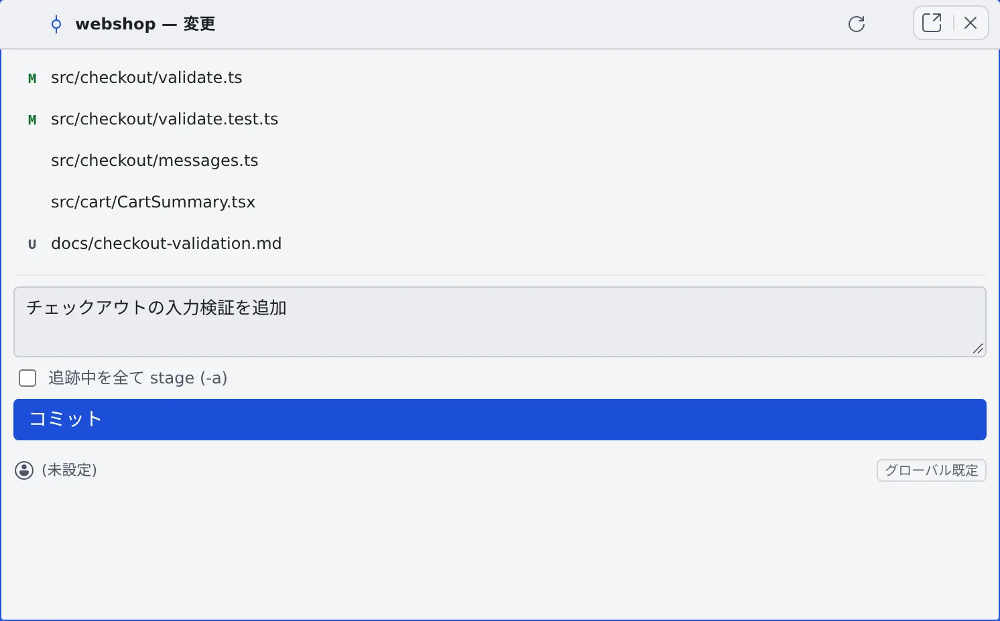

# コミットグラフでコミットする

[English](commit.md) | 日本語

コミットグラフで履歴と差分を見て、「変更」のペインでファイルをステージし、コミットできます。
ターミナルを開かずに、エージェントの変更を確かめてからコミットしたいときに使います。

## 全体像

| あなたがやること | 起きること |
|---|---|
| コミットグラフを開く | ブランチと履歴が出る。コミットを押すと差分が出る |
| 「変更」でファイルをステージし、メッセージを書いてコミットする | 作業コピーにコミットされる |
| fetch や Fast-Forward を押す | リモートを取得する・upstream に追いつく |

## コミットグラフを開く

リポジトリの行を右クリックして「**コミットグラフを開く**」を選びます。

- 行を Ctrl（Mac は ⌘）を押しながらクリックするか中クリックすると、新しいペインに開きます
- 行をふつうにクリックすると、下のセッションや worktree を開いたり閉じたりします

上の帯には、今のブランチと次のボタンが並びます。狭いときは **⋯** にまとまります。

| ボタン | すること |
|---|---|
| 変更 | コミットする「変更」のペインを、別のペインで開く |
| fetch | リモートを取得する（`git fetch --prune`） |
| Fast-Forward | 今のブランチを upstream に fast-forward する（`pull --ff-only`） |
| 更新 | 表示を新しくする |

- ブランチ名を押すと「**ブランチ切替**」が開きます。絞り込めて、新しいコミットの順に並びます
- `.gitmodules` があると、帯の対象の選択に submodule が並びます。取得済みの submodule を選ぶと、その submodule のコミットグラフが見られます。未取得のものは「（未取得）」と出て、選べません

## 変更をステージしてコミットする

1. 「**変更**」を押します。「{リポジトリ名} — 変更」のペインに、変更したファイルが並びます
2. 各行のボタンで「**ステージ**」「**ステージ解除**」します
3. 下の「**コミットメッセージ**」に書きます。追跡中のファイルをすべて入れるなら「**追跡中を全て stage (-a)**」に印を付けます
4. 「**コミット**」を押します

- 「ステージ」「ステージ解除」のボタンは、行にマウスを重ねると出ます
- 追跡中のファイルは「**変更を破棄**」もできます。確認のあとで消え、元に戻せません
- メッセージが空だと「コミットメッセージが必要です」と出ます

### コミットの作者を変える

「変更」のペインに、今のコミットの作者が出ます。押すと「**コミット者を変更（このリポの上書き）**」になり、このリポジトリだけの名前とメールを決められます。

- 作者は「このリポ上書き」→「プロバイダ既定」→「グローバル既定」の順に決まります
- 「**解除**」で、プロバイダーの既定に戻ります
- プロバイダーとグローバルの既定は、**⚙設定 →「Git ホスティング」** にあります（[Git のサービスを接続する](connect-git.ja.md#コミットの作者を決める)）

## 履歴と差分を見る

コミットグラフの行を押すと、そのコミットの変更したファイルと差分が出ます。

- 差分はファイルごとに折りたためます。「**全て開く**」「**全て閉じる**」「**折り返し**」で見え方を変えます
- コミットを右クリックすると、次のメニューが出ます

| 項目 | すること |
|---|---|
| 詳細を表示 | そのコミットの差分を開く |
| {ブランチ} で作業を始める… | そのブランチ専用の作業コピーで、作業を始める |
| ブランチ切替: {ブランチ} | 今の作業コピーを、そのブランチに切り替える |
| リモートブランチへ切替: {ブランチ} | リモートのブランチに切り替える |
| チェックアウト（detached HEAD） | そのコミットをチェックアウトする |
| このコミットから新規ブランチ… | そのコミットから新しいブランチを作って切り替える |

- ほかの作業コピーで使っているブランチには「{ブランチ} は {フォルダ} で作業中 — 開く」が出て、その作業コピーを開きます

## 困ったとき

### 「コミットをチェックアウト」が失敗する

コミットしていない変更があると、失敗することがあります。先にコミットするか、変更を片付けてください。

## 関連

- [リポジトリからセッションを起動する](launch-from-repo.ja.md)：右クリックのほかのメニューと、行のバッジ
- [Git のサービスを接続する](connect-git.ja.md)：push とコミットの作者
